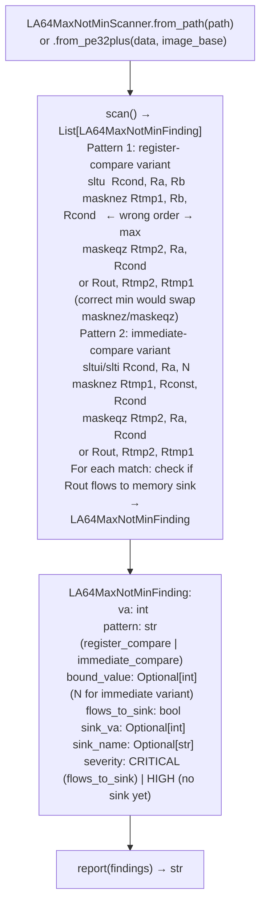

# LoongArch64 Compiler Bug Detection

Detect the GCC 12.3.1.7 LoongArch64 `min`-to-`max` code generation bug — identifying the four-instruction branchless sequence where swapped `masknez`/`maskeqz` order produces the maximum of two values instead of the minimum — and determine whether the wrong (maximum) value flows into a memory sink on the same taint path.

---

## Why this exists

1. **GCC 12.3.1.7-1.tl4 for LoongArch64 emits `max(a, b)` when the source calls `min(a, b)`.** The branchless min/max pattern uses `masknez`/`maskeqz` to select one of two values; correct `min` requires `maskeqz` to select `Ra` when `Ra < Rb` and `masknez` to select `Rb` otherwise. GCC 12.3.1.7 emits the inverted order, producing `max`. This bug appears in TencentOS 4.6 kernel 6.6.119-52.9.tl4 and any other LoongArch64 target compiled with this GCC version.

2. **A second variant uses immediate-compare instructions (`sltui`/`slti`) with a constant** — `min(x, CONSTANT)` where the bug produces `max(x, CONSTANT)`. This is the higher-severity variant: when `CONSTANT` is a buffer size or allocation limit, the wrong (larger) value passed to a memory sink produces a heap overflow. `LA64MaxNotMinScanner.scan()` detects both the register-compare and immediate-compare variants.

3. **`LA64MaxNotMinScanner.from_pe32plus()` supports PE32+ (Windows on LoongArch)** — enabling analysis of LoongArch64 Windows kernel drivers compiled with the same buggy GCC toolchain. This covers LoongArch64 IoT and industrial targets that ship Windows-based firmware.

---

## How it works



---

## Usage

```python
from ablation.analyzers.loongarch64_max_not_min_scanner import LA64MaxNotMinScanner

scanner = LA64MaxNotMinScanner.from_path('/path/to/tencentos_kernel.elf')
findings = scanner.scan()

for f in findings:
    print(f"  {f.va:#x}  {f.pattern}  flows_to_sink={f.flows_to_sink}")
    if f.bound_value is not None:
        print(f"    bound={f.bound_value:#x}  (wrong: uses max, should be min)")
    if f.flows_to_sink:
        print(f"    CRITICAL: wrong value reaches {f.sink_name} at {f.sink_va:#x}")

print(scanner.report(findings))
```

---

## Example output

The following illustrates the LoongArch64 compiler bug detection output format. Actual addresses are binary-specific.

```
LA64MaxNotMinScanner: tencentos_kernel.elf

Findings: <N>

  <va>  immediate_compare  bound=0x1000
    Incorrect: max(input, 0x1000) instead of min(input, 0x1000)
    flows_to_sink=True  memcpy at <va>
    CRITICAL: max value used as copy length → heap overflow

  <va>  register_compare
    flows_to_sink=False
    HIGH: inverted min/max — sink not yet identified
```

---

## False positives

**The four-instruction pattern may appear in code that legitimately computes `max()`** — a correct `max(a, b)` implementation uses exactly this pattern with the correct `masknez`/`maskeqz` order. `LA64MaxNotMinScanner` detects the `max` pattern as a potential bug only when the source context (function name containing `min`, `clamp`, `limit`, or `bound`) suggests `min` was intended. Validate with source code review if available.

**`from_pe32plus()` requires a valid image base** — providing an incorrect `image_base` will produce incorrect VAs in findings. Verify the image base from the PE's `Optional Header.ImageBase` field before calling.

---

## Pipeline position

Run `LA64MaxNotMinScanner` on any LoongArch64 ELF or PE binary. Prioritize `CRITICAL` findings (flows to sink) for immediate taint verification. The `LoongArch64TaintTracker` can confirm the path from the `max` result to the sink.

---

## See also

- [LoongArch64 Taint Analysis](taint-analysis-2.md) — `TaintTrackerLA64` for full dataflow verification of scanner findings
- [LoongArch64 KASAN-Aware Decoding](hisilicon-risc-v-extensions.md) — `LoongArchDecoderV2` for debug kernel analysis
