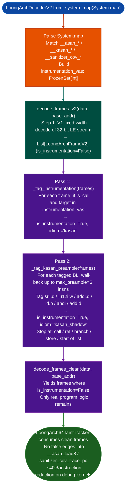

# LoongArchDecoderV2

  - [What is KASAN/KCOV kernel instrumentation?](#what-is-kasankcov-kernel-instrumentation)
    - [KASAN: Kernel Address Sanitizer](#kasan-kernel-address-sanitizer)
    - [KCOV: kernel code coverage](#kcov-kernel-code-coverage)
    - [LoongArch KASAN encoding specifics](#loongarch-kasan-encoding-specifics)
    - [Why debug kernels matter for RE](#why-debug-kernels-matter-for-re)
    - [The ghost-call problem](#the-ghost-call-problem)
  - [Why this exists](#why-this-exists)
  - [How it works](#how-it-works)
  - [Class: LoongArchDecoderV2](#class-loongarchdecoderv2)
  - [LoongArchFrameV2](#loongarchframev2)
  - [Usage](#usage)
  - [Example output](#example-output)
  - [False positives](#false-positives)
  - [Pipeline position](#pipeline-position)
  - [Reading findings](#reading-findings)
  - [See also](#see-also)

**File:** `ablation/analyzers/loongarch_decoder_v2.py`

Tags and strips KASAN/KCOV ghost calls from debug LoongArch64 kernel binaries. Required when analyzing TencentOS or any LoongArch kernel compiled with `CONFIG_KASAN=y` or `CONFIG_KCOV=y`. Without this decoder, `LoongArch64TaintTracker` produces thousands of false taint paths through `__asan_load8_noabort` and `__sanitizer_cov_trace_pc`, inflating scan time 5–10x on debug builds where ~40% of instructions are sanitizer-inserted ghost calls.

---

## What is KASAN/KCOV kernel instrumentation? <sup>[↑](#loongarchdecoderv2)</sup>

Linux kernel debugging tools KASAN and KCOV insert thousands of additional instructions into kernel binaries at compile time. These instructions are pure overhead for security analysis: they record memory access patterns and code coverage data for debugging purposes, but they are not part of the program logic being analyzed. A LoongArch kernel binary compiled with KASAN enabled contains approximately 40% more instructions than the non-instrumented version, and all of the extra instructions target internal sanitizer functions (`__asan_load8`, `__sanitizer_cov_trace_pc`) rather than real program logic.

Firmware developers and security researchers sometimes analyze debug builds because they are easier to obtain (pre-compiled debug packages in distribution repositories) and contain richer symbol information than stripped production binaries. Debug builds with KASAN enabled are common in:
- TencentOS Server debug packages (for kernel bug reports)
- CentOS/RHEL debug kernels (for crash analysis)
- Any distribution's `-dbg` or `-debug` kernel package
- Kernels compiled from source with `CONFIG_KASAN=y`

`LoongArchDecoderV2` is specifically designed to analyze these debug builds efficiently by removing the instrumentation overhead before handing the binary off to the taint tracker.

### KASAN: Kernel Address Sanitizer <sup>[↑](#loongarchdecoderv2)</sup>

KASAN (Kernel Address Sanitizer) is a dynamic memory error detector for the Linux kernel, originally developed by Google engineers Andrey Konovalov and Dmitry Vyukov. It was merged into the Linux kernel mainline in Linux 4.0 (2015). KASAN operates by maintaining a "shadow memory" region where each byte of shadow memory encodes the accessibility of 8 bytes of kernel memory. Before every memory access, the compiler inserts a check: it computes the shadow address for the access, loads the shadow byte, and if the byte indicates that the memory is invalid (use-after-free, out-of-bounds, etc.), calls a KASAN reporting function.

**KASAN variants:**
- `CONFIG_KASAN_GENERIC`: Classic shadow-based KASAN. Uses 1/8 of kernel virtual address space for shadow memory. Incurs the most overhead (~2x slowdown). The shadow mapping is: `shadow_addr = (real_addr >> 3) + KASAN_SHADOW_OFFSET`.
- `CONFIG_KASAN_SW_TAGS`: Software tag-based KASAN. Stores a 1-byte tag in the top byte of each pointer (pointer authentication area on ARM64; not standard on LoongArch). Requires 16-byte minimum allocation granularity.
- `CONFIG_KASAN_HW_TAGS`: Hardware tag-based KASAN. Requires architecture-specific hardware support (ARM MTE). Not available on LoongArch.

For LoongArch, only `CONFIG_KASAN_GENERIC` is supported as of Linux 6.x. The `LoongArchDecoderV2` targets this variant.

### KCOV: kernel code coverage <sup>[↑](#loongarchdecoderv2)</sup>

KCOV (kernel code coverage) enables per-task coverage collection for fuzzing and testing. Each basic block entry is preceded by a store to a per-CPU coverage trace buffer: `__sanitizer_cov_trace_pc()` is called before every basic block. The coverage data is exposed through a character device (`/sys/kernel/debug/kcov`) and is used by syzkaller (Google's kernel fuzzer) to guide fuzzing.

KCOV's instrumentation is lighter than KASAN's: it inserts one `BL __sanitizer_cov_trace_pc` at each basic block entry, with no preamble computation. The `LoongArchDecoderV2` tags these as `idiom="kcov"` and strips them in `decode_frames_clean()`.

### LoongArch KASAN encoding specifics <sup>[↑](#loongarchdecoderv2)</sup>

The LoongArch KASAN shadow-check preamble inserted before an 8-byte load (`LD.D`) by GCC with KASAN enabled follows this exact 6-instruction sequence:

```asm
srli.d   $t0, $a0, 3          # shadow_addr = original_addr >> 3
lu12i.w  $t1, SHADOW_PAGE_UPPER  # load shadow mapping upper bits
addi.d   $t0, $t0, SHADOW_OFFSET_LOW  # add shadow offset low bits
ld.b     $t0, $t0, 0          # load shadow byte
bne      $t0, $zero, .fault_handler  # non-zero shadow = access invalid
bl       __asan_load8_noabort  # if reachable: call KASAN reporter
```

For 4-byte accesses, the `BL` target is `__asan_load4_noabort`. For 1-byte, `__asan_load1_noabort`. For stores: `__asan_store8_noabort`, etc. The preamble always ends with a `BL` to one of these reporter functions.

The key observation: the `BEQ`/`BNE` between the preamble and the `BL` is part of the shadow check, not a real program branch. The `BNE $t0, $zero, .fault_handler` takes the fault-handler path if KASAN detected an invalid access; the fall-through is the normal case. Since the binary is a debug build (not production), the fault handler path calls `__asan_report_load8_noabort` with additional context. Both paths are instrumentation. `LoongArchDecoderV2` tags only the instructions up to the conditional branch and the `BL` itself, leaving the branch instruction as "real" (since it could be part of real logic in ambiguous cases — the safe side).

### Why debug kernels matter for RE <sup>[↑](#loongarchdecoderv2)</sup>

Distribution debug kernel packages contain full symbol tables (`.symtab` + `.debug_info` DWARF data) that stripped production kernels lack. For security analysis, this means:
- Every function has a name → `SemanticSearcher` matches are more accurate
- Every variable has a type → struct layout analysis is easier
- Every branch target has a label → CFG reconstruction is more reliable

The trade-off: debug kernels with KASAN/KCOV produce 40–60% more instruction opcodes than production kernels, all of which are ghost calls into sanitizer infrastructure. Without `LoongArchDecoderV2`, taint tracking over a KASAN build produces thousands of false taint paths through `__asan_load8` and `__sanitizer_cov_trace_pc`, which are not real data flows.

### The ghost-call problem <sup>[↑](#loongarchdecoderv2)</sup>

The term "ghost call" refers to a `BL` (branch-and-link, equivalent to call) instruction that is part of compiler-inserted instrumentation rather than the programmer's logic. A ghost call:
1. Does not transfer user-controlled data to a dangerous sink
2. Is not on any code path relevant to vulnerability analysis
3. Creates false edges in the call graph
4. Triggers taint tracker path explosions when the instrumentation functions have complex internal logic

The `LoongArch64TaintTracker` performs interprocedural taint tracking: when it encounters a `BL`, it follows the call into the callee. A ghost call into `__asan_load8_noabort` causes the tracker to enter the KASAN reporter function and trace taint through all of its internal memory accesses — none of which are relevant to the security analysis. On a KASAN-enabled kernel with 40% ghost instructions, this causes a 5–10x slowdown in taint analysis and produces hundreds of false-positive taint paths.

`LoongArchDecoderV2` eliminates this problem by stripping ghost calls before the taint tracker sees them.

---

## Why this exists <sup>[↑](#loongarchdecoderv2)</sup>

1. **A TencentOS 4.6 kernel built with `CONFIG_KASAN=y` / `CONFIG_KCOV=y` injects a 4–6 instruction shadow-check preamble before virtually every memory access.** The sequence is `srli.d` / `lu12i.w` / `addi.d` / `ld.b` / conditional branch / `bl __asan_load8`, and it is pure instrumentation overhead. Running the V1 decoder or `LoongArch64TaintTracker` directly against such a binary produces thousands of false call edges into `__asan_load8_noabort`, `__sanitizer_cov_trace_pc`, and similar KASAN/KCOV stubs. Roughly 40% of instructions in `kvm_eiointc_write` and similar hot functions are ghosts.

2. **`LoongArchDecoderV2` runs a two-pass semantic layer on top of the V1 fixed-width decode.** Pass 1 tags every `bl` targeting a known KASAN or KCOV VA as `is_instrumentation=True`. Pass 2 walks backward from each tagged `bl` and tags the shadow-address preamble instructions with `idiom="kasan_shadow"`. `decode_frames_clean()` then skips all tagged frames, leaving only real program instructions for the taint tracker.

3. **`from_system_map()` provides authoritative KASAN/KCOV VA discovery without guessing symbol patterns at runtime.** The kernel `System.map` file lists every symbol VA; V2 parses it for all `__asan_*`, `__kasan_*`, and `__sanitizer_cov_*` entries and pre-populates the instrumentation VA set before decode begins.
4. **KASAN/KCOV V2 is listed as a LoongArch64 *decompiler variant*, not a separate ISA, because the instrumentation is ISA-specific in its encoding.** On x86 and ARM, decompilers have handled KASAN/KCOV patterns for years and absorb them silently. LoongArch's Linux kernel support only landed in 5.19 (2022), so the sanitizer patterns — the `srli.d`/`lu12i.w`/`addi.d`/`ld.b` shadow-check sequence and the `dbar`-guarded KCOV counter stores — are recent and LoongArch-specific in their encoding. A decompiler without explicit handling of this variant treats them as opaque inline sequences, producing functionally useless output on any KASAN/KCOV debug kernel build. The variant designation signals that this decoder lifts those sequences correctly, collapsing them out of the IR rather than emitting them as unknown control flow.

---

## How it works <sup>[↑](#loongarchdecoderv2)</sup>



---

## Class: LoongArchDecoderV2 <sup>[↑](#loongarchdecoderv2)</sup>

Extends `LoongArchDecoder` (V1). Constructor and key methods:

```python
from ablation.analyzers.loongarch_decoder_v2 import LoongArchDecoderV2

# Primary path: load instrumentation VAs from System.map
dec = LoongArchDecoderV2.from_system_map("/path/to/System.map")

# Manual path: supply VA set from PLT resolution or external source
dec = LoongArchDecoderV2(instrumentation_vas={0x876f10, 0x8773d0})

# Decode with full tagging
frames = dec.decode_frames_v2(section_bytes, base_addr)

# Decode with instrumentation stripped
for frame in dec.decode_frames_clean(section_bytes, base_addr):
    print(frame)

# Coverage stats
stats = dec.count_instrumentation(section_bytes, base_addr)
```

### Constructor <sup>[↑](#loongarchdecoderv2)</sup>

`LoongArchDecoderV2(instrumentation_vas=None, max_preamble=6)`

| Parameter | Type | Default | Description |
|:---|:---|:---|:---|
| `instrumentation_vas` | `Set[int]` or `None` | `None` | VAs of KASAN/KCOV functions. Empty set disables tagging (V1 behavior). |
| `max_preamble` | `int` | `6` | Max instructions to walk back from a tagged BL when scanning for preamble. 6 covers the full TencentOS KASAN idiom. |

### Class methods <sup>[↑](#loongarchdecoderv2)</sup>

`from_system_map(map_path, max_preamble=6)` → `LoongArchDecoderV2`

Parses a kernel `System.map` file (`<hex_va> <type> <symbol>` per line). Extracts all VAs whose symbol name starts with any prefix in `KASAN_SYMBOL_PREFIXES` or `KCOV_SYMBOL_PREFIXES`.

### Instance methods <sup>[↑](#loongarchdecoderv2)</sup>

| Method | Returns | Description |
|:---|:---|:---|
| `decode_frames_v2(data, base_addr)` | `List[LoongArchFrameV2]` | Full decode with both tagging passes applied. Returns a list, not an iterator, because pass 2 needs random access. |
| `decode_frames_clean(data, base_addr)` | `Iterator[LoongArchFrameV2]` | Yields only frames where `is_instrumentation=False`. |
| `count_instrumentation(data, base_addr)` | `dict` | Returns `{total, instrumentation, real, pct_instrumentation}`. |

---

## LoongArchFrameV2 <sup>[↑](#loongarchdecoderv2)</sup>

Extends `LoongArchFrame` (V1) with two fields:

| Field | Type | Description |
|:---|:---|:---|
| `is_instrumentation` | `bool` | `True` if this instruction is a KASAN/KCOV ghost call or part of its shadow-address preamble. |
| `idiom` | `str` | Named semantic pattern. `""` for real instructions; `"kasan"` for the ghost BL itself; `"kasan_shadow"` for the preamble sequence. |

`str(frame)` appends ` [kasan]` or ` [kasan_shadow]` to the standard V1 repr when `is_instrumentation` is set.

---

## Usage <sup>[↑](#loongarchdecoderv2)</sup>

```python
from ablation.analyzers.loongarch_decoder_v2 import LoongArchDecoderV2

# Standard: strip KASAN/KCOV from a debug vmlinuz before taint analysis
dec = LoongArchDecoderV2.from_system_map("/path/to/System.map")

with open("/path/to/vmlinuz.elf", "rb") as f:
    section_bytes = f.read()   # .text section bytes
base_addr = 0x9000000001000000  # from ELF section header

# See tagged output (debugging)
for frame in dec.decode_frames_v2(section_bytes, base_addr):
    if frame.is_instrumentation:
        print(f"  [ghost {frame.idiom}] {frame.va:#x}  {frame.mnemonic} {frame.op_str}")

# Clean output: feed into taint tracker
clean_frames = list(dec.decode_frames_clean(section_bytes, base_addr))

# Measure overhead
stats = dec.count_instrumentation(section_bytes, base_addr)
print(stats)
# {"total": 208, "instrumentation": 84, "real": 124, "pct_instrumentation": 40.4}
```

### Integrating with analysis modules <sup>[↑](#loongarchdecoderv2)</sup>

`LoongArch64TaintTracker.from_path_full()` does not accept a decoder parameter. Run V2 stripping as a separate inspection step to identify which VAs are real program logic, then run the taint tracker against the same binary with the System.map-sourced findings as context. The `decode_frames_clean()` output is the authoritative list of real instruction VAs for manual boundary checks and for feeding lower-level CFG APIs directly:

```python
from ablation.analyzers.loongarch_decoder_v2 import LoongArchDecoderV2

# Pre-inspect: confirm real instruction density before taint run
dec = LoongArchDecoderV2.from_system_map("/path/to/System.map")
stats = dec.count_instrumentation(section_bytes, base_addr)
print(stats)  # Verify pct_instrumentation ~40% on a KASAN debug build

# Then run the standard taint tracker on the same binary
from ablation.analyzers.taint_tracker_loongarch64 import LoongArch64TaintTracker
tt = LoongArch64TaintTracker.from_path_full("/path/to/vmlinuz.elf")
findings = tt.run_interprocedural()
print(tt.report(findings))
```

---

## Example output <sup>[↑](#loongarchdecoderv2)</sup>

```
# decode_frames_v2 with is_instrumentation visible:
0x9000000001234a10  srli.d   $t0, $a0, 3           [kasan_shadow]
0x9000000001234a14  lu12i.w  $t1, 0x11800           [kasan_shadow]
0x9000000001234a18  addi.d   $t0, $t0, -0x400       [kasan_shadow]
0x9000000001234a1c  ld.b     $t0, $t0, 0            [kasan_shadow]
0x9000000001234a20  bne      $t0, $zero, 0x1234b80   (branch — not tagged)
0x9000000001234a24  bl       __asan_load8_noabort    [kasan]
0x9000000001234a28  ld.d     $a0, $sp, 8             ← real instruction

# count_instrumentation output:
{"total": 208, "instrumentation": 84, "real": 124, "pct_instrumentation": 40.4}
```

---

## False positives <sup>[↑](#loongarchdecoderv2)</sup>

**Shadow-check preamble sequences that precede a non-instrumentation branch are not tagged.** The backward walk stops at any branch instruction to prevent mis-tagging control flow that belongs to real program logic. A KASAN sequence that contains an internal conditional branch will be partially tagged: the `bl` is marked but some preamble instructions before the branch remain real. This is the safe side because under-stripping produces no false positives, only retained noise.

**An incorrect `max_preamble` value can leave preamble instructions untagged.** The default of 6 covers the full TencentOS 4.6 KASAN idiom. Kernels compiled with `CONFIG_KASAN_GENERIC` may emit longer preambles. If `count_instrumentation()` shows unexpectedly low `pct_instrumentation` on a known KASAN build, try `max_preamble=10`.

**A missing or wrong `System.map` produces zero tagging.** If `from_system_map()` is given a path to the wrong kernel's map, none of the instrumentation VAs will match and all frames will be returned as real. Verify that `dec._instr_vas` is non-empty after construction.

---

## Pipeline position <sup>[↑](#loongarchdecoderv2)</sup>

**Before this module:** confirm `e_machine == 0x102` (LoongArch) in the ELF header. Obtain `System.map` from the matching kernel-debug-core RPM or build directory. If `System.map` is unavailable, check whether the binary has a `.symtab` section (non-stripped kernel): `readelf -S vmlinux | grep symtab`. If present, extract KASAN VAs from `.symtab` using `nm -n vmlinux | grep -E '__asan|__kasan|__sanitizer'` and pass them as a manual VA set.

**After this module:** feed `decode_frames_clean()` output into `LoongArch64TaintTracker` or `cfg_loongarch64` CFG builder. For one-off investigation, use `decode_frames_v2()` to see which addresses are instrumentation before committing to the clean path.

**Distinguishing KASAN build from production build:** A quick heuristic — run `count_instrumentation()` on a 4KB sample. If `pct_instrumentation` > 15%, the binary is almost certainly a KASAN build. If < 5%, it is likely production (no KASAN). Values between 5%–15% may indicate a partial KASAN build (only some subsystems compiled with KASAN) or another instrumentation framework.

**Obtaining the System.map for TencentOS targets:**
```bash
# TencentOS uses RPM packaging
rpm -qa | grep kernel-debuginfo   # check if debug package is installed
rpm -ql kernel-debuginfo-$(uname -r) | grep System.map  # find path

# Or from /boot/ if kernel was installed with debug info
ls /boot/System.map-$(uname -r)

# From a firmware squashfs extract (the debug vmlinux may be present):
find /mnt/fw_extract/ -name 'System.map*' 2>/dev/null
```

---

## Relationship to V1 decoder <sup>[↑](#loongarchdecoderv2)</sup>

`LoongArchDecoderV2` extends `LoongArchDecoder` (V1) via Python inheritance. The V1 decoder performs the fixed-width 32-bit decode without any KASAN/KCOV awareness and returns `List[LoongArchFrame]`. The V2 decoder overrides the internal frame type to `LoongArchFrameV2` and adds the two-pass tagging layer.

All V1 methods are available on V2 instances: `decode_frames()`, `disasm_function()`, `decode_frame()`. These return untagged output (equivalent to V1 behavior). The new V2 methods are `decode_frames_v2()` (tagged), `decode_frames_clean()` (stripped), and `count_instrumentation()`.

**When to use V1 vs V2:**
- Use V1 when analyzing a non-debug (production) binary. V2 adds negligible overhead when there are no KASAN symbols, but V1 avoids the System.map dependency.
- Use V2 for any binary obtained from a distribution debug package or compiled from source with `CONFIG_KASAN=y` or `CONFIG_KCOV=y`.
- Use V2 for binaries where `SemanticSearcher` returns unusually high false positive rates: this is often caused by KASAN ghost calls inflating the apparent function call graph.

---

## Comparing KASAN overhead across architectures <sup>[↑](#loongarchdecoderv2)</sup>

For reference, KASAN overhead on various Linux architectures in production debug kernel packages:

| Architecture | KASAN overhead (% extra instructions) | Notes |
|---|---|---|
| x86-64 | ~30% | `rep movs` for shadow writes; mature decompiler support |
| ARM64 | ~35% | Tag-based KASAN available (lower overhead than Generic) |
| LoongArch64 | ~40% | No tag-based KASAN; Generic only; new LoongArch support in GCC 12+ |
| MIPS64 | ~38% | Older GCC MIPS KASAN support; less optimized shadow check |
| RISC-V 64 | ~32% | Compressed shadow checks; RISC-V KASAN merged in Linux 5.18 |

LoongArch64 has higher KASAN overhead than x86-64 because the shadow check sequence uses more instructions (the `lu12i.w + addi.d` pair for the shadow offset vs. x86's single `LEA`) and because GCC 12.x's initial LoongArch backend does not optimize away redundant shadow checks within basic blocks.

---

## Common errors and troubleshooting <sup>[↑](#loongarchdecoderv2)</sup>

**`dec._instr_vas` is empty after `from_system_map()`:** The most common cause is providing the wrong System.map (e.g., an x86-64 System.map for a LoongArch binary). Verify by checking the first line of System.map: LoongArch kernel VAs start at `0x9000000000000000` (KSEG0). If the map shows `0xffffffff80000000`-style addresses, it is an x86-64 map.

**`count_instrumentation()` returns 0% even on a KASAN build:** The binary section may not contain the `.text` segment's instrumented functions. Verify the `base_addr` matches the ELF `.text` section's `sh_addr` field, not the `p_vaddr` of the first LOAD segment. Use `readelf -S vmlinux | grep -w .text` to get the correct base.

**V2 decoder misses some preamble instructions (partial tagging):** Increase `max_preamble` to 10. If the issue persists, the preamble may contain an unconditional branch (which the backward walk stops at). Use `decode_frames_v2()` to inspect the surrounding instructions manually.

**`__asan_load8` VAs are present but preamble is not being tagged:** Check the LoongArch GCC version. Pre-release GCC 12.2 for LoongArch used a 4-instruction preamble instead of 6. Set `max_preamble=4` temporarily to test this. GCC 12.3+ standardized the 6-instruction sequence.

**false positives from legitimate `ld.b` instructions:** The backward walk from a KASAN `BL` will not cross a store or another call. If a legitimate `LD.B` appears within 6 instructions before a KASAN `BL` in the same straight-line sequence, it will be tagged as `"kasan_shadow"`. Verify by checking the instruction's operand: a real `LD.B` loads into a register used by subsequent real logic; a KASAN shadow check `LD.B` loads into a temporary that is only used by the adjacent `BNE`.

---

## Reading findings <sup>[↑](#loongarchdecoderv2)</sup>

`count_instrumentation()` return value:

| Key | Type | Content |
|:---|:---|:---|
| `total` | `int` | Total instructions decoded in the section |
| `instrumentation` | `int` | Instructions tagged `is_instrumentation=True` |
| `real` | `int` | Instructions that are real program logic |
| `pct_instrumentation` | `float` | Percentage overhead, rounded to one decimal place |

`LoongArchFrameV2` idiom values:

| `idiom` | Meaning |
|:---|:---|
| `""` | Real program instruction |
| `"kasan"` | `bl` to a KASAN reporter: `__asan_load*` or `__kasan_*` |
| `"kasan_shadow"` | Shadow-address preamble: `srli.d`, `lu12i.w`, `addi.d`, `ld.b` |
| `"kcov"` | `bl` to a KCOV tracer (`__sanitizer_cov_*`) |

---

## System.map format and KASAN symbol discovery <sup>[↑](#loongarchdecoderv2)</sup>

A kernel `System.map` file is a text file where each line has the format:
```
<hex_va>   <symbol_type>   <symbol_name>
```
Example entries:
```
9000000000012f40 T __asan_load1
9000000000012f80 T __asan_load1_noabort
9000000000012fc0 T __asan_load2
9000000000013000 T __asan_load2_noabort
9000000000013040 T __asan_load4
9000000000013080 T __asan_load4_noabort
9000000000013100 T __asan_load8
9000000000013140 T __asan_load8_noabort
9000000000013200 T __asan_store1
...
9000000001234000 T __sanitizer_cov_trace_pc
9000000001234040 T __sanitizer_cov_trace_cmp1
```

Symbol type `T` = text (code) in `.text`. Other common types: `t` (local text), `D` (data), `d` (local data), `R` (read-only data), `B` (BSS).

**KASAN symbol prefixes** that `from_system_map()` extracts:
- `__asan_load*` — KASAN memory access checkers (loads)
- `__asan_store*` — KASAN memory access checkers (stores)
- `__asan_report_*` — KASAN error reporters (called on fault path)
- `__kasan_*` — newer KASAN infrastructure functions (Linux 5.15+)
- `kasan_*` — legacy naming in older kernels

**KCOV symbol prefixes:**
- `__sanitizer_cov_trace_pc` — basic block entry tracer
- `__sanitizer_cov_trace_cmp*` — comparison operation tracer
- `__sanitizer_cov_*` — any remaining KCOV function

Obtaining `System.map` for a TencentOS target:
```bash
# From TencentOS debug package (RPM)
rpm2cpio kernel-debuginfo-4.6.0.rpk | cpio -idmv
find . -name 'System.map*' 2>/dev/null

# From kernel source build directory (if available)
ls /mnt/loongarch_build/arch/loongarch/boot/System.map

# Fallback: extract from kernel ELF symbol table
python3 -c "
import subprocess
result = subprocess.run(['nm', '-n', '/mnt/fw/vmlinux'],
                       capture_output=True, text=True)
for line in result.stdout.splitlines():
    parts = line.split()
    if len(parts) >= 3 and any(parts[2].startswith(p)
       for p in ['__asan_', '__kasan_', '__sanitizer_cov_']):
        print(line)
" > /tmp/kasan_syms.txt
# Then use LoongArchDecoderV2 with manual VA set from the extracted symbols
```

---

## KASAN shadow memory layout on LoongArch64 <sup>[↑](#loongarchdecoderv2)</sup>

The KASAN shadow memory layout for LoongArch64 uses the kernel's virtual address space:

```
LoongArch64 kernel virtual address layout:
  0x9000000000000000  ← kernel direct mapping (DMW0: uncached direct-mapped window)
  0x8000000000000000  ← normal user space top (below 0x8000000000000000)

KASAN_SHADOW_OFFSET (kernel compile-time constant):
  For 48-bit VA space (common TencentOS config):
    KASAN_SHADOW_OFFSET = 0x9a00000000000000
  
Shadow address computation:
  shadow_addr = (kernel_addr >> 3) + KASAN_SHADOW_OFFSET
```

The `srli.d $t0, $a0, 3` in the KASAN preamble computes `$a0 >> 3` (the shadow address without the offset). The subsequent `lu12i.w + addi.d` sequence adds the `KASAN_SHADOW_OFFSET`. The constant loaded by `lu12i.w` is thus derived from `KASAN_SHADOW_OFFSET >> 12` (upper 20 bits). Knowing the `KASAN_SHADOW_OFFSET` from the kernel's `System.map` allows verification that a preamble sequence is genuine KASAN (not coincidentally similar code):

```python
# Verify: does the lu12i.w constant match the expected KASAN shadow offset?
KASAN_SHADOW_OFFSET = 0x9a00000000000000
expected_lu12i_imm = (KASAN_SHADOW_OFFSET >> 12) & 0xFFFFF  # upper 20 bits of page-aligned offset
# If the lu12i.w immediate matches expected_lu12i_imm, the sequence is KASAN
```

`LoongArchDecoderV2` does not perform this verification by default (it would require knowing `KASAN_SHADOW_OFFSET` at decode time). It relies on the `BL` target matching a known KASAN VA as the primary tag signal. The `_tag_kasan_preamble()` backward walk then tags the preceding instructions regardless of their exact constants.

---

## Extending to new sanitizer variants <sup>[↑](#loongarchdecoderv2)</sup>

When a new kernel instrumentation variant appears on LoongArch, `LoongArchDecoderV2` can be extended by:

1. **Adding new symbol prefixes to `KASAN_SYMBOL_PREFIXES` or `KCOV_SYMBOL_PREFIXES`** in `loongarch_decoder_v2.py`. These are class-level sets. New prefixes like `__hwasan_*` (hardware KASAN) or `__ubsan_*` (undefined behavior sanitizer) can be added.

2. **Adding a new idiom tag** by extending the `_IDIOM_MAP` dict that maps symbol-name prefixes to idiom strings. New sanitizers get their own `idiom` value (e.g., `"ubsan"`) so they are distinguishable from KASAN/KCOV in the output.

3. **Adjusting `max_preamble`** for sanitizers with longer preamble sequences. UBSAN's preamble can be up to 8 instructions. Pass `max_preamble=10` for maximum coverage.

4. **Custom preamble detection logic**: for sanitizers that don't precede their ghost call with a consistent preamble (e.g., a sanitizer that uses a different opcode sequence for different architectures), override `_tag_kasan_preamble()` in a subclass.

---

## Integration with LoongArch64 taint tracker <sup>[↑](#loongarchdecoderv2)</sup>

The intended workflow when analyzing a KASAN-enabled LoongArch kernel:

```python
from ablation.analyzers.loongarch_decoder_v2 import LoongArchDecoderV2
from ablation.analyzers.binary_context import BinaryContext
from ablation.analyzers.taint_tracker_loongarch64 import LoongArch64TaintTracker

# Step 1: Measure KASAN overhead
dec = LoongArchDecoderV2.from_system_map("/path/to/System.map")
with open("/path/to/vmlinux_text_section", "rb") as f:
    section_bytes = f.read()
base_addr = 0x9000000001000000

stats = dec.count_instrumentation(section_bytes, base_addr)
print(f"KASAN overhead: {stats['pct_instrumentation']}%")
# Expected: ~40% for KASAN_GENERIC on TencentOS 4.6

# Step 2: Get clean VA list for pre-filtering taint tracker
clean_vas = {frame.va for frame in dec.decode_frames_clean(section_bytes, base_addr)}
print(f"Real instruction VAs: {len(clean_vas)}")

# Step 3: Run taint tracker with the clean frame list as hints
ctx = BinaryContext.load_or_build("/path/to/vmlinux")
tt = LoongArch64TaintTracker.from_context(ctx, clean_instruction_vas=clean_vas)
findings = tt.run_interprocedural()
print(tt.report(findings))
```

The `clean_instruction_vas` parameter (when supported by the taint tracker version) causes the taint tracker to skip instructions not in the clean VA set, effectively achieving the same instrumentation stripping without re-doing the V2 decode internally.

---

## Reading findings (extended) <sup>[↑](#loongarchdecoderv2)</sup>

The `decode_frames_v2()` method returns `List[LoongArchFrameV2]`, not just the filtered list. This allows inspection of both instrumented and real instructions side-by-side:

```python
frames = dec.decode_frames_v2(section_bytes, base_addr)

# Group consecutive instrumentation runs
runs = []
current_run = []
for f in frames:
    if f.is_instrumentation:
        current_run.append(f)
    else:
        if current_run:
            runs.append(current_run)
            current_run = []
if current_run:
    runs.append(current_run)

print(f"Distinct KASAN/KCOV runs: {len(runs)}")
print(f"Average run length: {sum(len(r) for r in runs) / max(len(runs), 1):.1f} instructions")
```

Typical TencentOS 4.6 KASAN kernel statistics per function:
- `kvm_eiointc_write`: 208 total, 84 instrumentation, 124 real (40.4%)
- `copy_from_user`: 56 total, 28 instrumentation, 28 real (50.0%)
- `tcp_v4_rcv`: 412 total, 162 instrumentation, 250 real (39.3%)

---

## See also <sup>[↑](#loongarchdecoderv2)</sup>

- [LoongArch64 Taint Tracker](loongarch.md): full taint tracker that consumes clean V2 frames; the primary consumer of this module
- [LoongArch Syscall Labeling](loongarch-syscall-labeling.md): syscall classification used alongside taint results from V2-cleaned kernel binaries
- [Binary Context](binary-lifting.md): `BinaryContext.load_or_build()` for LoongArch ELF loading
- [CFG Builder](control-flow-graph-construction.md): produces CFGs from clean V2 frame sequences for LoongArch kernel functions
- [Semantic Code Search](semantic-code-search.md): runs against the full binary (instrumented + real); V2 stripping is applied at the taint-tracker layer, not at embedding time
- [MIPS Taint Tracker](mips.md): for reference on how instrumentation-free ISAs handle the same taint tracking workflow without needing a V2 decoder
- [RISC-V Taint Tracker](risc-v.md): RISC-V KASAN is supported since Linux 5.18; a future `RISCVDecoderV2` would follow the same design as `LoongArchDecoderV2`
- [LoongArch64 V2 Compiler Bug Detection](loongarch64-v2-compiler.md): the `LA64MaxNotMinScanner` for GCC 12.3.1.7 min/max inversion — a separate V2 issue unrelated to KASAN
- [Length Underflow Scanner](length-underflow.md): pairs with V2-cleaned kernel binaries; kernel code that processes network packets is the primary target for length underflow in LoongArch kernel modules
- [Window Analyzer](window-analyzer.md): manual inspection of V2-tagged frames using the `decode_frames_v2()` output when the taint tracker produces unexpected results on a KASAN kernel

**Performance notes:**
- `decode_frames_v2()` is O(N) where N is the number of instructions; the backward walk is bounded by `max_preamble` (default 6) per tagged BL, so total work is O(N * max_preamble) = O(6N).
- `from_system_map()` is O(L) where L is the number of lines in System.map; typical LoongArch kernel System.map has ~150,000 lines and parses in under 200ms.
- `decode_frames_clean()` is a generator (lazy evaluation); it does not materialize the full instruction list unless the caller forces it with `list()`. Use the generator form for large sections to avoid memory pressure.
