# LoongArch64 Analysis Stack

Pure-Python LoongArch64 (LA64) decoder, CFG builder, and interprocedural taint tracker. Capstone 5.x has no LoongArch support, so the entire decode path is Python. Instruction table source: binutils 2.41 `opcodes/loongarch-opc.c`. Targets stripped ELF binaries compiled for the lp64 ABI: TencentOS 4.6 server packages, Loongson firmware, EDK2/GRUB2 EFI modules, and kernel drivers.

---

## What this is

LoongArch is a RISC ISA designed by Loongson Technology for Chinese-market server and desktop CPUs. TencentOS, Kylin, and UOS all ship LoongArch64 packages. Production servers from Loongson use this ISA exclusively. Capstone 5.x has no LoongArch support, so any RE tool that depends on Capstone is blind to this architecture.

This stack is the only public RE toolkit built specifically for LA64. It covers the full analysis pipeline: instruction decode, CFG construction, interprocedural taint tracking, PLT/GOT stub resolution, KASAN/KCOV ghost stripping on debug kernels, and kernel module source and sink tracking.

---

## Where it's used

- **TencentOS 4.6**: server packages and kernel modules distributed as stripped ELF
- **Loongson 3A5000 / 3A6000 firmware**: EDK2 and GRUB2 EFI modules
- **Linux kernel modules**: built for LA64 with BTF and `.eh_frame` present
- Any stripped LoongArch64 ELF binary where `e_machine == 0x102`

---

## Safe usage

**Verify the architecture before constructing.** Passing an ARM64 or x86-64 ELF to `LoongArch64TaintTracker` produces wrong function starts with no error. Check `e_machine == 0x102` in the ELF header first.

**Use `from_path_full()` for stripped binaries.** `from_path()` seeds function starts from symbol tables and `addi.d $sp,$sp,-N` prologues. Leaf functions and tail-call-optimised bodies have no stack frame prologue and no symbol entries, so `from_path()` misses them. `from_path_full()` adds `.eh_frame`, DWARF, and BTF sources and recovers them.

**Strip KASAN/KCOV ghosts before taint analysis on kernel targets.** A TencentOS kernel built with `CONFIG_KASAN=y` has roughly 40% of its instructions as instrumentation. Running the taint tracker directly against a KASAN build produces thousands of false call edges into `__asan_load8_noabort` and similar. Run `LoongArchDecoderV2.from_system_map()` first and use `decode_frames_clean()`.

**Check PLT resolution before reporting zero findings.** If `run_interprocedural()` returns no findings on a dynamically linked binary, confirm that PLT stubs resolved. A failed `.rela.plt` parse leaves every `bl` to an external function as an unknown edge so taint paths through the network stack are silently dropped. Inspect `tt._plt_map`, it should be non-empty for a dynamically linked binary.

**Byte-verify every finding VA before reporting.** Confirm `data[va - base: va - base + 4]` matches the expected bytes at the sink instruction. A wrong function start can produce a finding at an address that is data, not code.

---

## Why this exists

Two gaps blocked LoongArch64 security analysis before this stack:

**1. No disassembler for LA64 in any Python-accessible library.**
Capstone 5.x does not support LoongArch. Radare2 supports it but has no Python API compatible with Ablation's pipeline. The only path was a pure-Python decoder built directly from the binutils opcode table. Every LA64 tool in Ablation depends on `loongarch_decoder` at the bottom.

**2. KASAN/KCOV instrumentation inflated kernel function instruction counts by ~40%.**
A kernel binary built with `CONFIG_KASAN=y` inserts a 4–6 instruction shadow-map-check preamble before virtually every memory access. Without stripping this noise, taint analysis on the debug kernel misattributes the instrumentation hooks as real program logic and produces thousands of false positive call edges. `loongarch_decoder_v2` tags and strips these ghosts.

---

## Module stack

```mermaid
flowchart TD
    A(["/path/to/binary.elf"]):::input --> B["loongarch_decoder (V1)\nFixed-width 32-bit LE instruction decode\nALU · immediate · CSR/TLB/privilege · FP compare\nload/store · atomics · barriers · float load/store\nbranch/call/return\nLSX/LASX → .word (deferred)\njirl polymorphism: $zero/$ra/$ra → ret/call/br"]:::primary

    B:::primary --> C["loongarch_decoder_v2 (KASAN/KCOV-aware)\nPass 1: BL tagging:\n  every bl targeting KASAN_SYMBOL_PREFIXES\n  or KCOV_SYMBOL_PREFIXES → is_instrumentation=True\nPass 2: preamble walk:\n  from each tagged BL, walk backward up to 6 insns\n  tag: srli.d / lu12i.w / addi.d / ld.b / andi / add.d\n  stop: on call, branch, store, or function start\ndecode_frames_clean() skips all instrumentation"]:::secondary

    C:::secondary --> D["isa_loongarch64 + insn_loongarch64\nRegister model: $zero · $ra · $tp · $sp\n  $a0-$a7 · $t0-$t8 · $fp · $s0-$s8\nlp64 ABI: ARG_REGS=($a0..$a7), RET_REGS=($a0,$a1)\ninsn_loongarch64: typed Reg/Imm operands from op_str"]:::tertiary

    D:::tertiary --> E["cfg_loongarch64\nLeader set: entry VA + branch targets + fallthrough\nSplits at terminators (branch, call, ret, ertn, break)\nCalls treated as fall-through (callee abstracted)\nIndirect branches → no successors"]:::tertiary

    E:::tertiary --> F["analysis_loongarch64\nFlow-sensitive, path-insensitive fixpoint analysis\nLoop widening: bounded-iteration then widen to top\nState: taint_reg(name, label) / mem_taint(base, off)"]:::tertiary

    F:::tertiary --> G(["LoongArch64TaintTracker\nInterprocedural BFS over call graph\nPLT/GOT stub resolution: .rela.plt + .dynsym\nFunction start: symbols + addi.d $sp,$sp,-N prologue\nfrom_path_full() adds: eh_frame FDE / DWARF / BTF"]):::output
    classDef input     fill:#0d47a1,stroke:#1565c0,color:#fff
    classDef primary   fill:#e65100,stroke:#bf360c,color:#fff
    classDef secondary fill:#004d40,stroke:#00695c,color:#fff
    classDef tertiary  fill:#4a148c,stroke:#6a1b9a,color:#fff
    classDef neutral   fill:#37474f,stroke:#546e7a,color:#fff
    classDef output    fill:#1b5e20,stroke:#2e7d32,color:#fff
    linkStyle 0 stroke:#bf360c,stroke-width:2px
    linkStyle 1 stroke:#00695c,stroke-width:2px
    linkStyle 2 stroke:#6a1b9a,stroke-width:2px
    linkStyle 3 stroke:#6a1b9a,stroke-width:2px
    linkStyle 4 stroke:#6a1b9a,stroke-width:2px
    linkStyle 5 stroke:#2e7d32,stroke-width:3px
```



---

## Quick start

```python
from ablation.analyzers.taint_tracker_loongarch64 import LoongArch64TaintTracker

tt = LoongArch64TaintTracker.from_path("libc-2.38.so.loongarch64")
findings = tt.run_interprocedural()
print(tt.report(findings))

# Stripped binary: use from_path_full for full function coverage
tt = LoongArch64TaintTracker.from_path_full("libssl.so.3.0.loongarch64")
findings = tt.run_interprocedural()
```

---

## PLT/GOT stub format

LoongArch PLT stubs are 4 instructions × 4 bytes = 16 bytes same width as AArch64:

```
  PLT stub (one external function):
    pcalau12i  $t3, page_off    ; PC-relative page load: GOT page address
    ld.d       $t3, $t3, off   ; load function pointer from GOT slot
    jirl       $zero, $t3, 0   ; indirect branch: no link (rd=$zero)
    nop                         ; alignment pad

  Key: jirl $zero,$rj,0 is classified as is_branch=True (not a call) because
  rd=$zero means no return address is saved. The decoder handles jirl polymorphism:

  jirl rd  rj  offset  | rd=$zero, rj=$ra, offset=0  → is_ret=True
  jirl rd  rj  offset  | rd=$ra,   rj=any, any        → is_call=True
  jirl rd  rj  offset  | rd=$zero, rj≠$ra, any        → is_branch=True
```

`_load_elf()` merges all PLT stub addresses from `.rela.plt` + `.dynsym` into the symbol map. A `bl <plt_stub_va>` resolves to the exact imported name without requiring the ±16-byte tolerance scan in `_PLT_TOL`.

### LoongArch relocation types

| Constant | Value | Meaning |
|---|---|---|
| `R_LARCH_NONE` | 0 | No-op |
| `R_LARCH_JUMP_SLOT` | 5 | GOT entry for lazy-bind PLT call |
| `R_LARCH_RELATIVE` | 3 | Base-address-relative fixup |
| `R_LARCH_IRELATIVE` | 12 | GNU IFUNC indirect relocation |
| `R_LARCH_TLS_TPREL64` | 11 | Thread-local initial-exec offset |

---

## lp64 register roles

| Range | ABI names | Role |
|---|---|---|
| r0 | `$zero` | Hardwired zero |
| r1 | `$ra` | Return address caller-saved |
| r2 | `$tp` | Thread pointer OS-managed |
| r3 | `$sp` | Stack pointer |
| r4–r11 | `$a0`–`$a7` | Arguments / return values caller-saved |
| r12–r20 | `$t0`–`$t8` | Caller-saved temporaries |
| r21 | `$r21` | Platform-reserved |
| r22 | `$fp` | Frame pointer callee-saved |
| r23–r31 | `$s0`–`$s8` | Callee-saved |

---

## Taint propagation rules

| Instruction class | Propagation |
|---|---|
| ALU 3-reg `add.d`, `mul.d`, and ... | `rd = taint(rj) ∪ taint(rk)` |
| ALU reg-imm `addi.d`, `ori`, and ... | `rd = taint(rj)` |
| `andi rd, rj, mask` | `rd = taint(rj)` with `bound = mask` if mask is 2^n-1 |
| Load `ld.d`, `ldx.d`, and ... | `rd = mem_taintbase, off` |
| Store `st.d`, `stx.d`, and ... | `membase, off = taint(rd)` |
| Atomic `amadd.d` and ... | `rd = old_mem_taint; mem = taint(rk) ∪ old` |
| `lu12i.w`, `pcaddi` | `rd = clean` address constant; not tainted |
| `addi.d $sp,$sp,-N` | Frame allocation: rebases `$sp`-relative memory slots |
| `addi.d $fp,$sp,N` | Records `$fp = $sp + N` in the frame-pointer map |
| Float ops | Not tracked at GPR level |

---

## Syscall tracking

When the constant-folding path has a value for `$a7` (set by `ori $a7,$zero,N` or `addi.d $a7,$zero,N`), the syscall is classified from the 318-entry asm-generic unistd.h table Linux 6.6.

**ABI:** syscall number in `$a7`; args in `$a0`–`$a5`; return value in `$a0`.

| Track | Examples | Effect |
|---|---|---|
| `source` | read(63), recvfrom(207), recvmsg(212), getrandom(278) | `$a0` tainted with `syscall:network` |
| `sink` | execve(221), execveat(281), bpf(280), ptrace(117), kexec_load(104) | Finding emitted if any `$a0`–`$a5` tainted |
| `escalation` | setuid(146), setgid(144), setresuid(147), capset(91) | Finding emitted at CRITICAL severity |

When `$a7` is unknown or tainted, caller-saved registers are conservatively clobbered.

```python
from ablation.analyzers.syscall_loongarch64 import classify_syscall

classify_syscall(207)   # ('recvfrom', 'source')
classify_syscall(221)   # ('execve', 'sink')
classify_syscall(146)   # ('setuid', 'escalation')
```

---

## Exception path CFG treatment

| Mnemonic | CFG treatment | Taint treatment |
|---|---|---|
| `ertn` | No successors exception return | Terminates scan of exception handler |
| `break N` | No successors (trap) | Terminates scan |
| `dbcl N` | No successors debug call | Terminates scan |
| `syscall 0` | Fall-through | Classify via `$a7`; source taints `$a0`, sink emits finding |

---

## KASAN/KCOV stripping

A TencentOS kernel built with `CONFIG_KASAN=y` has roughly 40% of its instructions as instrumentation ghosts. Without stripping, taint analysis on the debug kernel produces thousands of false edges into `__asan_load8_noabort` and similar.

```python
from ablation.analyzers.loongarch_decoder_v2 import LoongArchDecoderV2

# Load symbol VAs from System.map (parses "<va> <type> <name>" format)
dec = LoongArchDecoderV2.from_system_map("/path/to/System.map")

# Full decode with instrumentation tags visible
for frame in dec.decode_frames_v2(section_bytes, base_addr):
    if frame.is_instrumentation:
        print(f"  [ghost {frame.idiom}] {frame.va:#x}")

# Clean decode: only real program instructions
for frame in dec.decode_frames_clean(section_bytes, base_addr):
    print(frame)

# Coverage stats
stats = dec.count_instrumentation(section_bytes, base_addr)
print(stats)
# {"total": 208, "instrumentation": 84, "real": 124, "pct_instrumentation": 40.4}
```

---

## Function start detection

`from_path()` uses two sources:
1. Symbol table entries (`st_value` in `.symtab` / `.dynsym`) within `.text`.
2. `addi.d $sp, $sp, -N` (N > 0): standard GCC/Clang LA64 prologue.

`from_path_full()` adds three DWARF/CFI sources:

| Source | Section | When present | Yields |
|---|---|---|---|
| `.eh_frame` FDE records | `.eh_frame` | GCC default stripped OK | Function start VAs |
| DWARF subprogram entries | `.debug_info` | Requires `-g` build | Name + start + end VA |
| BTF func_info | `.BTF` + `.BTF.ext` | Kernel modules | Name + VA |

Use `from_path_full()` for stripped TencentOS binaries. `.eh_frame` recovers leaf functions and tail-call-optimised bodies that have no `addi.d $sp` prologue. When `.debug_info` is present, `high_pc` values are stored in `tt._dwarf_ends` for precise function end VAs.

---

## Kernel module sources and sinks

For kernel modules, `_SOURCE_NAMES` and `_SINK_NAMES` extend to kernel-space names:

| Function | Track | Notes |
|---|---|---|
| `copy_from_user`, `get_user`, `strncpy_from_user` | source | User-to-kernel memory copy |
| `memdup_user`, `nla_get_string`, `nla_data` | source | Netlink / sysfs attribute reads |
| `copy_to_user`, `put_user` | sink | Kernel-to-user memory copy |
| `call_usermodehelper`, `kernel_execve` | sink CRITICAL | Exec from kernel space |
| `commit_creds`, `prepare_kernel_cred` | escalation CRITICAL | Privilege escalation |
| `kmalloc`, `kzalloc`, `vmalloc` | sink (HIGH) | Size-controlled allocation |

---

## How it works

`analyze_cfgcfg, state, insn_frames` runs a path-insensitive, flow-sensitive dataflow analysis over a LoongArch64 CFG. Instruction frames come from `from_loongarch_frames()` decoded LA64 instructions; the initial taint `State` seeds argument registers. Each basic block executes the transfer functions for the LoongArch64 instruction set, merging taint state at join points. Called by `TaintTrackerLoongArch64` to propagate attacker-controlled data from source registers to sink call sites.

---

## Usage

```python
from ablation.analyzers.loongarch64_max_not_min_scanner import LA64MaxNotMinScanner

scanner = LA64MaxNotMinScanner.from_path('/path/to/loongarch64_binary.elf')
findings = scanner.scan()
for f in findings:
    print(f)
```

---

## Example output

```
# analyze_cfg(cfg, state, insn_frames) taint output (same State.tainted_sinks format):
[LA64-TAINT] tlv_parse (0x4a2000) -> memcpy($a0, $a1, $a2) @ 0x4a2140  [src: recv]
[LA64-TAINT] tlv_parse (0x4a2000) -> snprintf($a0) @ 0x4a2200  [src: recv]
```

---

## False positives

**GOT-based indirect calls.** `analyze_cfg()` tracks taint through direct calls resolved by `analysis_loongarch64`'s PLT table. Indirect calls through the GOT common in shared libraries are not resolved: the callee is recorded as `Unknown`. Use `ppc64_elfv1_resolver` pattern adapted for LA64 to pre-populate the PLT before analysis.

---

## Pipeline position

**Before this module:** Build the LoongArch64 CFG with `from_loongarch_frames()`. Seed the initial `State` with tainted argument registers for the function entry point.

**After this module:** Inspect the returned sink list for `CALL` sinks with tainted argument registers, and escalate those to `PathSolver` for feasibility confirmation.

---

## Reading findings

`scan_sources_to_sinks(ctx)` returns `List[TaintFindingLA64]`.

| Field | Type | Content |
|:---|:---|:---|
| `func_va` | `int` | VA of the function containing the sink call |
| `func_name` | `str` | Name of the function (from `ctx`) |
| `sink_va` | `int` | VA of the sink call instruction |
| `sink_name` | `str` | Sink function name such as `system` and `popen` |
| `tainted_args` | `List[str]` | Tainted argument registers at the call such as `['a0']` |
| `source_name` | `str` | Taint source label that propagated to this sink |
| `severity` | `str` | `'HIGH'` for all findings (default) |

---

## See also

- [BinaryContext](binary-context.md): session state and function/import index
- [TaintAnalysis](taint-analysis.md): dataflow tracking on resolved functions
- [SemanticSearch](semantic-search.md): behavioral candidate search on the binary
