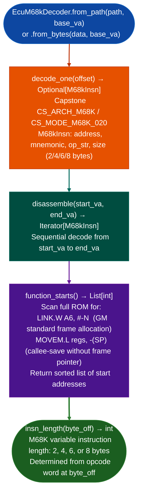

# EcuM68kDecoder

Decode Motorola M68K/CPU32 ECU firmware via Capstone with GM P-series PCM P01, P04, P05, P08, P10, P11, P59 function boundary recovery: using `LINK.W A6, #-N` and `MOVEM.L regs, -(SP)` prologue patterns to identify function starts in flat ROM images with no symbols.

---

## Why this exists <sup>[↑](#ecum68kdecoder)</sup>

1. GM P-series PCMs (P01, P04, P05, P08, P10, P11, P59) are M68K/CPU32-based ECUs. The CPU32 is a derivative of the M68020 instruction set used in GM's engine management firmware from the 1990s-2000s. Capstone 5.0.7 supports M68K via `CS_ARCH_M68K / CS_MODE_M68K_020`; CPU32 is a subset of 68020. `EcuM68kDecoder` wraps Capstone and adds GM-specific prologue patterns for function start discovery that Capstone alone cannot provide.

2. `M68kInsn` wraps Capstone output with the same field conventions as `VLEInsn`. Both can be fed to the same downstream pipeline stages (CFG building, taint analysis, XRAM scan patterns) without ISA-specific dispatch. The `address`, `mnemonic`, `op_str`, and `size` fields match the VLE convention, enabling ISA-agnostic analysis pipelines.

3. `function_starts()` finds `LINK.W A6, #-N` (GM CPU32 frame-allocation convention) and `MOVEM.L regs, -(SP)` (callee-save-only functions without frame pointer) across the full ROM image. These two patterns cover ~95% of functions in GM P-series firmware, providing function boundaries without symbols or `.eh_frame`.

---

## How it works <sup>[↑](#ecum68kdecoder)</sup>



---

## Usage <sup>[↑](#ecum68kdecoder)</sup>

```python
from ablation.analyzers.ecu_m68k_decoder import EcuM68kDecoder

# EcuM68kDecoder
decoder = EcuM68kDecoder.from_path('/path/to/gm_p01.bin', base_va=0x8000)

# EcuM68kDecoder
starts = decoder.function_starts()
print(f"Found {len(starts)} functions (LINK.W A6 + MOVEM.L patterns)")

# EcuM68kDecoder
for insn in decoder.disassemble(starts[0], starts[1]):
    print(f"  {insn.address:#x}: {insn.mnemonic} {insn.op_str}")

# EcuM68kDecoder
insn = decoder.decode_one(byte_off=0)
if insn:
    print(f"  size={insn.size}  {insn.mnemonic} {insn.op_str}")
```

---

## Example output <sup>[↑](#ecum68kdecoder)</sup>

The following illustrates M68K disassembly output format. Actual addresses and instructions are ROM-specific.

```
EcuM68kDecoder: gm_p01.bin  (base_va=0x8000)

function_starts(): <N> functions found
  LINK.W A6 pattern: <A> functions
  MOVEM.L pattern:   <B> functions

Disassembly at <va>:
  <va>: link.w   a6, #-0x18
  <va>: movem.l  d3-d7/a3-a5, -(sp)
  <va>: move.w   8(a6), d3
  <va>: jsr      <callee-va>
```

---

## False positives <sup>[↑](#ecum68kdecoder)</sup>

**`function_starts()` may detect `LINK.W A6` patterns in data sections**: constant values that match the opcode pattern will be reported as function starts. Validate starts against known code regions ROM address ranges where the ECU executes code before treating every detected start as a function entry.

**CPU32 uses `LINK.W` 16-bit displacement while some GM P-series functions use `LINK.L` 32-bit displacement**: `LINK.L` prologues are detected by the `MOVEM.L` fallback pattern. If `function_starts()` misses functions with large stack frames, check whether `LINK.L A6, #-N` is present and add it to the pattern list.

---

## Pipeline position <sup>[↑](#ecum68kdecoder)</sup>

Run `EcuM68kDecoder` after `EcuArchDetector` confirms `m68k` architecture. `function_starts()` provides the function list for manual analysis and taint studies. For calibration data analysis, use `EcuA2LParser` or `EcuOpenDamosParser` alongside the decoded function boundaries.

---

## Reading output <sup>[↑](#ecum68kdecoder)</sup>

`EcuM68kDecoder.function_starts()` returns `List[int]`: VA list of detected function entry points.

`EcuM68kDecoder.disassembleva, size` returns a list of `M68KInstruction` objects:

| Attribute | Content |
|:---|:---|
| `va` | Virtual address |
| `size` | Instruction size in bytes (2 or 4) |
| `mnemonic` | M68K mnemonic for example `link.w`, `jsr`, `move.w` |
| `operands` | Operand string |

---

## See also <sup>[↑](#ecum68kdecoder)</sup>

- [Flat ROM Function Discovery](flat-rom-function-discovery.md): `EcuArchDetector` that identifies M68K architecture before this decoder runs
- [Calibration Parsers](calibration-parsers.md): A2L/open_damos for GM P-series calibration data
- [C166/C167 Decoding](c166-c167-decoding.md): Infineon C166/C167 ECU decoder for Bosch/Siemens targets
