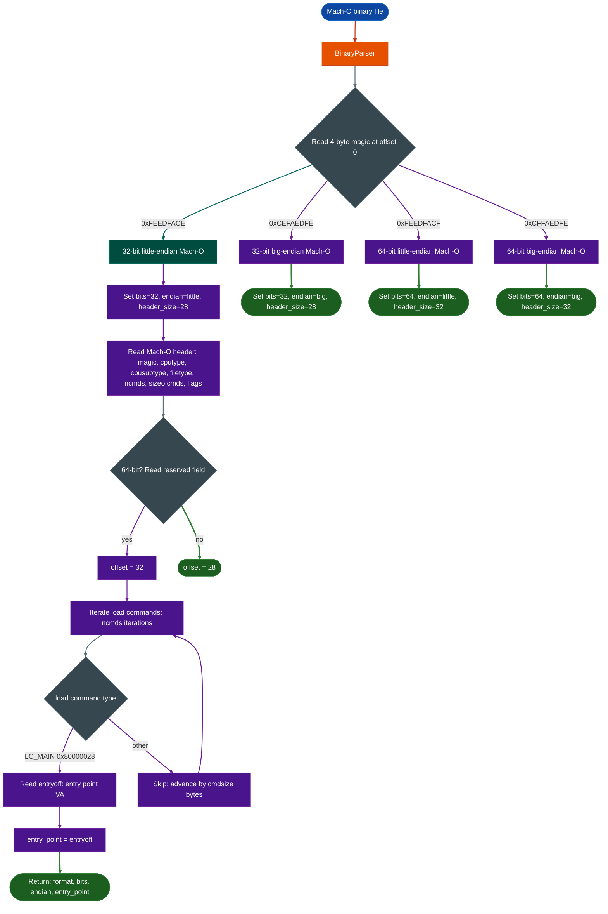

# Mach-O Internals

Parse Apple Mach-O binaries: including universal fat binaries, dylibs, and macOS/iOS executables: extracting architecture metadata, bitness, endianness, and entry point from the Mach-O header and LC_MAIN load command.

---

## Why this exists

1. **macOS and iOS represent a growing target surface for enterprise security teams.** Mach-O is the native binary format for all Apple platforms: macOS system binaries, Safari and WebKit, iOS kernel extensions, and embedded macOS agents deployed by enterprise MDM systems. Security teams that analyze corporate endpoints, mobile threat research, or macOS-specific malware need the same parsing and analysis surface for Mach-O that Ablation provides for ELF and PE.

2. **Mach-O's format differs fundamentally from ELF and PE.** Rather than a fixed header with section descriptors, Mach-O uses a variable-length load command sequence following the fixed header. Each load command has a distinct type identifier and length, and must be walked sequentially to find structures of interest. The entry point (LC_MAIN), segment mappings LC_SEGMENT_64, and dynamic linker dependencies LC_LOAD_DYLIB are all embedded as load commands rather than fixed-offset header fields. This requires format-specific parsing logic that cannot be handled by the ELF or PE parser.

3. **Both 32-bit and 64-bit formats must be handled with correct header size arithmetic.** A 32-bit Mach-O header is 28 bytes; a 64-bit Mach-O header is 32 bytes (the extra 4 bytes are a `reserved` field). Getting this wrong by 4 bytes means the first load command is misread, and every subsequent load command offset is computed incorrectly. This parser explicitly accounts for the bitness difference.

---

## How it works



**Magic-based format detection.** The 4-byte magic at the start of a Mach-O file encodes both bitness and endianness:

| Magic bytes | Value | Meaning |
|---|---|---|
| `CE FA ED FE` | `0xFEEDFACE` | Mach-O 32-bit, little-endian (x86) |
| `FE ED FA CE` | `0xCEFAEDFE` | Mach-O 32-bit, big-endian (PowerPC) |
| `CF FA ED FE` | `0xFEEDFACF` | Mach-O 64-bit, little-endian x86-64, ARM64 |
| `FF FA ED CF` | `0xCFFAEDFE` | Mach-O 64-bit, big-endian (PowerPC64) |
| `CA FE BA BE` | `0xCAFEBABE` | Universal fat binary not parsed by this module |

**Header fields.** After the 4-byte magic, the Mach-O header contains:
- `cputype` (4 bytes): CPU architecture 12 = x86, 16777228 = ARM, 16777223 = x86-64, 16777228 + 0x01000000 = ARM64
- `cpusubtype` (4 bytes): CPU subtype further specifies microarchitecture
- `filetype` (4 bytes): binary type 2 = MH_EXECUTE, 6 = MH_DYLIB, 8 = MH_BUNDLE, 11 = MH_KEXT_BUNDLE
- `ncmds` (4 bytes): count of load commands following the header
- `sizeofcmds` (4 bytes): total byte size of all load commands
- `flags` (4 bytes): binary attribute flags
- `reserved` 4 bytes, 64-bit only: unused padding

**Load command iteration.** Load commands begin immediately after the header. Each starts with `cmd` 4 bytes, type identifier and `cmdsize` 4 bytes, total command size including the two fields. The parser advances by `cmdsize` after each command, iterating until `ncmds` commands have been read.

**LC_MAIN (0x80000028).** The `LC_MAIN` load command specifies the entry point as an offset from the `__TEXT` segment base. The parser extracts `entryoff` at offset +8 within the command and stores it as the entry point.

### Current scope

The parser extracts:
- Format identification Mach-O 32/64-bit, endianness
- Architecture metadata bitness, endian
- Entry point via `LC_MAIN`

The following are not yet parsed in this version:
- `LC_SEGMENT` / `LC_SEGMENT_64`: section VA mapping and permissions
- `LC_LOAD_DYLIB`: dylib dependency list
- `LC_CODE_SIGNATURE`: code signing blobs
- `LC_DYLD_INFO`: rebase and binding information
- Symbol table (`LC_SYMTAB` / `LC_DYSYMTAB`)

For full Mach-O analysis including imports, exports, and code signature verification, use `BinaryContext.load_or_build()` backed by LIEF's Mach-O support.

---

## BinaryParser Mach-O path

```python
from ablation.core.binary_parser import BinaryParser

parser = BinaryParser('/path/to/target.dylib')
info = parser.parse()
# {
#   'format': 'Mach-O',
#   'bits': 64,
#   'endian': 'little',
#   'entry_point': '0x100003f00'
# }

print(parser.report())
# Binary: target.dylib
# Format: Mach-O
# Architecture: 64 bit
# Endianness: little
# Entry Point: 0x100003f00
```

---

## Usage

```python
from ablation.core.binary_parser import BinaryParser

p = BinaryParser('/fw/macos/httpd')
info = p.parse()

if info['format'] == 'Mach-O':
    print(f"Mach-O {info['bits']}-bit {info['endian']}-endian")
    if info.get('entry_point'):
        print(f"Entry: {info['entry_point']}")
    else:
        print("Note: dylib/bundle — no entry point (LC_MAIN absent)")

# Format detection without full parse
from ablation.core.binary_parser import BinaryParser
p = BinaryParser('/unknown/binary')
fmt = p.detect_format()
print(fmt)  # 'ELF', 'PE', 'Mach-O', or 'Unknown'
```

---

## Example output

```
Binary: Safari.framework
Format: Mach-O
Architecture: 64 bit
Endianness: little
Entry Point: 0x10000d3e0

JSON:
{
  "format": "Mach-O",
  "bits": 64,
  "endian": "little",
  "entry_point": "0x10000d3e0"
}
```

---

## False positives

**Universal fat binaries.** A Mach-O fat binary begins with `0xCAFEBABE`, which is not parsed by this module. The magic detection returns `Unknown` for fat binaries. To analyze a fat binary, extract the architecture-specific slice first using `lipo -extract` or LIEF's fat binary support, then pass the extracted slice to `BinaryParser`.

**Dylibs and bundles without LC_MAIN.** Shared libraries MH_DYLIB and plugin bundles MH_BUNDLE do not have an entry point; they have `_init` sections instead. The parser returns `entry_point: None` for these. This is correct: the absence of an entry point in a dylib is expected behavior, not a parsing error.

**32-bit ARM Mach-O (Thumb).** iOS 32-bit binaries may use Thumb instruction encoding for ARM code. The entry point VA from `LC_MAIN` points to the Thumb entry function, but the lowest bit may need to be masked off to get the aligned instruction address: `entry_va & ~1`. The parser returns the raw `entryoff` value without masking.

---

## Pipeline position

**Before this module:** File acquisition and hash verification. No other Ablation module is required.

**After this module:** `BinaryContext.load_or_build()` uses the format identification to select the appropriate LIEF parsing path. For Mach-O targets, this populates the PLT map from `LC_LOAD_DYLIB` resolved imports, function starts from the symbol table, and call graph from disassembly.

---

## Reading findings

| Field | Content |
|:---|:---|
| `format` | `'Mach-O'` |
| `bits` | `32` or `64` |
| `endian` | `'little'` or `'big'` |
| `entry_point` | Hex string of the `LC_MAIN` entry offset, or `None` if absent |

---

## See also

- [Binary Context](binary-context.md): full analysis context for Mach-O; required for downstream tools
- [ELF Internals and Hardening](elf-internals-and-hardening.md): equivalent parser for ELF binaries
- [PE Internals and Indicators](pe-internals-and-indicators.md): equivalent parser for Windows PE
- [Binary Format and Platform Identification](binary-format-and-platform-identification.md): the magic-detection layer that selects this parser
