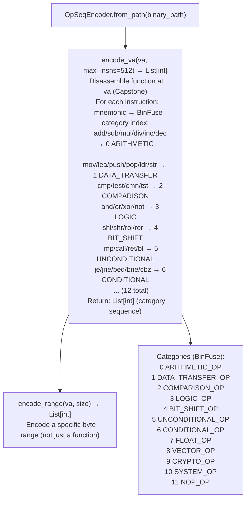

# Opcode Category Sequence Encoding

Convert a function's disassembly to a sequence of opcode category integers — mapping each instruction to one of 12 BinFuse categories (`ARITHMETIC_OP`, `DATA_TRANSFER_OP`, `COMPARISON_OP`, etc.) — producing the normalized time-series representation consumed by `MatrixProfileDiff`, `DTWMatcher`, `SAXIndex`, and `SubsequenceSearcher` for structural function similarity analysis.

---

## Why this exists

1. **`MatrixProfileDiff`, `DTWMatcher`, `SAXIndex`, and `SubsequenceSearcher` all require the same input format** — a `List[int]` where each integer is a BinFuse category index. Without `OpSeqEncoder`, each tool would need its own disassembly-to-sequence conversion, with inconsistent category boundaries. `OpSeqEncoder` is the shared normalizer that ensures all similarity tools operate on the same representation.

2. **Opcode category normalization abstracts away register names and operand values** — `ADD RAX, RBX` and `ADD R10, R12` both map to `ARITHMETIC_OP (0)`. This normalization makes the sequence comparison invariant to register renaming and constant-propagation transformations, which are the primary sources of variation between functionally identical functions across compiler versions.

3. **12-category BinFuse encoding provides sufficient discrimination** — the category assignment is architecture-independent: `ARITHMETIC_OP` covers `add/sub/mul/div` on all architectures; `CONDITIONAL_OP` covers all conditional branches. This enables `DTWMatcher` to compare ARM64 and x86-64 functions directly using the same category sequence, which is essential for cross-architecture homolog matching.

---

## How it works



---

## Usage

```python
from ablation.analyzers.opseq import OpSeqEncoder

encoder = OpSeqEncoder.from_path('/path/to/target.so')

# Encode a function at a specific VA
seq = encoder.encode_va(func_va)
print(f"Category sequence: {seq[:20]}...")

# Use with DTWMatcher for similarity comparison
from ablation.analyzers.dtw_matcher import DTWMatcher
matcher = DTWMatcher()
seq_a = encoder.encode_va(va_in_version_a)
seq_b = encoder.encode_va(va_in_version_b)
score = matcher.score_functions(seq_a, seq_b)
print(f"Similarity score: {score:.3f}")
```

---

## Example output

The following illustrates opcode sequence encoding output format.

```
OpSeqEncoder: target.so

encode_va(<va>, max_insns=512):
  [1, 5, 0, 1, 2, 6, 1, 5, 0, 0, 1, 5, 5, ...]  (<N> categories)

Category distribution:
  DATA_TRANSFER_OP: <A>
  ARITHMETIC_OP:    <B>
  UNCONDITIONAL_OP: <C>
  CONDITIONAL_OP:   <D>
```

---

## False positives

**Category encoding is lossy** — two structurally different functions with the same category distribution will appear similar. DTW and matrix profile methods provide more discriminating comparison than raw category counts; always use `DTWMatcher` or `MatrixProfileDiff` rather than comparing raw sequences directly.

**Architecture-specific instructions** (SIMD, crypto accelerator, privilege instructions) map to `VECTOR_OP`, `CRYPTO_OP`, or `SYSTEM_OP` — these categories are only relevant for functions that use such instructions. On stripped ARM ECU firmware without SIMD, these categories will always be 0.

---

## Pipeline position

`OpSeqEncoder` is not a standalone analysis tool — it is a preprocessor used internally by `MatrixProfileDiff`, `DTWMatcher`, `SAXIndex`, and `SubsequenceSearcher`. Call these tools directly; they invoke `OpSeqEncoder` internally.

---

## Reading output

`OpSeqEncoder.encode_va(va, max_insns)` returns a `List[int]` — the opcode category sequence for the function.

Category integers map to: `0=NOP`, `1=DATA_TRANSFER_OP`, `2=ARITHMETIC_OP`, `3=LOGIC_OP`, `4=MEMORY_OP`, `5=CALL_OP`, `6=UNCONDITIONAL_OP`, `7=CONDITIONAL_OP`.

`OpSeqEncoder.category_distribution(va)` returns `Dict[str, int]` — category name → instruction count.

---

## See also

- [Cross-Version Function Matching](fortinet-multi-phase-directory-sweeps.md) — `version_delta` uses `DTWMatcher` and `OpSeqEncoder` for homolog matching
- [Persistent Analysis Context](persistent-analysis-context.md) — `BinaryContext` that provides the binary data for `OpSeqEncoder`
