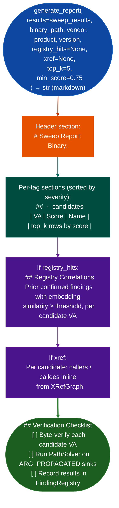

# Markdown Research Reports

Render sweep results as a structured markdown research report: ranked candidates per vulnerability class, prior-finding registry correlations similar confirmed findings from earlier engagements, and a manual verification checklist: via `sweeps/report_generator.py`.

---

## Why this exists

1. `PatternLibrary.sweep()` output is a raw dict keyed by tag with lists of `va, score` pairs: useful for programmatic processing but not readable as a findings report. `generate_report()` transforms this into a per-vuln-class ranked table with candidate VAs, scores, and the top-k hits per class, sorted by `_SEVERITY_RANK` (`CRITICAL → HIGH → MEDIUM → LOW → INFO`). This is the report format used in the manual verification step.

2. **`registry_hits` correlation surfaces prior confirmed findings with similar embeddings.** When an RE session has a `FindingRegistry` with prior work, `generate_report()` renders a second section showing which current candidates match known-confirmed findings from earlier binaries: allowing the analyst to fast-track candidates that match a pattern confirmed in a prior engagement rather than treating every hit as new.

3. The `xref` parameter (`XRefGraph` instance) adds cross-reference context: for each top candidate, the report includes the immediate callers and callees from the XRefGraph. This removes the need to manually run `xref.callers_of(va)` during the verification checklist phase, since the report includes that context inline with each candidate.

---

## How it works



---

## Usage

```python
from sweeps.report_generator import generate_report
from pathlib import Path

report_md = generate_report(
    results=sweep_results,          # PatternLibrary.sweep() output
    binary_path='/path/to/firmware.so',
    vendor='fortinet',
    product='fortigate',
    version='7.4.0',
    registry_hits=registry_hits,    # optional: {va: [similar FindingRegistry entries]}
    xref=xg,                        # optional: XRefGraph instance
    top_k=5,
    min_score=0.75,
)
Path('sweep_report.md').write_text(report_md)
```

---

## Example output

The following illustrates research report structure. Actual findings are binary-specific.

```markdown
# Sweep Report: fortigate 7.4.0
Binary: /path/to/firmware.so  |  Generated: 2026-10-17

## MEMORY_SAFETY — <N> candidates
| VA     | Score | Name        |
|--------|-------|-------------|
| 0xXXXX | 0.91  | sub_XXXX    |
| 0xYYYY | 0.88  | <name>      |

## Registry Correlations
0xXXXX — similar to CONFIRMED HIGH (prior engagement: FortiOS 7.2.1, tag=memory-safety)

## Verification Checklist
- [ ] Byte-verify each candidate VA
- [ ] Run PathSolver on ARG_PROPAGATED sinks
```

---

## False positives

**Registry correlations are embedding-similarity matches, not confirmed equivalences**: a high-similarity registry hit means the function's semantic description is similar to a prior confirmed finding, not that it is the same vulnerability. Treat registry correlations as prioritization hints, not confirmations.

**`top_k=5` may omit relevant candidates**: for vuln classes with many high-scoring hits, increase `top_k` or post-filter by score before reporting. The default `min_score=0.75` is the standard semantic sweep threshold.

---

## Pipeline position

Run `generate_report()` immediately after `PatternLibrary.sweep()` completes, before manual verification. The report is a working document for the verification session, not a deliverable. Confirmed findings go into the RE module after `FindingRegistry.register()`.

---

## Reading output

`generate_reportresults, binary_path` returns a Markdown string. The rendered report structure:

| Section | Content |
|:---|:---|
| Header | Binary path, date, sweep summary |
| Per-category tables | `VA \| Score \| Name`: one table per vulnerability class with hits |
| Registry Correlations | Matches between sweep hits and prior confirmed findings |
| No-hit classes | Vulnerability classes with zero hits above threshold |

The Markdown string can be written to disk with `report_writer.writereport, path`.

---

## See also

- [JSON and SARIF Export](json-and-sarif-export.md): structured export for CI/CD and Code Scanning upload
- [Semantic Pattern Sweep](semantic-pattern-sweep.md): `PatternLibrary.sweep()` that feeds `generate_report()`
