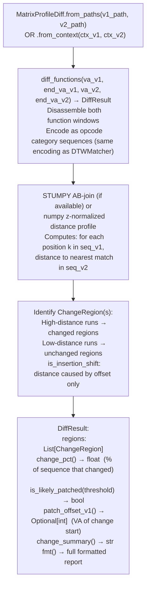

# Matrix Profile Patch Diff

Localize instruction-level changes between two versions of the same function using Matrix Profile AB-join distance: encoding both versions as opcode category sequences and identifying the subsequences where the distance is highest (changed) versus lowest unchanged.

---

## What is Matrix Profile

The Matrix Profile is a data structure that records, for every subsequence in a time series, the distance to its nearest neighbor elsewhere in the same series or in a second series. The term "profile" refers to the array of those nearest-neighbor distances indexed by position. A low value at position k means the subsequence starting at k has a close match somewhere. A high value means it does not.

The AB-join variant computes this between two separate sequences rather than within one. For every subsequence window in sequence A, it finds the closest matching window in sequence B. The result is a distance profile over A: each position shows how well that region of A is represented in B. Positions with high distance have no counterpart in B, which means they were added, removed, or substantially rewritten between the two versions.

This property makes Matrix Profile well suited for patch localization. A security patch typically changes one tight region of a function and leaves the rest intact. The distance profile for the patched function will show a spike at exactly that region and near-zero values everywhere else. A refactor produces multiple spikes spread across the profile. A complete rewrite produces uniformly high distances. The shape of the profile distinguishes these cases without requiring the analyst to read the full disassembly of both versions.

The window size controls the granularity of detection. A window of 4 instructions finds patches that touch as few as 4 consecutive opcodes. Smaller windows catch finer changes but also fire on noise from compiler rescheduling. The default window of 4 is tuned for the size of a typical security check: one compare instruction and one conditional branch, with context instructions on either side.

---

## Why this exists

1. **Once `DTWMatcher` confirms that two functions are homologs, the next question is: exactly what changed?** `MatrixProfileDiff` answers this at instruction-level precision by computing the AB-join distance profile between the two versions' opcode category sequences: high distance at position k means there is no close match for that subsequence in the other version, i.e., that region was changed. This points an analyst directly to the patched instruction window without requiring manual comparison of the full disassembly.

2. **Matrix Profile AB-join avoids the false-change problem of naive instruction diffing.** Naive instruction-level diff diff on disassembly text reports every instruction that moved due to a non-local code change for example a function growing by one instruction shifts all subsequent instruction offsets. Matrix Profile is shift-invariant: it matches subsequences regardless of offset, so an unchanged block that shifted by N bytes still reports as unchanged. The `ChangeRegion.is_insertion_shift` flag distinguishes true changes from shift artifacts.

3. **`DiffResult.is_likely_patched(threshold=15.0)` provides a binary patched/not-patched verdict** suitable for automated version triage. When scanning N firmware images for a known vulnerability, `MatrixProfileDiff` can quickly identify which versions contain the unpatched function without requiring manual analysis of each version.

---

## How it works



---

## Usage

```python
from ablation.analyzers.matrix_profile_diff import MatrixProfileDiff
from ablation.analyzers.binary_context import BinaryContext

ctx_v1 = BinaryContext.load_or_build('/firmware/v1/libfoo.so')
ctx_v2 = BinaryContext.load_or_build('/firmware/v2/libfoo.so')

diff = MatrixProfileDiff.from_paths(
    v1_path='/firmware/v1/libfoo.so',
    v2_path='/firmware/v2/libfoo.so',
)

# Diff a specific function pair (confirmed homologs from DTWMatcher)
result = diff.diff_functions(
    va_v1=0x4000, end_va_v1=0x4143f,
    va_v2=0x41800, end_va_v2=0x41980
)
print(result.fmt())
print(result.change_summary())

# Quick verdict: was this function patched between versions?
if result.is_likely_patched(threshold=15.0):
    patch_va = result.patch_offset_v1()
    print(f"Patched: change starts at v1 offset {patch_va:#x}")

# Automated triage across many versions
for v in firmware_versions:
    diff = MatrixProfileDiff.from_paths(baseline_path, v.path)
    result = diff.diff_functions(target_va_v1, end_va_v1, v.target_va, v.end_va)
    print(f"  {v.label}: {result.change_pct():.1f}% changed, patched={result.is_likely_patched()}")
```

---

## Example output

The following illustrates the diff output format. Actual percentages and change regions are binary-specific.

```
# DiffResult.fmt() output (from diff_functions()):
MatrixProfileDiff  v1=0x22ccc0 (312 insns)  v2=0x23a010 (318 insns)  window=4  change=14.4%
  [CHANGED  ]  v1[42:58]             v2[42:61]             discord=3.82
  [UNCHANGED]  v1[58:312]            v2[61:318]            discord=0.14

# change_summary() method:
change=14.4%  changed:16

# is_likely_patched(): True when change_pct >= threshold (default 15.0)
```

---

## False positives

**`is_likely_patched(threshold=15.0)` fires if more than 15% of the opcode sequence has no close match in the other version.** A function that was heavily refactored not just patched will also exceed the threshold. Use `change_pct()` and manual inspection of the identified `ChangeRegion` to distinguish a targeted security patch one tight change region from a refactor many spread-out change regions.

**STUMPY is optional: the numpy fallback uses the same math but is slower on sequences longer than ~2000 instructions.** For binaries where all functions are under 2000 instructions, the numpy fallback is adequate. Install STUMPY for firmware-wide batch triage: `pip install stumpy`.

---

## Pipeline position

Step 2 of the cross-version patch analysis workflow: after `DTWMatcher.score_functions()` identifies homologs (step 1), run `MatrixProfileDiff.diff_functions()` to locate the changed region. Step 3 is `VersionTracker.find_homolog()` to identify the earliest unpatched version.

---

## Reading output

`MatrixProfileDiff.diff_functionsva_v1, va_v2` returns a `DiffResult` object:

| Attribute | Content |
|:---|:---|
| `va_v1` / `va_v2` | VAs of the two functions being compared |
| `seq_v1` / `seq_v2` | Mnemonic sequences (lists) for each function |
| `regions` | `List[ChangeRegion]`: classified regions of the alignment |
| `window` | Matrix-profile window size used |
| `change_pct` | Property: float percentage of the function that changed |
| `is_likely_patched()` | `True` if `change_pct` exceeds the configured threshold |
| `patch_offset_v1()` | VA of the first modified region start in version 1 |

Each `ChangeRegion` has:

| Attribute | Content |
|:---|:---|
| `kind` | `'unchanged'` / `'modified'` / `'inserted'` / `'deleted'` all lowercase |
| `v1_start` | Start index in `seq_v1` instruction sequence (`-1` if this region is inserted) |
| `v1_end` | Exclusive end index in `seq_v1` |
| `v2_start` | Start index in `seq_v2` instruction sequence (`-1` if this region is deleted) |
| `v2_end` | Exclusive end index in `seq_v2` |
| `max_discord` | Maximum matrix-profile distance value within this region |

---

## See also

- [DTW & Matrix Profile Similarity](dtw-matrix-profile-similarity.md): combined entry point covering both tools and the two-step pipeline
- [DTW Function Homolog Matching](dtw-function-homolog-matching.md): step 1 detail: confirms homologs before diffing
- [Behavioral Subsequence Search](behavioral-subsequence-search.md): for finding a known subsequence in a new binary without a confirmed homolog VA
- [CFG Fixpoint Dataflow](cfg-fixpoint-dataflow.md): for semantic understanding of the changed region identified by the diff
