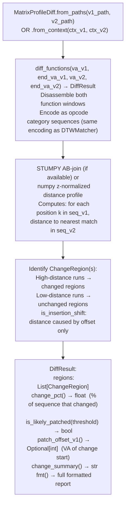

# Matrix Profile Patch Diff

Localize instruction-level changes between two versions of the same function using Matrix Profile AB-join distance — encoding both versions as opcode category sequences and identifying the subsequences where the distance is highest (changed) versus lowest (unchanged).

---

## Why this exists

1. **Once `DTWMatcher` confirms that two functions are homologs, the next question is: exactly what changed?** `MatrixProfileDiff` answers this at instruction-level precision by computing the AB-join distance profile between the two versions' opcode category sequences — high distance at position k means there is no close match for that subsequence in the other version, i.e., that region was changed. This points an analyst directly to the patched instruction window without requiring manual comparison of the full disassembly.

2. **Matrix Profile AB-join avoids the false-change problem of naive instruction diffing.** Naive instruction-level diff (diff on disassembly text) reports every instruction that moved due to a non-local code change (e.g., a function growing by one instruction shifts all subsequent instruction offsets). Matrix Profile is shift-invariant: it matches subsequences regardless of offset, so an unchanged block that shifted by N bytes still reports as unchanged. The `ChangeRegion.is_insertion_shift` flag distinguishes true changes from shift artifacts.

3. **`DiffResult.is_likely_patched(threshold=15.0)` provides a binary patched/not-patched verdict** suitable for automated version triage. When scanning N firmware images for a known vulnerability, `MatrixProfileDiff` can quickly identify which versions contain the unpatched function without requiring manual analysis of each version.

---

## How it works



---

## Usage

```python
from ablation.analyzers.matrix_profile_diff import MatrixProfileDiff
from ablation.analyzers.binary_context import BinaryContext

ctx_v1 = BinaryContext.load_or_build('/firmware/v1/libfoo.so')
ctx_v2 = BinaryContext.load_or_build('/firmware/v2/libfoo.so')

diff = MatrixProfileDiff.from_paths(
    v1_path='/firmware/v1/libfoo.so',
    v2_path='/firmware/v2/libfoo.so',
)

# Diff a specific function pair (confirmed homologs from DTWMatcher)
result = diff.diff_functions(
    va_v1=0x4000, end_va_v1=0x4143f,
    va_v2=0x41800, end_va_v2=0x41980
)
print(result.fmt())
print(result.change_summary())

# Quick verdict: was this function patched between versions?
if result.is_likely_patched(threshold=15.0):
    patch_va = result.patch_offset_v1()
    print(f"Patched: change starts at v1 offset {patch_va:#x}")

# Automated triage across many versions
for v in firmware_versions:
    diff = MatrixProfileDiff.from_paths(baseline_path, v.path)
    result = diff.diff_functions(target_va_v1, end_va_v1, v.target_va, v.end_va)
    print(f"  {v.label}: {result.change_pct():.1f}% changed, patched={result.is_likely_patched()}")
```

---

## Example output

The following illustrates the diff output format. Actual percentages and change regions are binary-specific.

```
MatrixProfileDiff: v1@<va>...<va> vs v2@<va>...<va>

Change regions:
  CHANGED:   v1[<off>..<off>]  (distance peak: <score>)
  UNCHANGED: v1[<off>..<off>]  (low distance)
  CHANGED:   v1[<off>..<off>]  (distance peak: <score>)

change_pct(): <N>%
is_likely_patched(): True
patch_offset_v1(): <va>

change_summary(): 2 changed regions; ~<N>% of function modified; likely patch at <va>
```

---

## False positives

**`is_likely_patched(threshold=15.0)` fires if more than 15% of the opcode sequence has no close match in the other version.** A function that was heavily refactored (not just patched) will also exceed the threshold. Use `change_pct()` and manual inspection of the identified `ChangeRegion` to distinguish a targeted security patch (one tight change region) from a refactor (many spread-out change regions).

**STUMPY is optional — the numpy fallback uses the same math but is slower on sequences longer than ~2000 instructions.** For binaries where all functions are under 2000 instructions, the numpy fallback is adequate. Install STUMPY for firmware-wide batch triage: `pip install stumpy`.

---

## Pipeline position

Step 2 of the cross-version patch analysis workflow: after `DTWMatcher.score_functions()` identifies homologs (step 1), run `MatrixProfileDiff.diff_functions()` to locate the changed region. Step 3 is `VersionTracker.find_homolog()` to identify the earliest unpatched version.

---

## Reading output

`MatrixProfileDiff.diff_functions(va_v1, va_v2)` returns a `PatchDiffResult` object:

| Attribute | Content |
|:---|:---|
| `change_regions` | `List[ChangeRegion]` — `{kind: CHANGED/UNCHANGED, v1_range, peak_distance}` |
| `change_pct` | Float — percentage of the function that changed |
| `is_likely_patched()` | `True` if `change_pct` exceeds the threshold |
| `patch_offset_v1` | VA of the first `CHANGED` region start in version 1 |

---

## See also

- [DTW Function Homolog Matching](dtw-function-homolog-matching.md) — step 1: confirms homologs before diffing
- [Behavioral Subsequence Search](behavioral-subsequence-search.md) — for finding a known subsequence in a new binary without a confirmed homolog VA
- [CFG Fixpoint Dataflow](cfg-fixpoint-dataflow.md) — for semantic understanding of the changed region identified by the diff
