# Media and Signaling Posture

Enumerate SIP server exposure across five attack surfaces: version fingerprint via OPTIONS, extension existence via REGISTER differential, unauthenticated registration bypass, Asterisk AMI default credential access, and RTP/SRTP encryption posture via INVITE: plus H.323 gatekeeper and SCCP/Skinny exposure probes for unified communications targets.

---

## Why this exists

1. **SIP servers expose extension existence and platform version to unauthenticated probes by design.** RFC 3261 requires SIP servers to respond to OPTIONS with supported methods and server identity. Kamailio, Asterisk, and FreePBX all respond to unauthenticated REGISTER requests with response codes that differentiate valid extensions (401) from invalid ones (403/404): creating an enumeration surface that does not require credentials. Without a dedicated scanner, analysts manually craft SIP packets and interpret response differentials by hand.

2. **Asterisk AMI default credentials admin:admin, admin:amp111 allow full call-system control without SIP access.** The Asterisk Manager Interface runs on TCP 5038 with a plaintext protocol and ships with default credentials in many packaged distributions FreePBX, Elastix, TrixBox. Successful AMI authentication enables call origination toll fraud, extension listing (`SIPpeers` action), and dialplan execution: none of which require SIP protocol access.

3. **Unencrypted RTP streams are interceptable on any intermediate network segment.** When a SIP server accepts an INVITE offering `RTP/AVP` unencrypted G.711, the resulting media stream traverses the network without encryption. The SDP answer in the 200 OK response reveals the exact IP and port where the audio stream will arrive: the specific interception target. This posture is common on enterprise UC systems where SRTP was never enforced.

---

## How it works

```mermaid
flowchart TD
    A(["SIPEnumerator(host, port=5060, timeout=5.0)"]):::input --> B["enumerate_all()"]:::primary
    B:::primary --> C["1. probe_sip_server()\nSend OPTIONS to sip:100@host via UDP\nParse status code, Server/User-Agent header, Allow header"]:::secondary
    C:::secondary --> D{"Any response?"}:::neutral
    D:::neutral -->|code != 0| E(["MEDIUM: SIP server active\nLOW: version disclosure (Server/User-Agent)\nLOW: method exposure (SUBSCRIBE/NOTIFY/PUBLISH in Allow)"]):::output
    D:::neutral -->|no response| F(["Skip · not SIP or filtered"]):::output
    B:::primary --> G["2. check_unauthenticated_register()\nSend REGISTER for ext 100 with no credentials"]:::tertiary
    G:::tertiary --> H{"code == 200?"}:::neutral
    H:::neutral -->|yes| I(["CRITICAL: registration bypass · extension hijack possible"]):::output
    H:::neutral -->|no| J(["J"]):::output
    B:::primary --> K["3. enumerate_extensions(start=100, end=110)\nBaseline probe: REGISTER 'fakesipuser99999' → invalid_code\nSweep each extension, compare to invalid_code"]:::tertiary
    K:::tertiary --> L{"response vs invalid_code"}:::neutral
    L:::neutral -->|code 200| M(["CRITICAL: unauthenticated extensions (list)"]):::output
    L:::neutral -->|code 401, invalid != 401| N(["HIGH: confirmed extension exists (auth required)"]):::output
    L:::neutral -->|code 401, invalid == 401| O(["Skip: Kamailio · cannot discriminate"]):::output
    B:::primary --> P["4. check_ami_interface()\nTCP connect port 5038\nCheck banner: 'Asterisk Call Manager'"]:::tertiary
    P:::tertiary --> Q{"default creds loop: admin:admin / admin:amp111 / admin:password / admin:''"}:::neutral
    Q:::neutral -->|Response: Success| R(["CRITICAL: AMI default credentials accepted"]):::output
    Q:::neutral -->|banner only| S(["MEDIUM: AMI exposed (no default creds)"]):::output
    B:::primary --> T["5. check_srtp_required()\nSend INVITE with SDP: m=audio N RTP/AVP 0 (unencrypted)"]:::tertiary
    T:::tertiary --> U{"Response code?"}:::neutral
    U:::neutral -->|200 + RTP/AVP in SDP answer| V(["MEDIUM: SRTP not enforced\nExtract media_ip, media_port from SDP answer\nparse_sdp_media(): c=IN IP4, m=audio, a=rtpmap"]):::output
    U:::neutral -->|488 or 606| W(["LOW: SRTP required · encrypted media enforced"]):::output
    U:::neutral -->|401| X(["LOW: INVITE requires auth"]):::output
    classDef input     fill:#0d47a1,stroke:#1565c0,color:#fff
    classDef primary   fill:#e65100,stroke:#bf360c,color:#fff
    classDef secondary fill:#004d40,stroke:#00695c,color:#fff
    classDef tertiary  fill:#4a148c,stroke:#6a1b9a,color:#fff
    classDef neutral   fill:#37474f,stroke:#546e7a,color:#fff
    classDef output    fill:#1b5e20,stroke:#2e7d32,color:#fff
    linkStyle 0 stroke:#bf360c,stroke-width:2px
    linkStyle 1 stroke:#00695c,stroke-width:2px
    linkStyle 2 stroke:#546e7a,stroke-width:2px
    linkStyle 3 stroke:#2e7d32,stroke-width:3px
    linkStyle 4 stroke:#2e7d32,stroke-width:3px
    linkStyle 5 stroke:#6a1b9a,stroke-width:2px
    linkStyle 6 stroke:#546e7a,stroke-width:2px
    linkStyle 7 stroke:#2e7d32,stroke-width:3px
    linkStyle 8 stroke:#2e7d32,stroke-width:3px
    linkStyle 9 stroke:#6a1b9a,stroke-width:2px
    linkStyle 10 stroke:#546e7a,stroke-width:2px
    linkStyle 11 stroke:#2e7d32,stroke-width:3px
    linkStyle 12 stroke:#2e7d32,stroke-width:3px
    linkStyle 13 stroke:#2e7d32,stroke-width:3px
    linkStyle 14 stroke:#6a1b9a,stroke-width:2px
    linkStyle 15 stroke:#546e7a,stroke-width:2px
    linkStyle 16 stroke:#2e7d32,stroke-width:3px
    linkStyle 17 stroke:#2e7d32,stroke-width:3px
    linkStyle 18 stroke:#6a1b9a,stroke-width:2px
    linkStyle 19 stroke:#546e7a,stroke-width:2px
    linkStyle 20 stroke:#2e7d32,stroke-width:3px
    linkStyle 21 stroke:#2e7d32,stroke-width:3px
    linkStyle 22 stroke:#2e7d32,stroke-width:3px
```



### Response code semantics extension enumeration

| Code | Extension state | Deployment |
|---|---|---|
| `200 OK` | EXISTS + no auth | CRITICAL: registration hijack possible |
| `401 Unauthorized` | EXISTS auth required | Kamailio, Asterisk default |
| `403 Forbidden` | DOES NOT EXIST | Trixbox/FreePBX typical |
| `404 Not Found` | DOES NOT EXIST | INVITE/OPTIONS default |
| `486 Busy Here` | EXISTS (in use) | Any SIP server |

---

## Usage

```python
from modules.sip_enum import SIPEnumerator, parse_sdp_media

# Full enumeration
enumerator = SIPEnumerator(host='10.10.10.100', port=5060, timeout=5.0)
result = enumerator.enumerate_all()

# Display findings by severity
for finding in result['findings']:
    print(f"[{finding['severity']:8}] {finding['title']}")
    print(f"  {finding['detail'][:120]}")

# Extension sweep — wider range for production targets
enumerator.enumerate_extensions(start=100, end=500)

# AMI check only (quick auth bypass test)
ami_findings = enumerator.check_ami_interface()
if ami_findings:
    for f in ami_findings:
        print(f"AMI: [{f['severity']}] {f['title']}")

# SRTP posture and SDP media extraction
srtp_findings = enumerator.check_srtp_required()
for f in srtp_findings:
    print(f"SRTP: {f['severity']} — {f['detail']}")

# Parse SDP from a captured SIP INVITE response body
with open('captured_invite_response.txt') as fh:
    sip_response = fh.read()
media = parse_sdp_media(sip_response)
if media:
    print(f"Media IP: {media.get('media_ip')}:{media.get('media_port')}")
    print(f"Profile: {media.get('profile')}  Codec: {media.get('codec')}")
    if media.get('profile') == 'RTP/AVP':
        print("UNENCRYPTED STREAM — intercept target confirmed")
```

---

## Example output

```
[MEDIUM  ] SIP server responding to unauthenticated OPTIONS
  SIP/UDP 10.10.10.100:5060 returned 200 to unauthenticated OPTIONS. Confirms active SIP service.

[LOW     ] SIP version disclosure via User-Agent header
  User-Agent: Asterisk PBX 16.28.0 — reveals platform and version string useful for CVE targeting.

[CRITICAL] SIP server accepts unauthenticated REGISTER
  Extension 100 REGISTER returned 200 OK with no credentials. Attacker can register any extension,
  intercept inbound calls, and perform registration hijacking (RFC 3261 §20.10 exploit).

[HIGH    ] SIP extension enumeration: 8 extensions confirmed
  Extensions ['100','101','102','103','110','200','201','300'] differentiate from invalid user
  baseline (invalid code=403). Confirmed active extensions with auth required.

[CRITICAL] Asterisk AMI default credentials accepted (admin:admin)
  AMI login succeeded with admin:admin. Attacker can originate calls (toll fraud),
  enumerate all SIP extensions via "Action: SIPpeers", and execute arbitrary dialplan logic.

[MEDIUM  ] SIP server accepts unencrypted RTP (SRTP not enforced)
  Server returned 200 OK to INVITE offering RTP/AVP (unencrypted).
  SDP answer: media=10.10.10.100:52318 profile=RTP/AVP codec=PCMU/8000.
```

---

## False positives

**`401` differential fails on Kamailio deployments.** Kamailio returns `401 Unauthorized` for both valid and invalid extensions, no differential exists via REGISTER. The `enumerate_extensions()` method detects this case (when `invalid_code == 401`) and skips rather than classifying, leaving no findings. Use OPTIONS-based probing (`probe_sip_server()`) for presence confirmation, then rely on `enumerate_extensions()` output only when `invalid_code != 401`.

**`check_srtp_required()` creates half-open dialogs.** The INVITE probe sends a SIP INVITE without sending ACK. This leaves a half-open dialog in the PBX's state table until it times out. On most production PBXs this is invisible; on systems with very small dialog tables or active TDoS mitigation rules, repeated INVITE probes trigger rate limiting. Run `check_srtp_required()` once, not in a loop.

**AMI banner detection requires exact string match.** `check_ami_interface()` checks for `'Asterisk Call Manager'` in the banner. Non-Asterisk AMI-compatible PBXs FreeSWITCH with mod_event_socket, Yeastar PBX use different banner strings and pass through without detection. Treat a negative AMI finding as "Asterisk AMI not confirmed", not as "no management interface present."

---

## Pipeline position

**Before this module:** Confirm UDP/5060 is open via `tiptoe` or `nmap -sU -p 5060`. SIP runs over UDP by default: TCP SIP port 5060 or 5061 for TLS requires explicitly setting the transport.

**After this module:** For `CRITICAL: unauthenticated REGISTER` findings: document the extension range and perform targeted registration hijacking in a controlled test. For `SRTP not enforced` findings: record the media IP and port from the SDP answer, these are the eavesdrop coordinates. For AMI default-credential findings: issue `Action: SIPpeers` to enumerate all registered extensions, then `Action: Originate` to confirm toll-fraud capability in scope.

---

## Reading findings

| Field | Content |
|:---|:---|
| `severity` | `CRITICAL` unauth registration, AMI default creds / `HIGH` confirmed extensions / `MEDIUM` server active, SRTP not enforced, AMI exposed / `LOW` version disclosure, SRTP enforced |
| `title` | Short classification string |
| `detail` | Full probe result with IP, port, codes, and SDP media parameters when applicable |
| `host` | Target IP |
| `port` | SIP server port default 5060 |

---

## See also

- [C2 / Exfiltration Indicators](c2-exfiltration-indicators.md): live host service probing C2 ports, VPN exposure
- [System-Call Tracing](system-call-tracing.md): dynamic trace of media daemon syscall behavior
- [Appliance Configuration Secret Helpers](appliance-configuration-secret-helpers.md): Cisco IOS SNMP/TFTP credential extraction from UC appliances
