# Messaging/Streaming Enumeration

Enumerate Kafka topics and consumer groups without credentials, probe Flink REST API for job topology and JAR submission endpoints, enumerate NiFi processor configurations, probe RabbitMQ management API for vhosts and queues, test NATS server for unauthenticated connection, and enumerate Confluent Schema Registry subjects: providing the complete messaging and streaming infrastructure attack surface: via `modules/streaming_enum.py`.

---

## Why this exists

1. **`kafka_list_topics()` enumerates Kafka topics and partition metadata using raw protocol**, it constructs a binary `Metadata(v1)` request `api_key=3, api_version=1` directly over TCP without using any Kafka client library, conforming to the Kafka wire protocol. In default deployments, Kafka brokers do not require authentication (`PLAINTEXT` listener). Topic enumeration reveals message streams containing PII, financial data, internal events, and machine-to-machine credentials that flow through the cluster.

2. **`flink_enumerate()` and `flink_submit_jar_rce()` expose Flink's unauthenticated REST API**: Flink's JobManager REST API port 8081 exposes job listing, task manager metrics, and JAR upload + submission without authentication in default configurations. `flink_submit_jar_rce()` uploads a JAR to `/jars/upload` and submits it to `/jars/<id>/run`, executing arbitrary code in the Flink cluster under the TaskManager process identity. This is a reliable remote code execution primitive on any Flink cluster accessible from the network.

3. **`nifi_enumerate()` extracts NiFi processor graph configuration**: Apache NiFi port 8080/8443 exposes a REST API that returns the full processor graph: all configured processors, their properties including database credentials, API keys, and cloud credentials stored as processor parameters, and the data flow topology. `nifi_enumerate()` calls `/nifi-api/process-groups/root/processors` and `/nifi-api/controller/config` to enumerate the configuration. NiFi processor properties include cleartext credentials for every data source and sink in the flow.

---

## How it works

```mermaid
flowchart TD
    A(["kafka_list_topics(host, port=9092) → dict\n  TCP connect\n  _kafka_request(api_key=3, api_version=0, body=pack('>i', 0))\n    → Metadata response: brokers array + topics array\n  Parse: topic name strings only (partition/replication not decoded)\n  → {host, port, reachable: bool, topics: List[str], error: str|None}"]):::input --> B["flink_enumerate(host, port=8081) → dict\n  GET /jobs/overview → running/finished jobs\n  GET /taskmanagers → TM count + memory\n  GET /jars → uploaded JAR list\n  → {jobs, taskmanagers, jars, config}\n\nflink_submit_jar_rce(host, jar_bytes, entryClass) → dict\n  POST /jars/upload (multipart jar)\n  POST /jars/<id>/run {entryClass, programArgs}\n  → {job_id, status: RUNNING|FAILED}"]:::primary
    B:::primary --> C["nifi_enumerate(host, timeout=8) → dict\n  GET /nifi-api/controller/config → instance config\n  GET /nifi-api/process-groups/root/processors\n    → [{name, type, properties: {credentials, endpoints}}]\n  GET /nifi-api/system-diagnostics → JVM memory\n  → {version, processors: List, properties_with_creds}"]:::secondary
    C:::secondary --> D(["RabbitMQ management API:\n  probe_rabbitmq_management(host, port=15672) → list\n    GET /api/vhosts → vhost list (guest:guest default)\n    GET /api/queues → all queues + message count\n    → [{finding: RABBITMQ_DEFAULT_CREDS, vhosts, queues}]\n\ncheck_nats_exposure(host, port=4222) → list\n  TCP connect: NATS INFO banner parsed\n  HTTP /varz, /connz monitoring endpoints\n  → [{severity, title, detail, host, port}]\n  Titles: 'NATS server client port exposed' (MEDIUM)\n          'NATS unauth access (monitoring)' (HIGH)\n          'NATS credentials in varz' (CRITICAL)"]):::output
    classDef input     fill:#0d47a1,stroke:#1565c0,color:#fff
    classDef primary   fill:#e65100,stroke:#bf360c,color:#fff
    classDef secondary fill:#004d40,stroke:#00695c,color:#fff
    classDef tertiary  fill:#4a148c,stroke:#6a1b9a,color:#fff
    classDef neutral   fill:#37474f,stroke:#546e7a,color:#fff
    classDef output    fill:#1b5e20,stroke:#2e7d32,color:#fff
    linkStyle 0 stroke:#bf360c,stroke-width:2px
    linkStyle 1 stroke:#00695c,stroke-width:2px
    linkStyle 2 stroke:#2e7d32,stroke-width:3px
```



---

## Usage

```python
from modules.streaming_enum import (
    kafka_list_topics,
    flink_enumerate,
    nifi_enumerate,
    check_nats_exposure,
    schema_registry_enumerate
)

# Kafka topic enumeration — returns dict {host, port, reachable, topics: List[str], error}
result = kafka_list_topics(target_host, port=9092)
if result['reachable']:
    print(f"Topics: {result['topics']}")

# Flink REST API
flink = flink_enumerate(target_host)
print(f"Running jobs: {len(flink.get('jobs', []))}")

# Schema Registry subjects
subjects = schema_registry_enumerate(target_host, port=8081)
print(f"Schema subjects: {subjects}")
```

---

## Example output

The following is a schematic example showing output structure and field names. Values are illustrative.

```
kafka_list_topics: <kafka-host>:9092

  Topics: [payments, user-events, iam-credentials, internal-telemetry, audit-log]
  (5 topics, no authentication required)

flink_enumerate: <flink-host>:8081

  Running jobs: 2
  JAR upload endpoint: accessible (RCE via flink_submit_jar_rce)

nifi_enumerate: <nifi-host>:8080

  Processors: 14
  Properties with credentials: database.password=<password>, aws.access.key=<access-key>

check_nats_exposure: <nats-host>:4222

  NATS v2.x.x  auth_required=False  (unauthenticated connection accepted)
```

---

## False positives

**`kafka_list_topics()` internal topics**: Kafka clusters always contain internal topics `__consumer_offsets`, `__transaction_state` prefixed with `__`. These are system topics and not data exposure findings. Count and report only non-internal topics.

**`flink_submit_jar_rce()` execution confirmation**: the JAR upload and run API calls return `{job_id: ..., status: RUNNING}` even if the JAR fails to initialize. A `RUNNING` status confirms the JAR was accepted and started; it does not confirm that arbitrary code executed successfully. Verify by checking the job's task metrics or by having the JAR write a canary file.

---

## Pipeline position

Run messaging and streaming enumeration after discovering port 9092 (Kafka), 8081 Flink/Schema Registry, 8080 (NiFi), 15672 (RabbitMQ), or 4222 (NATS). Kafka topics with sensitive stream names `payments`, `credentials`, `iam-` are immediate data exfiltration targets; Flink JAR submission is an RCE path.

---

## Reading findings

Messaging/streaming probe functions return `List[{severity, title, detail, host, port}]`:

| Field | Content |
|:---|:---|
| `severity` | `CRITICAL` unauthenticated access / `HIGH` RCE surface |
| `title` | Finding code for example `KAFKA_TOPICS_UNAUTH`, `FLINK_JAR_UPLOAD_EXPOSED` |
| `detail` | Topic list, job count, or RCE function name |
| `host` | Target IP |
| `port` | Service port for example `9092` for Kafka, `8081` for Flink |

---

## See also

- [Streaming Operational Helpers](streaming-operational-helpers.md): `kafka_consume_sample()` for actual message sampling from discovered topics
- [Observability Exposure](observability-exposure.md): `probe_kafka_schema_registry()` for schema introspection
