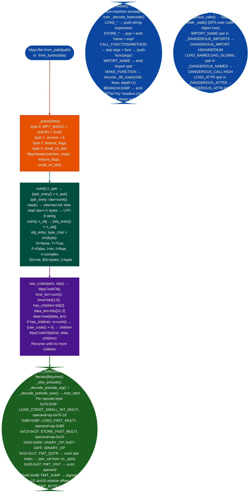

# MicroPython .mpy Lifter

Parse MicroPython `.mpy` v6 compiled modules: decoding the global qstr table, constant object table, and recursive code-object tree, and lift bytecode to pseudo-Python source while flagging dangerous imports `os`, `machine`, `uctypes`, dangerous calls `exec`, `eval`, `compile`, and direct hardware memory access `machine.mem32`, `machine.mem16`, `machine.mem8`.

---

## Why this exists

1. **MicroPython `.mpy` v6 bytecode is opaque to standard Python decompilers: `dis`, `uncompyle6`, and `pycdc` all fail on it.** `.mpy` files use a 4-byte header (`M\x06`), a compact vuint-encoded qstr interned string table, and a recursive code-object tree whose bytecode uses MicroPython-specific opcodes that do not exist in CPython bytecode. `dis.dis()` raises `TypeError` because it expects CPython `code` objects. Without a format-specific decoder, `.mpy` modules in IoT firmware are opaque blobs.

2. **Dangerous hardware access in MicroPython firmware uses `machine.mem32` / `machine.mem16` / `machine.mem8`, which appear as attribute loads, not as function calls, making them invisible to string search.** `machine.mem32[0x40011000] = 0x1` is a STORE_SUBSCR on a `LOAD_ATTR` result, not a `CALL_FUNCTION`. A grep for `mem32` in the source finds nothing after compilation. `dangerous_calls()` flags `LOAD_ATTR` instructions where the attribute name is in `_DANGEROUS_ATTRS` = `{'system', 'popen', 'execv', 'execve', 'spawn', 'mem32', 'mem16', 'mem8'}`.

3. **CircuitPython modules use the same `.mpy` v6 format as MicroPython: hardware access, network code, and credential strings embedded in CircuitPython `.mpy` files are recoverable.** CircuitPython 7.x and 8.x ship with the same v6 format same `M\x06` magic, same bytecode. `MpyLifter` supports `.mpy` v6.0 through v6.3 (MicroPython 1.19–1.23+) and all CircuitPython 7.x/8.x versions without configuration.

---

## How it works



### Security flag sets

| Set | Members | Severity |
|---|---|---|
| `_DANGEROUS_IMPORTS` (HIGH) | `os`, `uos`, `machine`, `uctypes` | HIGH |
| `_DANGEROUS_IMPORTS` (MEDIUM) | `socket`, `network`, `ussl`, `ssl`, `uasyncio`, `asyncio`, `usocket`, `ubinascii`, `subprocess`, `uhashlib`, `ucryptography`, `io`, `uio` | MEDIUM |
| `_DANGEROUS_NAMES` | `exec`, `eval`, `compile`, `__import__`, `execfile`, `open` | HIGH |
| `_DANGEROUS_ATTRS` | `system`, `popen`, `execv`, `execve`, `spawn`, `mem32`, `mem16`, `mem8` | HIGH |

---

## Usage

```python
from modules.mpy_lifter import MpyLifter

lifter = MpyLifter.from_path('/firmware/lib/sensor_driver.mpy')

# Pseudo-Python source
source = lifter.lift_module()
print(source[:800])

# Imported modules
for mod in lifter.imports():
    print(f"  import {mod}")

# Security findings
findings = lifter.dangerous_calls()
print(MpyLifter.report(findings))

# Filter by type
hw_access = [f for f in findings if f['detail'] in ('mem32', 'mem16', 'mem8')]
for f in hw_access:
    print(f"[HW_WRITE] function={f['function']} offset=0x{f['offset']:x} attr={f['detail']}")

# Check for network access (MEDIUM severity imports)
net_imports = [f for f in findings
               if f['type'] == 'DANGEROUS_IMPORT'
               and f['detail'] in ('socket', 'network', 'ussl', 'ssl')]
if net_imports:
    print(f"\nNetwork access detected: {[f['detail'] for f in net_imports]}")

# Batch scan all .mpy files in firmware tree
from pathlib import Path
for mpy_path in Path('/firmware').rglob('*.mpy'):
    try:
        lft = MpyLifter.from_path(str(mpy_path))
        fnd = lft.dangerous_calls()
        if fnd:
            print(f"\n{mpy_path.name}: {len(fnd)} finding(s)")
            print(MpyLifter.report(fnd))
    except (ValueError, Exception) as e:
        print(f"  {mpy_path.name}: parse error: {e}")
```

---

## Example output

```python
# lift_module() excerpt:
import os
import machine

def update_firmware(url, verify=True):
    import network
    import ussl
    _v0 = network.WLAN(0)
    _v0.active(True)
    _v1 = ussl.wrap_socket(_v2, server_hostname=url)
    return _v1

_v3 = machine.mem32[1073744896]     # 0x40010800 = STM32 GPIOA ODR
machine.mem32[1073744896] = (_v3 | 256)

exec(_v4)
```

```
# dangerous_calls() report:
Type                   Sev    Function                     Detail
--------------------------------------------------------------------------------
DANGEROUS_IMPORT       HIGH   <module>                     os
DANGEROUS_IMPORT       HIGH   <module>                     machine
DANGEROUS_IMPORT       MEDIUM update_firmware              network
DANGEROUS_IMPORT       MEDIUM update_firmware              ussl
DANGEROUS_ATTR         HIGH   <module>                     mem32
DANGEROUS_CALL         HIGH   <module>                     exec
```

---

## False positives

**`DANGEROUS_IMPORT` for `os` / `uos` fires even when only non-dangerous `os.path` methods are used.** The import check fires on the `IMPORT_NAME` opcode regardless of what attributes are subsequently accessed. An `.mpy` that imports `os` only for `os.path.exists()` will produce a HIGH `DANGEROUS_IMPORT` finding. Check `lift_module()` output to confirm whether the `os` import leads to `os.system()`, `os.exec*()`, or file reads before escalating.

**`DANGEROUS_CALL` for `open` fires on legitimate file reads in firmware update validation.** `open()` in MicroPython can only access the local filesystem typically a small flash FS, it cannot access `/etc/passwd` or OS system files. A DANGEROUS_CALL for `open` indicates file system access, not necessarily a security issue. Context matters: `open` in a firmware update validator reading a checksum file is benign; `open` in a network-facing request handler is not.

**`LOAD_ATTR mem32` fires on attribute access, not necessarily on a write.** `dangerous_calls()` detects the `LOAD_ATTR` opcode with attribute `mem32`, it does not distinguish between reading `machine.mem32[addr]` load subscript and writing `machine.mem32[addr] = val` store subscript. Both produce `DANGEROUS_ATTR`. The `lift_module()` output distinguishes them: a read appears as `_vN = machine.mem32[...]` LOAD_SUBSCR; a write appears as `machine.mem32[...] = val` STORE_SUBSCR.

---

## Pipeline position

**Before this module:** Confirm the file is a `.mpy` v6 binary: check that `data[0] == 0x4D` (ASCII `M`) and `data[1] == 0x06`. Files produced by earlier MicroPython versions v5 or below or CircuitPython 6.x are not supported and raise `ValueError('.mpy version N not supported')`. Native or Viper-compiled code objects `KIND_NATIVE=1`, `KIND_VIPER=2` produce `# <native/viper code, not lifted>` in the pseudo-Python output: they require separate native code analysis.

**After this module:** For `mem32`/`mem16`/`mem8` findings: extract the address from `lift_module()` output and cross-reference with the target SoC's memory map to identify the peripheral register being accessed. For `exec`/`eval` findings: check whether the argument is user-controlled network input, file read, environment variable: if yes, this is a remote code execution surface. For network import findings: check whether plaintext credentials are embedded in string constants using `co._qstrs` or `co._objs` from the code object tree.

---

## Reading findings

| Field | Content |
|:---|:---|
| `finding['type']` | `DANGEROUS_IMPORT`, `DANGEROUS_CALL`, or `DANGEROUS_ATTR` |
| `finding['detail']` | The specific module name, function name, or attribute name that triggered the finding |
| `finding['severity']` | `HIGH` os, machine, exec, eval, mem32 or `MEDIUM` network, socket, ssl |
| `finding['function']` | Code object name: `<module>` for top-level code, otherwise function name |
| `finding['offset']` | Byte offset of the triggering instruction in the code object's bytecode data |

---

## See also

- [Binary Lifting](binary-lifting.md): ELF binary lifter for native ARM/x86/RISC-V code objects within `.mpy` files
- [Taint Analysis](taint-analysis.md): trace `exec()` / `eval()` argument taint from network input in MicroPython firmware
- [Firmware Analysis](firmware-analysis.md): extract `.mpy` files from firmware images before analysis
