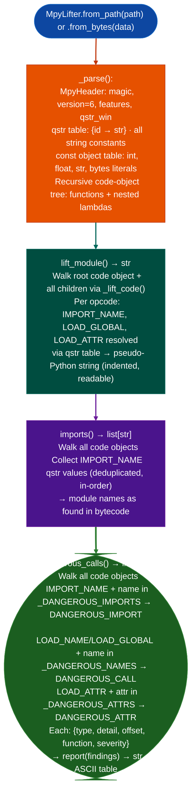

# MicroPython Analysis

Lift compiled MicroPython `.mpy` v6 bytecode files to readable pseudo-Python source, extract imported module names, and flag dangerous import and call patterns `exec`, `eval`, `os`, `machine`, `uctypes`: identifying firmware-embedded scripting attack surfaces without requiring the MicroPython runtime: via `modules/mpy_lifter.py` `MpyLifter`.

---

## Why this exists

1. **Embedded firmware increasingly ships with compiled MicroPython modules**: network appliances, IoT gateways, and industrial controllers embed `.mpy` files alongside native code. These modules run with full hardware access `machine.mem32`, `machine.mem16`, `machine.mem8` and can execute arbitrary Python expressions via `eval`/`exec`. Binary analysis tools that only process ELF or PE binaries miss the entire scripting layer of these devices.

2. **`.mpy` files are not source code: they require a bytecode-aware lifter**: a compiled `.mpy` v6 file stores a qstr table interned string constants, a constant object table, and a recursive code-object tree with VM opcodes. `MpyLifter` decodes all three structures without launching the MicroPython VM, producing readable pseudo-Python that exposes function definitions, imports, constant values, and call patterns.

3. **`MpyLifter.dangerous_calls()` classifies security-relevant patterns into three finding types**: `DANGEROUS_IMPORT` import of `os`, `machine`, `uctypes`, `subprocess`, etc., `DANGEROUS_CALL` call to `exec`, `eval`, `compile`, `open`, and `DANGEROUS_ATTR` attribute access on dangerous modules: `machine.mem32`, `machine.mem16`, `uctypes.addressof`. Each finding carries a `function` field the code object name and `offset` field bytecode instruction offset, enabling precise location within the bytecode.

---

## How it works



---

## Usage

```python
from modules.mpy_lifter import MpyLifter

# Lift a compiled .mpy file from firmware extraction
lifter = MpyLifter.from_path('/path/to/extracted/module.mpy')

# Full pseudo-Python source
print(lifter.lift_module())

# Imported module names (in-order, deduplicated)
print("Imports:", lifter.imports())

# Security findings
# Each dict: {type, detail, offset, function, severity}
findings = lifter.dangerous_calls()
for f in findings:
    print(f"  [{f['severity']}] {f['type']}: {f['detail']}  "
          f"(in {f['function']} @ offset {f['offset']})")

# ASCII table report
print(MpyLifter.report(findings))
```

---

## Example output

The following is a schematic example showing output structure and field names. Values are illustrative.

```
lift_module():
  import machine
  import os

  def update_firmware(url):
      data = fetch(url)
      machine.mem32[<addr>] = <value>
      exec(data)

imports(): ['machine', 'os', 'uio']

dangerous_calls():
  [HIGH]   DANGEROUS_CALL    exec        (in update_firmware @ offset 14)
  [HIGH]   DANGEROUS_ATTR    mem32       (in update_firmware @ offset 8)
  [HIGH]   DANGEROUS_IMPORT  machine     (in <module> @ offset 2)

MpyLifter.report(findings):
  Type                   Sev    Function                     Detail
  -------------------------------------------------------------------------------
  DANGEROUS_CALL         HIGH   update_firmware              exec
  DANGEROUS_ATTR         HIGH   update_firmware              mem32
  DANGEROUS_IMPORT       HIGH   <module>                     machine
```

---

## False positives

**`DANGEROUS_IMPORT` fires on any import of `os` or `machine`**: most MicroPython hardware drivers import `machine` for pin control and PWM. An `DANGEROUS_IMPORT` finding for `machine` is informational; escalate only when `DANGEROUS_ATTR` findings for `mem32`, `mem16`, or `mem8` also appear in the same function, indicating direct memory writes rather than safe peripheral API use.

**`DANGEROUS_ATTR` for `mem32` read access vs write access**: `machine.mem32[addr]` (read) is less dangerous than `machine.mem32[addr] = val` (write). The finding fires for either form; read the lifted pseudo-Python from `lift_module()` to determine whether the access is read-only or a write that could overwrite firmware or peripheral registers.

---

## Pipeline position

Run `MpyLifter` on every `.mpy` file extracted from firmware containers. Combine with `BinaryContext.load_or_build()` on the native ELF loader to cover both the compiled C layer and the MicroPython scripting layer. Use firmware extraction tooling to locate `.mpy` files within firmware squashfs images before analysis.

---

## Reading output

`MpyLifter.lift_module()` returns a `str`: multi-line Python-like pseudocode for the entire `.mpy` module. Additional methods:

- `MpyLifter.imports()` → `List[str]`: all imported module names found in the bytecode
- `MpyLifter.dangerous_calls()` → `List[dict]`: calls to `exec`, `eval`, `os`, `machine`, `uctypes`, etc.; each dict has `type`, `qstr`, `va`, `severity`

---

## See also

- [MicroPython .mpy Lifter](mpy-lifter.md): detailed constructor patterns, opcode reference, and version compatibility table
- [Firmware Extraction](firmware-extraction.md): squashfs and CRAMFS extraction to locate embedded `.mpy` files
- [Hardware Root Discovery](hardware-root-discovery.md): native firmware analysis for the C/assembler layer alongside MicroPython modules
