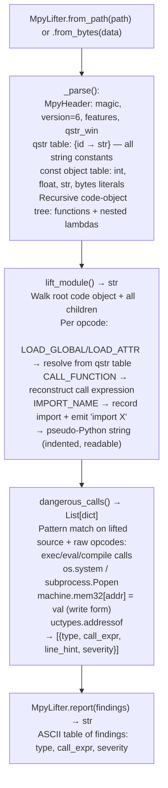

# MicroPython Analysis

Lift compiled MicroPython `.mpy` v6 bytecode files to readable pseudo-Python source, extract imported module names, and flag dangerous call patterns (`exec`, `eval`, `compile`, `os.system`, `machine.mem32`) — identifying firmware-embedded scripting attack surfaces without requiring the MicroPython runtime — via `modules/mpy_lifter.py` `MpyLifter`.

---

## Why this exists

1. **Embedded firmware increasingly ships with compiled MicroPython modules** — network appliances, IoT gateways, and industrial controllers embed `.mpy` files alongside native code. These modules run with full hardware access (`machine.mem32`, `machine.mem16`, `machine.mem8`) and can execute arbitrary Python expressions via `eval`/`exec`. Binary analysis tools that only process ELF or PE binaries miss the entire scripting layer of these devices.

2. **`.mpy` files are not source code — they require a bytecode-aware lifter** — a compiled `.mpy` v6 file stores a qstr table (interned string constants), a constant object table, and a recursive code-object tree with VM opcodes. `MpyLifter` decodes all three structures without launching the MicroPython VM, producing readable pseudo-Python that exposes function definitions, imports, constant values, and call patterns.

3. **`MpyLifter.dangerous_calls()` flags security-relevant patterns without false positive noise** — rather than flagging any import of `os` (which most modules use benignly), it checks for specific dangerous call patterns: `exec`/`eval`/`compile` (arbitrary code execution), `os.system`/`subprocess` (shell injection), `machine.mem32` write sequences (direct hardware memory manipulation), and `uctypes.addressof` (pointer arithmetic). These patterns are directly actionable findings in firmware security review.

---

## How it works



---

## Usage

```python
from modules.mpy_lifter import MpyLifter

# Lift a compiled .mpy file from firmware extraction
lifter = MpyLifter.from_path('/path/to/extracted/module.mpy')

# Full pseudo-Python source
print(lifter.lift_module())

# Imported module names
print("Imports:", lifter.imports())

# Security findings: [{type, call_expr, line_hint, severity}]
findings = lifter.dangerous_calls()
for f in findings:
    print(f"  [{f['severity']}] {f['type']}: {f['call_expr']}")

# ASCII report
print(MpyLifter.report(findings))
```

---

## Example output

The following is a schematic example showing output structure and field names. Values are illustrative.

```
MpyLifter: module.mpy (v6)

Pseudo-Python:
  import machine
  import os

  def update_firmware(url):
      data = fetch(url)
      machine.mem32[<addr>] = <value>
      exec(data)

Imports: ['machine', 'os', 'uio']

dangerous_calls:
  type=EXEC_EVAL  call_expr='exec(data)'  severity=CRITICAL
  type=MEM32_WRITE  call_expr='machine.mem32[<addr>] = <value>'  severity=HIGH
```

---

## False positives

**`machine.mem32` read access is less dangerous than write** — many MicroPython hardware drivers read hardware registers using `machine.mem32[addr]`. `MpyLifter.dangerous_calls()` distinguishes read-only access (lower severity) from write access (`machine.mem32[addr] = val`) which can overwrite firmware or peripheral registers. Review the `call_expr` to confirm the access direction.

**`eval` in trusted utility code** — some firmware modules use `eval()` to implement a lightweight JSON-like parser for configuration values where a proper JSON library is too large for constrained memory. Check whether the input to `eval` is a constant string or a network-received value before escalating severity.

---

## Pipeline position

Run `MpyLifter` on every `.mpy` file extracted from firmware containers. Combine with `BinaryContext.load_or_build()` on the native ELF loader to cover both the compiled C layer and the Python scripting layer. Use `firmware_extraction.py` to locate `.mpy` files within firmware squashfs images before analysis.

---

## See also

- [MicroPython .mpy Lifter](mpy-lifter.md) — detailed constructor patterns, opcode reference, and version compatibility table
- [Firmware Extraction](firmware-extraction.md) — squashfs and CRAMFS extraction to locate embedded `.mpy` files
- [Hardware Root Discovery](hardware-root-discovery.md) — native firmware analysis for the C/assembler layer alongside MicroPython modules
