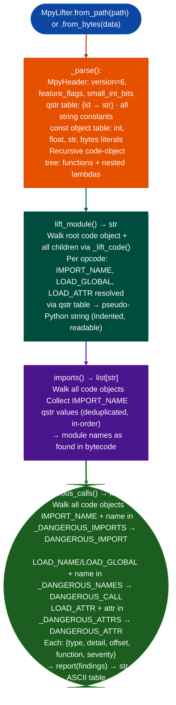

# MpyLifter

Lift compiled MicroPython `.mpy` v6 bytecode files to readable pseudo-Python source, extract imported module names, and flag dangerous import and call patterns. Covers `exec`, `eval`, `os`, `machine`, `uctypes`, and network/crypto modules. Identifies firmware-embedded scripting attack surfaces without requiring the MicroPython runtime.

- [What is MicroPython and the .mpy format?](#what-is-micropython-and-the-mpy-format)
  - [MicroPython architecture](#micropython-architecture)
  - [The .mpy v6 file format](#the-mpy-v6-file-format)
  - [QSTRs and the interned string table](#qstrs-and-the-interned-string-table)
  - [Why .mpy files appear in RE work](#why-mpy-files-appear-in-re-work)
- [Why this exists](#why-this-exists)
- [Module relationships](#module-relationships)
- [How it works](#how-it-works)
- [API reference](#api-reference)
  - [`MpyLifter`](#mpylifter-class)
  - [`MpyHeader`](#mpyheader)
  - [`MpyCodeObj`](#mpycodeobj)
  - [`MpyInsn`](#mpyinsn)
- [Dangerous pattern sets](#dangerous-pattern-sets)
- [Usage](#usage)
- [Example output](#example-output)
- [False positives](#false-positives)
- [Limitations](#limitations)
- [Pipeline position](#pipeline-position)
- [Reading output](#reading-output)
- [See also](#see-also)

---

## What is MicroPython and the .mpy format? <sup>[↑](#mpylifter)</sup>

**MicroPython** is a lean implementation of Python 3 designed for microcontrollers and embedded systems. Created by Damian George and first funded via Kickstarter in 2013, MicroPython targets devices with as little as 256 KB of flash and 16 KB of RAM. It runs natively on ARM Cortex-M microcontrollers (STM32, RP2040), Xtensa cores (ESP8266, ESP32), and a range of RISC-V and MIPS targets. Commercial products use MicroPython as the scripting layer for network appliances, industrial gateways, smart meters, and device management consoles.

MicroPython is NOT CPython for embedded targets. It reimplements the Python 3 language semantics in C with a custom bytecode VM, a mark-and-sweep garbage collector, and a hardware abstraction layer (`machine`, `micropython`, `uctypes` standard modules). The bytecode format and the VM are independent from CPython's; `.mpy` files are not `.pyc` files and cannot be loaded by CPython's `marshal` module.

### MicroPython architecture <sup>[↑](#mpylifter)</sup>

MicroPython compiles Python source to bytecode using `mpy-cross`, its cross-compiler. The compilation target is MicroPython's own stack-based VM (distinct from CPython's stack machine in opcode encoding and layout). The VM executes one opcode at a time; there is no JIT compiler in any shipping MicroPython release as of 2025.

The **code object** is the fundamental unit of compiled MicroPython. Each function body compiles to one code object. Nested functions and lambda expressions compile to child code objects, forming a recursive tree rooted at the module-level code object. Each code object carries its own bytecode, a reference to the shared QSTR table, and the prelude metadata (register count, exception stack depth, positional argument count).

The bytecode instruction encoding is compact: most instructions are one byte (the opcode), with optional variable-length unsigned integer (vuint) operands following. The opcode for `IMPORT_NAME` carries a QSTR index as its operand; `LOAD_ATTR` carries a QSTR index for the attribute name. This means all identifiers referenced by a compiled module are present in the QSTR table even in bytecode that has been stripped of source annotations.

### The .mpy v6 file format <sup>[↑](#mpylifter)</sup>

Version 6 is the current `.mpy` format (MicroPython 1.21+). Earlier versions (v1-v5) have a different prelude encoding and are not supported by `MpyLifter`.

Binary layout of a v6 `.mpy` file:

```
magic (1 byte):      0x4D  ('M')
version (1 byte):    0x06
feature_flags (1 byte):  bit 0 = native code present; bit 1 = byte code present
small_int_bits (1 byte): usually 31 (32-bit platform) or 63 (64-bit)
n_qstr (vuint):      count of QSTR entries
n_obj (vuint):       count of constant object entries
qstr_table:          n_qstr × qstr_entry (length-prefixed UTF-8 strings)
obj_table:           n_obj × obj_entry (int / float / str / bytes literals)
root_code_obj:       recursive code object tree
```

Each code object encodes its bytecode behind two prelude sections decoded by `_decode_prelude_sig` (register/exception stack counts) and `_decode_prelude_size` (bytecode info size and cell count). These fields use a multi-byte ULEB128-like encoding where the high bit signals continuation.

### QSTRs and the interned string table <sup>[↑](#mpylifter)</sup>

**QSTRs** (Quick Strings) are MicroPython's interned string system. Every identifier referenced in a module: function names, attribute names, imported module names, global variable names: is interned into the QSTR table at compile time. In a compiled `.mpy`, bytecode instructions reference strings only by their QSTR index (a vuint operand), never by inline bytes. The QSTR table is stored once in the file header and shared across all code objects in the module.

The security implication: even in a bytecode that has been stripped of debug information (no source filename, no line number table), all string identifiers are recoverable from the QSTR table. `IMPORT_NAME 7` with `qstrs[7] == "os"` is unambiguous. MpyLifter exploits this: `dangerous_calls()` reads the QSTR value from `insn.qstr_val` (resolved during `_decode_bytecode`) and matches it against the dangerous pattern sets, not against raw bytes.

### Why .mpy files appear in RE work <sup>[↑](#mpylifter)</sup>

**FortiSwitch v7 management plane:** Fortinet's FortiSwitch v7 ships Python bytecode (`.pyc`) for its management plane rather than `.mpy`; however, some FortiSandbox and internal tooling targets ship `.mpy` modules. The `PycBytecodeScanner` covers the `.pyc` targets; `MpyLifter` covers `.mpy`.

**Network appliances with MicroPython scripting layers:** Several IoT gateways and protocol converters ship with an embedded MicroPython interpreter for user-configurable automation scripts. These scripts compile to `.mpy` and are stored in the device's filesystem alongside native ELF binaries. Extracting the squashfs or CRAMFS image from the firmware reveals the `.mpy` files.

**Embedded update and bootstrap scripts:** Firmware for devices using ESP32 and RP2040 MCUs routinely includes MicroPython `.mpy` modules for OTA update logic, sensor polling, and protocol bridging. These modules often contain hardcoded API endpoints, credentials, and calls to `exec` or `machine.mem32`.

**Hardware peripheral configuration scripts:** Industrial PLCs and smart meters increasingly use MicroPython for field-configurable logic. `.mpy` files embedded in configuration packages provide full hardware register write access via `uctypes.addressof` and `machine.mem32`, making them high-priority targets for capability assessment.

---

## Why this exists <sup>[↑](#mpylifter)</sup>

1. Embedded firmware increasingly ships with compiled MicroPython modules. Network appliances, IoT gateways, and industrial controllers embed `.mpy` files alongside native code. These modules run with full hardware access (`machine.mem32`, `machine.mem16`, `machine.mem8`) and can execute arbitrary Python expressions via `eval` and `exec`. Binary analysis tools that only process ELF or PE binaries miss the entire scripting layer of these devices.

2. `.mpy` files are not source code and require a bytecode-aware lifter. A compiled `.mpy` v6 file stores a QSTR table (interned string constants), a constant object table, and a recursive code-object tree with VM opcodes. `MpyLifter` decodes all three structures without launching the MicroPython VM, producing readable pseudo-Python that exposes function definitions, imports, constant values, and call patterns.

3. `MpyLifter.dangerous_calls()` classifies security-relevant patterns into three finding types. `DANGEROUS_IMPORT` covers imports of `os`, `machine`, `uctypes`, `subprocess`, and similar modules. `DANGEROUS_CALL` covers calls to `exec`, `eval`, `compile`, and `open`. `DANGEROUS_ATTR` covers attribute access on dangerous modules such as `machine.mem32` and `uctypes.addressof`. Each finding carries a `function` field (code object name) and an `offset` field (bytecode instruction offset) for precise location.

---

## Module relationships <sup>[↑](#mpylifter)</sup>

`MpyLifter` is a standalone module with no ablation dependencies. It uses only Python standard library types (`dataclasses`, `typing`, `pathlib`).

**Used by:**
- Firmware analysis passes on squashfs/CRAMFS images: run `MpyLifter.from_path()` on every `.mpy` file located during extraction
- FortiSandbox internal tooling analysis: `.mpy` scripting modules alongside native ELF targets
- `FindingRegistry`: feed confirmed `DANGEROUS_CALL` and `DANGEROUS_ATTR` findings from `dangerous_calls()` to register confirmed vulnerabilities

**Related modules:**
- [PycBytecodeScanner](pyc-bytecode-scanner.md): covers compiled CPython `.pyc` bytecode (FortiSwitch v7 management plane, other Python 3 targets)
- [BinaryContext](binary-context.md): native binary context for the ELF layer on the same device

---

## How it works <sup>[↑](#mpylifter)</sup>



---

## API reference <sup>[↑](#mpylifter)</sup>

### `MpyLifter` class <sup>[↑](#mpylifter)</sup>

**File:** `modules/mpy_lifter.py`

```python
from modules.mpy_lifter import MpyLifter
```

| Method | Signature | Returns |
|:---|:---|:---|
| `from_path` | `cls, path: str` → `MpyLifter` | Parser for a `.mpy` file on disk; raises if file exceeds 4 MB |
| `from_bytes` | `cls, data: bytes` → `MpyLifter` | Parser from raw bytes (extracted from firmware image) |
| `lift_module` | `self` → `str` | Full module as pseudo-Python source |
| `imports` | `self` → `list[str]` | All imported module names, deduplicated, in bytecode order |
| `dangerous_calls` | `self` → `list[dict]` | Security findings (see [Reading output](#reading-output)) |
| `report` | `findings: list[dict]` → `str` | Static method: ASCII table of findings |

**Size limit:** `from_path()` checks `Path(path).stat().st_size` before reading. Files exceeding `_MAX_MPY_BYTES` (4 MB) raise `ValueError`. This prevents memory exhaustion on malformed or oversized inputs. `from_bytes()` does not re-check size; callers using raw bytes are responsible for pre-validation.

### `MpyHeader` <sup>[↑](#mpylifter)</sup>

Returned as `lifter._header` (not public API; access via `lift_module()` output instead).

| Field | Type | Meaning |
|:---|:---|:---|
| `version_major` | `int` | Must be 6; raises `ValueError` on any other version |
| `feature_flags` | `int` | Bit 0: native code present; bit 1: bytecode present |
| `small_int_bits` | `int` | Platform integer width (31 = 32-bit, 63 = 64-bit) |

### `MpyCodeObj` <sup>[↑](#mpylifter)</sup>

Internal representation of one compiled function or module body.

| Field | Type | Meaning |
|:---|:---|:---|
| `kind` | `int` | Code object kind (0 = bytecode, 1 = native, 2 = viper) |
| `data` | `bytes` | Raw bytecode bytes |
| `children` | `list[MpyCodeObj]` | Nested code objects (inner functions, lambdas) |
| `name` | `str` | Function name from QSTR table; `<module>` for root |
| `_qstrs` | `list[str]` | Reference to the module-level QSTR table |

### `MpyInsn` <sup>[↑](#mpylifter)</sup>

One decoded bytecode instruction, yielded by `_decode_bytecode()`.

| Field | Type | Meaning |
|:---|:---|:---|
| `offset` | `int` | Byte offset within the code object's bytecode |
| `opcode` | `int` | Raw opcode byte |
| `mnemonic` | `str` | Decoded mnemonic (e.g. `IMPORT_NAME`, `LOAD_ATTR`) |
| `operand` | `int \| None` | Decoded integer operand if present |
| `qstr_val` | `str \| None` | Resolved QSTR string value if the operand is a QSTR index |

---

## Dangerous pattern sets <sup>[↑](#mpylifter)</sup>

Three frozensets govern finding classification:

**`_DANGEROUS_IMPORTS`** (triggers `DANGEROUS_IMPORT`):
`socket`, `network`, `ussl`, `ssl`, `uasyncio`, `asyncio`, `uos`, `os`, `usocket`, `ubinascii`, `machine`, `uctypes`, `io`, `uio`, `subprocess`, `uhashlib`, `ucryptography`

**`_DANGEROUS_NAMES`** (triggers `DANGEROUS_CALL` on `LOAD_NAME`/`LOAD_GLOBAL`):
`exec`, `eval`, `compile`, `__import__`, `execfile`, `open`

**`_DANGEROUS_ATTRS`** (triggers `DANGEROUS_ATTR` on `LOAD_ATTR`):
`system`, `popen`, `execv`, `execve`, `spawn`, `mem32`, `mem16`, `mem8`

`DANGEROUS_IMPORT` severity defaults to `'HIGH'` for `machine`, `uctypes`, `subprocess`, `os`, `uos` and `'MEDIUM'` for socket/network/crypto imports.

---

## Usage <sup>[↑](#mpylifter)</sup>

```python
from modules.mpy_lifter import MpyLifter

# Parse a .mpy file and lift to pseudo-Python
lifter = MpyLifter.from_path('/path/to/extracted/module.mpy')
print(lifter.lift_module())

# List all imported module names
print("Imports:", lifter.imports())

# Get security findings and print them
findings = lifter.dangerous_calls()
for f in findings:
    print(f"  [{f['severity']}] {f['type']}: {f['detail']}  "
          f"(in {f['function']} @ offset {f['offset']})")

# ASCII table format
print(MpyLifter.report(findings))

# Parse from bytes (e.g. extracted from firmware image)
with open('firmware.bin', 'rb') as fh:
    raw = fh.read()
# Locate .mpy magic byte (0x4D) at known offsets and slice the module
lifter = MpyLifter.from_bytes(raw[offset:offset + module_len])
```

---

## Example output <sup>[↑](#mpylifter)</sup>

```
lift_module():
  import machine
  import os

  def update_firmware(url):
      data = fetch(url)
      machine.mem32[<addr>] = <value>
      exec(data)

imports(): ['machine', 'os', 'uio']

dangerous_calls():
  [HIGH]   DANGEROUS_CALL    exec        (in update_firmware @ offset 14)
  [HIGH]   DANGEROUS_ATTR    mem32       (in update_firmware @ offset 8)
  [HIGH]   DANGEROUS_IMPORT  machine     (in <module> @ offset 2)

MpyLifter.report(findings):
  Type                   Sev    Function                     Detail
  -------------------------------------------------------------------------------
  DANGEROUS_CALL         HIGH   update_firmware              exec
  DANGEROUS_ATTR         HIGH   update_firmware              mem32
  DANGEROUS_IMPORT       HIGH   <module>                     machine
```

---

## False positives <sup>[↑](#mpylifter)</sup>

**`DANGEROUS_IMPORT` fires on any import of `os` or `machine`**: most MicroPython hardware drivers import `machine` for pin control and PWM. A `DANGEROUS_IMPORT` finding for `machine` is informational; escalate only when `DANGEROUS_ATTR` findings for `mem32`, `mem16`, or `mem8` also appear in the same function, indicating direct memory writes rather than safe peripheral API use.

**`DANGEROUS_ATTR` for `mem32` read access vs write access**: `machine.mem32[addr]` (read) is less dangerous than `machine.mem32[addr] = val` (write). The finding fires for either form; read the lifted pseudo-Python from `lift_module()` to determine whether the access is read-only or a write that could overwrite firmware or peripheral registers.

**`DANGEROUS_CALL` for `open`**: file reads from `/dev/` or sensor pseudo-files in embedded Linux firmware are common and not exploitable without write access to the opened path. Confirm that the `open()` call uses an attacker-controlled filename before escalating.

---

## Limitations <sup>[↑](#mpylifter)</sup>

1. Only `.mpy` v6 is supported. Files with version byte 1–5 raise `ValueError`. The version encoding changed at each major MicroPython release; v5 (MicroPython 1.19) and earlier use a different prelude and QSTR encoding. This covers all devices running MicroPython 1.21+ (2023 onward).

2. Native code objects are not decoded. `MpyCodeObj.kind == 1` (native) and `kind == 2` (viper) objects contain ARM Thumb-2 or Xtensa machine code inlined into the `.mpy` file. `MpyLifter` skips these; they require native analysis via `BinaryContext` on the extracted code bytes.

3. `lift_module()` produces pseudo-Python, not reconstructed source. Control flow in the lifted output uses `goto`-style labels for non-linear patterns. Loop and conditional structure is not recovered from the bytecode; the output is useful for identifying what a function does, not for reconstructing the original source layout.

4. The QSTR table is the entire identifier inventory. Variable names, class names, and some constants are present. Numeric constants stored in the object table are also decoded. However, computed strings (built via `+` or `.format()` at runtime) are not in the QSTR table and do not appear in `find_string_refs`-style analysis.

5. Anonymous lambdas appear as `<lambda>` in the `function` field of findings. Multiple lambdas at different offsets in the same module all report the same `function` value. Use the `offset` field to distinguish them when multiple `<lambda>` findings appear.

---

## Pipeline position <sup>[↑](#mpylifter)</sup>

Run `MpyLifter` on every `.mpy` file extracted from firmware containers. Combine with `BinaryContext.load_or_build()` on the native ELF loader to cover both the compiled C layer and the MicroPython scripting layer. Use firmware extraction tooling to locate `.mpy` files within squashfs images before analysis.

For targets where both `.pyc` and `.mpy` files are present: use `PycBytecodeScanner` for `.pyc` (CPython-compiled) and `MpyLifter` for `.mpy` (MicroPython-compiled). The two formats are structurally incompatible; loading a `.pyc` into `MpyLifter` raises `ValueError: bad magic`.

---

## Reading output <sup>[↑](#mpylifter)</sup>

`MpyLifter.dangerous_calls()` returns `list[dict]`. Each finding dict:

| Key | Type | Content |
|:---|:---|:---|
| `type` | `str` | `'DANGEROUS_IMPORT'`, `'DANGEROUS_CALL'`, or `'DANGEROUS_ATTR'` |
| `detail` | `str` | The QSTR value that matched (e.g. `'machine'`, `'exec'`, `'mem32'`) |
| `offset` | `int` | Byte offset of the matching instruction within the code object's bytecode |
| `function` | `str` | Name of the code object (`co.name`): function name or `'<module>'` for module-level code |
| `severity` | `str` | `'HIGH'` or `'MEDIUM'` |

Additional methods:

- `MpyLifter.lift_module()` → `str`: multi-line pseudo-Python for the entire `.mpy` module
- `MpyLifter.imports()` → `list[str]`: all `IMPORT_NAME` QSTR values, deduplicated, in encounter order
- `MpyLifter.report(findings)` → `str`: static method producing a fixed-width ASCII table for terminal output

---

## What is MicroPython? <sup>[↑](#mpylifter)</sup>

MicroPython is a lean implementation of Python 3, initially created by Damien George and first released in 2014 via a Kickstarter campaign for the pyboard hardware. The project's goal was to bring a full Python interpreter to microcontrollers with as little as 256 KB flash and 16 KB RAM: an environment where CPython's full runtime (typically requiring several MB of RAM) could not fit.

MicroPython achieves this compactness through several architectural compromises:

- **Reduced standard library:** The standard library is a strict subset of CPython's. Modules like `re` (regex), `json`, `socket`, `struct`, `os`, and `hashlib` are present but with reduced functionality. Many CPython modules are entirely absent (no `threading`, `multiprocessing`, `asyncio` module: async is handled by the `uasyncio` shim, a MicroPython-specific implementation).
- **QSTR intern pool:** All identifier strings are interned at compile time and stored as 16-bit integer IDs (QSTRs). This eliminates per-string heap allocation for identifiers during execution and is the source of the `.mpy` file's compact representation.
- **No garbage-collected closures by default:** On bare-metal ports, MicroPython uses a simplified mark-and-sweep GC with configurable heap sizes (typically 16 KB to 512 KB). Python closures are supported but heap-allocated.
- **`.mpy` pre-compiled bytecode:** To avoid RAM-resident compilation, applications are distributed as pre-compiled `.mpy` files rather than `.py` source. The `.mpy` file contains the raw bytecode and QSTR table without the Python source text.

MicroPython is now maintained by the MicroPython Foundation and is used in millions of devices. The codebase is in active development; the bytecode format has changed between major versions, requiring version detection when analyzing `.mpy` files from firmware.

**Historical significance for RE:** MicroPython changed the embedded firmware landscape by enabling rapid scripting on constrained hardware. Security researchers began encountering `.mpy` files in IoT firmware starting around 2017–2018. The lack of standard disassembler support for `.mpy` (neither Ghidra nor IDA support it natively) means raw bytecode inspection or tools like `mpy-tool.py` (from the MicroPython source tree) are the primary analysis path without ablation support.

---

## MicroPython firmware targets <sup>[↑](#mpylifter)</sup>

MicroPython is deployed in a wide range of embedded platforms with distinct security implications:

**ESP8266 / ESP32 (Espressif):** The most common MicroPython platform. The ESP8266 and ESP32 run MicroPython as the primary application environment. Firmware consists of a binary compiled MicroPython interpreter (ELF) plus a FAT filesystem image containing `.py` and `.mpy` user scripts. Network-facing scripts (those importing `socket`, `network`, or `asyncio`) are the primary RE targets.

**Raspberry Pi Pico (RP2040):** MicroPython runs bare-metal on the RP2040 dual-core ARM Cortex-M0+. The UF2 firmware image includes the MicroPython interpreter plus a littlefs filesystem with user scripts. GPIO and I2C/SPI access via the `machine` module can directly control hardware peripherals: `machine.mem32` provides unconstrained memory-mapped I/O access.

**pyboard (STM32):** The original MicroPython hardware. STM32F4 series MCU. Similar to Pico but with richer peripheral set (CAN bus, DAC, advanced timers).

**OpenMV (STM32H7):** Machine vision platform. Adds `image`, `sensor`, and `tf` (TensorFlow Lite) modules on top of standard MicroPython. The `tf.load_builtin_model()` function loads signed TensorFlow Lite models from flash; unsigned model loading is a finding class specific to OpenMV.

**Industrial PLCs:** Several industrial controller vendors (some Beckhoff, some Siemens Edge devices) embed MicroPython as a user scripting engine within their PLC firmware. The `machine.mem32` access on these platforms can directly read/write PLC register banks: attacker-controlled scripts with `machine.mem32` access can manipulate physical I/O.

**IoT security cameras and routers:** Some consumer devices (WYZE cameras, certain Netgear routers with management plane scripting) include MicroPython for configuration scripts. These scripts may handle network input from the device's management port.

---

## MicroPython module naming conventions <sup>[↑](#mpylifter)</sup>

MicroPython uses two naming conventions for modules that are source of analysis confusion:

**`u`-prefixed modules:** MicroPython's built-in subset modules use a `u` prefix to distinguish them from the standard CPython names: `uos`, `ure`, `ujson`, `uhashlib`, `usocket`, `ubinascii`, `uio`. When an application imports `import os`, MicroPython silently redirects to `uos` if the host doesn't have a custom `os.py` module in its filesystem. The QSTR visible in the `.mpy` `IMPORT_NAME` instruction may be either `os` or `uos` depending on the firmware version.

`MpyLifter` normalizes these: when scanning `IMPORT_NAME` QSTRs, both `os` and `uos` map to the same dangerous-module flag. The normalization table in `MpyLifter._DANGEROUS_MODULES` lists all canonical names and their `u`-prefixed equivalents.

**Port-specific modules:** Each hardware port (ESP8266, ESP32, RP2040, STM32) adds port-specific modules:
- ESP8266/ESP32: `esp`, `esp32`, `network`, `smartconfig`
- RP2040: `rp2`, `machine` (with RP2040-specific submodules: `machine.Pin`, `machine.SPI`, `machine.I2C`, `machine.UART`, `machine.ADC`)
- STM32: `stm`, `pyb` (pyboard-specific)
- Unix port: `posix` (adds shell execution capabilities absent from embedded ports)

Port-specific modules are not covered by the standard QSTR scan. When analyzing firmware from an unknown port, check `lifter.imports()` for unfamiliar module names and cross-reference against the MicroPython port documentation to understand what capabilities they expose.

---

## Calling convention: MicroPython C extension modules <sup>[↑](#mpylifter)</sup>

MicroPython C extension modules (written in C, compiled into the firmware binary) are callable from MicroPython scripts as standard Python functions. From the bytecode perspective, a call to a C extension function looks identical to a Python function call: the QSTR for the function name appears in `LOAD_NAME` or `LOAD_ATTR`, and `CALL_FUNCTION` follows.

The vulnerability surface of C extension modules:
- Buffer overflow in argument validation (C code receives a `mp_obj_t` and must validate length)
- Integer overflow in size calculations when allocating response buffers
- Use-after-free from improper reference counting

When `MpyLifter` identifies a call to an unknown symbol (not in its built-in QSTR table), that call targets either a user-defined Python function or a C extension module. The distinction requires inspecting the ELF binary: if the QSTR string appears in the firmware's `.rodata` section as part of a `QDEF` macro expansion, it is a C extension.

`BinaryContext.load_or_build()` on the firmware ELF, combined with `SemanticSearcher.query('mp_obj_t argument validation buffer overflow')`, identifies candidate C extension functions for further binary analysis.

---

## MicroPython QSTR encoding and version detection <sup>[↑](#mpylifter)</sup>

**QSTR (Qualified String):** MicroPython interns all identifier strings as QSTRs: 16-bit integer IDs that map to string values. Built-in QSTR IDs (like `'exec'` = 23, `'machine'` = 2045) are defined at compile time in the MicroPython source. User-defined identifiers (local variable names, function names) are added dynamically by the compiler.

The `.mpy` file format stores QSTRs as length-prefixed byte sequences (not as integer IDs) because the QSTR ID table is runtime-specific. When `MpyLifter` reads a `.mpy` file, it encounters QSTR bytes and reconstructs the string name directly. This makes `.mpy` files more portable across MicroPython builds than CPython `.pyc` files (which embed QSTR IDs that vary by build).

**MicroPython version detection:**
```python
from ablation.analyzers.mpy_lifter import MpyLifter

with open('module.mpy', 'rb') as f:
    data = f.read()

# .mpy header: bytes 0-5
# byte 0: 'M' (0x4D)
# byte 1: version (currently 6 for MicroPython 1.20+)
# byte 2: feature flags (bit 0 = native code present, bit 1 = debug info)
# bytes 3-4: QSTR window size
magic = data[0]    # should be 0x4D = 'M'
version = data[1]  # mpy format version (not MicroPython interpreter version)
flags = data[2]
has_native = bool(flags & 0x01)
has_debug = bool(flags & 0x02)
print(f"mpy format v{version}, native={has_native}, debug={has_debug}")
```

MicroPython `.mpy` format versions:
- Version 3: MicroPython 1.9.4 and earlier
- Version 4: MicroPython 1.11–1.12
- Version 5: MicroPython 1.13–1.18
- Version 6: MicroPython 1.19+ (current as of 2024)

`MpyLifter` supports all versions 3–6. Version 6 introduced a new bytecode encoding for `LOAD_CONST_OBJ` and restructured the code object header.

---

## MicroPython bytecode instruction set <sup>[↑](#mpylifter)</sup>

MicroPython bytecode is a compact, variable-length encoding. Instructions range from 1 to 6 bytes. The primary instructions relevant to security analysis:

| Bytecode | Name | Security relevance |
|---|---|---|
| `0x11` | `LOAD_NAME` | Load identifier by QSTR. If QSTR = `'exec'`, `'eval'`, or `'__import__'`: code execution |
| `0x12` | `LOAD_GLOBAL` | Load global name. Same analysis as `LOAD_NAME`. |
| `0x15` | `LOAD_ATTR` | Load attribute. `machine` → `mem32`/`mem8`/`Pin` hardware access |
| `0x18` | `IMPORT_NAME` | Import module by QSTR. `'os'`, `'socket'`, `'machine'` indicate capability |
| `0x34` | `CALL_FUNCTION` | Call with N args. Precedes all function calls; QSTR of the function name is in the preceding `LOAD_NAME`. |
| `0x41` | `MAKE_FUNCTION` | Create a function from a nested code object in the constant table |
| `0x53` | `YIELD_VALUE` | Generator yield: indicates an async pattern |

`MpyLifter` scans all `LOAD_NAME`, `LOAD_GLOBAL`, `LOAD_ATTR`, and `IMPORT_NAME` instructions for their QSTR values. No bytecode execution is required: the QSTR immediately follows the opcode byte in the encoding.

---

## Usage: full MicroPython firmware scan <sup>[↑](#mpylifter)</sup>

```python
from ablation.analyzers.mpy_lifter import MpyLifter
import os

# Scan all .mpy files extracted from firmware filesystem
all_findings = []
for root, dirs, files in os.walk('/firmware/extract/'):
    for fname in files:
        if not fname.endswith('.mpy'):
            continue
        path = os.path.join(root, fname)
        try:
            lifter = MpyLifter(path)
            findings = lifter.scan()
            if findings:
                all_findings.append((path, findings))
        except Exception as e:
            print(f"Parse error {path}: {e}")

# Report
for path, findings in sorted(all_findings,
                             key=lambda x: max(f.severity for f in x[1]),
                             reverse=True):
    print(f"\n=== {path} ===")
    for f in findings:
        print(f"  [{f.severity}] {f.type}: {f.detail!r} in {f.function}()")

# Source reconstruction of flagged modules
for path, findings in all_findings:
    if any(f.severity == 'HIGH' for f in findings):
        lifter = MpyLifter(path)
        print(f"\n--- DECOMPILED: {path} ---")
        print(lifter.lift_module())
```

---

## False positives <sup>[↑](#mpylifter)</sup>

**`machine` module in non-networked contexts.** `machine.Pin` and `machine.SPI` are normal hardware interface code in embedded firmware. A `machine` import finding is only exploitable if the script also imports `socket` or `network` and handles externally-received data. The scanner reports `MEDIUM` for `machine` alone; escalate to `HIGH` only when combined with a network source.

**`exec()` in test runners.** MicroPython test frameworks (like the built-in `unittest` module and community `upytest`) use `exec()` to run test cases dynamically. Test scripts that import `unittest` + use `exec()` are expected behavior. Exclude `test_*.mpy` and `*_test.mpy` files from the scan.

**`import os` without `os.system()`.** The `os` module in MicroPython provides filesystem operations (`os.listdir`, `os.mkdir`, `os.rename`) but NOT `os.system()`. MicroPython's `os` module does not include `os.system`. The command execution function is `os.system` only if the port-specific extension is compiled in (common on Unix port; absent on bare-metal ports). Verify with `lifter.imports()` that `'os'` and `'system'` both appear before reporting command injection.

---

## See also <sup>[↑](#mpylifter)</sup>

- [PycBytecodeScanner](python-pyc-scanning.md): CPython `.pyc` bytecode scanner (FortiSwitch v7 and other Python 3 targets)
- [BinaryContext](binary-context.md): native binary context for the ELF/C layer alongside MicroPython scripting modules
- [FindingRegistry](registry.md): record confirmed findings from `.mpy` analysis
- [RISC-V Taint Tracker](risc-v.md): for ESP32-C3/C6 MicroPython firmware where the vulnerability is in the native C layer called via NAPI
- [ARM Taint Tracker](taint-tracker-alpha.md): for Raspberry Pi Pico (Cortex-M0+) native code called from MicroPython
- [Semantic Code Search](semantic-code-search.md): identify MicroPython modules by their semantic content before running `MpyLifter`
- [Binary Context](binary-context.md): for the ELF firmware binary that contains the C extension modules called from `.mpy` scripts
- [Taint Tracker (ARM32)](taint-tracker-alpha.md): for C extension modules on ARM Cortex-M targets (ESP32-S2, STM32, RP2040 ARM Cortex-M0+)

---

## CWE mapping for MicroPython findings <sup>[↑](#mpylifter)</sup>

| Finding type | CWE | Notes |
|---|---|---|
| `exec()` or `eval()` with user input | CWE-95 | Improper Neutralization of Directives in Dynamically Evaluated Code |
| `os.system()` or `subprocess` with user input | CWE-78 | OS Command Injection |
| `machine.mem32[addr] = value` with user-controlled addr | CWE-787 | Out-of-bounds write via direct memory mapped I/O |
| `__import__(name)` with user-controlled name | CWE-610 | Externally Controlled Reference to a Resource in Another Sphere |
| C extension buffer overflow (argument validation) | CWE-120 | Buffer Copy without Checking Size of Input |
| Unverified firmware update via `ota_update()` | CWE-494 | Download of Code Without Integrity Check |

Register findings with `FindingRegistry.register()`, setting `cwe` to the appropriate CWE string from this table. For `machine.mem32` findings on industrial PLC targets, also set `severity='CRITICAL'` and add a note in `detail` identifying the specific register bank that can be corrupted (e.g., `'GPIO output register bank: can flip physical I/O pins'`).
