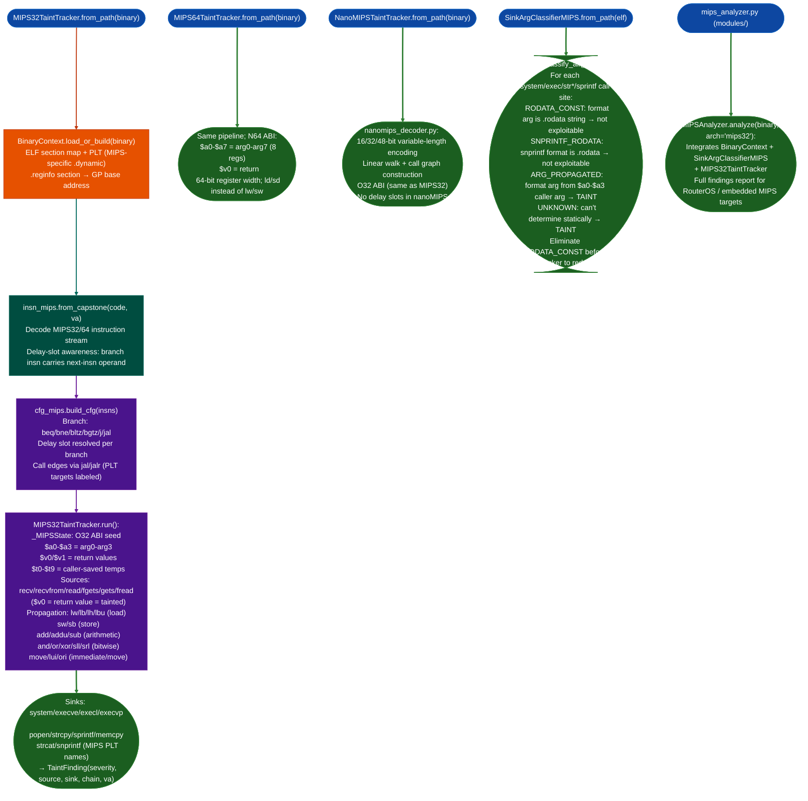

# MIPS32TaintTracker

  - [What is MIPS?](#what-is-mips)
    - [Register file](#register-file)
    - [Delay slots](#branch-and-load-delay-slots)
    - [Calling conventions](#calling-conventions)
    - [Big-endian vs. little-endian variants](#big-endian-vs-little-endian)
    - [MIPS-64 and nanoMIPS](#mips-64-and-nanomips)
    - [RE implications](#re-implications)
  - [Why this exists](#why-this-exists)
  - [How it works](#how-it-works)
  - [Usage](#usage)
  - [Example output](#example-output)
  - [False positives](#false-positives)
  - [Pipeline position](#pipeline-position)
  - [Reading findings](#reading-findings)
  - [See also](#see-also)

**Files:** `ablation/analyzers/taint_tracker_mips.py` · `ablation/analyzers/insn_mips.py` · `ablation/analyzers/isa_mips.py`

Interprocedural taint analysis for MIPS32 big-endian and little-endian firmware. Traces network-received data from `recv`/`fgets`/`read` source functions through MIPS register moves, arithmetic, memory loads, and across call boundaries to shell-execution sinks (`system`, `popen`, `execv`). Handles MIPS delay slots, `$gp`-relative GOT addressing, and o32/n32 stack-argument spill conventions. Supports Cisco IOS Classic (MIPSEB), RouterOS (MIPSEL), OpenWRT/LEDE (MIPSEL), and Broadcom/Atheros gateway firmware.

---

## What is MIPS? <sup>[↑](#mips32tainttracker)</sup>

MIPS (Microprocessor without Interlocked Pipeline Stages) is a RISC processor architecture developed at Stanford University by John Hennessy in 1981 and commercialized by MIPS Computer Systems (later MIPS Technologies, acquired by Wave Computing in 2018). The architecture is defined in four main specification series: MIPS I (1985), MIPS II (1990), MIPS III (1992, added 64-bit), MIPS IV (1994), and MIPS32/MIPS64 Release 1-6 (1999-2014). The architecture is notable for being the first commercial RISC processor and for introducing the concept of a delayed branch slot.

MIPS became dominant in embedded systems: Cisco routers, residential gateways, DSL modems, network switches, and set-top boxes shipped on MIPS hardware throughout the 1990s and 2000s. Qualcomm Atheros, Broadcom, Ralink/MediaTek, and Cavium all produced MIPS-based SoCs for networking hardware. MikroTik RouterOS still runs on MIPS. PlayStation, Nintendo 64, and Sony PSP used MIPS CPUs. SGI workstations ran MIPS/IRIX. As of 2024, the majority of currently-deployed embedded Linux devices in the 1-100 USD price range run MIPS firmware.

### Architecture generations and firmware targets <sup>[↑](#mips32tainttracker)</sup>

The MIPS architecture has evolved through several specification generations with distinct security implications:

**MIPS I (1985, R2000/R3000):** 32-bit, no caches beyond TLB. Load and branch delay slots. No floating-point in integer instruction set (separate FPU coprocessor). The Silicon Graphics workstations and early Cisco routers used this generation. R3000 was the PS1 CPU.

**MIPS II (1990, R6000):** Added 64-bit FPU instructions and SWL/SWR (unaligned store) instructions. Relevant for older Cisco 2500/3000 series routers.

**MIPS III (1992, R4000):** First 64-bit MIPS. Added 64-bit registers and 40-bit physical address space. The SGI Indigo/Challenge workstations and Cisco 7200 series used R4000. This is the generation most commonly found in `re/cisco/` targets. MIPS III is what Cisco IOS Classic runs on.

**MIPS IV (1994, R8000/R10000):** Added prefetch, indexed load/store, parallel FP operations. SGI Origin and Challenge servers.

**MIPS32 Release 1 (1999):** Formalized 32-bit subset with privileged instruction set (CP0), TLB management. Added MIPS16 (16-bit instruction compression). This is the dominant generation for consumer embedded hardware: Broadcom BCM47xx, Atheros AR7xxx/AR9xxx, MediaTek MT7xxx, Ralink RT2880/RT3883.

**MIPS32 Release 2 (2002):** Added hardware performance counters, shadow register sets, extended TLB (RI/XI bits). Cavium OCTEON uses MIPS64 Release 2 with proprietary extensions.

**MIPS32 Release 6 (2014):** Breaking changes — removed delay slots, changed branch semantics, added compact branches (`BC`, `BALC`, `BEQZC`, etc.). **Critical for taint tracker**: a MIPS Release 6 binary has no delay slots and the taint tracker must be version-aware. MIPS32R6 compact branches are identified by specific opcode encodings that differ from MIPS32R1/R2.

**nanoMIPS (2017):** Variable-length 16/32/48-bit encoding (see `nanomips.md`). Used in Imagination Technologies processors for IoT targets.

### Register file <sup>[↑](#mips32tainttracker)</sup>

MIPS defines 32 general-purpose 32-bit registers (64-bit in MIPS-64). Registers are conventionally named by the ABI alias rather than the architectural number:

| Register | Number | Convention |
|---|---|---|
| `$zero` / `$0` | r0 | Hard-wired zero. Reads always return 0; writes are discarded. |
| `$at` / `$1` | r1 | Assembler temporary. Used by assembler for pseudo-instructions like `la`. |
| `$v0–$v1` | r2–r3 | Function return values. Network entry points return socket FDs in `$v0`. |
| `$a0–$a3` | r4–r7 | Function arguments. First 4 arguments. Further args go on the stack. |
| `$t0–$t9` | r8–r15, r24–r25 | Caller-saved temporaries. Clobbered across calls. |
| `$s0–$s7` | r16–r23 | Callee-saved. Preserved across calls. Freed pointers move here for UAF tracking. |
| `$k0–$k1` | r26–r27 | Reserved for OS kernel / exception handler. Never seen in userspace code. |
| `$gp` / `$28` | r28 | Global pointer. Points to the middle of the `.got` section; used for PIC. |
| `$sp` / `$29` | r29 | Stack pointer. Grows downward. |
| `$fp` / `$30` | r30 | Frame pointer (or callee-saved `$s8` in non-frame-pointer conventions). |
| `$ra` / `$31` | r31 | Return address. Set by `JAL`/`JALR`. The target of the `JR $ra` return. |

Special registers: `HI` and `LO` hold the 64-bit result of `MULT`/`MULTU`/`DIV`/`DIVU`. They are not general-purpose and cannot be used as sink arguments without an intervening `MFLO`/`MFHI`. Taint on `LO` must be tracked separately when a size comes from a multiplication.

### Branch and load delay slots <sup>[↑](#mips32tainttracker)</sup>

MIPS has no branch prediction. To avoid a one-cycle bubble after every branch instruction, the architecture defines that the instruction in the "delay slot" immediately following every branch, jump, or call always executes before the branch takes effect. This is the single most important MIPS-specific RE detail:

```asm
beq   $t0, $zero, target   ; conditional branch
 addiu $a0, $s0, 0          ; DELAY SLOT: executes before the branch resolves
```

The instruction at `branch_va + 4` is the delay slot. It is NOT part of the next basic block: it belongs semantically to the branch instruction. A linear scanner that splits blocks at every branch will misattribute the delay slot instruction to the wrong basic block, dropping taint propagations that span the branch boundary.

Similarly, load delay slots (MIPS I only, removed in MIPS II): a load result is not available until one instruction after the load. Code targeting MIPS I inserts an explicit `NOP` or a useful instruction after every load before using the loaded value.

`MIPS32TaintTracker` handles delay slots by consuming the delay slot instruction as part of the branch instruction's taint propagation, not as an independent instruction in the next block.

### Calling conventions <sup>[↑](#mips32tainttracker)</sup>

MIPS has three calling conventions in common use across embedded targets:

**O32 (MIPS I/II 32-bit)**: The original 32-bit convention. Arguments go in `$a0–$a3`; additional arguments go on the stack at `$sp+16` (the "argument shadow" space is always reserved even for register arguments). Return values go in `$v0` (and `$v1` for 64-bit returns). Stack is 8-byte aligned. This is the convention on all Cisco, Netgear, Linksys, and most RouterOS targets.

**N32 / N64**: The newer 64-bit conventions. `$a0–$a7` (8 argument registers instead of 4). Used on MIPS-64 Linux systems (SGI IRIX, modern embedded Linux with 64-bit MIPS SoCs). The `MIPS64TaintTracker` handles this variant.

**EABI**: Embedded ABI. Used by bare-metal MIPS code on automotive and industrial targets. Reduces stack overhead by using more registers.

### Big-endian vs. little-endian <sup>[↑](#mips32tainttracker)</sup>

MIPS supports both endianness modes and the choice is a power-on configuration: the same silicon can run either way. This creates a practical RE problem: two firmware images from the same product line may have different byte ordering.

- **Big-endian (MIPSEB)**: Cisco IOS, older Netgear/Linksys consumer firmware, SGI IRIX. A 32-bit load from memory has the most significant byte at the lower address. Magic bytes at file offsets are in network byte order.
- **Little-endian (MIPSEL)**: MikroTik RouterOS (Atheros AR7xxx), MediaTek/Ralink-based consumer gear, PlayStation. Newer Cavium Octeon networking hardware can run either way.

The endianness affects how the taint tracker interprets multi-byte loads and stores: a `LW` (load word) on MIPSEB reads bytes in the reverse order from a `LW` on MIPSEL. Ablation's MIPS decoder sets endianness from the ELF `e_flags` field or from the BinaryContext platform detection result before any instruction decoding begins.

### MIPS-64 and nanoMIPS <sup>[↑](#mips32tainttracker)</sup>

MIPS-64 (introduced in MIPS III, 1992) extends the register file to 64-bit-wide registers while keeping the same 32-bit instruction encoding. Pointers are 64-bit; function arguments that are pointer-sized must be handled as 64-bit values. `MIPS64TaintTracker` handles MIPS-64 specifically.

**nanoMIPS** (MIPS Technologies, 2018) is a variable-width encoding where 16-bit and 32-bit instructions are interleaved: a 2-bit prefix determines instruction width. It was designed for microcontroller-class embedded targets where code density is critical. The dedicated `NanoMIPSTaintTracker` uses the variable-width decoder from `nanomips_decoder.py` to handle prefix-based instruction parsing before taint propagation.

### RE implications <sup>[↑](#mips32tainttracker)</sup>

**Identifying network entry points**: RouterOS and Cisco IOS embedded firmware receive network data via `recv()`, `recvfrom()`, `read()`, or custom socket wrappers. The return value in `$v0` is the byte count received; `$a0` on entry to the recv wrapper was the socket file descriptor. Taint both `$v0` (the count) and the buffer argument (`$a1` for `recv`) as network-sourced.

**Recognizing prologue/epilogue**: MIPS prologues save `$ra` to the stack (callee-saved) and save callee-saved `$s` registers. A typical prologue: `ADDIU $sp, $sp, -N; SW $ra, N-4($sp); SW $s0, N-8($sp)`. Epilogue: `LW $ra, N-4($sp); JR $ra` with a delay slot that is often the stack restore (`ADDIU $sp, $sp, N`).

**GOT and PIC code**: Position-independent MIPS code loads addresses through the Global Offset Table via `$gp`. The `$gp` value is set by a `_gp_disp` calculation at function entry. Any indirect call through a GOT slot (`LW $t9, offset($gp); JALR $t9`) may be a call to an imported function. The tracker resolves these via the PLT/GOT maps in `BinaryContext`.

## Why this exists <sup>[↑](#mips32tainttracker)</sup>

1. MIPS-32 big-endian is the dominant ISA for consumer routing firmware. Mikrotik RouterOS, older Cisco IOS images, and embedded HTTP/SNMP stacks ship as MIPS-32 BE ELF. The architecture's load-delay slot makes naive taint propagation incorrect: the instruction immediately after a branch executes before the branch takes effect, so a linear-order tracker produces false results for any register written in a delay slot. `MIPS32TaintTracker` processes delay slots as part of the preceding branch, matching the hardware execution model.

2. MIPS sink classification requires a platform-specific approach. `sprintf` argument position differs by ABI: MIPS32 O32 puts the format in `$a0`; MIPS64 N64 uses `$a0`-`$a7` for all arguments. RouterOS uses a custom allocator whose functions are not in the standard PLT. `SinkArgClassifierMIPS` extends the generic classifier with MIPS-specific argument register slots and RouterOS-specific allocation sink signatures.

3. nanoMIPS is a compressed ISA used in MIPS I7200 and P-class cores for code-density-optimized embedded targets. It is not MIPS16e; it requires a distinct decoder. `taint_tracker_nanomips.py` and `nanomips_decoder.py` provide the instruction model and taint analysis for nanoMIPS binaries, preventing misidentification of 16-bit opcodes as MIPS32 instructions.

---

## How it works <sup>[↑](#mips32tainttracker)</sup>



### Module inventory <sup>[↑](#mips32tainttracker)</sup>

| Module | Role |
|:---|:---|
| `taint_tracker_mips.py` | MIPS-32 labeled-taint tracker; delay-slot-aware; O32 ABI; RouterOS targets |
| `taint_tracker_mips64.py` | MIPS-64 labeled-taint tracker; N64 ABI |
| `taint_tracker_mips_labeled.py` | TCL3-qualified labeled-taint variant; used in coverage gate scope |
| `taint_tracker_nanomips.py` | nanoMIPS labeled-taint tracker; 16/32/48-bit variable-length encoding |
| `insn_mips.py` | MIPS-32/64 instruction decoder with delay-slot model |
| `cfg_mips.py` | MIPS CFG builder: branch/delay-slot edges, JAL/JALR calls |
| `isa_mips.py` | ISA constant tables: register names, ABI modes, calling convention |
| `analysis_mips.py` | CFG fixpoint analysis for labeled taint |
| `nanomips_decoder.py` | nanoMIPS binary decoder: variable-length instruction parsing |
| `sink_arg_classifier_mips.py` | MIPS-specific sink argument classification RODATA_CONST / ARG_PROPAGATED / UNKNOWN |
| `modules/mips_analyzer.py` | Module-level orchestrator for MIPS firmware RE targets |

---

## Usage <sup>[↑](#mips32tainttracker)</sup>

```python
from ablation.analyzers.taint_tracker_mips import MIPS32TaintTracker

# MIPS32TaintTracker
tracker = MIPS32TaintTracker.from_path('/path/to/mips32.elf')
findings = tracker.run()
for f in findings:
    print(f"{f.source_name} → {f.sink_name} @ {f.sink_va:#x}")

# MIPS32TaintTracker
chains = tracker.run_interprocedural(depth=4)

# MIPS32TaintTracker
from ablation.analyzers.taint_tracker_mips64 import MIPS64TaintTracker
tracker64 = MIPS64TaintTracker.from_path('/path/to/mips64.elf')
findings = tracker64.run()

# MIPS32TaintTracker
from ablation.analyzers.sink_arg_classifier_mips import SinkArgClassifierMIPS
clf = SinkArgClassifierMIPS.from_path('/path/to/mips32.elf')
classified = clf.classify_all()
# MIPS32TaintTracker
for va, classification in classified.items():
    if classification not in ('RODATA_CONST', 'SNPRINTF_RODATA'):
        print(f"{va:#x}: {classification} - run taint tracker")

# MIPS32TaintTracker
from ablation.analyzers.binary_lifter import BinaryLifter
lifter = BinaryLifter.from_path('/path/to/mips32.elf', arch='mips32')
print(lifter.lift_function(0x400a00))

# MIPS32TaintTracker
lifter_el = BinaryLifter.from_path('/path/to/mipsel.elf', arch='mips32el')
print(lifter_el.lift_function(0x400a00))
```

---

## Example output <sup>[↑](#mips32tainttracker)</sup>

The following illustrates the format for representative taint findings. Actual function names, addresses, and call chains reflect the specific binary.

```
[CRITICAL] recv → system @ <va>
  Chain: recv($v0) → lw $a0, sp+0x1c → jal system
  Taint: $v0 (recv return, unbound)
  Sink: system - shell injection via unvalidated recv buffer

[HIGH] fgets → sprintf @ <va>
  Chain: fgets($v0) → move $a1, $v0 → jal sprintf($a0=<fmt>, $a1=<tainted>)
  Taint: $v0 (fgets input), $a1 propagated
  Sink: sprintf argument-1 - format-string or buffer overflow candidate

SinkArgClassifier:
  <va>: RODATA_CONST (format from .rodata - not a finding)
  <va>: ARG_PROPAGATED ($a0 from caller) - run taint tracker
  <va>: UNKNOWN - run taint tracker
```

---

## False positives <sup>[↑](#mips32tainttracker)</sup>

**MIPS delay slots in tainted branches produce apparent taint flows that are not real.** When a branch instruction `beq $t0, $zero, target` has a tainted register in the condition, the delay slot's instruction executes regardless of branch direction. A taint sink in the delay slot appears to execute on both branch paths, but it only executes once before the branch takes effect. The tracker models this correctly, but output that shows the delay slot instruction as a taint step may be confusing, it is the branch pre-condition, not a conditional write.

**`SinkArgClassifierMIPS` marks RouterOS custom allocator calls as `UNKNOWN` because they are not in the standard PLT.** RouterOS uses `fast_malloc`/`fast_free` family functions that are not exported or present in standard glibc PLT slots. `SinkArgClassifier` cannot determine their argument positions and marks them `UNKNOWN`. Run `SemanticSearcher.query("allocation function MIPS")` to identify them before classification.

---

## MIPS PLT/GOT and dynamic linking model <sup>[↑](#mips32tainttracker)</sup>

Position-independent MIPS code uses the Global Offset Table (GOT) for all external symbol references. Unlike x86 PLT stubs (which use a single `JMP [GOT]` instruction), MIPS PLT stubs use a four-instruction sequence:

```mips
# MIPS PLT stub for printf (PIC ABI)
lui    $t9, %hi(%got_page(printf))   # load high 16 bits of GOT page
addiu  $t9, $t9, %lo(%got_ofst(printf))  # add low 16 bits
lw     $t9, 0($t9)                   # load function pointer from GOT
jr     $t9                           # indirect call
nop                                  # delay slot
```

The `$t9` convention is critical for MIPS RE. The MIPS o32 and n32 ABIs require that the callee receive its own function address in `$t9` on entry (the "PIC function entry point"). This allows the callee to set up `$gp` relative to its own address:

```mips
# Callee prologue for PIC function
.cpload $t9    # = lui $gp, ...; addiu $gp, $gp, ...; addu $gp, $gp, $t9
addiu  $sp, $sp, -32
sw     $ra, 28($sp)
sw     $gp, 24($sp)
```

`MIPS32TaintTracker` recognizes `.cpload $t9` prologue patterns to identify function entry points and avoid treating the `$gp` setup instructions as taint sources.

**`JALR $t9`** is the indirect call form. When `$t9` is loaded from a GOT entry (via `lw $t9, offset($gp)`), it is an external library call. When `$t9` is loaded from a function pointer in memory or a register result, it is a dynamic dispatch that the tracker cannot resolve statically without `IPRegAnnotator`.

---

## MIPS ABI: stack frame layout <sup>[↑](#mips32tainttracker)</sup>

The MIPS o32 ABI defines a specific stack frame layout that the taint tracker uses to model argument passing beyond the four register arguments:

```
High address
  ┌─────────────────────────────┐
  │ argument 5 (if any)         │  ← $sp + 16 (as seen by callee)
  │ argument 6 (if any)         │  ← $sp + 20
  │ ...                          │
  ├─────────────────────────────┤  ← original $sp (before prologue)
  │ saved $ra                   │  ← $sp + (framesize - 4)
  │ saved $gp (PIC)             │
  │ saved $fp (if used)         │
  │ local variables              │
  │ argument build area (16B)   │  ← $sp + 0 through $sp + 12
  └─────────────────────────────┘
Low address ($sp after prologue)
```

The "argument build area" (16 bytes at the bottom of every frame) is always reserved, even if the function only uses register arguments. It provides space for callees to spill the first four arguments if needed (required by o32 ABI: callees may spill `$a0`–`$a3` at any time for `va_list` functions like `printf`). This area is a common taint propagation path: a source value arrives in `$a1`, gets spilled to `$sp+4`, then re-loaded by the callee as its second argument.

The tracker models `SW $a0, 0($sp)` as a stack write of the value in `$a0`, and `LW $a0, 0($sp)` as a stack read that may propagate taint from a previous write at the same offset.

---

## Usage: full MIPS firmware scan workflow <sup>[↑](#mips32tainttracker)</sup>

```python
from ablation.analyzers.binary_context import BinaryContext
from ablation.analyzers.semantic_searcher import SemanticSearcher
from ablation.analyzers.sink_arg_classifier import SinkArgClassifierMIPS
from ablation.analyzers.taint_tracker_mips import MIPS32TaintTracker
from ablation.analyzers.finding_registry import FindingRegistry

# 1. Load binary
ctx = BinaryContext.load_or_build('/firmware/extract/usr/sbin/httpd')
print(ctx.summary())

# 2. Semantic sweep — find candidates before manual disasm
ss = SemanticSearcher.from_context(ctx)
candidates = ss.query("command injection via network input", top_k=20)
for fn in candidates:
    print(f"  {ctx.name(fn.va)}: score={fn.score:.2f}")

# 3. Classify all shell sink call sites
classifier = SinkArgClassifierMIPS.from_context(ctx)
all_sites = classifier.classify_all()
work_sites = [s for s in all_sites if s.classification in ('ARG_PROPAGATED', 'UNKNOWN')]
print(f"  {len(work_sites)}/{len(all_sites)} sites need taint analysis")

# 4. Run MIPS32 taint tracker on work sites
tracker = MIPS32TaintTracker.from_context(ctx)
findings = tracker.scan(sink_sites=work_sites)

# 5. Byte-verify and register findings
reg = FindingRegistry()
for f in findings:
    data = open(ctx.binary_path, 'rb').read()
    off = f.sink_va - ctx.base
    # Verify: JAL/JALR instruction at sink_va
    word = int.from_bytes(data[off:off+4], 'big' if ctx.is_big_endian else 'little')
    assert (word >> 26) in (0x03, 0x00), f"Not a JAL/JALR at {f.sink_va:#x}"
    ctx.set_name(f.sink_va, f"sink_{f.sink_name}_{f.sink_va:08x}", source="confirmed")
    reg.register(f)
    print(f"[{f.severity}] {f.sink_name} @ {f.sink_va:#x}: {f.source_name} → arg{f.tainted_args}")
```

---

## Pipeline position <sup>[↑](#mips32tainttracker)</sup>

**Before this module:** Run `SinkArgClassifierMIPS.classify_all()` to eliminate `RODATA_CONST` and `SNPRINTF_RODATA` sites, this typically reduces TaintTracker input by 40-60% on firmware binaries. For little-endian MIPS (mipsel), specify `arch='mips32el'` or `arch='mips64el'` in `BinaryLifter.from_path()`.

**After this module:** Feed confirmed findings into `FindingRegistry.register()` and write them to `re/<vendor>/<target>_re.py`.

**Confirming a MIPS taint finding (byte-verification protocol):**

The MIPS JAL instruction at the sink call site must be byte-verified before reporting. A JAL instruction has the form `0000 11tt tttt tttt tttt tttt tttt tttt` in big-endian binary (6-bit opcode 0x03 at bits [31:26]). For little-endian MIPS, the bytes are reversed. The JALR instruction is R-type with funct=0x09.

```python
data = open(binary_path, 'rb').read()
off = sink_va - base

# Big-endian MIPS (Cisco IOS Classic)
word = int.from_bytes(data[off:off+4], 'big')
opcode = word >> 26
if opcode == 0x03:
    print("JAL confirmed")
elif opcode == 0x00 and (word & 0x3f) == 0x09:
    print("JALR confirmed")
else:
    print(f"NOT a call instruction: opcode={opcode:#x}")

# Little-endian MIPS (RouterOS, OpenWRT)
word_le = int.from_bytes(data[off:off+4], 'little')
opcode_le = word_le >> 26
```

For finding registration, use the sink VA (the JAL instruction address, not the callee entry point) as the finding's `va` field. The sink function name (e.g., `'system'`, `'sprintf'`) goes in the `sink` field. The source function name (`'recv'`, `'fgets'`) goes in `source`.

**MIPS-specific finding fields in `FindingRegistry`:**
- `arch`: `'mips32be'` or `'mips32le'` or `'mips64be'`
- `sink_va`: VA of the JAL/JALR instruction
- `sink_arg`: 0-indexed argument register that is tainted (0 = `$a0`, 1 = `$a1`, etc.)
- `source`: taint source function label
- `delay_slot_va`: VA of the delay slot instruction (sink_va + 4); always present for MIPS32R1/R2, always None for MIPS32R6 compact branches

---

## Reading findings <sup>[↑](#mips32tainttracker)</sup>

`MIPS32TaintTracker.from_context(ctx).scan()` returns `List[TaintFinding32Mips]`.

| Field | Type | Content |
|:---|:---|:---|
| `binary` | `str` | Binary path |
| `func_va` | `int` | VA of the function containing the sink call |
| `func_name` | `str` | Name of the function (from `ctx`) |
| `sink_va` | `int` | VA of the sink call instruction |
| `sink_name` | `str` | Sink function name for example `system`, `sprintf` |
| `tainted_args` | `List[int]` | 0-indexed argument positions that are tainted at the call |
| `source_name` | `str` | Taint source label for example `recv`, `read` |

---

## MIPS instruction encoding reference <sup>[↑](#mips32tainttracker)</sup>

MIPS32 uses a fixed 32-bit instruction encoding in three formats:

**R-type (register operands):**
```
 31    26 25  21 20  16 15  11 10   6 5      0
[  op=0  ][ rs  ][ rt  ][ rd  ][shamt][ funct ]
   6-bit    5      5      5      5       6
```
`ADD rd, rs, rt` → op=0, funct=0x20. `JR rs` → op=0, funct=0x08.

**I-type (immediate operands):**
```
 31    26 25  21 20  16 15             0
[  op   ][ rs  ][ rt  ][   imm16       ]
   6-bit    5      5         16
```
`LW rt, imm(rs)` → op=0x23. `BEQ rs, rt, offset` → op=0x04.

**J-type (jump):**
```
 31    26 25                          0
[  op   ][        target26             ]
   6-bit               26
```
`J target` → op=0x02. `JAL target` → op=0x03.

Security-critical encodings:
- `JAL 0x00000000` with resolved PLT target → call to imported function. The JAL target is `(PC & 0xF0000000) | (target26 << 2)`.
- `JALR $t9` (op=0, rs=t9=25, rd=ra=31, funct=0x09) → indirect call via $t9. Taint source if $t9 came from network input.
- `LW $a0, offset($sp)` → load function argument from stack frame. Taint propagation across `JAL` uses this to recover passed-back values.

---

## MIPS SoC variants and firmware fingerprinting <sup>[↑](#mips32tainttracker)</sup>

Embedded Linux firmware running on MIPS has SoC-specific characteristics that affect RE:

**Cisco IOS (Classic):** MIPS32 big-endian. Monolithic binary: no shared libraries, no dynamic linker. All system calls go through Cisco's internal kernel abstraction layer (KAL) rather than Linux syscalls. No PLT: all calls are direct or via function pointer tables. Cisco IOS firmware is identified by the string `"IOS (tm)"` at the start of the decompressed image.

**Cisco IOS-XE:** MIPS64 big-endian or x86-64. Uses a microkernel (`iosd`) with Linux userspace. Has shared libraries and standard PLT. The `iosd` binary is the main target: it handles CLI parsing, SNMP, and REST API.

**MikroTik RouterOS:** MIPS32 little-endian (mipsel). Uses a modified Linux kernel with proprietary userspace. The `nova` binary implements the management plane. RouterOS uses custom memory allocation (`fast_malloc`, `fast_free`) that is not in the standard PLT.

**OpenWRT / LEDE:** Standard Linux userspace with uClibc or musl libc. PLT/GOT-based dynamic linking. Standard MIPS32 little-endian. `busybox` is the primary user binary; router-specific daemons (`netifd`, `hostapd`, `uhttpd`) are the security-relevant targets.

**Broadcom CFE (Common Firmware Environment):** MIPS32 big-endian. Bootloader for Broadcom ADSL/cable gateways. CFE is the first executed code: vulnerabilities here enable pre-boot persistence. The CFE binary is typically at offset 0x10000 in the flash image.

**Cavium OCTEON:** MIPS64 big-endian, 8–48 hardware cores. Used in Cisco ASR, Juniper MX, and F5 BIG-IP line cards. The OCTEON SDK provides parallel processing APIs that complicate linear taint analysis.

---

## MIPS taint tracker architecture <sup>[↑](#mips32tainttracker)</sup>

`MIPS32TaintTracker` implements interprocedural BFS taint propagation specific to the MIPS32 register model:

**Taint state:** A `TaintStateMIPS` object tracks which of the 32 MIPS general-purpose registers (`$zero`–`$ra`) are tainted, plus tainted memory offsets relative to `$sp` (stack frame slots). `$zero` is never tainted (hardwired to 0 in hardware).

**Source labeling:** Each taint source (recv, read, fgets, gets, sscanf with external argument) is labeled with the source function name and the register it populates on return (`$v0` by convention). The label propagates through data moves and arithmetic.

**Delay slot handling:** The tracker explicitly models delay slot execution order. For `JAL target; NOP` (the common delay slot pattern), the NOP executes before the call takes effect. For `JAL target; SW $t0, 0($sp)` (a store in the delay slot), the store executes before the callee runs, potentially setting up the stack frame. Tainted stores in delay slots are tracked.

**Cross-call propagation:** When the taint tracker encounters a `JAL`/`JALR` call with tainted argument registers (`$a0`–`$a3`), it follows the call into the callee function's taint state. It returns the callee's output taint state (which registers are tainted on return) to the caller's BFS. This interprocedural step runs to a configurable depth (default: 5 call levels).

---

## False positives (continued) <sup>[↑](#mips32tainttracker)</sup>

**`$v0` contains syscall return values as well as return values from C functions.** A `SYSCALL` instruction writes the syscall result to `$v0`. If the code reads `$v0` after a syscall and the tracker is not syscall-aware, it may propagate a tainted `$v0` from a network-read syscall (SYS_recvfrom = 4176) into a subsequent function call. `MIPS32TaintTracker` marks `$v0` as tainted after `SYS_recvfrom`, `SYS_recv`, `SYS_read`, and `SYS_readv` syscalls.

**`$gp` is a global pointer, not taintable.** MIPS32 PIC code uses `$gp` (register 28) to address the global offset table. `LW $t0, offset($gp)` loads a GOT entry. The tracker never taints `$gp`: a `LW $a0, offset($gp)` does not propagate taint from `$gp` to `$a0`, since `$gp` holds a table address, not user-controlled data.

---

## See also <sup>[↑](#mips32tainttracker)</sup>

- [Binary Lifter](binary-lifter.md): `arch='mips32'`/`'mips64'`/`'nanomips'` structural lifting
- [Sink Arg Classifier](sink-arg-classifier.md): generic sink classification; MIPS variant extends it
- [Taint Analysis](taint-analysis.md): labeled-taint model and CFG fixpoint analysis
- [MIPS Analyzer](mips-analyzer.md): module-level orchestrator for MIPS firmware RE
- [NanoMIPS](nanomips.md): variable-length compressed instruction encoding for space-constrained MIPS targets
- [Length Underflow Scanner](length-underflow.md): pairs with MIPS taint tracking for header-subtraction underflow in MIPS networking code
- [Semantic Code Search](semantic-code-search.md): initial candidate identification before running `MIPS32TaintTracker` on specific functions
- [PPC32 Taint Tracker](ppc32-taint-tracker.md): equivalent for PowerPC 32-bit firmware; compare delay-slot vs. no-delay-slot models
- [RISC-V Taint Tracker](risc-v.md): equivalent for RISC-V firmware; clean basic blocks (no delay slots)
- [IPReg Annotator](ipreg-annotator.md): resolve indirect calls through function pointer tables in MIPS firmware before running taint tracker
- [Path Solver](taint-analysis.md): CFG feasibility solver for confirming MIPS taint paths that pass through conditional branches
- [Window Analyzer](window-analyzer.md): manual MIPS disassembly with delay-slot-aware annotation when automated tools cannot handle the sink

**MIPS taint tracker version awareness checklist:**
- Check MIPS release version (R1/R2 vs R6) from ELF header or binary heuristics before scanning
- For MIPS32R6: disable delay slot modeling, enable compact branch detection
- For MIPS64: use `MIPS64TaintTracker` (not `MIPS32TaintTracker`): 64-bit registers, 8-byte load/store widths
- For nanoMIPS: use `NanoMIPSTaintTracker` from `nanomips.md`
- For Cavium OCTEON extensions (`DMULT`, `DPOP`, `EXTS`, etc.): the tracker skips unknown opcodes with a warning; manual review required at the skipped sites
