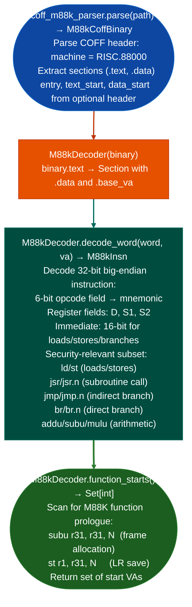

<a id="motorola-88000--bcs-coff-analysis"></a>
# Legacy Binary Formats

Decode Motorola 88000 (M88K) binaries: identifying `RISC.88000` architecture COFF containers, disassembling M88K instructions, and providing function start discovery for taint analysis of legacy Motorola 88000 firmware targets including NeXT workstations, early Motorola embedded platforms, and HP-UX systems that used the M88K processor.

---

## Why this exists

1. **Capstone does not support the Motorola 88000 ISA.** The M88K is a pure RISC architecture used in NeXT workstations (NeXTSTEP on M88K), early Motorola embedded platforms, and HP-UX installations prior to the transition to PA-RISC. Without `insn_m88k.py`/`isa_m88k.py`, M88K firmware cannot be disassembled by any existing tool in the pipeline.

2. **M88K COFF BCS Binary Compatibility Standard containers** use the `RISC.88000` magic identifier in the COFF header's optional machine type field. `isa_m88k.py` parses BCS COFF to extract code sections and determine the base address for disassembly. This is the entry point for M88K firmware analysis without a full RE platform.

3. M88K uses a fixed 32-bit instruction width with a pure RISC encoding: all instructions are 4 bytes, big-endian, with a 6-bit opcode field and distinct register encoding for 3-operand, immediate, and branch forms. The fixed width makes sequential disassembly reliable; `InsnM88K` provides the security-relevant subset loads, stores, branches, and arithmetic needed for taint analysis.

---

## How it works



---

## Usage

```python
from ablation.core.coff_m88k_parser import parse as parse_m88k
from ablation.analyzers.insn_m88k import M88kDecoder

binary = parse_m88k('/path/to/next_firmware.coff')
decoder = M88kDecoder(binary)

starts = sorted(decoder.function_starts())
print(f"Found {len(starts)} M88K functions")

# Decode a range starting at the first function
text = binary.text
for va in range(starts[0], starts[0] + 40, 4):
    word = int.from_bytes(text.read_bytes(va, 4), 'big')
    insn = decoder.decode_word(word, va)
    print(f"  {va:#x}: {insn.mnemonic} {insn.op_str}")
```

---

## Example output

The following illustrates M88K decoding output format. Actual addresses are binary-specific.

```
parse_m88k('next_firmware.coff') → M88kCoffBinary

arch: ppc32  machine: RISC.88000
.text: <N> bytes at base_va=<va>

M88kDecoder.function_starts(): <F> M88K functions

Disassembly at <va>:
  <va>: subu  r31, r31, 0x20   ; frame alloc
  <va>: st    r1, r31, 0x1c    ; LR save
  <va>: jsr   r10              ; indirect call
```

---

## False positives

**`function_starts()` heuristic is based on `subu r31, r31, N` + `st r1, r31, N` prologue**: leaf functions that do not save LR are not detected. The function start list is a lower bound; supplement with call-graph reachability from detected starts.

**M88K `jsr.n` delayed branch includes a delay slot instruction**: the instruction following `jsr.n` executes before the branch takes effect. `M88kInsn` has `is_call=True` for `jsr.n` but does not automatically consume the delay slot. Callers must skip one instruction after a `jsr.n` to maintain correct sequential decode.

---

## Pipeline position

Run M88K analysis on any BCS COFF firmware binary confirmed to use the M88K architecture. Function starts feed `TaintTracker`-equivalent analysis using the same source/sink model: porting to M88K ABI r2–r9 argument registers is required for full taint analysis.

---

## Reading output

`M88kDecoder(binary).function_starts()` returns `Set[int]`: VA set of identified M88K function entry points.

`M88kDecoder(binary).decode_wordword, va` returns an `M88kInsn`:

| Attribute | Content |
|:---|:---|
| `address` | Virtual address of the instruction |
| `mnemonic` | M88100 mnemonic for example `'subu'`, `'st'`, `'jsr'` |
| `op_str` | Operand string |
| `raw` | 32-bit big-endian instruction word |
| `is_branch` | `True` if this is a branch instruction |
| `is_call` | `True` if this is a subroutine call (`jsr`/`bsr`) |
| `is_return` | `True` if this is a return (`jmp r1`) |
| `branch_target` | Target VA for branches/calls, or `None` |

---

## See also

- [Flat ROM Function Discovery](flat-rom-function-discovery.md): `EcuArchDetector` for architecture identification before M88K-specific analysis
- [M68K CPU32 Decoding](m68k-cpu32-decoding.md): Motorola M68K equivalent different architecture family
