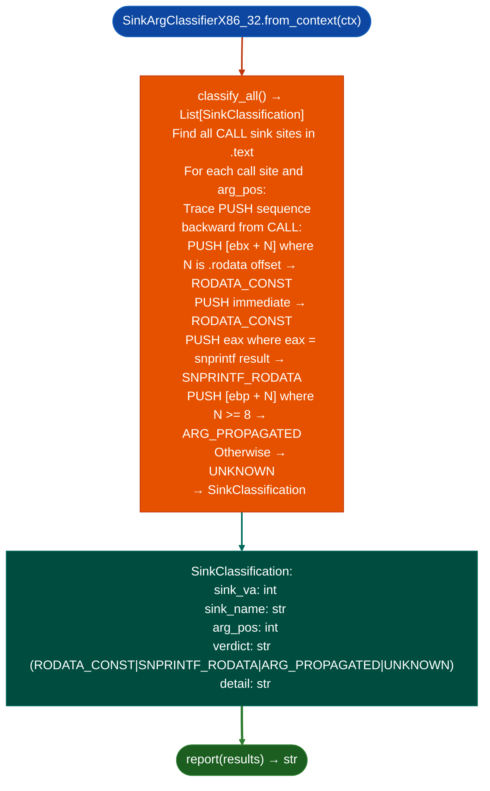

# x86-32 Sink Argument Classification

Classify exec-class sink argument provenance in x86-32 ELF and PE binaries: producing the four-verdict model `RODATA_CONST`, `SNPRINTF_RODATA`, `ARG_PROPAGATED`, `UNKNOWN` for x86-32 cdecl stack arguments: filling the gap documented as `RMC-GAP-002` / `COMMSVR-GAP-004` / `HACMP-GAP-001`.

---

## Why this exists

1. **`SinkArgClassifier` hardcodes x86-64 registers `rdi`, `rsi`, `rdx`.** x86-32 cdecl passes all arguments on the stack via `PUSH` before the `CALL`, not in registers. Running `SinkArgClassifier` on x86-32 targets produced `UNKNOWN` for all sinks. `SinkArgClassifierX86_32` resolves `RMC-GAP-002` RSM/COMMSVR, `COMMSVR-GAP-004`, and `HACMP-GAP-001`.

2. x86-32 cdecl stack argument classification looks for `PUSH` sequences before each `CALL`: the last `PUSH` before a `CALL sink_func` is argument `arg0`, the second-to-last is `arg1`, and so on. For each `PUSH`, the source operand is traced backward to its definition: `.rodata`-relative address `LEA eax, [ebx+N]` → `RODATA_CONST`; `MOV eax, [ebp+N]` positive offset from frame pointer → `ARG_PROPAGATED`.

3. `EBP+N` positive offset from frame pointer indicates a function argument: x86-32 cdecl callee accesses its arguments at `[EBP+8]`, `[EBP+12]`, etc. A `PUSH [EBP+N]` where N ≥ 8 is therefore `ARG_PROPAGATED`. This is structurally different from x86-64 where arguments are in `rdi`/`rsi`/`rdx` and `ARG_PROPAGATED` is detected by tracing register assignments.

---

## How it works



---

## Usage

```python
from ablation.analyzers.sink_arg_classifier_x86_32 import SinkArgClassifierX86_32
from ablation.analyzers.binary_context import BinaryContext

ctx = BinaryContext.load_or_build('/path/to/x86_32_target.so')
classifier = SinkArgClassifierX86_32.from_context(ctx)

results = classifier.classify_all()
print(classifier.report(results))

# Pre-filter for TaintTracker
taint_targets = [r for r in results if r.verdict in ('ARG_PROPAGATED', 'UNKNOWN')]
print(f"TaintTracker targets: {len(taint_targets)}")
```

---

## Example output

The following illustrates x86-32 sink argument classification output format. Actual addresses are binary-specific.

```
SinkArgClassifierX86_32: x86_32_target.so

[RODATA_CONST]  system at <va>  arg0=PUSH [ebx+N] → .rodata  (not a finding)
[ARG_PROPAGATED] system at <va>  arg0=PUSH [ebp+8] → function arg  (→ TaintTracker)
[UNKNOWN]        execv at <va>   arg0=provenance not resolved

Pre-filter: <R> RODATA_CONST eliminated  <T> sent to TaintTracker
```

---

## False positives

**`[EBP+N]` interpretation assumes standard cdecl frame**: a function that uses a non-standard frame for example `__fastcall` which passes first two args in `ecx`/`edx` will produce incorrect `ARG_PROPAGATED` classifications. Verify that the calling convention is cdecl before trusting `ARG_PROPAGATED` verdicts.

**`ebx` GOT-base pointer recognition**: on x86-32 PIC `.so` files, `ebx` holds the GOT base. `PUSH [ebx+N]` is a GOT-relative load. If `N` points to a `.rodata` symbol, the verdict is `RODATA_CONST`; if `N` points to a `.data` or `.bss` symbol, the verdict may be misclassified. The classifier uses ELF section range checks to distinguish `.rodata` from `.data` accesses.

---

## Pipeline position

Run `SinkArgClassifierX86_32.classify_all()` on every x86-32 ELF or PE binary before running `TaintTracker`. This pre-filtering step eliminates constant-argument sinks and focuses taint analysis on user-controlled arguments only.

---

## Reading output

`SinkArgClassifierX86_32.classify_all()` returns a list of `SinkClassification` objects:

| Attribute | Content |
|:---|:---|
| `sink_name` | Sink function name |
| `arg_pos` | 0-indexed argument position being classified |
| `func_va` | VA of the calling function |
| `call_va` | VA of the call instruction |
| `verdict` | `'RODATA_CONST'`, `'ARG_PROPAGATED'`, or `'UNKNOWN'` |
| `detail` | Human-readable trace of how the argument was loaded for example `PUSH [ebp+N]` stack arg |
| `severity` | `'HIGH'` ARG_PROPAGATED, `'MEDIUM'` (UNKNOWN), or `'LOW'` RODATA_CONST |

---

## See also

- [Exec-Class Sink Argument Classification](sink-argument-classifier.md): `SinkArgClassifier` x86-64 equivalent
- [ARM32 Sink Argument Classification](lightweight-arm32-symbolic-execution.md): `SinkArgClassifierARM32` ARM32 AAPCS equivalent
