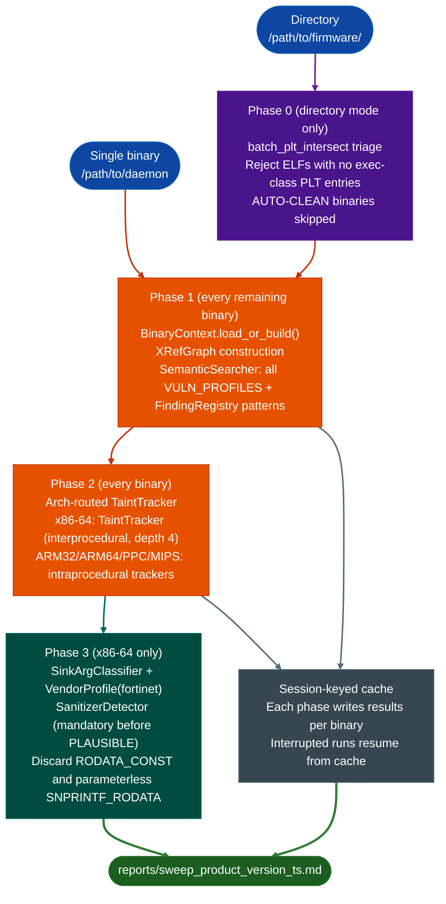

# Multi-Phase Vulnerability Sweeps

Run all registered vulnerability profiles across a binary or directory using a four-phase pipeline that combines pre-filtering, semantic search, multi-architecture taint analysis, and sink argument classification. The Fortinet-specific driver (`fortinet_sweep.py`) covers eight vulnerability profiles across x86-64, ARM32, ARM64, PPC, and MIPS targets. The generic driver (`base_sweep.py`) provides the single-binary template for adapting to other targets. Each phase writes to a session-keyed cache so interrupted runs resume without reprocessing completed binaries.

---

## Why this exists

1. **Taint analysis is expensive: running it on every function in a firmware image wastes time on functions that cannot reach a dangerous sink.** Phase 0 directory triage eliminates entire binaries that have no exec-class PLT entries. Phase 1 semantic search identifies the top candidates per vulnerability class. Phase 2 taint runs only on those candidates. This ordering cuts analysis time by 60-80% on firmware images where most binaries are data-only or utility code.

2. **Different CPU architectures have different calling conventions, stack layouts, and register semantics, so a single taint tracker produces wrong results on mixed-arch firmware.** The pipeline detects architecture from the ELF header and routes each binary to the correct tracker: `TaintTracker` for x86-64, `ARM32TaintTracker` for ARM32, `ARM64TaintTracker` for ARM64, `PPC32TaintTracker` / `PPC64TaintTracker` for PowerPC, and `MIPSTaintTracker` for MIPS. Binaries with unsupported architectures are skipped with a note in the report.

3. **Sink argument classification prevents false positives before any finding is recorded.** After taint analysis, `SinkArgClassifier` classifies each exec-class sink call site as `RODATA_CONST`, `SNPRINTF_RODATA`, `ARG_PROPAGATED`, or `UNKNOWN`. Only `ARG_PROPAGATED` and `UNKNOWN` sites proceed to reporting. `RODATA_CONST` sites, where the format string is a compile-time constant, are discarded without recording a finding.

4. **Prior confirmed findings from the `FindingRegistry` automatically replay on new binaries.** Phase 1 queries the `FindingRegistry` for all previously confirmed patterns and runs them alongside the standard VULN_PROFILES. A pattern confirmed on one FortiWeb version automatically scans all subsequent FortiWeb binaries in the same sweep run.

---

## How it works



---

## Vulnerability profiles

Both drivers use the same eight base profiles. `fortinet_sweep.py` adds FortiOS-specific profiles on top.

| Profile key | Dangerous sinks | Vulnerability class |
|:---|:---|:---|
| `unsafe_memcpy` | `memcpy` | Length from packet data without upper-bound check |
| `strcpy_overflow` | `strcpy` | User-controlled string into fixed-size buffer |
| `int_overflow` | `malloc`, `calloc` | Integer overflow in size arithmetic before allocation |
| `double_free` | `free` | Double free or use-after-free |
| `format_string` | `printf`, `sprintf`, `fprintf` | User-controlled format argument |
| `recv_overflow` | `recv`, `recvfrom`, `recvmsg`, `read` | Network recv into stack buffer without bounds check |
| `heap_spray` | `malloc`, `realloc` | Allocation size from untrusted input |
| `cmd_injection` | `system`, `popen`, `execve`, `execl` | Command built from user input via `snprintf`/`sprintf` |

---

## Architecture routing (Phase 2)

| Architecture | Tracker class | Scope |
|:---|:---|:---|
| x86-64 | `TaintTracker` | Interprocedural, depth 4 |
| ARM32 | `ARM32TaintTracker` | Intraprocedural |
| ARM64 | `ARM64TaintTracker` | Intraprocedural, requires bounds |
| PPC32 | `PPC32TaintTracker` | Intraprocedural |
| PPC64 | `PPC64TaintTracker` | Intraprocedural |
| MIPS32/64 | `MIPSTaintTracker` | Intraprocedural |
| Other | (skipped) | Note written to report |

---

## Usage

### Fortinet driver (directory or single binary)

```python
# Directory scan
python3 sweeps/fortinet_sweep.py /tmp/fwb743/ --product fortiweb --version 7.4.3

# Single binary
python3 sweeps/fortinet_sweep.py /tmp/fwb743/httpsd --product fortiweb --version 7.4.3
```

Output: `reports/sweep_fortinet_fortiweb_7.4.3_<timestamp>.md`

### Generic base driver (single binary, adapt for new targets)

```python
python3 sweeps/base_sweep.py /path/to/target_binary
```

Customize `VULN_PROFILES` in `base_sweep.py` for the target binary's threat model. Add PLT entries specific to the binary using `objdump -d` to find PLT addresses.

### Programmatic (Phase 1 + Phase 2 inline)

```python
from ablation.analyzers.binary_context import BinaryContext
from ablation.analyzers.semantic_search import SemanticSearcher
from ablation.analyzers.taint_tracker_x86 import TaintTracker
from ablation.analyzers.sink_arg_classifier import SinkArgClassifier

ctx = BinaryContext.load_or_build('/path/to/daemon')
searcher = SemanticSearcher.from_context(ctx)

# Phase 1: semantic sweep across all VULN_PROFILES
results = {}
for key, query in VULN_PROFILES:
    hits = searcher.query(query, top_k=20)
    results[key] = hits

# Phase 2: taint on top candidates (x86-64 path)
tracker = TaintTracker.from_context(ctx)
for key, hits in results.items():
    for hit in hits[:5]:
        paths = tracker.trace(hit.va, depth=4)
        # ...

# Phase 3: classify sink call sites before recording
classifier = SinkArgClassifier.from_context(ctx)
classifications = classifier.classify_all()
for site in classifications:
    if site.classification in ('ARG_PROPAGATED', 'UNKNOWN'):
        # record finding
        pass
```

---

## Example output

```
sweep_fortinet_fortiweb_7.4.3_20261025_144200.md

## Phase 0 triage
  Scanned: 847 ELF files
  Skipped (no exec sinks):  821
  Queued for analysis:       26

## Phase 1 results — httpsd
  unsafe_memcpy     : 18 candidates  (top score 0.83)
  cmd_injection     : 11 candidates  (top score 0.79)
  recv_overflow     :  7 candidates  (top score 0.71)

## Phase 2 taint — httpsd (x86-64)
  0x22ccc0 [cmd_injection]  ARG_PROPAGATED  depth=2  path: recv_handler -> build_cmd -> system

## Phase 3 classification — httpsd
  0x22ccc0  CLASSIFICATION: ARG_PROPAGATED  [PLAUSIBLE — SanitizerDetector: no sanitizer found]
```

---

## False positives

**Phase 1 semantic similarity scores are candidates, not confirmed findings.** A score of 0.71 at Phase 1 means the function embedding is close to the vulnerability query embedding. It does not mean the function is vulnerable. Phase 2 taint and Phase 3 classification filter the candidate list before any finding is recorded.

**ARM32/ARM64/MIPS trackers are intraprocedural only.** A taint source that propagates through a callee into the dangerous sink will not be detected on non-x86-64 targets. Manually trace interprocedural paths for ARM/MIPS candidates that show `UNKNOWN` classification.

**`SanitizerDetector` must run before marking any finding `PLAUSIBLE`.** A Phase 2 taint path that reaches an exec sink without running `SanitizerDetector` may be blocked by a sanitizer already in the call chain. Skipping Phase 3 produces false positive findings.

**Session-keyed cache entries from an older binary version produce stale results.** If a binary is updated in a firmware directory and the cache is not invalidated, the sweep replays the old results. Delete the session cache and re-run when a firmware image is updated.

---

## Pipeline position

Run multi-phase sweeps as the initial triage step on a new binary or firmware directory. Sweep results feed `SinkArgClassifier` directly. Confirmed `ARG_PROPAGATED` / `UNKNOWN` findings from Phase 3 go to `FindingRegistry.register()` and then to `FuncProfiler` for deeper manual analysis. Prior confirmed findings from `FindingRegistry` automatically include in Phase 1 on subsequent runs.

---

## Reading the output

| Field | Content |
|:---|:---|
| Phase 0 triage counts | Binaries scanned, skipped, queued for analysis |
| Phase 1 candidates | Per-profile hit count and top cosine similarity score |
| Phase 2 taint paths | VA, profile key, classification, interprocedural depth, call chain |
| Phase 3 classification | `RODATA_CONST` (discarded), `SNPRINTF_RODATA` (usually discarded), `ARG_PROPAGATED` (finding), `UNKNOWN` (finding) |
| Report file | `reports/sweep_<driver>_<product>_<version>_<timestamp>.md` |

---

## See also

- [Generic Vulnerability Profile Sweeps](generic-vulnerability-profile-sweeps.md): single-phase semantic sweep using `SemanticSearcher` and `PatternLibrary`, step 5 of the RE workflow
- [Sink Argument Classifier](sink-arg-classifier.md): Phase 3 detail, classifying exec sink call sites as RODATA_CONST vs. ARG_PROPAGATED
- [Taint Analysis](taint-analysis.md): full TaintTracker API and interprocedural depth configuration
- [Pattern Library](pattern-library.md): `PatternLibrary.sweep()` that the Phase 1 profile queries use
- [Finding Registry](registry.md): persistent finding storage that prior-finding replay in Phase 1 reads from
