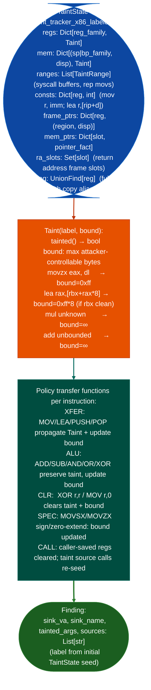

# Named Taint Sources and Bounds

Forward labeled-taint tracking for x86/x86-64 instruction streams with full sub-register aliasing, symbolic frame slots, attacker-controllable byte-range tracking, and `bound` propagation: the richer taint model used when provenance labels and size bounds are needed alongside reachability.

---

## Why this exists

1. **`TaintTracker` the base taint tracker tracks whether a value is tainted, but not how many attacker-controlled bytes it carries.** `taint_tracker_x86_labeled.py`'s `Taint.bound` field tracks the maximum attacker-controllable contribution to a value through arithmetic: `movzx eax, dl` gives bound=0xff; `lea rax, [rbx+rax*8]` with clean `rbx` gives bound=0xff*8; multiply by unknown or unbounded add resets bound to infinity. This enables distinguishing overflows bound > buffer_size from bounded-but-tainted values.

2. **Named taint labels let multiple taint sources be tracked simultaneously**: `TaintState.taint_reg("rdi", "recv_payload")` and `TaintState.taint_reg("rsi", "config_file")` produce separate labeled `Taint` objects. At a sink, the finding identifies not just "tainted" but "tainted from recv_payload" versus "tainted from config_file", enabling precise attribution in multi-source functions.

3. **`TaintState.mem` tracks symbolic frame slots**: `sp_family, disp → Taint` entries track taint in stack slots across push/pop/sub rsp/leave, with aliasing on `mov rbp, rsp`. This handles the common pattern where a tainted value is spilled to the stack between the source and the sink.

---

## How it works



---

## Usage

```python
from ablation.analyzers.taint_tracker_x86_labeled import TaintState, Policy
from ablation.analyzers.taint_tracker import TaintTracker  # reuses base runner
from ablation.analyzers.binary_context import BinaryContext

ctx = BinaryContext.load_or_build('/path/to/target.elf')

# Seed named taint at specific sources
init = TaintState()
init.taint_reg("rdi", "recv_payload")
init.taint_reg("rsi", "config_input")

# Run with labeled taint state (base TaintTracker uses the state)
tracker = TaintTracker.from_context(ctx)
findings = tracker.run_on_function_seeded(func_va=0x12340, initial_state=init)

for f in findings:
    print(f"sink: {f.sink_name}  sources: {f.source_calls}")
    print(f"  bound: {f.tainted_regs}")  # carries bound info
```

---

## Example output

The following illustrates the labeled taint output format. Actual labels and bounds are engagement-specific.

```
Finding at <va>:
  sink: system
  tainted args: rdi
  sources: ['recv_payload']  (not config_input)
  bound: rdi bound=0xff  (recv return value, at most 1 user byte)
```

---

## False positives

**`bound=∞` means the bound was not tracked through an arithmetic operation**, it does not confirm that the value is unbounded in practice. A `bound=∞` finding at a `malloc` call site means the allocation size could be arbitrarily large; confirm with `PathSolver` whether the actual value space is bounded.

**Named label attribution is only as precise as the initial seed**: if both `recv_payload` and `config_input` flow through the same register before the sink, the finding's `sources` list will contain both labels, making attribution ambiguous. Re-seed with only one label at a time to isolate individual source contributions.

---

## Pipeline position

Use labeled taint when the standard `TaintTracker` finding does not provide sufficient attribution detail: specifically when multiple taint sources may reach the same sink and you need to know which one is exploitable. The labeled variant runs on the same `TaintTracker.run_on_function_seeded()` infrastructure, so the pipeline position is identical to standard taint analysis.

---

## Reading findings

Labeled taint finding dicts extend the standard taint finding shape with source attribution:

| Field | Content |
|:---|:---|
| `va` | VA of the sink call |
| `sink` | Sink function name |
| `tainted_args` | List of tainted argument registers at the call |
| `sources` | List of named taint source labels that reach this sink |
| `bound` | Register bound description for example `rdi bound=0xff` if a bound was declared |
| `taint_path` | Register propagation chain |

---

## See also

- [Taint Analysis (x86)](x86.md): base x86/x86-64 taint tracker with standard unlabeled taint
- [Named Taint Multi-ISA](taint-analysis.md): ISA-specific variants ARM32, ARM64, MIPS, PPC32, LoongArch64
- [Global BSS Taint Tracking](global-symbol-and-bss-tracking.md): BSS-source taint tracking for kernel initrd patterns
