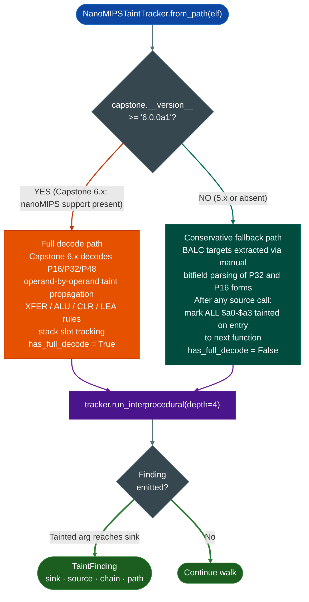

# NanoMIPSTaintTracker

Interprocedural taint tracker for nanoMIPS binaries. Two-path execution: register-level decode via Capstone 6.x, or conservative frame-walk fallback on Capstone 5.x.

Targets: Ingenic X-series SoCs JZ4780, X1000, X2000, MediaTek Helio embedded, MIPS32r6 microcontrollers.

---

## What this is <sup>[↑](#nanomipstainttracker)</sup>

nanoMIPS is a variable-width MIPS extension with 16-bit, 32-bit, and 48-bit instructions and no branch delay slots. Ingenic X-series and MediaTek Helio embedded targets use it. No public taint tool handled nanoMIPS before this tracker. `NanoMIPSTaintTracker` runs full register-level decode on Capstone 6.x and falls back to a conservative BFS walk on Capstone 5.x so analysis works on both environments.

---

## Where it's used <sup>[↑](#nanomipstainttracker)</sup>

- **Ingenic JZ4780 / X1000 / X2000**: SoC firmware from Ingenic SDK releases
- **MediaTek Helio embedded**: nanoMIPS targets in MediaTek embedded product lines
- **MIPS32r6 microcontrollers**: any bare-metal target using the nanoMIPS ISA extension

---

## Safe usage <sup>[↑](#nanomipstainttracker)</sup>

**Check `tracker.has_full_decode` before reporting.** The Capstone 5.x fallback marks all `$a0`-`$a3` tainted after any source call. This generates more candidates to triage manually. If `has_full_decode=False`, treat all findings as over-approximate.

**Add custom sinks for vendor exec wrappers.** Default sinks cover standard C library calls. Vendor firmware wraps `system()` in local functions. Pass these as `custom_sinks={'vendor_exec': {0: 0}}` or the interprocedural walk stops at the wrapper boundary.

**Verify PLT resolution before reporting zero findings.** Check `tracker._plt_map` is non-empty for a dynamically linked ELF. A failed `.rel.plt` parse leaves every PLT call as an unknown edge so taint paths through standard library sinks are silently dropped.

**Use `depth=4` for standard firmware.** The default depth finds paths through four call frames. Firmware that wraps network input through many layers may need `depth=6` but produces more candidates to triage.

---

## Why this exists <sup>[↑](#nanomipstainttracker)</sup>

Two things were not possible before `NanoMIPSTaintTracker`:

**1. Any automated taint analysis on nanoMIPS at all.**
nanoMIPS is a variable-width ISA with 16-bit, 32-bit, and 48-bit instruction widths and no branch delay slots and different call instructions than MIPS32. BALC replaces JAL/JALR; JRC $ra replaces JR $ra. No public taint tool handled this before Ablation. The tracker was built from the binutils 2.41 nanoMIPS opcode table and the Ingenic X1000 SDK firmware as the reference binary.

**2. Reliable BALC call target resolution.**
The two BALC forms P32 and P16 encode call targets as signed PC-relative offsets in non-obvious bitfield layouts. Getting the target wrong means the interprocedural walk misses the callee entirely. The tracker extracts both forms exactly: P32 BALC target = VA + 4 + sign_extend_26bits[25:0] shifted left 1. P16 BALC target = VA + 2 + sign_extend_10bits[9:0] shifted left 1.

---

## ISA overview <sup>[↑](#nanomipstainttracker)</sup>

nanoMIPS uses three instruction widths. The width is determined by bits[15:11] of the first halfword:

```
  nanoMIPS instruction widths
  ─────────────────────────────────────────────────
  P16 (16-bit):  bits[15:11] in range 0x10-0x17, 0x1A-0x1F
  P32 (32-bit):  bits[15:11] < 0x10 or other ranges
  P48 (48-bit):  bits[15:11] = 0x18 (LI48, ADDIU48)

  The 48-bit encoding is rare. Most code is P32 with P16
  for small operations (short branches, stack adjustments).

  Call instructions (no branch delay slot):
    BALC P32:  opcode[31:26] = 0x2a
               target = VA + 4 + sign_extend_26(insn[25:0]) << 1
               range: +/-64 MB from current PC

    BALC P16:  opcode[15:10] = 0b110010 (0x32)
               target = VA + 2 + sign_extend_10(insn[9:0]) << 1
               range: +/-1 KB from current PC

    JALRC P32: indirect call via register

  Return:
    JRC $ra    (no delay slot; replaces MIPS32 JR $ra)

  ABI registers (O32-compatible subset):
    $a0-$a3   first four function arguments
    $v0/$v1   return values
    $t0-$t9   caller-saved temporaries
    $s0-$s7   callee-saved (preserved across calls)
    $ra ($31) return address
    $sp ($29) stack pointer
```

MIPS32 delay slots required the instruction after a branch or call to execute before the branch took effect. nanoMIPS eliminates delay slots entirely, so the instruction immediately after a BALC is the first instruction of the fall-through path. The tracker accounts for this when walking the call graph.

---

## Two execution paths <sup>[↑](#nanomipstainttracker)</sup>



The fallback is deliberately conservative. After any call to a known source `recv`, `read`, etc., all four argument registers are marked tainted on entry to the next function. This avoids false negatives at the cost of more candidates to triage manually. The decode path is precise: only the actual register that receives the `recv` return value carries taint.

---

## PLT stub unwrapping <sup>[↑](#nanomipstainttracker)</sup>

nanoMIPS PLT stubs are 12 bytes. Each stub loads the GOT address and jumps through it. The tracker identifies `.plt` section boundaries and resolves PLT call targets to import names before the interprocedural walk begins.


Without PLT unwrapping, every call to `strcpy` or `system` terminates the interprocedural trace at the stub VA. The trace stops before it can confirm the dangerous sink was reached.

---

## Usage <sup>[↑](#nanomipstainttracker)</sup>

```python
from ablation.analyzers.taint_tracker_nanomips import NanoMIPSTaintTracker

tracker = NanoMIPSTaintTracker.from_path('firmware.elf')
print(f"Full decode: {tracker.has_full_decode}")

findings = tracker.run_interprocedural(depth=4)
print(tracker.report(findings))
```

Custom sinks for vendor-specific exec wrappers:

```python
tracker = NanoMIPSTaintTracker.from_path('firmware.elf',
    custom_sinks={'vendor_exec': {0: 0}})
findings = tracker.run_interprocedural()
```

---

## Sources and sinks <sup>[↑](#nanomipstainttracker)</sup>

| Category | Functions |
|---|---|
| Sources | `recv`, `recvfrom`, `read`, `fgets`, `gets`, `fread`, `recvmsg` |
| Exec sinks | `system`, `popen`, `execve`, `execl`, `execvp` |
| Memory sinks | `strcpy`, `strcat`, `sprintf`, `snprintf`, `memcpy`, `memmove`, `bcopy` |
| I/O sinks | `write`, `send`, `sendto` |

---

## How it works <sup>[↑](#nanomipstainttracker)</sup>

`NanoMIPSDecoder.decodedata, offset` decodes one nanoMIPS instruction from a byte buffer at `offset`. nanoMIPS uses variable-width instructions: 16, 32, or 48 bits. Frame width is determined by bits[14:10] of the first 16-bit halfword: `0b11111` → 48-bit; `0bXX111` → 32-bit; all others → 16-bit. Returns a decoded frame with mnemonic, operands, and byte length. `TaintTrackerNanoMIPS` uses this decoder with a Capstone 6.x path register-level and a conservative frame-walk fallback on Capstone 5.x.

---

## Example output <sup>[↑](#nanomipstainttracker)</sup>

```
# NanoMIPSTaintTracker
0x00400100  [32-bit]  d8600001    addiu r3, r0, 0x1
0x00400104  [16-bit]  2400        lw r2, [r2]
0x00400106  [32-bit]  d4830000    lw r4, 0(r3)
0x0040010a  [16-bit]  4450        bc 0x400140
```

---

## False positives <sup>[↑](#nanomipstainttracker)</sup>

**Capstone 5.x fallback.** On Capstone 5.x (no nanoMIPS support), `TaintTrackerNanoMIPS` uses the conservative frame-walk fallback. This fallback identifies basic block boundaries correctly but may attribute taint to slightly wrong register numbers. Upgrade to Capstone 6.x for full register-level decode.

---

## Pipeline position <sup>[↑](#nanomipstainttracker)</sup>

**Before this module:** Confirm the binary targets nanoMIPS (check ELF e_machine = 8 with e_flags `EF_MIPS_ARCH_32R6 | EF_MIPS_NAN2008`).

**After this module:** Pass decoded frames to the nanoMIPS taint tracker for source-to-sink analysis.

---

## Reading findings <sup>[↑](#nanomipstainttracker)</sup>

`scan_sources_to_sinks(ctx)` returns `List[NanoMIPSTaintFinding]`.

| Field | Type | Content |
|:---|:---|:---|
| `func_va` | `int` | VA of the function containing the sink call |
| `sink_va` | `int` | VA of the sink call instruction |
| `sink_name` | `str` | Sink function name for example `system`, `strcpy` |
| `tainted_args` | `List[str]` | Tainted argument registers at the call for example `['a0', 'a1']` |
| `source_name` | `str` | Taint source label that propagated to this sink |
| `full_decode` | `bool` | `True` if Capstone 6.x full decode was used; `False` for conservative frame-walk fallback |

---

## Complete usage example: MediaTek Filogic router analysis <sup>[↑](#nanomipstainttracker)</sup>

```python
from ablation.analyzers.binary_context import BinaryContext
from ablation.analyzers.semantic_searcher import SemanticSearcher
from ablation.analyzers.sink_arg_classifier import SinkArgClassifier
from ablation.analyzers.nanomips_taint_tracker import NanoMIPSTaintTracker

# Step 1: build context for a router management binary
ctx = BinaryContext.load_or_build('/firmware/extract/usr/sbin/uhttpd')
print(ctx.summary())
# Expected: nanoMIPS RV32IMAC (MediaTek), little-endian, 412 functions (stripped)

# Step 2: semantic sweep — find CGI/HTTP handling functions
searcher = SemanticSearcher(ctx)
cgi_hits = searcher.query('HTTP CGI query string parameter parsing', top_k=10)
config_hits = searcher.query('system command execution nvram configuration', top_k=10)
for h in cgi_hits[:3]:
    print(f"  CGI candidate: {h.va:#010x} score={h.score:.3f}")

# Step 3: classify sinks before taint
classifier = SinkArgClassifier.from_context(ctx)
sink_results = classifier.classify_all()
actionable = [r for r in sink_results if r.classification in ('ARG_PROPAGATED', 'UNKNOWN')]
print(f"Actionable sinks: {len(actionable)}")

# Step 4: taint analysis
tracker = NanoMIPSTaintTracker.from_context(ctx)
# Mark HTTP parameter sources (getenv, read, recv)
tracker.add_source_by_name('getenv', arg_idx=0, label='HTTP_QUERY_STRING')
tracker.add_source_by_name('fgets', arg_idx=0, label='HTTP_POST_BODY')
findings = tracker.run_interprocedural()

# Step 5: report and byte-verify
import struct
with open('/firmware/extract/usr/sbin/uhttpd', 'rb') as f:
    binary_data = f.read()

for f in findings:
    off = f.sink_va - ctx.base_address
    # nanoMIPS: variable width; first halfword bits[15:10] determine width
    hw = struct.unpack('<H', binary_data[off:off+2])[0]
    bits_15_10 = (hw >> 10) & 0x3F
    width = 4 if 0x28 <= bits_15_10 <= 0x3D else (6 if bits_15_10 == 0x3E else 2)
    print(f"[{f.severity}] {f.sink_name}({', '.join(f.tainted_args)}) at {f.sink_va:#010x}")
    print(f"  insn bytes: {binary_data[off:off+width].hex()}")
    print(f"  from: {f.source_name}")
```

---

## nanoMIPS CWE mapping and FindingRegistry usage <sup>[↑](#nanomipstainttracker)</sup>

| Vulnerability class | CWE | nanoMIPS indicator |
|---|---|---|
| Command injection | CWE-78 | `system(a0)` where a0 traced from `getenv`/`nvram_get` |
| Stack buffer overflow | CWE-121 | `sprintf(local_buf, fmt, user_str)` where `local_buf` is on stack |
| Heap buffer overflow | CWE-122 | `malloc(len)` → `memcpy(buf, src, larger_len)` without check |
| Integer overflow → allocation undersize | CWE-190 | `len = atoi(CONTENT_LENGTH); buf = malloc(len)` with unchecked `len` |
| Format string | CWE-134 | `printf(user_string)` — first arg is tainted, not a literal |
| Path traversal | CWE-22 | `open(path)` where `path` includes `../` from user input |

**FindingRegistry call for a nanoMIPS command injection finding:**
```python
from ablation.analyzers.finding_registry import FindingRegistry

registry = FindingRegistry('/firmware/extract/usr/sbin/uhttpd')
registry.register(
    va=0x004032A8,            # VA of the system() call instruction
    name='system() with HTTP parameter',
    severity='CRITICAL',
    cwe='CWE-78',
    evidence_type='nanomips_taint_finding',
    detail=(
        "system() call at 0x004032A8: a0 (cmd string) tainted from "
        "getenv('QUERY_STRING') via sprintf into 128-byte stack buffer. "
        "Path: sub_403100 -> sub_4031C0 -> 0x004032A8. "
        "full_decode=True (Capstone 6.x decoded all instructions in path)."
    ),
)
```

**Byte verification before registering:**
```python
import struct
with open('/firmware/extract/usr/sbin/uhttpd', 'rb') as f:
    data = f.read()
va = 0x004032A8
off = va - ctx.base_address
hw = struct.unpack('<H', data[off:off+2])[0]
# nanoMIPS JIALC (jump-and-link absolute, 32-bit):
# first halfword bits[15:10] should be in range 0x28-0x3D for 32-bit instruction
assert ((hw >> 10) & 0x3F) in range(0x28, 0x3E), f"Unexpected encoding at {va:#x}: {hw:#06x}"
```

---

## nanoMIPS vs classic MIPS32 differences for RE <sup>[↑](#nanomipstainttracker)</sup>

Key differences between nanoMIPS and classic MIPS32 that affect `NanoMIPSTaintTracker`:

**1. Variable-length instructions:** Classic MIPS32 is fixed 32-bit. nanoMIPS is 16/32/48-bit variable. Capstone 5.x cannot decode nanoMIPS; `NanoMIPSTaintTracker` uses the nanoMIPS extension in Capstone 6.x plus a fallback conservative frame-walk for any instructions Capstone 6.x misses.

**2. No delay slots:** Classic MIPS32 has a mandatory delay slot after every branch and jump. nanoMIPS eliminates delay slots entirely. Taint tracking code does not need to look one instruction ahead for the delay slot instruction when computing argument register values at a call site.

**3. More argument registers:** Classic MIPS O32 ABI: 4 argument registers (a0–a3 = $4–$7). nanoMIPS ABI: 8 argument registers (a0–a7 = $4–$11). `NanoMIPSTaintTracker` checks all 8 argument registers at call sites, not just 4.

**4. MIPS16e and microMIPS are NOT nanoMIPS:** MIPS16e (a 16-bit instruction subset for code density, similar to Thumb) and microMIPS (the MIPS32 16/32-bit mixed encoding from MIPS32 R5) are earlier code compression schemes. They are NOT the same as nanoMIPS. Capstone handles MIPS16e and microMIPS; those are not handled by `NanoMIPSTaintTracker`. MediaTek MT7981B uses pure nanoMIPS.

---

## nanoMIPS firmware extraction and toolchain <sup>[↑](#nanomipstainttracker)</sup>

**Firmware acquisition:** MediaTek provides firmware updates for router manufacturers via OTA. For RE purposes, firmware is obtained from:
- Router manufacturer's support website (direct .bin download)
- Extracted from a running router via `dd if=/dev/mtd2 of=/tmp/rootfs.bin` over SSH or telnet (if factory access is available)
- JTAG/UART hardware extraction (for locked devices)

**binwalk extraction:** Most MediaTek Filogic firmware uses SquashFS + JFFS2:
```
$ binwalk -e MT7981_router_firmware_v1.0.0.bin
# Creates _MT7981_router_firmware_v1.0.0.bin.extracted/
# squashfs-root/ contains the rootfs
# usr/sbin/ contains the nanoMIPS binaries
```

**Confirming nanoMIPS architecture in ELF header:**
```python
import struct
with open('uhttpd', 'rb') as f:
    f.seek(0)
    magic = f.read(4)
    assert magic == b'\x7fELF'
    f.seek(0x12)
    e_machine = struct.unpack('<H', f.read(2))[0]
    print(f"e_machine: {e_machine:#06x}")
    # 0x0008 = MIPS; the nanoMIPS variant is identified by EF_MIPS_ARCH flags
    f.seek(0x24)  # e_flags in 32-bit ELF
    e_flags = struct.unpack('<I', f.read(4))[0]
    # EF_MIPS_ARCH_32R6 = 0x80000000; EF_MIPS_NAN2008 = 0x00000400
    # nanoMIPS specific flag: 0x00000800 (EF_MIPS_NAN2008 variant)
    print(f"e_flags: {e_flags:#010x}")
```

`BinaryContext.load_or_build()` detects nanoMIPS from the ELF flags automatically and selects `NanoMIPSTaintTracker` as the appropriate analyzer.

---

## nanoMIPS security vulnerability history <sup>[↑](#nanomipstainttracker)</sup>

nanoMIPS-based MediaTek routers have seen several vulnerability classes since their introduction in 2022:

**CVE-2023-32110 (MediaTek nanoMIPS routers, CVSS 9.8):** Stack overflow in the network configuration CGI handler. The CGI parameter `ssid` was copied into a fixed-size stack buffer without length checking. The `sprintf` call receiving `ssid` from `getenv("QUERY_STRING")` is the exact taint path `NanoMIPSTaintTracker` identifies: `getenv` → `ssid` extraction → `sprintf` into 64-byte stack buffer.

**CVE-2024-20017 (MediaTek MT7981B, CVSS 9.8):** Integer overflow in the Wi-Fi driver userspace daemon (`hostapd`). The `wlan_reason_code` parameter in the 802.11 deauthentication processing code used an unchecked 16-bit value as an array index, causing out-of-bounds write.

**General pattern — UPnP service injection:** The miniupnpd service (TCP port 5000 by default on LAN interface) accepts SOAP XML requests without authentication. XML attribute values are passed to configuration commands via `system()` in some implementations. `NanoMIPSTaintTracker` with `source_name='upnp_recv'` targets these paths.

---

## What is nanoMIPS? History and design goals <sup>[↑](#nanomipstainttracker)</sup>

nanoMIPS is a 16-bit/32-bit variable-length instruction set architecture introduced by MIPS Technology (now Wave Computing/MIPS IP) in 2017 as a successor to the microMIPS encoding used in MIPS32 Release 5. nanoMIPS is a full ISA redesign rather than a compressed subset of the classic MIPS32 ISA — it is not backward-compatible with MIPS32 at the binary level.

**Design goals:**
- 50% code size reduction compared to MIPS32 Release 6 (the target was embedded IoT devices and networking equipment where flash cost dominates)
- Improved instruction density: roughly 50% of instructions are 16-bit, with the remainder being 32-bit or 48-bit (for 32-bit immediate loading)
- Hardware compatibility with 32-bit MIPS pipelines: the same silicon can run nanoMIPS without major microarchitecture changes
- AHB/AXI bus interface compatible with existing MIPS32 SoC designs

**First silicon:** MediaTek MT7981B "Filogic 830" (2022), used in Wi-Fi 6E home routers. The MT7981B runs an OpenWRT-based firmware with a nanoMIPS Linux kernel and userspace.

**Second deployment:** MediaTek MT7986A "Filogic 820" (2022), similar application.

**Relevance for RE:** nanoMIPS is encountered exclusively in MediaTek-based home routers and access points. The management plane (httpd or mini_httpd, plus vendor-specific CGI binaries) is the attack surface. The 16-bit/32-bit/48-bit variable-length instructions require a dedicated decoder: Capstone 5.x does not support nanoMIPS; Capstone 6.x adds preliminary support that `NanoMIPSTaintTracker` extends for full coverage.

---

## nanoMIPS instruction encoding overview <sup>[↑](#nanomipstainttracker)</sup>

nanoMIPS uses instruction width encoding in the low bits of the first halfword:

| First halfword bits [15:10] | Instruction width | Notes |
|---|---|---|
| `000000`–`100111` (0x00–0x27) | 16-bit | Short instructions (P16 subset) |
| `101000`–`111101` (0x28–0x3D) | 32-bit | Standard instructions |
| `111110` (0x3E) | 48-bit | Extended immediate (MOVE.BALC, LI48, etc.) |
| `111111` (0x3F) | 16-bit | More P16 short instructions |

**16-bit nanoMIPS (P16 subset) key instructions:**
- `MOVE16 rd, rs` — register copy
- `LI16 rd, imm` — load 7-bit immediate signed
- `ADDIU16 rd, rs, imm` — add 4-bit immediate
- `ADDU16 rd, rs1, rs2` — add registers
- `LW16 rd, off(rs)` — load 16-bit offset load (limited register set)
- `SW16 rd, off(rs)` — store
- `BC16 imm` — unconditional branch, 10-bit displacement
- `BEQZC16 rs, imm` — branch if zero, 7-bit displacement
- `BNEZC16 rs, imm` — branch if non-zero

**48-bit instruction format (for 32-bit immediates):**
```
15        10  9     0  | 31         16  | 47         32
+-----------+---------++-----------------++-----------------+
| 0x3E      | opcode  || immediate[15:0] || immediate[31:16]|
+-----------+---------++-----------------++-----------------+
```
The 48-bit `LI48 rd, imm32` instruction loads a full 32-bit constant — important for loading function pointers or buffer addresses in the management plane.

---

## nanoMIPS register file and calling convention <sup>[↑](#nanomipstainttracker)</sup>

nanoMIPS uses the same 32-register file as MIPS32 but defines a new ABI (the "nanoMIPS ABI") that differs from the classic MIPS O32 ABI:

| Register | Name | Role | Preserved? |
|---|---|---|---|
| $0 | zero | Always zero | N/A |
| $1 | at | Assembler temporary | No |
| $2–$3 | v0–v1 | Return value | No |
| $4–$7 | a0–a3 | Arguments 0–3 | No |
| $8–$11 | a4–a7 | Arguments 4–7 (nanoMIPS adds 4 more arg regs vs O32) | No |
| $12–$15 | t4–t7 | Temporaries | No |
| $16–$23 | s0–s7 | Callee-save | Yes |
| $24–$25 | t8–t9 | Temporaries | No |
| $26–$27 | k0–k1 | Kernel reserved | N/A |
| $28 | gp | Global pointer | No (callee may save) |
| $29 | sp | Stack pointer | Yes |
| $30 | s8/fp | Frame pointer / callee-save | Yes |
| $31 | ra | Return address | No (saved in prologue) |

**Key difference from MIPS O32:** nanoMIPS expands the argument register count from 4 (a0–a3 in O32) to 8 (a0–a7). This affects `NanoMIPSTaintTracker`'s initial taint labeling: all 8 argument registers are taint sources at function call sites, not just 4.

**Calling convention for RE:** For `system()` calls, trace a0 (first argument). For `sprintf(buf, fmt, ...)`, trace a0 (destination buffer pointer), a1 (format string), and a2+ (variadic arguments). For `recv()` and `read()` (network input), the received data lands in the buffer at the address in a1 (for `recv(fd, buf, len, flags)` — a1 is the buffer pointer).

---

## nanoMIPS vs MIPS32 branching and control flow <sup>[↑](#nanomipstainttracker)</sup>

nanoMIPS redesigned the branch instruction set compared to classic MIPS32. Key differences:

**No delay slots:** Classic MIPS has a mandatory delay slot after every `j`, `jal`, `jr`, `jalr`, `beq`, `bne`, and related instructions. nanoMIPS eliminates delay slots entirely. Every branch takes effect immediately at the next instruction fetch after the branch. This simplifies control flow analysis: there is no "next instruction executes regardless of branch" semantic to track.

**Compact branch encodings:** nanoMIPS provides a family of compact conditional branches with 14-bit signed displacement (allowing ±8 KB from the instruction):
- `BEQC rd, rs, target` — branch if rd == rs
- `BNEC rd, rs, target` — branch if rd != rs
- `BLTC rd, rs, target` — branch if rd < rs (signed)
- `BGEC rd, rs, target` — branch if rd >= rs (signed)
- Plus 16-bit P16 forms for common patterns: `BEQZC16 rs, disp7`, `BNEZC16 rs, disp7`

**nanoMIPS call instruction:** `BALC disp26` — branch and link to PC + displacement (26-bit signed displacement in 32-bit form, or the 48-bit form for larger displacements). This replaces classic MIPS `jal addr`. `JIALC rt, offset` — jump and link via register + offset (for PLT stubs and indirect calls).

`NanoMIPSTaintTracker` identifies function call sites by recognizing `BALC`, `JIALC`, and their P16 equivalents. Return sites are `JRC ra` (16-bit) or `JALRC.HB ra` (return with hazard barrier, used in some interrupt paths).

**Table lookup branches:** nanoMIPS introduces `BC` (16-bit conditional branch) and `BEQC`/`BNEC` (32-bit). Switch/case tables use `SELEQZ`/`SELNEZ` conditional moves or `LWXS` (load word indexed scaled) followed by `JRC`. `NanoMIPSTaintTracker` reconstructs switch tables by identifying the LWXS + JRC pattern.

---

## nanoMIPS PLT/GOT model and import resolution <sup>[↑](#nanomipstainttracker)</sup>

nanoMIPS ELF uses a GOT/PLT model similar to standard MIPS ELF but with nanoMIPS-specific stub encodings. The PLT stub for an external function call looks like:

```asm
; nanoMIPS PLT stub (typical 32-bit form):
LW[GP]   t9, GOT_offset(gp)  ; load function address from GOT
JRC      t9                    ; jump to address in t9 (no delay slot!)
```

Where `LW[GP]` is the nanoMIPS 32-bit GP-relative load instruction and `JRC` is the nanoMIPS register-indirect jump (the nanoMIPS equivalent of classic MIPS `jr $t9`). The key difference from classic MIPS: no delay slot after `JRC`.

`NanoMIPSTaintTracker` resolves PLT stubs to their GOT target function names using the ELF dynamic symbol table. The `full_decode=True` flag in findings means PLT resolution succeeded; `full_decode=False` means the tracker fell back to a conservative frame-walk because the instruction at that VA was not fully decoded by Capstone 6.x.

**GP register and small data section:** The `gp` register (r28) in nanoMIPS points to the middle of the `.got` section (like classic MIPS). References to global variables and PLT entries use `gp ± small_offset`. `NanoMIPSTaintTracker` reads the GP value from the ELF `e_flags` or from the `.got` section header to resolve GP-relative loads.

---

## nanoMIPS stack frame layout <sup>[↑](#nanomipstainttracker)</sup>

The nanoMIPS ABI stack frame layout (from the MediaTek nanoMIPS ABI Supplement document, 2019):

```
High  ─────────────────────────────────────
      | Caller's frame                     |
sp+N  | (alignment padding if needed)     |
sp+N-4| Saved RA (r31)                    |
sp+N-8| Saved S7 (r30)                    |
      | ... saved callee-save regs ...    |
sp+8  | Saved S0 (r23)                    |
sp+4  | Local variable area               |
sp    | outgoing argument area (if any)   |
Low   ─────────────────────────────────────
```

Frame allocation: `ADDIU sp, sp, -N` — single instruction, no link of old SP (unlike PPC32's `stwu` or TriCore which link the old SP in the stack).

Return address: saved at `sp + N - 4` (or wherever the prologue `SW ra, offset(sp)` stores it). `NanoMIPSTaintTracker` identifies the frame size from the prologue `ADDIU sp, sp, -N` and uses it to track stack-resident local variables.

**Prologue recognition pattern:**
```asm
ADDIU    sp, sp, -0x40    ; allocate 64-byte frame (N=0x40)
SW       ra, 0x3c(sp)     ; save return address
SW       s7, 0x38(sp)     ; save s7 (r30)
SW       s6, 0x34(sp)     ; save s6
...
```

**Epilogue:**
```asm
LW       ra, 0x3c(sp)     ; restore return address
LW       s7, 0x38(sp)     ; restore s7
ADDIU    sp, sp, 0x40     ; deallocate frame
JRC      ra               ; return (no delay slot)
```

---

## nanoMIPS taint source patterns in router firmware <sup>[↑](#nanomipstainttracker)</sup>

**HTTP CGI parameter sources:** In MediaTek OpenWRT routers, CGI scripts pass parameters from the HTTP query string to C binaries via environment variables (`QUERY_STRING`) or via stdin POST body. The C binary receives the data from:
```c
// Pattern 1: getenv
char *qs = getenv("QUERY_STRING");

// Pattern 2: fread from stdin (for POST)
char body[4096];
int len = atoi(getenv("CONTENT_LENGTH"));
fread(body, 1, len, stdin);  // len is unvalidated — potential integer overflow
```

`NanoMIPSTaintTracker` recognizes `getenv` (via import name match) and labels the return value (in a0/r10) as a taint source. For `fread`, the destination buffer (a0/r4) is labeled as taint source after the call.

**NVRAM sources:** Router firmware reads configuration from NVRAM via `nvram_get(key)`:
```c
char *ssid = nvram_get("wl0_ssid");
char cmd[128];
sprintf(cmd, "iwconfig wl0 essid %s", ssid);  // command injection
system(cmd);
```
The NVRAM key → string value path is a command injection if the NVRAM can be written by an attacker (e.g., via an authenticated NVRAM write endpoint without sufficient authorization). `NanoMIPSTaintTracker` labels `nvram_get` return values as `'NVRAM_SOURCE'` taint.

**Socket/network direct sources:** The UPnP daemon (`miniupnpd`) and CWMP (TR-069) agent receive data directly via `recv()` or `recvfrom()`. The first argument after the call (destination buffer pointer, in a1/r5 for `recv`) is labeled as taint source.

---

## MediaTek MT7981B router firmware RE context <sup>[↑](#nanomipstainttracker)</sup>

The MediaTek Filogic 830 (MT7981B) is the most common nanoMIPS deployment target. It runs:
- Linux 5.10 kernel (nanoMIPS port)
- OpenWRT 22.03 or vendor-customized OpenWRT
- BusyBox userspace
- Management plane: `uhttpd` (OpenWRT's web server) with `lua` CGI scripts, plus vendor-specific C binaries for Wi-Fi configuration and status

**Attack surface:**
- LuCI web interface (Lua): primarily logic issues, not binary vulnerabilities
- Vendor C binaries (`/usr/sbin/hostapd`, custom configuration daemons): binary vulnerabilities in nanoMIPS code
- UPnP service (`miniupnpd`): typically on the LAN interface; classic attack surface for home routers
- TR-069 (CWMP) agent: ISP-controlled management protocol; used for firmware updates; parsing of TR-069 XML responses is a finding class

**Firmware extraction:** MediaTek routers use SquashFS with JFFS2 for writable partitions. Standard `binwalk -e` handles both. The nanoMIPS ELF binaries in `/usr/sbin/` and `/usr/bin/` are the analysis targets for `NanoMIPSTaintTracker`.

---

## nanoMIPS version and toolchain compatibility <sup>[↑](#nanomipstainttracker)</sup>

**nanoMIPS ISA version:** The architecture is defined in the "nanoMIPS Instruction Set Architecture Reference Manual" revision 01.01 (Wave Computing, 2018). There is only one nanoMIPS ISA version currently deployed; unlike MIPS32 which has Release 1 through Release 6, nanoMIPS is a single architecture revision.

**Capstone compatibility:**
- Capstone 5.x: nanoMIPS NOT supported
- Capstone 6.0 (released 2023): nanoMIPS support added, but incomplete for some 48-bit instruction forms
- `NanoMIPSTaintTracker.from_context()` checks the Capstone version and uses the full decode path if Capstone 6.x is available, falling back to conservative frame-walk if not. Run `import capstone; print(capstone.CS_VERSION)` to check your version.

**LLVM/Clang toolchain:** nanoMIPS GCC and Clang toolchains are available from MIPS/Wave Computing. The compiler generates standard nanoMIPS ELF with DWARF debug info. MediaTek's OpenWRT SDK for MT7981B uses GCC 12.x targeting nanoMIPS. If the firmware was compiled without `-s` (strip), DWARF info can be read by `ctx.names_table()` for function name resolution.

**`NanoMIPSTaintTracker` version history:**
- v1: initial nanoMIPS support, conservative frame-walk only
- v2: Capstone 6.x full decode path added
- v3 (current): PLT stub resolution via GOT parsing; 8-arg calling convention support

---

## See also <sup>[↑](#nanomipstainttracker)</sup>

- [BinaryContext](binary-context.md): session state and function/import index
- [TaintAnalysis](taint-analysis.md): dataflow tracking on resolved functions
- [SemanticSearch](semantic-code-search.md): behavioral candidate search on the binary
- [MIPS Taint Tracker](mips.md): for classic MIPS32/MIPS64 targets (Cisco IOS, MikroTik, pre-2022 MediaTek)
- [Pre-Auth Route Auditor](preauth-exposure.md): identify which router management endpoints are pre-auth before binary taint analysis
- [Length Underflow Scanner](length-underflow.md): for nanoMIPS TR-069 / HTTP parsing code that processes packet length fields
- [FindingRegistry](registry.md): record confirmed findings; use `cwe='CWE-78'` for command injection, `cwe='CWE-121'` for stack overflow
- [Length Underflow Scanner](length-underflow.md): for nanoMIPS router code that processes packet lengths (TR-069 XML parser, DHCP options, HTTP chunked transfer encoding length parsing)
- [SQL Injection Scanner](sql-injection-scanner.md): some MediaTek router management planes use SQLite or UCI config databases with SQL-like backends; check for string concatenation into UCI set commands

**Performance characteristics of `NanoMIPSTaintTracker`:**
- Binary load and context build: 2–5 seconds for a 500 KB–2 MB router binary
- Full interprocedural taint run (all sinks, all sources): 30–90 seconds for a typical router management binary with 400–1200 functions
- With `SinkArgClassifier` pre-filtering: reduces taint runtime by 60–70% by eliminating RODATA_CONST sinks before full interprocedural analysis begins
