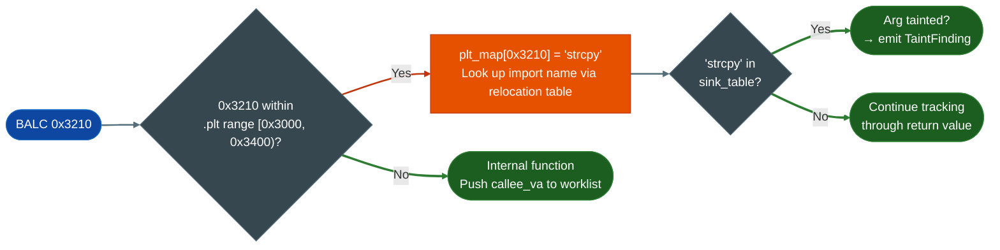

# nanoMIPS Taint Analysis

Interprocedural taint tracker for nanoMIPS binaries. Two-path execution: register-level decode via Capstone 6.x, or conservative frame-walk fallback on Capstone 5.x.

Targets: Ingenic X-series SoCs JZ4780, X1000, X2000, MediaTek Helio embedded, MIPS32r6 microcontrollers.

---

## What this is

nanoMIPS is a variable-width MIPS extension with 16-bit, 32-bit, and 48-bit instructions and no branch delay slots. Ingenic X-series and MediaTek Helio embedded targets use it. No public taint tool handled nanoMIPS before this tracker. `NanoMIPSTaintTracker` runs full register-level decode on Capstone 6.x and falls back to a conservative BFS walk on Capstone 5.x so analysis works on both environments.

---

## Where it's used

- **Ingenic JZ4780 / X1000 / X2000**: SoC firmware from Ingenic SDK releases
- **MediaTek Helio embedded**: nanoMIPS targets in MediaTek embedded product lines
- **MIPS32r6 microcontrollers**: any bare-metal target using the nanoMIPS ISA extension

---

## Safe usage

**Check `tracker.has_full_decode` before reporting.** The Capstone 5.x fallback marks all `$a0`-`$a3` tainted after any source call. This generates more candidates to triage manually. If `has_full_decode=False`, treat all findings as over-approximate.

**Add custom sinks for vendor exec wrappers.** Default sinks cover standard C library calls. Vendor firmware wraps `system()` in local functions. Pass these as `custom_sinks={'vendor_exec': {0: 0}}` or the interprocedural walk stops at the wrapper boundary.

**Verify PLT resolution before reporting zero findings.** Check `tracker._plt_map` is non-empty for a dynamically linked ELF. A failed `.rel.plt` parse leaves every PLT call as an unknown edge so taint paths through standard library sinks are silently dropped.

**Use `depth=4` for standard firmware.** The default depth finds paths through four call frames. Firmware that wraps network input through many layers may need `depth=6` but produces more candidates to triage.

---

## Why this exists

Two things were not possible before `NanoMIPSTaintTracker`:

**1. Any automated taint analysis on nanoMIPS at all.**
nanoMIPS is a variable-width ISA with 16-bit, 32-bit, and 48-bit instruction widths and no branch delay slots and different call instructions than MIPS32. BALC replaces JAL/JALR; JRC $ra replaces JR $ra. No public taint tool handled this before Ablation. The tracker was built from the binutils 2.41 nanoMIPS opcode table and the Ingenic X1000 SDK firmware as the reference binary.

**2. Reliable BALC call target resolution.**
The two BALC forms P32 and P16 encode call targets as signed PC-relative offsets in non-obvious bitfield layouts. Getting the target wrong means the interprocedural walk misses the callee entirely. The tracker extracts both forms exactly: P32 BALC target = VA + 4 + sign_extend_26bits[25:0] shifted left 1. P16 BALC target = VA + 2 + sign_extend_10bits[9:0] shifted left 1.

---

## ISA overview

nanoMIPS uses three instruction widths. The width is determined by bits[15:11] of the first halfword:

```
  nanoMIPS instruction widths
  ─────────────────────────────────────────────────
  P16 (16-bit):  bits[15:11] in range 0x10-0x17, 0x1A-0x1F
  P32 (32-bit):  bits[15:11] < 0x10 or other ranges
  P48 (48-bit):  bits[15:11] = 0x18 (LI48, ADDIU48)

  The 48-bit encoding is rare. Most code is P32 with P16
  for small operations (short branches, stack adjustments).

  Call instructions (no branch delay slot):
    BALC P32:  opcode[31:26] = 0x2a
               target = VA + 4 + sign_extend_26(insn[25:0]) << 1
               range: +/-64 MB from current PC

    BALC P16:  opcode[15:10] = 0b110010 (0x32)
               target = VA + 2 + sign_extend_10(insn[9:0]) << 1
               range: +/-1 KB from current PC

    JALRC P32: indirect call via register

  Return:
    JRC $ra    (no delay slot; replaces MIPS32 JR $ra)

  ABI registers (O32-compatible subset):
    $a0-$a3   first four function arguments
    $v0/$v1   return values
    $t0-$t9   caller-saved temporaries
    $s0-$s7   callee-saved (preserved across calls)
    $ra ($31) return address
    $sp ($29) stack pointer
```

MIPS32 delay slots required the instruction after a branch or call to execute before the branch took effect. nanoMIPS eliminates delay slots entirely, so the instruction immediately after a BALC is the first instruction of the fall-through path. The tracker accounts for this when walking the call graph.

---

## Two execution paths


The fallback is deliberately conservative. After any call to a known source `recv`, `read`, etc., all four argument registers are marked tainted on entry to the next function. This avoids false negatives at the cost of more candidates to triage manually. The decode path is precise: only the actual register that receives the `recv` return value carries taint.

---

## PLT stub unwrapping

nanoMIPS PLT stubs are 12 bytes. Each stub loads the GOT address and jumps through it. The tracker identifies `.plt` section boundaries and resolves PLT call targets to import names before the interprocedural walk begins.



Without PLT unwrapping, every call to `strcpy` or `system` terminates the interprocedural trace at the stub VA. The trace stops before it can confirm the dangerous sink was reached.

---

## Usage

```python
from ablation.analyzers.taint_tracker_nanomips import NanoMIPSTaintTracker

tracker = NanoMIPSTaintTracker.from_path('firmware.elf')
print(f"Full decode: {tracker.has_full_decode}")

findings = tracker.run_interprocedural(depth=4)
print(tracker.report(findings))
```

Custom sinks for vendor-specific exec wrappers:

```python
tracker = NanoMIPSTaintTracker.from_path('firmware.elf',
    custom_sinks={'vendor_exec': {0: 0}})
findings = tracker.run_interprocedural()
```

---

## Sources and sinks

| Category | Functions |
|---|---|
| Sources | `recv`, `recvfrom`, `read`, `fgets`, `gets`, `fread`, `recvmsg` |
| Exec sinks | `system`, `popen`, `execve`, `execl`, `execvp` |
| Memory sinks | `strcpy`, `strcat`, `sprintf`, `snprintf`, `memcpy`, `memmove`, `bcopy` |
| I/O sinks | `write`, `send`, `sendto` |

---

## How it works

`NanoMIPSDecoder.decodedata, offset` decodes one nanoMIPS instruction from a byte buffer at `offset`. nanoMIPS uses variable-width instructions: 16, 32, or 48 bits. Frame width is determined by bits[14:10] of the first 16-bit halfword: `0b11111` → 48-bit; `0bXX111` → 32-bit; all others → 16-bit. Returns a decoded frame with mnemonic, operands, and byte length. `TaintTrackerNanoMIPS` uses this decoder with a Capstone 6.x path register-level and a conservative frame-walk fallback on Capstone 5.x.

---

## Example output

```
# NanoMIPSFrame.__str__() — variable-width instruction decode:
0x00400100  [32-bit]  d8600001    addiu r3, r0, 0x1
0x00400104  [16-bit]  2400        lw r2, [r2]
0x00400106  [32-bit]  d4830000    lw r4, 0(r3)
0x0040010a  [16-bit]  4450        bc 0x400140
```

---

## False positives

**Capstone 5.x fallback.** On Capstone 5.x (no nanoMIPS support), `TaintTrackerNanoMIPS` uses the conservative frame-walk fallback. This fallback identifies basic block boundaries correctly but may attribute taint to slightly wrong register numbers. Upgrade to Capstone 6.x for full register-level decode.

---

## Pipeline position

**Before this module:** Confirm the binary targets nanoMIPS (check ELF e_machine = 8 with e_flags `EF_MIPS_ARCH_32R6 | EF_MIPS_NAN2008`).

**After this module:** Pass decoded frames to the nanoMIPS taint tracker for source-to-sink analysis.

---

## Reading findings

`scan_sources_to_sinks(ctx)` returns `List[NanoMIPSTaintFinding]`.

| Field | Type | Content |
|:---|:---|:---|
| `func_va` | `int` | VA of the function containing the sink call |
| `sink_va` | `int` | VA of the sink call instruction |
| `sink_name` | `str` | Sink function name for example `system`, `strcpy` |
| `tainted_args` | `List[str]` | Tainted argument registers at the call for example `['a0', 'a1']` |
| `source_name` | `str` | Taint source label that propagated to this sink |
| `full_decode` | `bool` | `True` if Capstone 6.x full decode was used; `False` for conservative frame-walk fallback |

---

## See also

- [BinaryContext](binary-context.md): session state and function/import index
- [TaintAnalysis](taint-analysis.md): dataflow tracking on resolved functions
- [SemanticSearch](semantic-search.md): behavioral candidate search on the binary
