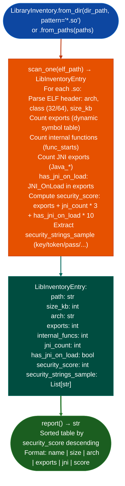

# Native Library Inventory

Batch-triage all native ELF shared libraries in a directory: producing a per-library summary table of size, architecture, export count, JNI interface count, and security score: replacing the repeated per-engagement ad-hoc enumeration of native `.so` files in Android IoT targets that ship 20–80 native libraries per APK.

---

## Why this exists

1. **Android IoT APKs ship 20–80 native `.so` files.** Running `BinaryContext.load_or_build()` individually on each is slow and session-filling. `LibraryInventory.from_dir()` batch-loads all libraries, generating a ranked summary table in a single call. The security score column ranks libraries by attack surface before any analysis: directing the analyst to high-value targets immediately.

2. **`LibInventoryEntry.jni_count` and `has_jni_on_load`** identify the libraries that expose a JNI interface to the Android runtime, these are the entry points for native code execution from Java. A library with `has_jni_on_load=True` runs code before any Java method is called, making it the first-hop attack surface for pre-authentication native code execution.

3. **`security_strings_sample`** provides a three-string excerpt of security-relevant strings from each library `key`, `token`, `password`, `secret`, `admin`, `auth`: giving the analyst a fast preview of whether a library handles credentials before loading the full `BinaryContext`.

---

## How it works



---

## Usage

```python
from ablation.analyzers.library_inventory import LibraryInventory

inventory = LibraryInventory.from_dir('/tmp/apk_extracted/lib/arm64-v8a/')
print(inventory.report())

# Top security-score entries
top = sorted(inventory.entries, key=lambda e: e.security_score, reverse=True)[:5]
for entry in top:
    print(f"  {entry.path}  score={entry.security_score}  jni={entry.jni_count}")
    print(f"    strings: {entry.security_strings_sample}")
```

---

## Example output

The following illustrates library inventory output format. Actual values are APK-specific.

```
LibraryInventory: /tmp/apk_extracted/lib/arm64-v8a/

Library                  | size  | arch   | exports | jni | score
-------------------------|-------|--------|---------|-----|------
libforticlient_jni.so    | <K>kb | arm64  | <E>     | <J> | <S>
libssl.so                | <K>kb | arm64  | <E>     | 0   | <S>
libcrypto.so             | <K>kb | arm64  | <E>     | 0   | <S>
```

---

## False positives

**`security_score` is a heuristic, not a severity rating**: a library with many exports may have a high score but serve only utility functions. A library with a low score and `has_jni_on_load=True` is more critical than its score suggests. Use `security_score` for initial ranking only; validate with `BinaryContext` analysis.

**`security_strings_sample` uses substring matching**: `key` matches `monkey`, `token` matches `autoconf_tokenize`. Review the full string context in `BinaryContext.strings()` before concluding a library handles credentials.

---

## Pipeline position

Run `LibraryInventory` at session start for any Android APK or firmware root filesystem with multiple native libraries. Use the ranked table to select the top 3–5 libraries for full `BinaryContext` analysis, skipping the rest until higher-priority targets are exhausted.

---

## Reading output

`LibraryInventory.scan()` returns a list of `LibInventoryEntry` objects:

| Attribute | Content |
|:---|:---|
| `path` | Absolute path to the library |
| `filename` | Library basename |
| `size_kb` | File size in kilobytes |
| `arch` | Architecture string for example `arm64`, `x86` |
| `exports` | Total count of dynamic symbols with a non-zero value |
| `internal` | BL-target internal function count −1 if unsupported arch |
| `jni` | Count of `Java_*` JNI exports |
| `has_jni_on_load` | `True` if `JNI_OnLoad` is exported |
| `security_score` | Integer 0–10: security interest score; higher = more worth analyzing |
| `plt_hooks` | `List[str]`: critical PLT import labels found |

---

## See also

- [Persistent Analysis Context](persistent-analysis-context.md): `BinaryContext` for full analysis of high-score libraries
- [Cross-Binary Taint Analysis](configurable-taint-reporting.md): `CrossBinaryTaintTracker` for inter-library taint chains
