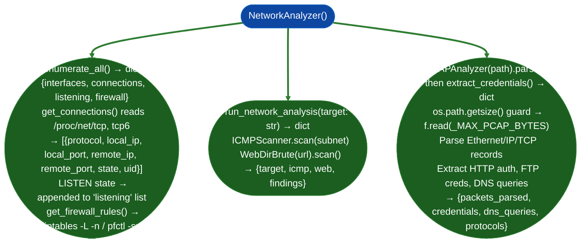

# Network Analysis

Network traffic analysis and active enumeration: PCAP parsing for credential extraction and protocol identification, TCP/UDP port scanning with service fingerprinting, ICMP host discovery, and HTTP directory brute-force: via `modules/network_analyze.py`.

---

## Why this exists

1. PCAP-based credential extraction without Wireshark: `PCAPAnalyzer.parse()` then `extract_credentials()` parses a PCAP file and extracts: HTTP Basic Auth credentials (decoded from `Authorization:` headers), FTP `USER`/`PASS` sequences, Telnet command sequences, and DNS query names. This enables offline credential triage from captured traffic without requiring Wireshark or tshark.

2. Host network state enumeration from `/proc/net/`: `NetworkAnalyzer.enumerate_all()` reads `/proc/net/tcp`, `/proc/net/tcp6`, `/proc/net/udp`, and `/proc/net/dev` directly. All reads are bounded by `_MAX_PROC_BYTES=4MB`. Returns `{interfaces, connections, listening, firewall}` with connection dicts as `{protocol, local_ip, local_port, remote_ip, remote_port, state, uid}`.

3. Active scanning without nmap: `run_network_analysis(target)` probes a target with ICMP and HTTP using `ICMPScanner.scan()` and `WebDirBrute.scan()`. Returns `{target, icmp, web, findings}`.

---

## Key constants

| Constant | Value | Applied to |
|:---|:---|:---|
| `_MAX_PCAP_BYTES` | 512 MB | PCAP file size guard before `f.read()` |
| `_MAX_HTTP_BYTES` | 4 MB | HTTP response body cap in `WebDirBrute` |
| `_MAX_PROC_BYTES` | 4 MB | `/proc/net/{tcp,tcp6,udp,dev}` reads |

---

## How it works



---

## Usage

```python
from modules.network_analyze import NetworkAnalyzer, run_network_analysis

# Live host network state
analyzer = NetworkAnalyzer()
state = analyzer.enumerate_all()
# state: {interfaces, connections, listening, firewall}
# Each connection: {protocol, local_ip, local_port, remote_ip, remote_port, state, uid}
for conn in state['listening']:
    print(f"  LISTEN {conn['protocol']} {conn['local_ip']}:{conn['local_port']}")

# Active scan: {target, icmp, web, findings}
result = run_network_analysis('10.0.0.1')
print(f"ICMP: {result['icmp']}  Web: {result['web']}")
```

---

## Example output

The following is a schematic example showing output structure and field names. Values are illustrative.

```
NetworkAnalyzer.enumerate_all():

interfaces: [{name: 'eth0', ip: '10.0.0.5'}]
listening:
  {protocol: 'tcp', local_ip: '0.0.0.0', local_port: 22, state: 'LISTEN', uid: 0}
  {protocol: 'tcp', local_ip: '127.0.0.1', local_port: 5432, state: 'LISTEN', uid: 999}
connections:
  {protocol: 'tcp', local_ip: '10.0.0.5', local_port: 54321,
   remote_ip: '10.0.0.1', remote_port: 443, state: 'ESTABLISHED', uid: 1000}
```

---

## False positives

**`get_firewall_rules()` requires root**: on hosts without root access, `iptables -L -n` fails silently; the firewall rules list is empty. An empty result means "could not enumerate" not "no rules."

**`/proc/net/tcp` port encoding**: ports are stored as hex in `/proc/net/tcp` such as `0050` = port 80. `NetworkAnalyzer` converts these; verify conversion is correct for ports above `0x7FFF` on big-endian kernels.

---

## Pipeline position

Run `NetworkAnalyzer.enumerate_all()` immediately after gaining shell access. The interface list seeds adjacent subnet ICMP sweeps. The listening port list reveals internal services not externally accessible.

---

## Reading output

`NetworkAnalyzer.enumerate_all()` returns a dict with four keys:

| Key | Content |
|:---|:---|
| `interfaces` | `List[{name, ip}]`: network interface name and IP address |
| `listening` | `List[{protocol, local_ip, local_port, uid}]`: listening services |
| `connections` | `List[{protocol, local_ip, local_port, remote_ip, remote_port, state, uid}]`: active connections |
| `firewall` | Platform-specific firewall rule list |

---

## See also

- [Local Network Inventory](local-network-inventory.md): same module with more complete annotation of connection fields
- [Host/Service Discovery](host-service-discovery.md): `ICMPScanner` for adjacent subnet enumeration
