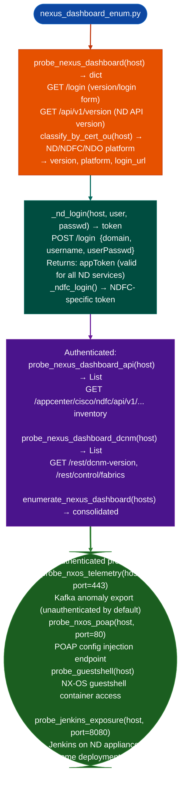

# Nexus Dashboard Enumeration

Enumerate Cisco Nexus Dashboard (ND), NDI Network Data & Infrastructure, NDFC Nexus Dashboard Fabric Controller, and NDO Nexus Dashboard Orchestrator management surfaces: including unauthenticated telemetry export, Kafka anomaly streaming, guestshell access, and POAP Power-On Auto Provisioning: via `modules/nexus_dashboard_enum.py`.

---

## Why this exists

1. **Nexus Dashboard Kafka telemetry export is unauthenticated by default.** `probe_nxos_telemetry()` checks the Nexus Dashboard telemetry streaming port for unauthenticated Kafka topic access. The Kafka anomaly export stream includes network flow data, fault events, and endpoint activity records: a significant information disclosure on deployments that have not configured Kafka authentication.

2. **Single SSO on Nexus Dashboard means one credential set grants access to APIC, NDFC, NDO, and Data Broker simultaneously.** `probe_nexus_dashboard()` and `probe_nexus_dashboard_api()` identify the ND login endpoint and software version; `_nd_login()` authenticates against the ND SSO token endpoint, after which the returned token is valid across all ND-integrated services without separate login.

3. **`probe_guestshell()` tests whether the NX-OS guestshell container is accessible via the Nexus Dashboard management API**: a guestshell that is accessible remotely and runs as root provides OS-level access on the NX-OS switch without requiring CLI/SSH credentials. `probe_nxos_poap()` tests POAP (port 80) which, on unpatched NX-OS, allows unauthenticated configuration injection during device boot.

---

## How it works



---

## Usage

```python
from modules.nexus_dashboard_enum import (
    probe_nexus_dashboard, probe_nxos_telemetry,
    probe_guestshell, probe_nxos_poap
)

# Version probe (unauthenticated)
info = probe_nexus_dashboard('10.0.0.10')
print(f"Platform: {info.get('platform')}  version: {info.get('version')}")

# Check unauthenticated exposures
telemetry = probe_nxos_telemetry('10.0.0.10')
guestshell = probe_guestshell('10.0.0.10')
poap = probe_nxos_poap('10.0.0.10')

for finding in telemetry + guestshell + poap:
    print(f"  {finding}")
```

---

## Example output

The following illustrates Nexus Dashboard enumeration output format.

```
probe_nexus_dashboard: 10.0.0.10

Platform: Nexus Dashboard Fabric Controller (NDFC)
Version:  12.2.2

probe_nxos_telemetry:
  Kafka telemetry port 443 (Anomaly Export): OPEN, no auth required

probe_nxos_poap:
  POAP endpoint (port 80): OPEN — configuration injection risk

probe_guestshell:
  Guestshell API: accessible — OS-level access potential
```

---

## False positives

**Kafka telemetry probe checks port accessibility, not actual topic read access**: a Kafka port that is open but requires TLS client authentication will appear as open without being exploitable. Verify topic access by attempting `kafka_list_topics()` from `modules/streaming_enum.py`.

**`probe_jenkins_exposure()` checks port 8080**: some Nexus Dashboard appliances run Jenkins for fabric automation workflows. Jenkins exposure on port 8080 without authentication is a confirmed finding; Jenkins on port 8080 requiring login is informational only.

---

## Pipeline position

Run Nexus Dashboard enumeration after identifying Nexus Dashboard management IPs. Unauthenticated probes run first; authenticated enumeration follows if default or known credentials are available. Single SSO access via `_nd_login()` is the highest-value escalation path.

---

## Reading findings

Nexus Dashboard probe functions return `List[{severity, title, detail, host, port}]`:

| Field | Content |
|:---|:---|
| `severity` | `CRITICAL` unauthenticated access / `HIGH` POAP/config injection / `MEDIUM` |
| `title` | Finding code for example `ND_KAFKA_TELEMETRY_OPEN`, `ND_POAP_UNAUTHENTICATED`, `ND_ADMIN_EXPOSED` |
| `detail` | Platform, version, port, and exploitation context |
| `host` | Target IP |
| `port` | Service port for example `443`, `80` |

---

## See also

- [NX-OS/ACI/APIC Fabric Enumeration](nx-os-aci-apic-fabric-enumeration.md): APIC/ACI fabric directly, separate from Nexus Dashboard
- [VXLAN/DCNM Exposure](vxlan-dcnm-exposure.md): DCNM predecessor to NDFC and VXLAN VTEP enumeration
- [Messaging/Streaming Enumeration](messaging-streaming-enumeration.md): Kafka topic enumeration for unauthenticated telemetry streams
