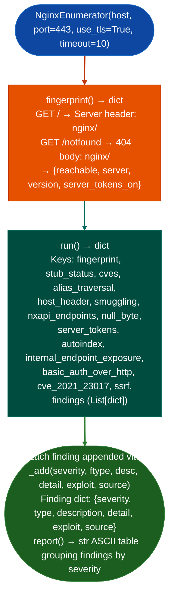

# Nginx Enumeration

Probe Nginx web server instances for version disclosure, CVE-exploitable configurations CVE-2017-7529, CVE-2021-23017, alias traversal misconfigurations, stub_status exposure, TLS weaknesses, LFI/SSRF surfaces, ingress-nginx controller exposure, and rate-limit bypass vectors: via `modules/nginx_enum.py` `NginxEnumerator`.

---

## Why this exists

1. Nginx alias traversal is a distinct attack class not detected by general web scanners: when a `location /static/` block uses `alias /var/www/static` missing trailing slash, a request for `/static../secret` resolves to `/var/www/secret`. `NginxEnumerator.probe_alias_traversal()` sends crafted requests targeting this off-by-one and checks responses for directory contents or file data that would be inaccessible through the intended path.

2. `stub_status` and `NX-API` endpoints are disabled by default but commonly left enabled in production: `probe_stub_status()` checks `/nginx_status`, `/_status`, and `/status` for the nginx stub_status module output active connections, accepted requests, handled requests. `enum_nxapi()` probes for Cisco NX-OS NX-API endpoints `/ins` and `/api/aaaLogin.json` that may coexist with an Nginx reverse proxy. Both surfaces are information disclosure findings that seed further enumeration.

3. CVE-2021-23017 off-by-one in Nginx resolver requires confirmation against the specific version and configuration: `check_cve_2021_23017()` extracts the server version from the `Server:` header and checks if it falls in the affected range 1.17.6–1.21.0. It additionally verifies whether `resolver` is configured by probing DNS resolution behavior. A version-positive finding without a configured `resolver` directive is a false positive; the check differentiates these cases.

---

## How it works



---

## Usage

```python
from modules.nginx_enum import (
    NginxEnumerator,
    probe_lfi_surface,
    probe_nginx_rate_limit_bypass,
    probe_security_headers,
)

# Class-based full scan
enum = NginxEnumerator('target.example.com', port=443, use_tls=True)
result = enum.run()
print(enum.report())

# Each finding: {severity, type, description, detail, exploit, source}
for f in result['findings']:
    print(f"  [{f['severity']}] {f['type']}: {f['description']}")
    if f.get('exploit'):
        print(f"    exploit: {f['exploit']}")

# Standalone probes return [{severity, type, description, detail, exploit, source}]
for f in probe_lfi_surface('target.example.com', port=443):
    print(f"  [{f['severity']}] {f['type']}")
```

---

## Example output

The following is a schematic example showing output structure and field names. Values are illustrative.

```
NGINX ENUMERATION — target.example.com:443
============================================================

[CRITICAL] ALIAS_TRAVERSAL
  Alias traversal confirmed: location block off-by-one allows path escape
  detail : GET /static../etc/passwd → HTTP 200, root:x:0:0
  exploit: curl 'https://target.example.com/static../etc/passwd'

[HIGH] NXAPI_UNAUTH
  NX-API endpoint accessible without authentication
  detail : POST /ins → HTTP 200, command execution surface

[MEDIUM] STUB_STATUS_EXPOSED
  Nginx stub_status accessible at /_status
  detail : Active connections: 42  Reading: 1 Writing: 1 Waiting: 40
```

---

## False positives

**`check_cve_2021_23017()` version match without configured `resolver`**: CVE-2021-23017 is only exploitable when the Nginx `resolver` directive is active enabling DNS resolution for upstream proxying. A version-positive finding on an Nginx instance with no `resolver` directive is not exploitable. Review the Nginx configuration to confirm `resolver` is present before escalating.

**`ALIAS_TRAVERSAL` on servers behind a WAF that normalizes path segments**: a WAF performing URL normalization decoding `%2f` and collapsing `../` upstream of Nginx will block alias traversal requests before they reach the server. The probe sends encoded path segments; confirm that the request reaches Nginx unmodified by checking access logs or bypassing the WAF in test.

---

## Pipeline position

Run `NginxEnumerator.run()` after confirming an Nginx server via the `Server:` header or default error page. Run `probe_lfi_surface()` and `probe_nginx_ingress_controller()` as standalone probes when specific LFI/ingress-nginx surfaces are the focus. Combine with `probe_tls_configuration()` for a complete TLS posture picture on the same host.

---

## Reading findings

`NginxEnumerator.run()` executes all probe methods and returns a dict with a `findings` key containing the accumulated list of finding dicts:

| Field | Content |
|:---|:---|
| `severity` | `CRITICAL` / `HIGH` / `MEDIUM` |
| `type` | Finding code such as `ALIAS_TRAVERSAL`, `NXAPI_UNAUTH`, and `NGINX_STATUS_EXPOSED` |
| `description` | One-line finding title |
| `detail` | Evidence: HTTP method, path, response code, or response excerpt |
| `exploit` | Ready-to-run curl/command string |
| `source` | Module that detected the finding such as `nginx_enum` |

---

## See also

- [TLS Certificate and Protocol Probing](tls-certificate-and-protocol-probing.md): TLS analysis for the Nginx HTTPS surface
- [Web Application Probe Helpers](web-app-probe-helpers.md): path enumeration and auth bypass helper functions
- [Finding Registry](finding-registry.md): record confirmed Nginx findings
