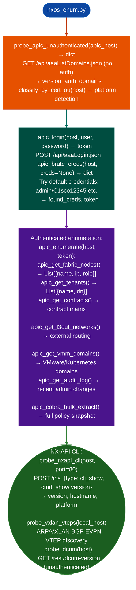

# NX-OS/ACI/APIC Fabric Enumeration

Enumerate Cisco ACI fabric via the APIC REST API: extracting tenants, contracts, L3Out networks, VMM domains, fabric nodes, service graphs, and the full audit log, and probing NX-OS NX-API CLI, with credential brute-force on the default APIC admin account, via `modules/nxos_enum.py`.

---

## Why this exists

1. **`probe_apic_unauthenticated()` returns the APIC software version and authentication domain list without credentials**: `GET /api/aaaListDomains.json` is unauthenticated on all APIC versions. The response includes configured authentication domains local, TACACS+, LDAP and the exact APIC software version string, which directly maps to known CVEs without requiring login.

2. **`apic_cobra_bulk_extract()` downloads the full APIC policy database snapshot** via the COBRA API export endpoint: a single authenticated call that produces a JSON snapshot of all tenants, bridge domains, EPGs, contracts, and VMM domain configurations. This is substantially more efficient than enumerating each object class individually and provides the complete fabric topology for offline analysis.

3. **`apic_get_contract_matrix()` extracts the full tenant-contract-EPG permission matrix**, which Endpoint Groups are permitted to communicate with which other EPGs and on which protocols. This is the ACI equivalent of network ACL enumeration: it reveals whether the fabric's micro-segmentation policy actually enforces isolation between application tiers, or whether overly permissive contracts create lateral movement paths.

---

## How it works



---

## Usage

```python
from modules.nxos_enum import (
    probe_apic_unauthenticated, apic_brute_creds,
    apic_enumerate, probe_nxapi_cli
)

# Unauthenticated version disclosure
info = probe_apic_unauthenticated('10.0.0.1')
print(f"APIC version: {info.get('version')}")
print(f"Auth domains: {info.get('auth_domains')}")

# Credential brute force
creds = apic_brute_creds('10.0.0.1')
if creds.get('found_creds'):
    token = creds['token']
    fabric = apic_enumerate('10.0.0.1', token)
    print(f"Tenants: {len(fabric.get('tenants', []))}")
    print(f"Fabric nodes: {len(fabric.get('fabric_nodes', []))}")
```

---

## Example output

The following illustrates APIC fabric enumeration output format.

```
probe_apic_unauthenticated: 10.0.0.1

APIC version: 5.2(7g)
Auth domains: [local, TACACS+ (10.1.1.50)]

apic_brute_creds: admin/C1sco12345 → SUCCESS

apic_enumerate:
  Fabric nodes: <N>  (leaves: <L>, spines: <S>)
  Tenants: <T>  |  Contracts: <C>
  L3Out networks: <M>
  Audit log: <K> recent changes
```

---

## False positives

**`apic_brute_creds()` attempts multiple login requests**: APIC lockout policies default 5 failed attempts may lock the admin account. Use a custom credential list with a single high-probability entry before attempting full brute force.

**`apic_cobra_bulk_extract()` produces large snapshots**: on large fabrics 100+ tenants, the bulk extract response may time out. Use `apic_get_tenants()` and targeted per-tenant calls instead for incremental enumeration.

---

## Pipeline position

Run APIC enumeration after network discovery identifies an APIC management IP. `probe_apic_unauthenticated()` is always safe no credentials, no lockout risk. Authenticated enumeration follows if default credentials succeed or known credentials are available.

---

## Reading findings

NX-OS/ACI/APIC probe functions return `List[{severity, title, detail, host, port}]`:

| Field | Content |
|:---|:---|
| `severity` | `CRITICAL` credential success / `HIGH` unauthenticated info / `MEDIUM` |
| `title` | Finding code for example `APIC_DEFAULT_CRED`, `APIC_UNAUTHENTICATED_INFO`, `NXOS_OSPF_AUTH_BYPASS` |
| `detail` | Version, tenant/node count, credential, or auth domain information |
| `host` | Target APIC or NX-OS IP |
| `port` | Service port for example `443` for APIC REST API |

---

## See also

- [IOS/IOS-XE Appliance Enumeration](ios-ios-xe-appliance-enumeration.md): `ios_enum.py` for IOS/IOS-XE appliances
- [VXLAN/DCNM Exposure](vxlan-dcnm-exposure.md): VXLAN VTEP and DCNM management surface
- [Nexus Dashboard](nexus-dashboard.md): Nexus Dashboard NDO/NDFC/NDI enumeration
