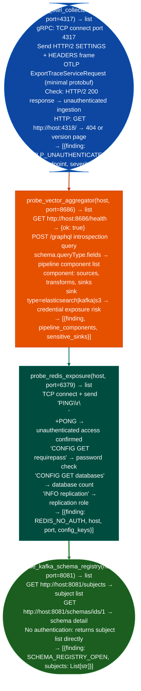

# Observability Exposure

Probe OpenTelemetry Collector gRPC/HTTP endpoints for unauthenticated metric and trace ingestion, enumerate Vector aggregator HTTP API pipeline configuration, and detect Redis exposure often deployed as a Prometheus/Grafana data source backend without credentials: providing the observability infrastructure attack surface: via `modules/network_analyze.py`.

---

## Why this exists

1. **`probe_otel_collector()` tests OpenTelemetry Collector for unauthenticated data submission**: OTel Collector's gRPC receiver port 4317 and HTTP receiver port 4318 accept OTLP-format spans, metrics, and logs. In default deployments, no authentication is configured. `probe_otel_collector()` sends a minimal OTLP ExportTraceServiceRequest to the gRPC endpoint and checks whether the response is `StatusCode.OK`: confirming that an attacker can inject arbitrary trace data into the observability pipeline, potentially poisoning dashboards, alerting, and audit logs.

2. **`probe_vector_aggregator()` enumerates Vector's HTTP API**: Vector's management API port 8686 exposes `/health`, `/metrics`, and `/graphql` endpoints without authentication in default configurations. `probe_vector_aggregator()` requests the `/graphql` schema introspection endpoint, which reveals the configured pipeline topology: source component types, transforms, and sink destinations including downstream Elasticsearch, Kafka, S3 export configurations with credentials in the component config.

3. **`probe_redis_exposure()` detects unauthenticated Redis**: Redis is deployed as a caching and pub/sub backend for Prometheus remote write, Grafana session storage, and alerting deduplication. `probe_redis_exposure()` sends a raw `PING\r\n` command and checks for `+PONG`: confirming unauthenticated access. A `CONFIG GET *` follow-up reveals whether Redis persistence is enabled and whether `requirepass` is configured.

---

## How it works



---

## Usage

```python
from modules.network_analyze import (
    probe_otel_collector,
    probe_vector_aggregator,
    probe_redis_exposure,
    probe_kafka_schema_registry
)

for host in discovered_hosts:
    # Observability exposure
    otel = probe_otel_collector(host)
    vec = probe_vector_aggregator(host)
    redis = probe_redis_exposure(host)
    schema = probe_kafka_schema_registry(host)

    for finding in otel + vec + redis + schema:
        # findings: {severity, title, detail, host, port}
        print(f"  [{finding['severity']}] {finding['title']}: {finding['detail'][:80]}")
```

---

## Example output

The following is a schematic example showing output structure and field names. Values are illustrative.

```
probe_otel_collector: <target-ip>:4317

  [HIGH] OTLP_UNAUTHENTICATED: gRPC endpoint accepts trace submission without auth
    detail: inject arbitrary spans into distributed trace system

probe_vector_aggregator: <target-ip>:8686

  [HIGH] VECTOR_API_OPEN: /graphql returns full pipeline topology
    detail: sinks contain downstream service credentials in pipeline config

probe_redis_exposure: <target-ip>:6379

  [CRITICAL] REDIS_NO_AUTH: +PONG (no password required)
    detail: requirepass unset; all keyspace readable/writable without credentials
```

---

## False positives

**`probe_otel_collector()` gRPC HTTP/2 negotiation**: some OTel Collector deployments use mutual TLS (`tls.cert_file` + `tls.client_ca_file`) even without application-level authentication. A successful TCP connect and HTTP/2 SETTINGS exchange does not confirm unauthenticated data submission if mTLS is enforced. Complete the TLS handshake with a client certificate before concluding the endpoint is open.

**`probe_redis_exposure()` `+PONG` on health check ports**: some services expose a lightweight health check on the Redis port that responds `+PONG` without actually being Redis. Verify by issuing `CONFIG GET maxmemory`: a real Redis instance returns a multi-bulk response.

---

## Pipeline position

Run observability exposure probing when internal service discovery reveals ports 4317, 8686, 6379, or 8081. Unauthenticated OTel injection provides trace poisoning capability; Redis without auth provides arbitrary data read/write into application caches and session stores.

---

## Reading findings

Observability probe functions return `List[{severity, title, detail, host, port}]`:

| Field | Content |
|:---|:---|
| `severity` | `HIGH` |
| `title` | Finding code for example `OTLP_UNAUTHENTICATED`, `VECTOR_API_OPEN`, `PROMETHEUS_METRICS_EXPOSED` |
| `detail` | Exploitation context: what can be injected or extracted |
| `host` | Target IP |
| `port` | Service port for example `4317` for OTLP gRPC, `8686` for Vector |

---

## See also

- [Secrets/Access Infrastructure](secrets-access-infrastructure.md): Consul service mesh and GraphQL introspection for secrets and API discovery
- [Messaging/Streaming Enumeration](messaging-streaming-enumeration.md): Kafka schema registry and event store enumeration
