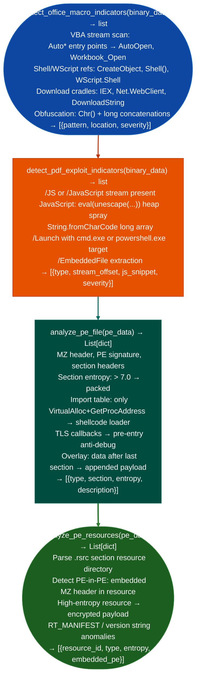

# Office/PDF Triage

Detect VBA macro indicators auto-execution entry points, Shell/WScript invocations, obfuscated string concatenation, PDF exploit patterns: JavaScript `eval()`, embedded EXE launch, and heap spray byte sequences, and PE resource section anomalies: providing a rapid first-pass triage verdict for Office and PDF document samples: via `modules/forensics_enum.py`.

---

## Why this exists

1. **`detect_office_macro_indicators()` identifies malicious VBA macro patterns statically**, it scans binary data for `AutoOpen`, `Workbook_Open`, `Document_Open`, and `Auto_Open` entry points which execute without user interaction, `Shell()`, `WScript.Shell`, `CreateObject("Shell.Application")`, `ActiveX` object creation, and PowerShell download cradle strings `IEX`, `Invoke-Expression`, `New-Object Net.WebClient`. These patterns appear in malicious Office documents used as initial access vectors.

2. `detect_pdf_exploit_indicators()` scans for JavaScript-based PDF exploit patterns: PDF documents containing JavaScript `/JS`, `/JavaScript` stream that calls `eval()`, `unescape()`, or `String.fromCharCode()` with long character arrays heap spray, and embedded file launches `/EmbeddedFile`, `/Launch` action with `cmd.exe` or `powershell.exe`. These are the canonical indicators of malicious PDF documents targeting Adobe Reader and PDF viewer vulnerabilities.

3. **`analyze_pe_file()` and `analyze_pe_resources()`** provide a detailed structural analysis of PE executables embedded within or dropped by documents: section entropy indicating packing, import table anomalies (common in malware: minimal imports + `VirtualAlloc`/`LoadLibrary` + `GetProcAddress`), resource section embedded executables PE-in-PE embedding, and version info / PE certificate anomalies.

---

## How it works



---

## Usage

```python
from modules.forensics_enum import (
    detect_office_macro_indicators,
    detect_pdf_exploit_indicators,
    analyze_pe_file,
    analyze_pe_resources
)

# Office document macro scan — returns [{severity, title, detail, host, port}]
doc_data = open('suspicious.docm', 'rb').read()
for m in detect_office_macro_indicators(doc_data):
    print(f"  [{m['severity']}] {m['title']}: {m['detail'][:80]}")

# PDF exploit scan — returns [{severity, title, detail, host, port}]
pdf_data = open('suspicious.pdf', 'rb').read()
for p in detect_pdf_exploit_indicators(pdf_data):
    print(f"  [{p['severity']}] {p['title']}: {p['detail'][:80]}")

# PE structural analysis
pe_data = open('dropped.exe', 'rb').read()
pe_findings = analyze_pe_file(pe_data)
resources = analyze_pe_resources(pe_data)
```

---

## Example output

The following illustrates Office/PDF triage output format.

```
detect_office_macro_indicators: suspicious.docm

  [HIGH] AUTOOPEN: Document_Open entry point present
  [HIGH] DOWNLOAD_CRADLE: IEX(New-Object Net.WebClient).DownloadString(...)
  [MEDIUM] OBFUSCATION: Chr() concatenation (138 calls)

detect_pdf_exploit_indicators: suspicious.pdf

  [HIGH] JS_HEAPSPRAY: eval(unescape('%u0c0c%u0c0c...'))  (78,192 bytes)
  [HIGH] LAUNCH_ACTION: /Launch cmd.exe /c powershell -enc ...

analyze_pe_file: dropped.exe

  [HIGH] PACKED_SECTION: .text entropy=7.82 (UPX-like)
  [MEDIUM] SHELLCODE_LOADER: imports VirtualAlloc + GetProcAddress only
```

---

## False positives

**`detect_office_macro_indicators()` `Chr()` concatenation**: legitimate VBA scripts sometimes use `Chr()` for non-ASCII characters in string operations for example localized templates. Short `Chr()` sequences < 20 calls are not obfuscation; flag only when the concatenation assembles a string of 50+ characters.

**High PE section entropy**: compressed game asset DLLs, legitimate packers Denuvo, Steam DRM, and self-extracting installers routinely produce sections with entropy > 7.0. Correlate high entropy with import table anomalies and overlay data before concluding that a PE is malicious.

---

## Pipeline position

Run Office/PDF triage on any document obtained during initial access analysis or from a phishing sample. Macro indicators and PDF JavaScript patterns provide rapid triage; `analyze_pe_file()` applies to any dropped or embedded PE binary for secondary analysis.

---

## Reading findings

`detect_office_macro_indicators()` and `detect_pdf_exploit_indicators()` return `List[{severity, title, detail}]`:

| Field | Content |
|:---|:---|
| `severity` | `HIGH` / `MEDIUM` |
| `title` | Finding code for example `AUTOOPEN`, `DOWNLOAD_CRADLE`, `JS_HEAPSPRAY`, `LAUNCH_ACTION` |
| `detail` | Technique description, code excerpt, or byte pattern |

---

## See also

- [Packing and Anti-Analysis Indicators](packing-and-anti-analysis-indicators.md): PE packer detection and anti-analysis technique enumeration
- [Rootkit/Bootkit Indicators](rootkit-bootkit-indicators.md): kernel persistence analysis for the post-exploitation stage following document delivery
