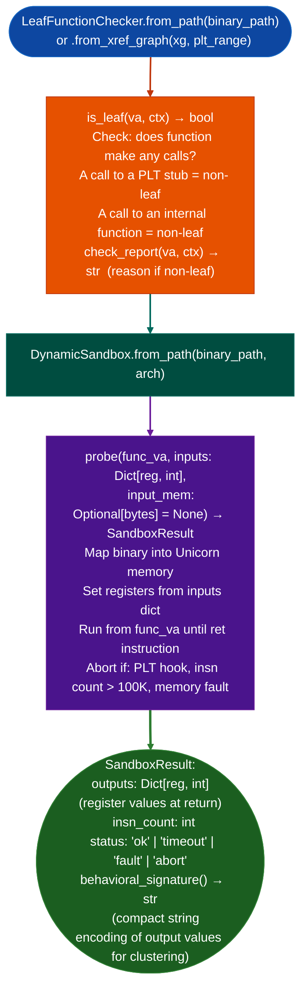

# Dynamic Sandbox Unicorn-Backed Probing

Execute leaf functions with controlled register inputs using Unicorn: capturing output register state as behavioral evidence for hypothesis validation, with safety constraints preventing access to external calls, PLT stubs, and system calls.

---

## Why this exists

1. **Static analysis can identify that a function transforms input in some way but cannot determine the exact transformation without running the code.** `DynamicSandbox` executes a leaf function with controlled inputs and captures the output register state, providing ground-truth behavioral evidence: `sandbox.probe(va, inputs={'x0': 0x41414141})` returns `{'x0': 0x12345678}`: the actual output value, not an approximation.

2. **Safety constraints make sandbox execution reliable on unknown firmware code.** The sandbox only executes "leaf functions" no external calls, verified by `LeafFunctionChecker` and aborts immediately if execution reaches a PLT stub mapped to an abort-hook region. A hard instruction-count timeout default 100,000 instructions prevents infinite loops. Snapshot/restore keeps binary memory clean between probes: each probe starts from an identical memory state.

3. Architecture support is arm64 and x86_64: the two primary firmware architectures for Ablation's main targets. LoongArch64 and MIPS64 stubs exist for future support but do not execute code. `DynamicSandbox` is described as "Phase 3" in the hypothesis engine plan, complementing static Phase 1 (taint) and Phase 2 semantic analysis.

---

## How it works



---

## Usage

```python
from ablation.analyzers.dynamic_sandbox import DynamicSandbox, LeafFunctionChecker
from ablation.analyzers.binary_context import BinaryContext

ctx = BinaryContext.load_or_build('/path/to/target.elf')

# Check which functions are leaf-safe
checker = LeafFunctionChecker.from_path('/path/to/target.elf')
safe_functions = [va for va in ctx.func_starts if checker.is_leaf(va, ctx)]
print(f"Leaf functions: {len(safe_functions)} / {len(ctx.func_starts)}")

# Probe a specific function
sandbox = DynamicSandbox.from_path('/path/to/target.elf', arch='arm64')

result = sandbox.probe(
    func_va=0x12340,
    inputs={'x0': 0x41414141, 'x1': 0x42424242}
)

if result.status == 'ok':
    print(f"Outputs: {result.outputs}")
    print(f"Behavioral signature: {result.behavioral_signature()}")
else:
    print(f"Sandbox: {result.status}")

# Cluster functions by behavioral signature (for dedup/naming)
signatures = {}
for va in safe_functions[:20]:
    r = sandbox.probe(va, inputs={'x0': 0x41, 'x1': 0x42, 'x2': 0x100})
    if r.status == 'ok':
        sig = r.behavioral_signature()
        signatures.setdefault(sig, []).append(va)
```

---

## Example output

The following illustrates sandbox probe output. Actual values are function-specific.

```
LeafFunctionChecker: <N> leaf / <M> total functions

probe(0x12340, x0=0x41414141, x1=0x42424242):
  status: ok
  outputs: {'x0': 0x1234, 'x1': 0x42424242, 'x2': 0x0}
  insn_count: 47
  behavioral_signature: 'x0:1234|x1:4242|x2:0'
```

---

## False positives

**`is_leaf()` may classify a function as a leaf when it contains indirect calls through function pointers**: if a function pointer load is not recognized as a call by `LeafFunctionChecker`, the function may attempt to execute through an uninitialized pointer in the sandbox, causing a fault. The sandbox's fault abort prevents hanging but may miss real behavior.

**Sandbox results reflect the function's behavior for one specific set of inputs**: a function with conditional behavior based on input values may produce different output register values for different inputs. Use multiple probes with varied inputs to characterize the function's full behavioral signature.

---

## Pipeline position

Run `DynamicSandbox` as Phase 3 in the hypothesis validation pipeline: after static taint (Phase 1) and semantic search (Phase 2) have identified a suspicious leaf function. Sandbox probing provides ground-truth behavioral evidence before committing to PoC development time.

---

## Reading output

`DynamicSandbox.probeva, **inputs` returns a `SandboxResult`:

| Attribute | Content |
|:---|:---|
| `va` | VA of the probed function |
| `input_regs` | `Dict[str, int]`: register values used as inputs |
| `output_regs` | `Dict[str, int]`: register values on return |
| `return_value` | `Optional[int]`: return register value, or `None` |
| `executed_insns` | Number of instructions executed |
| `memory_writes` | `List[tuple]`: `address, size, value_bytes` tuples for each memory write |
| `aborted` | `True` if execution was cut short |
| `abort_reason` | Reason string if aborted, empty otherwise |
| `arch` | Architecture string (default `'arm64'`) |

`LeafFunctionChecker.is_leafva, ctx=None` returns `True` if the function at `va` makes no external (PLT) calls: use this to identify safe probe candidates before running `DynamicSandbox`.

---

## See also

- [Evidence Scoring and Probe Ranking](evidence-scoring-and-probe-ranking.md): `ProbeRanker` that includes sandbox probing as a ranked probe type
- [Assisted Vulnerability Hypotheses](assisted-vulnerability-hypotheses.md): Phase 2 static analysis that identifies sandbox candidates
- [ARM64 Symbolic Slicing](arm64-symbolic-slicing.md): Phase 1 taint analysis complementing sandbox probing
