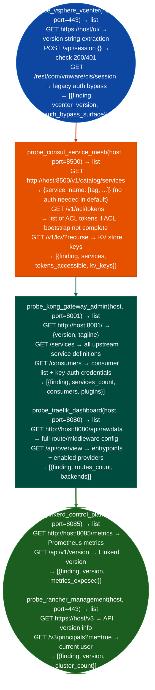

# Orchestration/Management Exposure

Probe vCenter/vSphere management APIs, Rancher cluster management, Kong Gateway admin port, Traefik dashboard, Linkerd control plane, Consul service mesh, and CNI network configuration endpoints: detecting unauthenticated management access in orchestration infrastructure: via `modules/network_analyze.py`.

---

## Why this exists

1. **`probe_vsphere_vcenter()` tests vSphere vCenter for authentication bypass surfaces**: vCenter's REST API (`/api/session`) and SOAP API (`/sdk`) are the management plane for the entire virtual infrastructure. `probe_vsphere_vcenter()` attempts the `POST /api/session` endpoint with empty credentials to test for CVE-2021-22005 class vulnerabilities, fetches `/ui/` to detect version-specific management interface exposure, and checks whether the `/rest/com/vmware/cis/session` endpoint returns without credentials in older vSphere versions.

2. **`probe_consul_service_mesh()` enumerates the Consul service catalog and ACL token list**: Consul's HTTP API port 8500 returns a full service catalog at `/v1/catalog/services` without authentication in default deployments. This reveals every registered service, its health check status, and associated metadata service tags, ports, node addresses. `probe_consul_service_mesh()` also requests `/v1/acl/tokens` (requires `management` token but often accessible in misconfigured deployments) to retrieve API tokens for other services.

3. **`probe_kong_gateway_admin()` and `probe_traefik_dashboard()` test API gateway admin interfaces**: Kong's Admin API port 8001 exposes full gateway configuration: upstream services, routes, plugins, and consumer credentials. Traefik's dashboard port 8080 exposes route, middleware, and service configuration. Both are intended for localhost access only but are commonly exposed on all interfaces in container deployments. Access to the Kong Admin API allows adding routes to any backend or modifying authentication plugin configuration.

---

## How it works



---

## Usage

```python
from modules.network_analyze import (
    probe_vsphere_vcenter,
    probe_consul_service_mesh,
    probe_kong_gateway_admin,
    probe_traefik_dashboard,
    probe_rancher_management,
    probe_linkerd_control_plane
)

for host in discovered_hosts:
    for probe, label in [
        (probe_vsphere_vcenter, 'vCenter'),
        (probe_consul_service_mesh, 'Consul'),
        (probe_kong_gateway_admin, 'Kong Admin'),
        (probe_traefik_dashboard, 'Traefik'),
    ]:
        findings = probe(host)
        for f in findings:
            # findings: {severity, title, detail, host, port}
            print(f"  [{label}] [{f['severity']}] {f['title']}: {f['detail'][:80]}")
```

---

## Example output

The following is a schematic example showing output structure and field names. Values are illustrative.

```
probe_vsphere_vcenter: <target-ip>:443

  [HIGH] VCENTER_EXPOSED: version=vSphere <version>  POST /api/session → 401 (auth enforced)

probe_consul_service_mesh: <target-ip>:8500

  [CRITICAL] CONSUL_CATALOG_OPEN: /v1/catalog/services → <N> services (no auth)
    detail: service catalog readable without authentication; service mesh topology exposed

  [HIGH] CONSUL_KV_OPEN: /v1/kv/?recurse → <N> keys accessible

probe_kong_gateway_admin: <target-ip>:8001

  [CRITICAL] KONG_ADMIN_OPEN: /services → <N> upstreams; /consumers → <N> consumers
```

---

## False positives

**`probe_consul_service_mesh()` service catalog exposure**: exposing the Consul catalog on port 8500 without ACL bootstrap is the default Consul configuration in development mode. Production deployments should have ACL bootstrapped. Verify that the endpoint is not intentionally accessible internal service mesh that trusts network perimeter before treating this as a finding.

**`probe_kong_gateway_admin()` port 8001 reachability**: Kong's Admin API should only be accessible from the management network. A reachable Admin API that requires authentication returns HTTP 401 is not an open finding. `probe_kong_gateway_admin()` confirms unauthenticated access before reporting a finding.

---

## Pipeline position

Run orchestration management probing after host/service discovery reveals management-plane port ranges 8001, 8080, 8085, 8500, and 443. Consul service catalog access provides a complete internal service map superior to network scanning.

---

## Reading findings

Orchestration probe functions return `List[{severity, title, detail, host, port}]`:

| Field | Content |
|:---|:---|
| `severity` | `CRITICAL` unauthenticated catalog/API / `HIGH` management API exposed |
| `title` | Finding code for example `CONSUL_CATALOG_OPEN`, `VCENTER_EXPOSED`, `KONG_ADMIN_OPEN` |
| `detail` | Service count, version, or configuration exposure description |
| `host` | Target IP |
| `port` | Service port |

---

## See also

- [Secrets/Access Infrastructure](secrets-access-infrastructure.md): Consul KV vault secrets and GraphQL API exposure
- [Kubernetes Policy Posture](kubernetes-policy-posture.md): Kubernetes control plane equivalent
