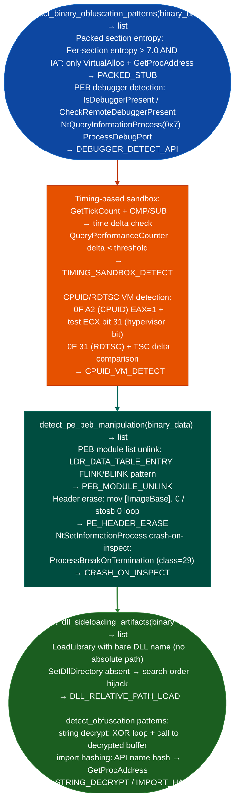

# Packing and Anti-Analysis Indicators

Detect packed section entropy, PEB/debugger detection patterns, opaque predicate and junk-code insertion, anti-disassembly overlapping instructions, data-in-code, sandbox environment fingerprinting, and binary obfuscation patterns: providing rapid classification of whether a binary requires unpacking before analysis: via `modules/forensics_enum.py`.

---

## Why this exists

1. **`detect_binary_obfuscation_patterns()` identifies four categories of anti-analysis technique** in raw binary data: (1) packed sections where entropy > 7.0 combined with a minimal import table (`VirtualAlloc` + `GetProcAddress` only), (2) `IsDebuggerPresent` / `CheckRemoteDebuggerPresent` / `NtQueryInformationProcess(ProcessDebugPort)` PEB/API debugger detection, (3) timing-based sandbox detection (`GetTickCount` / `QueryPerformanceCounter` with delta comparison), and (4) CPUID/RDTSC instruction sequences used for hypervisor or emulator fingerprinting.

2. `detect_pe_peb_manipulation()` identifies techniques that evade process image inspection: unlinking from the PEB module list (`InMemoryOrderModuleList` FLINK/BLINK manipulation), erasing the PE header from mapped memory zeroing the MZ/PE magic bytes at the base address, and `NtSetInformationProcess(ProcessBreakOnTermination)` crash-on-inspect patterns. These techniques break the PE introspection tools that security products use to identify malicious code at runtime.

3. **`analyze_elf_binary_indicators()`** provides the Linux-side counterpart: `detect_binary_obfuscation_patterns()` in the same module covers `ptracePTRACE_TRACEME` self-debugging anti-attach, `/proc/self/status` TracerPid check Linux debugger detection, and environment variable sandbox detection `SANDBOX`, `CUCKOO`, `TRIAGE` in environment variable names accessed by the binary.

---

## How it works



---

## Usage

```python
from modules.forensics_enum import (
    detect_binary_obfuscation_patterns,
    detect_pe_peb_manipulation,
    detect_dll_sideloading_artifacts
)

data = open('suspicious.exe', 'rb').read()

obfusc = detect_binary_obfuscation_patterns(data)
peb = detect_pe_peb_manipulation(data)
sideload = detect_dll_sideloading_artifacts(data)

all_findings = obfusc + peb + sideload
for f in all_findings:
    print(f"  [{f.get('severity','INFO')}] {f.get('title','?')}: {f.get('detail','')[:80]}")
```

---

## Example output

The following illustrates packing and anti-analysis indicator output format.

```
detect_binary_obfuscation_patterns: suspicious.exe

  [HIGH] PACKED_STUB: .text entropy=7.82; IAT=VirtualAlloc,GetProcAddress only
  [HIGH] DEBUGGER_DETECT_API: IsDebuggerPresent + CheckRemoteDebuggerPresent refs
  [MEDIUM] TIMING_SANDBOX_DETECT: GetTickCount delta check (potential sandbox evasion)

detect_pe_peb_manipulation:

  [HIGH] PEB_MODULE_UNLINK: LDR_DATA_TABLE_ENTRY FLINK/BLINK write pattern
  [HIGH] PE_HEADER_ERASE: write-zero to ImageBase pattern
```

---

## False positives

**High entropy packed section**: legitimate software protectors VMProtect, Themida, game DRM and self-extracting installers produce high-entropy sections that are indistinguishable from malware packers based on entropy alone. Correlate with import table anomalies: a packed stub's IAT contains only what's needed to unpack, while a DRM-protected game retains a full import table.

**`IsDebuggerPresent` as benign anti-cheat**: many games, commercial software, and enterprise applications call `IsDebuggerPresent` to protect intellectual property. This is not malware behavior in isolation. Flag it only when combined with other indicators: packed section, PEB unlinking, or import hashing.

---

## Pipeline position

Run packing and anti-analysis checks as the second analysis step on any PE binary, before attempting disassembly or taint tracking. A packed binary requires dynamic unpacking or memory dump analysis before static tools produce valid results.

---

## Reading findings

`detect_binary_obfuscation_patterns()` and `detect_pe_peb_manipulation()` return `List[{severity, title, detail}]`:

| Field | Content |
|:---|:---|
| `severity` | `HIGH` / `MEDIUM` |
| `title` | Finding code for example `PACKED_STUB`, `DEBUGGER_DETECT_API`, `PEB_MODULE_UNLINK`, `PE_HEADER_ERASE` |
| `detail` | Entropy value, API reference, or PEB manipulation pattern description |

---

## See also

- [Office/PDF Triage](office-pdf-triage.md): document-delivered dropper analysis; the dropped PE feeds into this page's checks
- [Rootkit/Bootkit Indicators](rootkit-bootkit-indicators.md): post-unpack analysis for kernel-mode malware components
