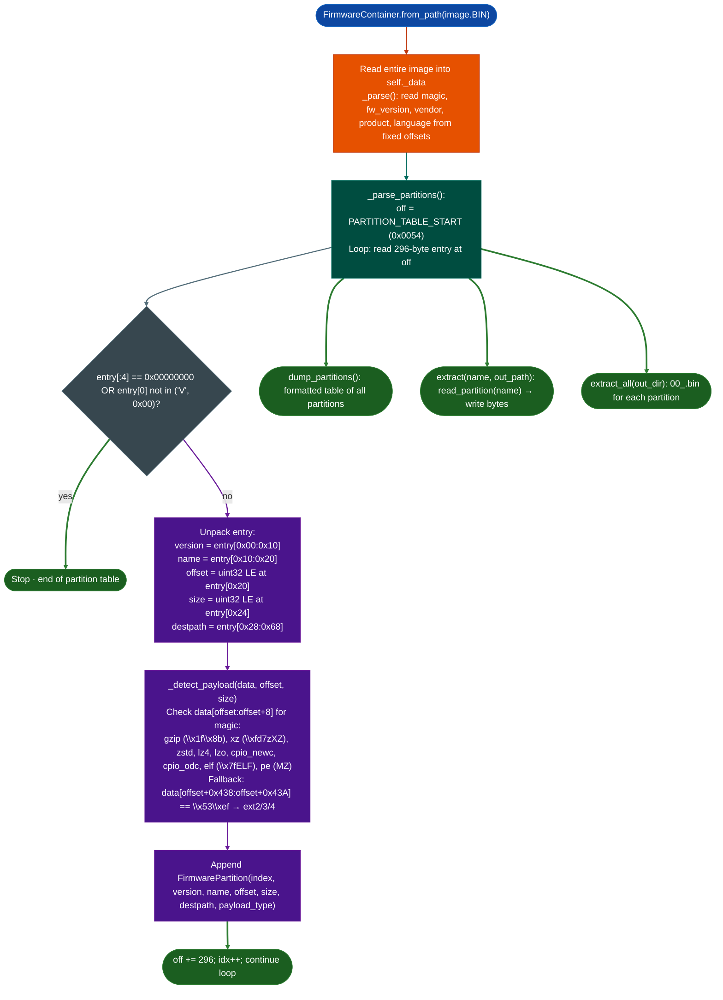

# Partition-Table Extraction

Parse a fixed-record firmware container image: reading the 84-byte header, walking the 296-byte-per-entry partition table, identifying partition payload types from magic bytes, and extracting individual or all partitions to disk for downstream analysis.

---

## Why this exists

1. **Embedded firmware images frequently use proprietary container formats that binwalk does not recognize.** Many industrial and IoT vendors Fortinet, Hikvision, HiSilicon-derived products ship firmware as a flat binary with a plaintext header, a version string, and a fixed-record partition table. These containers are not compressed at the container level: individual partitions carry gzip, xz, or ext2 payloads, but the outer envelope uses no standard archive format. `FirmwareContainer` reads the exact binary layout: magic at `0x00`, version at `0x08`, vendor/product/language strings at `0x24`–`0x53`, and partition records starting at `0x0054`.

2. **Partition payload type affects the correct next-step tool selection.** A partition of type `elf` feeds directly into `BinaryContext.load_or_build()`. A partition of type `gzip` or `xz` requires decompression before analysis. An `ext2/3/4` partition requires mounting or `debugfs` extraction. Identifying the payload type at parse time: rather than running `file` on extracted bytes: lets the analyst route each partition to the correct tool without intermediate steps.

3. **The ext2/3/4 superblock appears at offset `+0x438` inside the partition data, not at byte 0.** A magic-bytes-only scanner that checks only the first 8 bytes of each partition misses ext filesystem partitions, which carry no identifying signature at their start. `FirmwareContainer` checks the first 8 bytes for all other formats gzip, xz, zstd, lz4, lzo, cpio, ELF, PE, then falls back to the superblock probe at `+0x438` for ext2/3/4.

---

## How it works



### Container memory map

| Offset | Length | Field |
|---|---|---|
| `0x0000` | 8 | magic string |
| `0x0008` | 8 | firmware version string |
| `0x0010` | 20 | metadata block reserved |
| `0x0024` | 16 | vendor string null-padded |
| `0x0034` | 16 | product string null-padded |
| `0x0044` | 16 | language string null-padded |
| `0x0054` | n × 296 | partition table |

### Partition record 296 bytes each

| Field offset | Length | Field |
|---|---|---|
| `+0x00` | 16 | version (`char[16]`) |
| `+0x10` | 16 | name (`char[16]`) |
| `+0x20` | 4 | offset in image (`uint32 LE`) |
| `+0x24` | 4 | size in bytes (`uint32 LE`) |
| `+0x28` | 64 | flash destination path (`char[64]`) |
| `+0x68` | 184 | padding (zeros) |

### Payload type detection signatures

| Signature bytes | Type |
|---|---|
| `\x1f\x8b` | `gzip` |
| `\xfd7zXZ` | `xz` |
| `\x28\xb5\x2f\xfd` | `zstd` |
| `\x02\x21\x4c\x18` | `lz4` |
| `\x89\x4c\x5a\x4f` | `lzo` |
| `070701` | `cpio_newc` |
| `070707` | `cpio_odc` |
| `\x7fELF` | `elf` |
| `MZ` | `pe` |
| `\x53\xef` at `+0x438` | `ext2/3/4` |
| none matched | `unknown` |

---

## Usage

```python
from ablation.analyzers.firmware_container import FirmwareContainer

fw = FirmwareContainer.from_path('/fw/target/firmware_v2.1.4.BIN')

# Print container header and partition table
print(repr(fw))
fw.dump_partitions()

# Inspect partitions by type
for p in fw.partitions:
    print(f"  [{p.index:02d}] {p.name:<16} {p.payload_type:<12} "
          f"0x{p.offset:08x}+0x{p.size:08x}  dest={p.destpath}")

# Extract a specific partition
fw.extract('kernel', '/tmp/kernel.img')
fw.extract('bin', '/tmp/bin.img')

# Extract all partitions at once
paths = fw.extract_all('/tmp/fw_parts/')

# Read partition data directly (no disk write)
kernel_bytes = fw.read_partition('kernel')
print(f"Kernel partition: {len(kernel_bytes):,} bytes")

# Route each partition to the correct next-step tool
from ablation.analyzers.binary_context import BinaryContext
import lzma, gzip

for p in fw.partitions:
    data = fw.read_partition(p.name)
    if p.payload_type == 'elf':
        # Write to temp file, load into BinaryContext
        tmp = f'/tmp/{p.name}.elf'
        open(tmp, 'wb').write(data)
        ctx = BinaryContext.load_or_build(tmp)
        print(f"{p.name}: {ctx.summary()}")
    elif p.payload_type == 'gzip':
        decompressed = gzip.decompress(data)
        print(f"{p.name}: gzip → {len(decompressed):,} bytes decompressed")
    elif p.payload_type == 'xz':
        decompressed = lzma.decompress(data)
        print(f"{p.name}: xz → {len(decompressed):,} bytes decompressed")
    elif p.payload_type == 'ext2/3/4':
        print(f"{p.name}: ext2/3/4 filesystem — mount with: "
              f"mount -o loop,ro /tmp/fw_parts/{p.index:02d}_{p.name}.bin /mnt/fw")
```

---

## Example output

```
FirmwareContainer('firmware_v2.1.4.BIN', magic='FIRMA01', product='TC-AP100W', 8 partitions)

firmware: firmware_v2.1.4.BIN
  magic='FIRMA01'  version=v2.1.4  vendor=Vendor  product=TC-AP100W

#   name             offset         size        MB type         destpath
------------------------------------------------------------------------------------
0   boot             0x00000100 0x0001f400    0.1 elf          /dev/mtdblock0
1   kernel           0x0001f500 0x00200000    2.0 gzip         /dev/mtdblock1
2   rootfs           0x0021f500 0x00800000    8.0 ext2/3/4     /dev/mtdblock2
3   bin              0x0a21f500 0x00400000    4.0 xz           /dev/mtdblock3
4   config           0x0e21f500 0x00080000    0.5 unknown      /dev/mtdblock4

extracted 'bin' (4,194,304 bytes) → /tmp/bin.img
extracted 'kernel' (2,097,152 bytes) → /tmp/kernel.img

00_boot.bin    → /tmp/fw_parts/  (126,976 bytes, elf)
01_kernel.bin  → /tmp/fw_parts/  (2,097,152 bytes, gzip)
02_rootfs.bin  → /tmp/fw_parts/  (8,388,608 bytes, ext2/3/4)
03_bin.bin     → /tmp/fw_parts/  (4,194,304 bytes, xz)
04_config.bin  → /tmp/fw_parts/  (524,288 bytes, unknown)
```

---

## False positives

**Partition table termination on first all-zero record.** The parser stops when `entry[:4] == b'\x00\x00\x00\x00'`. A firmware image with padding between valid partition entries zero-filled gaps for alignment triggers early termination. If `fw.partitions` has fewer entries than expected, check whether the raw image has zero-filled gaps between partition table entries at multiples of 296 bytes from `0x0054`.

**`entry[0] not in (ord('V'), 0x00)` termination condition.** The guard checks whether the first byte of the version string is `V` ASCII 86, the start of common version strings like `V2.1` or `\x00`. Version strings starting with any other letter for example `R2.1`, `1.4.0`, `FW_v2` cause early termination. When the version string in the firmware uses a different prefix, remove or adjust this guard and re-parse.

**`payload_type='unknown'` on valid but rare formats.** The detection table covers 9 common formats plus ext2/3/4. Ubifs (`\x31\x18\x10\x06`), cramfs (`\x45\x3d\xcd\x28`), squashfs (`sqsh` / `hsqs`), and JFFS2 (`\x19\x85`) are not in the table. An `unknown` payload type does not mean the partition is empty or corrupt: run `file` on the extracted bytes to identify these formats.

---

## Pipeline position

**Before this module:** Confirm the image is a `FirmwareContainer`-format file. Check for the 8-byte magic string at `0x00` and a readable product string at `0x34`. If the file starts with a valid ELF header or gzip magic, it is a bare partition, not a container: use `BinaryContext.load_or_build()` directly.

**After this module:** For `elf` partitions: load with `BinaryContext.load_or_build()` and run `CorpusBuilder.build()` before any sweep. For `gzip`/`xz` partitions: decompress and inspect the decompressed content, these typically contain a second-level filesystem squashfs, cramfs, cpio. For `ext2/3/4` partitions: mount read-only and examine `/etc`, `/usr/sbin`, and daemon startup scripts before identifying analysis targets.

---

## Reading findings

| Field | Content |
|:---|:---|
| `fw.magic` | 8-byte container magic string |
| `fw.fw_version` | Firmware version string from header |
| `fw.vendor` / `fw.product` | Vendor and product identifier strings |
| `fw.partitions` | `List[FirmwarePartition]`: each with `index`, `name`, `version`, `offset`, `size`, `destpath`, `payload_type` |
| `p.payload_type` | Detected content type: see table above |
| `p.destpath` | Flash device path where the partition lands on the target (`/dev/mtdblock*`) |

---

## See also

- [Firmware Analysis](firmware-analysis.md): higher-level firmware analysis pipeline: filesystem extraction, binary listing
- [Binary Format and Platform Identification](binary-format-and-platform-identification.md): identify architecture of ELF partitions before BinaryContext load
- [Installer Payload Analysis](installer-payload-analysis.md): parallel parser for Windows installer container formats BitRock, NSIS, Inno Setup
