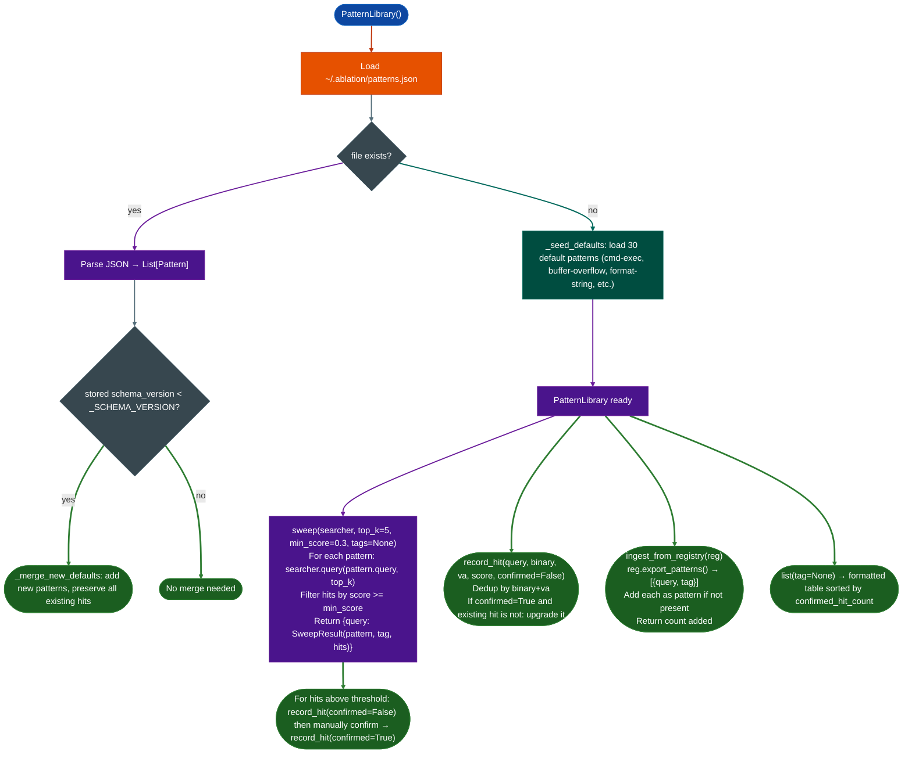

# Pattern Library

Accumulate and replay semantic search queries that have produced confirmed RE findings, so each successful query string runs automatically on every new binary, turning past confirmed findings into permanent detection coverage.

---

## Why this exists

1. **Re-running confirmed queries manually on each new binary is friction that leads to missed findings.** When a query like `"CLI handler passes argv directly to exec without sanitization"` confirms a command injection on one FortiOS build, the same pattern almost certainly exists in related builds, in the next FortiOS version, and in comparable Aruba or Huawei firmware. Without a replay mechanism, the analyst must remember to re-run that query, or it gets skipped. `PatternLibrary.sweep()` runs every confirmed pattern against a new binary in a single call.

2. **Hit rate data shapes query refinement.** Not all patterns produce useful results. A query that has matched 0 confirmed functions across 50 binaries is noise; a query with 23 confirmed hits across 8 vendors is a reliable detector. The registry tracks `confirmed_hit_count` and `total_hit_count` per pattern per binary so analysts can prune low-signal queries and refine high-signal ones based on real data rather than intuition.

3. **Schema versioning preserves accumulated hit records through default pattern updates.** The default pattern set evolves as new vulnerability classes are added. A naive overwrite on upgrade would destroy the hit records attached to existing patterns. The library stores a `schema_version` integer; on load, any new default patterns merge into the existing set while all confirmed hit records survive intact.

---

## How it works



### Default pattern categories

The library seeds 30 patterns on first load, covering:

| Tag | Example query |
|---|---|
| `buffer-overflow` | `"strcpy or strcat called with source from user-controlled config string, no length check"` |
| `cmd-exec` | `"system or popen called with command string constructed from network input"` |
| `cmd-inject` | `"CLI command string constructed from user input and evaluated without sanitization"` |
| `tcl-inject` | `"Tcl_Eval called with script constructed from user-supplied config or CLI argument"` |
| `format-string` | `"printf or syslog called with user-controlled argument directly in format position"` |
| `path-traversal` | `"user-controlled path joined or concatenated without realpath or traversal check"` |
| `integer-overflow` | `"multiplication of user-supplied count and element-size passed to malloc without overflow check"` |
| `use-after-free` | `"pointer freed inside loop or error path then dereferenced or freed again in cleanup"` |
| `double-free` | `"heap pointer freed twice on error unwind with no NULL assignment between frees"` |
| `auth-bypass` | `"session token or credential comparison short-circuits on empty or null input"` |
| `race-condition` | `"shared counter or flag read and written from multiple threads without mutex protection"` |
| `crypto` | `"IV or nonce reused across encryption calls, or nonce derived from predictable counter"` |
| `info-leak` | `"stack buffer or heap object returned in response without zeroing uninitialized bytes"` |
| `dos` | `"loop iterates until packet field reaches zero, no iteration bound, possible infinite loop"` |
| `timing-side-channel` | `"password or secret compared with strcmp instead of constant-time function"` |

---

## Usage

```python
from ablation.analyzers.pattern_library import PatternLibrary
from ablation.analyzers.semantic_search import SemanticSearcher
from ablation.analyzers.binary_context import BinaryContext

pl = PatternLibrary()  # loads ~/.ablation/patterns.json

# Print all patterns with hit stats
print(pl.list())
print(pl.list(tag='cmd-exec'))  # filter by tag

# Sweep all patterns against a new binary
ctx = BinaryContext.load_or_build('/fw/fortigate/httpsd')
searcher = SemanticSearcher.from_context(ctx)
searcher.build_corpus()

results = pl.sweep(searcher, top_k=5, min_score=0.65)
for query, result in results.items():
    if result.hits:
        print(f"\n[{result.tag}] {query[:70]}")
        for va, score in result.hits:
            print(f"  0x{va:x}  {score:.3f}  {ctx.name(va)}")

# Record a hit (candidate) then confirm after manual verification
pl.record_hit(
    query="system or popen called with command string constructed from network input",
    binary="httpsd",
    va=0x22ccc0,
    score=0.91,
    confirmed=False,
)
# After TaintTracker confirms it:
pl.record_hit(
    query="system or popen called with command string constructed from network input",
    binary="httpsd",
    va=0x22ccc0,
    score=0.91,
    confirmed=True,  # upgrades the existing hit record
)
pl.save()

# Add a new pattern for a vendor-specific pattern class
pl.add(
    "fadcsystem called with buffer built from SSL cert field without sanitization",
    tag="cmd-exec",
)
pl.save()

# Ingest confirmed findings from FindingRegistry as new patterns
from ablation.analyzers.finding_registry import FindingRegistry
reg = FindingRegistry()
n = pl.ingest_from_registry(reg)
pl.save()
print(f"{n} new patterns ingested")
```

---

## Example output

```
PatternLibrary: 33 patterns  (/home/user/.ablation/patterns.json)
  Tag                  Confirmed  Total  Query
  -------------------- ---------  -----  -----
  cmd-exec                    23     41  system or popen called with command string construct...
  buffer-overflow             18     35  strcpy or strcat called with source from user-control...
  format-string               12     21  printf or syslog called with user-controlled argument...
  cmd-inject                   8     15  CLI command string constructed from user input and ev...
  use-after-free               5     11  pointer freed inside loop or error path then derefere...
  integer-overflow             4      9  multiplication of user-supplied count and element-siz...
  auth-bypass                  3      7  session token or credential comparison short-circuits...
  ...

[cmd-exec] system or popen called with command string constructed from network input
  0x22ccc0  0.912  recv_handler
  0x40b200  0.877  http_param_execute
  0x40c150  0.841  cli_exec_dispatch

[buffer-overflow] strcpy or strcat called with source from user-controlled config string, no length check
  0x22d400  0.901  config_parser_strncpy
  0x22e100  0.856  copy_vdom_name
```

---

## False positives

**Low `min_score` threshold produces noise.** The default `min_score=0.3` in `sweep()` captures distant semantic matches. In practice, a score below 0.65 rarely corresponds to the target vulnerability class. Use `min_score=0.65` for triage sweeps and `min_score=0.80` for high-precision runs where manual review capacity is limited.

**Pattern drift over engagement count.** As confirmed hit counts accumulate on high-confidence patterns, their statistical weight grows. This can cause `list()` output to appear dominated by a handful of patterns, obscuring new low-hit-count patterns. Filter by `tag` to review coverage across categories rather than reading the full list.

---

## Pipeline position

**Before this module:** `SemanticSearcher.build_corpus()` on the target binary: `sweep()` requires a pre-built corpus.

**After this module:** For every hit above threshold, call `FuncProfiler.profile()` and `SinkArgClassifier.classify_all()`. Confirmed findings go into `FindingRegistry.register()` and back into the pattern library via `ingest_from_registry()`.

---

## Reading the library state

| Field | Content |
|:---|:---|
| `Pattern.query` | The semantic search query string |
| `Pattern.tag` | Vulnerability class tag such as `cmd-exec` and `buffer-overflow` |
| `Pattern.confirmed_hit_count` | Count of hits marked `confirmed=True` across all binaries |
| `Pattern.total_hit_count` | Count of all hits confirmed + unconfirmed across all binaries |
| `PatternHit.binary` | Binary filename where the hit occurred |
| `PatternHit.va` | Function VA |
| `PatternHit.score` | Cosine similarity score from `SemanticSearcher.query()` |
| `PatternHit.confirmed` | `True` after manual RE confirmation; `False` for unreviewed candidates |
| `SweepResult.hits` | `List[Tuple[int, float]]`: `va, score` pairs for one pattern |

---

## See also

- [Finding Registry](finding-registry.md): source of confirmed findings for `ingest_from_registry()`
- [Semantic Code Search](semantic-code-search.md): the underlying query engine for `sweep()`
- [Sink Arg Classifier](sink-arg-classifier.md): follow-up tool for sweep hits at exec-class sinks
- [Function Profiler](function-profiler.md): deep profile of candidate functions from sweep results
