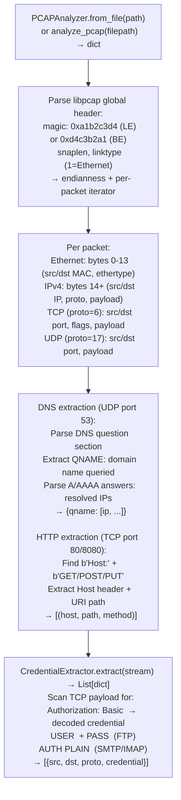

# PCAP Inspection

Extract DNS queries, HTTP request/response metadata, and cleartext credential patterns from PCAP files — without requiring Scapy or Wireshark — using a pure-Python packet parser that handles Ethernet/IP/TCP/UDP frame reassembly, via `modules/network_analyze.py` `PCAPAnalyzer`.

---

## Why this exists

1. **`PCAPAnalyzer` extracts cleartext credentials without external tools.** `CredentialExtractor` (in `net_sniffer.py`) searches TCP streams for HTTP Basic Auth `Authorization: Basic` headers, FTP `USER`/`PASS` commands, SMTP `AUTH PLAIN`, and Telnet password prompts. These patterns are detected in the raw byte stream without requiring application-layer protocol parsing; `CredentialExtractor.extract()` returns matches with the stream direction, source IP, and port.

2. **`analyze_pcap()` provides a single-call PCAP summary** — DNS query names and resolved IPs, HTTP `Host` headers and URI paths (for unencrypted HTTP/1.x), and protocol distribution by port number. This is the standard first-pass on any PCAP obtained from a post-compromise capture session, providing a communication map before detailed stream analysis.

3. **`PCAPAnalyzer` is dependency-free** — it implements libpcap global header parsing (`magic 0xa1b2c3d4`, `snaplen`, `linktype`), Ethernet frame extraction (`linktype=1`), IPv4 header parsing, and TCP/UDP payload extraction in pure Python `struct.unpack`. No Scapy, dpkt, or system libpcap required.

---

## How it works



---

## Usage

```python
from modules.network_analyze import PCAPAnalyzer, analyze_pcap
from modules.net_sniffer import CredentialExtractor

# Quick PCAP summary
summary = analyze_pcap('/path/to/capture.pcap')
print(f"DNS queries: {list(summary['dns'].keys())[:10]}")
print(f"HTTP hosts: {summary['http_hosts'][:5]}")

# Detailed analysis with credential extraction
analyzer = PCAPAnalyzer.from_file('/path/to/capture.pcap')
streams = analyzer.tcp_streams()
extractor = CredentialExtractor()
for stream in streams:
    creds = extractor.extract(stream.payload)
    for c in creds:
        print(f"  [{c['proto']}] {c['src']} → {c['credential']}")
```

---

## Example output

The following illustrates PCAP inspection output format.

```
PCAPAnalyzer: capture.pcap  (<N> packets)

DNS queries:
  api.internal → 10.0.1.50
  db.prod.internal → 10.0.2.100

HTTP hosts: api.internal, db.prod.internal

CredentialExtractor:
  [HTTP Basic] 10.0.0.5 → admin:C1sco12345  (Authorization: Basic)
  [FTP] 10.0.0.7 → USER=ftpuser PASS=<plaintext>
```

---

## False positives

**HTTP Basic credential extraction is regex-based** — Base64-encoded values that happen to match the `Authorization: Basic ` prefix in non-authentication traffic (e.g., a base64-encoded block in a POST body that starts with `Basic `) will trigger a false positive. Verify that the extracted value is in an `Authorization:` HTTP header, not a body parameter.

**DNS reassembly is single-packet only** — DNS responses that span multiple UDP packets (rare but possible for DNSSEC responses) will not be parsed correctly. Truncated DNS responses are logged but not decoded.

---

## Pipeline position

Run PCAP inspection on any packet capture obtained from a post-compromise network tap or promiscuous-mode capture session. DNS query analysis provides the internal network map; credential extraction provides lateral movement material. Feed extracted hosts to `ICMPScanner` for live host confirmation.

---

## See also

- [Raw Packet Capture](raw-packet-capture.md) — `RawSniffer` for live capture to produce PCAP for this tool
- [Local Network Inventory](local-network-inventory.md) — `NetworkAnalyzer` for live network interface and connection enumeration
