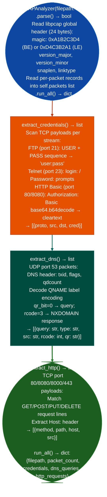

# PCAP Inspection

Extract DNS queries with NXDOMAIN/domain-flux detection, cleartext credentials FTP USER/PASS, Telnet login prompts, HTTP Basic Auth, and HTTP request lines from PCAP files: without Scapy, dpkt, or libpcap: using a pure-Python libpcap global header parser that handles Ethernet/IP/TCP/UDP frame reassembly, via `modules/network_analyze.py` `PCAPAnalyzer`.

---

## Why this exists

1. **`PCAPAnalyzer` extracts cleartext credentials from PCAP files without external tools.** `extract_credentials()` scans TCP payloads for FTP `USER`/`PASS` command sequences (port 21), Telnet `login:` and `Password:` prompts (port 23), and HTTP Basic Auth `Authorization: Basic <base64>` headers ports 80/8080. Credentials are returned as `[{'proto', 'src', 'dst', 'cred'}]` dicts where `cred` is the decoded plaintext string.

2. **`analyze_pcap()` provides a single-call PCAP summary**: credential extraction, DNS query enumeration, and HTTP request logging combined in one pass. DNS extraction (`extract_dns()`) returns `[{'query', 'type', 'src', 'rcode', 'qr'}]` dicts; NXDOMAIN responses (rcode=3) are included as domain-flux indicators per the Conficker analysis pattern from Violent Python chapter 4.

3. **`PCAPAnalyzer` is dependency-free**, it parses the libpcap global header `magic 0xA1B2C3D4` or `0xD4C3B2A1` LE, `snaplen`, `linktype`, Ethernet frame extraction (`linktype=1`), and IPv4/TCP/UDP header fields in pure Python `struct.unpack`. `LINKTYPE_ETHERNET = 1` and `LINKTYPE_RAW = 101` are the two supported link types. No Scapy, dpkt, or system libpcap is required.

---

## How it works



---

## Usage

```python
from modules.network_analyze import PCAPAnalyzer, analyze_pcap

# Single-call summary
summary = analyze_pcap('/path/to/capture.pcap')
print(f"Packets: {summary['packet_count']}")
print(f"Credentials found: {len(summary['credentials'])}")
for c in summary['credentials']:
    # keys: proto, src, dst, cred
    print(f"  [{c['proto']}] {c['src']} → {c['cred']}")

# DNS query history
for d in summary['dns_queries']:
    # keys: query, type, src, rcode, qr
    if d['rcode'] == 3:
        print(f"  NXDOMAIN from {d['src']}: {d['query']}")
    elif d['qr'] == 'query':
        print(f"  Query from {d['src']}: {d['query']} ({d['type']})")

# Direct instantiation for multi-step use
analyzer = PCAPAnalyzer('/path/to/capture.pcap')
analyzer.parse()
credentials = analyzer.extract_credentials()
dns = analyzer.extract_dns()
```

---

## Example output

The following is a schematic example showing output structure and field names. Values are illustrative.

```
analyze_pcap: capture.pcap

packet_count: <N>

credentials:
  {proto: 'FTP', src: '<src-ip>', dst: '<dst-ip>', cred: '<user>:<password>'}
  {proto: 'HTTP', src: '<src-ip>', dst: '<dst-ip>', cred: '<user>:<password>'}

dns_queries:
  {query: 'internal-api.corp.example', type: 'A', src: '<src-ip>', rcode: 0, qr: 'query'}
  {query: 'db.prod.example', type: 'A', src: '<src-ip>', rcode: 0, qr: 'query'}
  {query: 'rnd-a1b2.evil.example', type: 'A', src: '<src-ip>', rcode: 3, qr: 'response'}

http_requests:
  {method: 'GET', path: '/api/v1/users', host: 'api.internal.example', src: '<src-ip>'}
```

---

## False positives

**HTTP Basic credential extraction is regex-based**: the `Authorization: Basic` pattern is matched on the raw TCP payload. A base64-encoded value that appears in a POST body with a field name containing `Authorization:` will match. Verify that extracted credentials appear in an HTTP header context, not a body parameter.

**DNS NXDOMAIN domain-flux detection**: a single NXDOMAIN response does not confirm domain flux. The pattern is significant only when a single source IP generates many NXDOMAIN responses in sequence: consistent with a worm or malware attempting to locate a C2 via generated domain names.

---

## Pipeline position

Run PCAP inspection on any packet capture obtained from a post-compromise network tap or promiscuous-mode capture session. DNS query analysis provides the internal network map; credential extraction provides lateral movement material. Feed extracted hosts to `ICMPScanner` for live host confirmation.

---

## Reading output

`PCAPAnalyzerfilepath.run_all()` returns a dict:

| Key | Content |
|:---|:---|
| `filepath` | Path to the PCAP file |
| `packet_count` | Total packets parsed from the PCAP |
| `credentials` | `list`: cleartext credentials extracted FTP, Telnet, HTTP Basic Auth |
| `dns_queries` | `list`: DNS query records |
| `http_requests` | `list`: HTTP request records |

The module-level `analyze_pcapfilepath` is a convenience wrapper that calls `PCAPAnalyzerfilepath.run_all()`.

---

## See also

- [Raw Packet Capture](raw-packet-capture.md): `RawSniffer` for live capture producing PCAP files for analysis here
- [DNS Service Posture](dns-service-posture.md): `probe_dns_zone_transfer()` and `probe_dns_recursion()` for active DNS security probing
