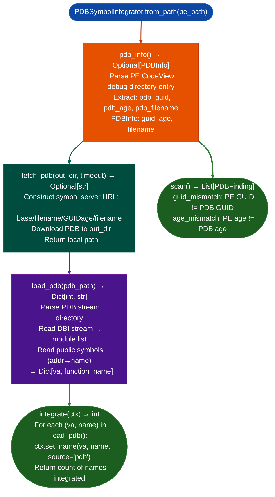

# PDB Symbol Integration

Parse Windows PDB Program Database symbol files and integrate function names, type information, and source line data into `BinaryContext` via `NameRegistry`: enabling symbol-aware analysis of MSVC-compiled PE binaries without requiring Microsoft's `dbghelp.dll` or a Windows analysis environment.

---

## Why this exists

1. **MSVC-compiled PE binaries ship without symbols in the binary**: function names, type information, and source file paths live in a separate `.pdb` file. Without PDB integration, every function in the binary is anonymous, making `SemanticSearcher` queries ineffective and `ctx.names_table()` empty. `PDBSymbolIntegrator.load_pdb()` populates `NameRegistry` with all function names from the PDB, enabling the full Ablation analysis pipeline on Windows targets.

2. **The PDB GUID embedded in the PE's CodeView debug directory entry identifies the exact matching PDB on Microsoft's symbol server.** `PDBSymbolIntegrator.fetch_pdb()` uses this GUID to download the matching PDB via `symsrv.dll` protocol (`https://msdl.microsoft.com/download/symbols/`), enabling on-demand symbol resolution for any Microsoft-signed binary.

3. **`PDBFinding` captures mismatches**: when the PE's embedded PDB GUID does not match the PDB file's own GUID for example a patched binary paired with an old PDB, `PDBSymbolIntegrator` reports this as a `guid_mismatch` finding. A patched binary with a mismatched PDB cannot be reliably analyzed with those symbols.

---

## How it works



---

## Usage

```python
from ablation.analyzers.pdb_symbol_integrator import PDBSymbolIntegrator
from ablation.analyzers.binary_context import BinaryContext

ctx = BinaryContext.load_or_build('/path/to/target.dll')
integrator = PDBSymbolIntegrator.from_path('/path/to/target.dll')

info = integrator.pdb_info()
if info:
    print(f"PDB: {info.filename}  GUID={info.guid}  age={info.age}")

    # Download matching PDB
    pdb_path = integrator.fetch_pdb(out_dir='/tmp/symbols/')
    if pdb_path:
        count = integrator.integrate(ctx)
        print(f"Integrated {count} symbols into BinaryContext")
        print(ctx.names_table())

findings = integrator.scan()
for f in findings:
    print(f.fmt())
```

---

## Example output

The following illustrates PDB integration output format. Actual GUIDs and names are binary-specific.

```
PDBSymbolIntegrator: target.dll

PDBInfo:
  filename: target.pdb
  guid: {XXXXXXXX-XXXX-XXXX-XXXX-XXXXXXXXXXXX}
  age: <N>

fetch_pdb(): downloaded to /tmp/symbols/target.pdb

integrate(): <N> symbols integrated

names_table() (sample):
  <va>  CoCreateInstanceWrapper   (pdb)
  <va>  ValidateClientCertificate  (pdb)
```

---

## False positives

**`guid_mismatch` findings are expected for patched binaries**: a security patch that replaces a function without updating the PDB produces a GUID mismatch. The symbols may still be partially valid for unchanged functions but cannot be trusted for patched addresses. Use `pdb` source symbols only for functions not in the patch delta.

**Symbol server download requires network access**: `fetch_pdb()` will fail in air-gapped environments. Supply a locally mirrored PDB path via `load_pdbpdb_path` directly when network access is unavailable.

---

## Pipeline position

Run `PDBSymbolIntegrator` immediately after `BinaryContext.load_or_build()` for any MSVC-compiled PE target. Symbol integration makes `SemanticSearcher`, `FuncProfiler`, and all downstream analysis significantly more effective on Windows targets.

---

## Reading output

`PDBSymbolIntegrator.inject_into_contextctx, pdb_path=None` loads PDB symbols into `BinaryContext` via `ctx.set_name()` and returns `int`: the count of symbol names injected. When `pdb_path=None`, the method fetches the PDB from the Microsoft symbol server automatically.

`PDBSymbolIntegrator.load_pdbpdb_path` returns `Dict[int, str]`: `{rva: name}` for all public symbols in the PDB without touching `BinaryContext`.

`PDBSymbolIntegrator.fetch_pdb(out_dir=None)` downloads the PDB to `out_dir` or a temp directory and returns the local path as a string, or `None` on failure.

After `inject_into_context()`, `ctx.name(va)` returns the PDB symbol name for any function that had one.

---

## See also

- [Persistent Analysis Context](persistent-analysis-context.md): `BinaryContext` whose `NameRegistry` is populated by `integrate()`
- [Function Semantic Search](function-semantic-search.md): `SemanticSearcher` that benefits from symbol-named functions
