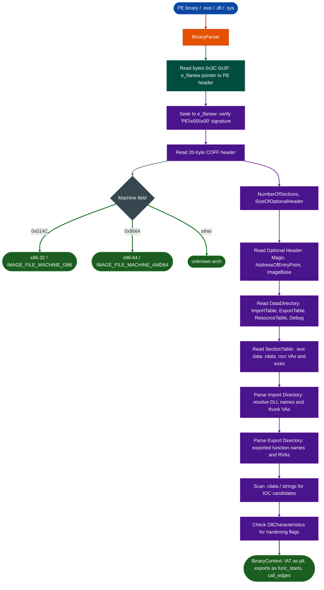

# PE Internals and Indicators

Parse Windows Portable Executable binaries: including `.exe`, `.dll`, `.sys`, and driver files: extracting the COFF header, optional header, import/export tables, sections, resources, and embedded strings, while flagging security-relevant patterns including anti-debug tricks, IOC candidates, and compiler hardening state.

---

## Why this exists

1. **Windows PE is a first-class target format in Ablation.** Cisco ASA, Fortinet Windows management agents, RPC servers, kernel drivers, and a large portion of the corporate attack surface runs as PE binaries. Before v2.45.0, loading a PE into `BinaryContext` silently returned an empty context: every semantic search, taint trace, and function-profile call returned nothing. The PE parser maps the IAT as the PLT, populates exports as function starts, and makes every downstream analysis tool work on Windows binaries with no code changes.

2. **The PE format encodes security posture directly in its headers.** The `IMAGE_DLLCHARACTERISTICS` field in the optional header records whether Dynamic Base (ASLR), NX (DEP), SEH protection, CFG, and Control Flow Guard are enabled. These are not inferred: they are declared in the binary. Surfacing them immediately tells the analyst what mitigations they are working against before disassembly begins.

3. **PE imports reveal capability and attack surface.** Knowing that a binary imports `NtCreateThreadEx`, `ZwWriteVirtualMemory`, `RtlDecompressBuffer`, or `CryptDecodeObjectEx` is often enough to characterize its purpose and prioritize analysis. The import table is the fastest path to understanding what a PE binary can do.

---

## How it works

The PE format layers three headers before reaching the actual sections:



**DOS header and e_lfanew.** Every PE file begins with the legacy DOS MZ header (`4D 5A`). Bytes 0x3C–0x3F hold `e_lfanew`, the file offset to the PE signature. This indirection exists because PE files must also be valid DOS executables that print "This program cannot be run in DOS mode" when executed on legacy hardware.

**COFF header.** The 20-byte COFF header immediately follows the PE signature. The `Machine` field identifies the architecture: `0x014C` is x86-32 IMAGE_FILE_MACHINE_I386, `0x8664` is x86-64 IMAGE_FILE_MACHINE_AMD64. The `Characteristics` field records file-level attributes including whether the image is a DLL, whether it is stripped of relocations, and whether it is a system-level image.

**Optional header.** Despite its name, the optional header is required for executable images. It contains `AddressOfEntryPoint` (RVA of the program's first instruction), `ImageBase` preferred load address, and the `DataDirectory`: an array of 16 entries pointing to the import table, export table, resource table, security directory, debug directory, and other critical structures.

**Hardening flags from DllCharacteristics.** The optional header's `DllCharacteristics` field is a bitmask:

| Bit | Constant | Meaning |
|---|---|---|
| `0x0040` | `IMAGE_DLLCHARACTERISTICS_DYNAMIC_BASE` | ASLR Dynamic Base enabled |
| `0x0100` | `IMAGE_DLLCHARACTERISTICS_NX_COMPAT` | DEP/NX compatible |
| `0x0400` | `IMAGE_DLLCHARACTERISTICS_NO_SEH` | No structured exception handlers |
| `0x4000` | `IMAGE_DLLCHARACTERISTICS_GUARD_CF` | Control Flow Guard enabled |

---

## BinaryParser (PE path)

```python
from ablation.core.binary_parser import BinaryParser

parser = BinaryParser('/path/to/target.exe')
info = parser.parse()
# {
#   'format': 'PE',
#   'bits': 64,
#   'entry_point': '0x1400012a0'
# }

print(parser.report())
# Binary: target.exe
# Format: PE
# Architecture: 64 bit
# Entry Point: 0x1400012a0
```

For full import/export resolution, taint analysis, and semantic search, use `BinaryContext`:

```python
from ablation.analyzers.binary_context import BinaryContext

# Works identically for PE as for ELF — same API, same downstream tools
ctx = BinaryContext.load_or_build('/path/to/rpcss.dll')
print(ctx.summary())

# Query imports (IAT exposed as plt)
for va, name in ctx.plt.items():
    print(f"  0x{va:x}  {name}")

# Semantic search on a Windows PE
from ablation.analyzers.semantic_search import SemanticSearcher
results = SemanticSearcher(ctx).query("unauthenticated RPC registration")

# Taint trace on a Windows PE
from ablation.analyzers.taint_tracker import TaintTracker
# (same API as for ELF targets)
```

---

## Usage

```python
from ablation.core.binary_parser import BinaryParser

p = BinaryParser('/path/to/driver.sys')
info = p.parse()

print(f"Architecture: {info['bits']}-bit PE")
print(f"Entry point:  {info['entry_point']}")

# Combine with BinaryContext for deep analysis
from ablation.analyzers.binary_context import BinaryContext
from ablation.analyzers.rpc_server_analyzer import RPCServerAnalyzer

ctx = BinaryContext.load_or_build('/path/to/rpcss.dll')
rpc = RPCServerAnalyzer.from_path('/path/to/rpcss.dll')
findings = rpc.scan()
```

---

## Example output

```
Binary: rpcss.dll
Format: PE
Architecture: 64 bit
Entry Point: 0x1800010f0

Hardening:
  ASLR (Dynamic Base): YES
  DEP / NX:            YES
  Control Flow Guard:  YES
  SafeSEH:             YES

Imports (selected):
  ntdll.dll!NtCreateThreadEx         → 0x18004a000
  kernel32.dll!CreateProcessW        → 0x18004a008
  sechost.dll!RegisterServiceCtrlHandlerExW → 0x18004a010
```

---

## False positives

**Packed or encrypted PE files.** Packers UPX, MPRESS, custom firmware loaders present a valid PE header wrapping compressed or encrypted content. The parser will read the header correctly but the section data will contain the packer stub, not the original code. Look for a very small import table (often just `LoadLibrary` / `GetProcAddress`) combined with high-entropy sections as a packing indicator. Use the Entropy Mapper to confirm.

**Managed .NET assemblies.** .NET binaries are valid PE files but their code lives in the CLR metadata, not in native x86/x64 instructions. The parser reads the PE structure correctly but the IAT will only contain `_CorExeMain` from `mscoree.dll`. Downstream taint and disassembly tools operate on the native stub only, not the managed bytecode.

**Forwarded exports.** Some DLLs export function names that are actually forwarded to another DLL for example `kernel32.dll!HeapAlloc` forwards to `ntdll.dll!RtlAllocateHeap`. The parser records the RVA correctly; the forwarding target is available in the export directory's forwarded string field.

---

## Pipeline position

**Before this module:** File acquisition. No Ablation prerequisite.

**After this module:** `BinaryContext.load_or_build()` uses the parsed PE structure to build the IAT map, function start list, and call graph. The Windows PE-specific analyzers: `RPCServerAnalyzer`, `CFGBypassDetector`, `KernelDriverAnalyzer`, `SEHChainAnalyzer`: all require a `BinaryContext` built on top of this parser.

---

## Reading findings

| Field | Content |
|:---|:---|
| `format` | `'PE'` |
| `bits` | `32` or `64` (None if machine type is unrecognized) |
| `entry_point` | Hex string of the `AddressOfEntryPoint` RVA |

---

## See also

- [Binary Context](binary-context.md): full analysis context; required for all downstream tools
- [Windows PE Security Analysis](windows-pe.md): PE sweep, CFG, SEH, RPC, COM, ETW, symbol and pool-allocation analyses
- [Windows Kernel Driver & BYOVD](kernel-drivers.md): driver-specific analysis built on PE parsing
- [RPC Server Analyzer](rpc-server-analyzer.md): deep RPC interface and endpoint analysis for PE binaries
- [ELF Internals and Hardening](elf-internals-and-hardening.md): equivalent parser for ELF targets
