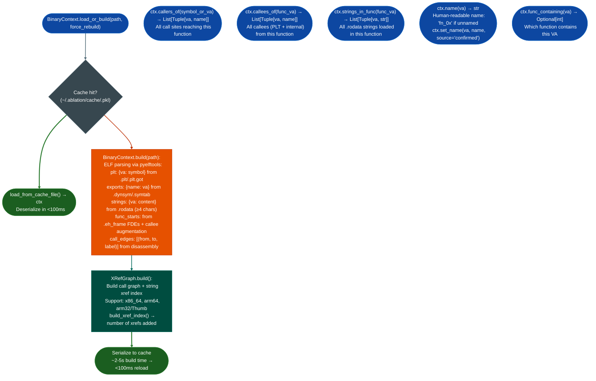

# Persistent Analysis Context

Pre-computed, serialized binary context cache that captures ELF parsing results once and reloads in under 100ms on subsequent sessions: storing PLT stub mappings, export symbols, `.rodata` strings, function start VAs, and the flat call graph in `~/.ablation/cache/`, eliminating the 2–5 second per-session ELF parsing overhead.

---

## Why this exists

1. **ELF parsing PLT resolution, `.eh_frame` FDE extraction, string table scan, call edge enumeration takes 2–5 seconds per binary: on a firmware image with 40 shared libraries, that is 80–200 seconds of parsing overhead per session if re-parsed each time.** `BinaryContext.load_or_build()` builds the context once and serializes it to `~/.ablation/cache/<binary_hash>.pkl`; subsequent loads from cache take under 100ms regardless of binary size.

2. `BinaryContext` is the single required input for every Ablation analyzer: `CFGBuilder`, `TaintTracker`, `FuncProfiler`, `SinkArgClassifier`, `FormatStringScanner`, `RegAnnotator`, and all other analyzers accept `from_context(ctx)` and require only the pre-built `BinaryContext`. Building the context once at session start and passing it to all analyzers is the baseline usage pattern described in `CLAUDE.md`.

3. **`BinaryContext` closes the primary capability gap vs. Ghidra for LLM-assisted RE: knowing what strings a function references and who calls it.** `ctx.strings_in_func(va)` returns all `.rodata` strings the function loads via RIP-relative LEA; `ctx.callers_of(symbol)` returns all call sites to a named function. Both dramatically improve `SemanticSearcher` embedding quality and `FuncProfiler` output by providing richer function descriptions without manual disassembly.

---

## How it works



---

## Usage

```python
from ablation.analyzers.binary_context import BinaryContext

# Build once; reload from cache on subsequent calls
ctx = BinaryContext.load_or_build('/path/to/target.elf')
print(ctx.summary())

# Names table (if symbols present)
if ctx.names_count():
    print(ctx.names_table())

# PLT lookups
print(ctx.plt)                          # {va: symbol_name}
print(ctx.plt_name(0x401020))           # 'recv'

# Export lookups
va = ctx.export_va('http_request_handler')

# Call graph queries
callers = ctx.callers_of('system')
callees = ctx.callees_of(0x12340)

# String lookups
strings = ctx.strings_in_func(0x12340)  # strings referenced in this function
nearby = ctx.strings_near(0x12340, radius=128)

# Name management
ctx.name(0x12340)                        # 'fn_0x12340' (unnamed)
ctx.set_name(0x12340, 'parse_request', source='confirmed')
ctx.name(0x12340)                        # 'parse_request'

# Force rebuild (e.g., after injecting new function starts)
ctx2 = BinaryContext.load_or_build('/path/to/target.elf', force_rebuild=True)
```

---

## Example output

```
BinaryContext: /path/to/target.elf
  PLT entries:   <N>
  Exports:       <M>
  Strings:       <K>  (.rodata)
  Function starts: <J>  (from eh_frame + callee augmentation)
  Call edges:    <L>
  Cache: ~/.ablation/cache/<hash>.pkl  (reload in <100ms)
```

---

## False positives

**`func_starts` from `.eh_frame` FDE entries includes exception landing pads**, these appear as spurious function starts mid-function. They do not cause analysis errors but increase the number of functions `SemanticSearcher` and `CorpusBuilder` process. Use `ctx.func_containing(va)` to test whether a discovered start is within a known function before treating it as an independent function entry.

**Cache invalidation is manual**: if the binary changes on disk for example a new version is downloaded to the same path, the cache retains the old binary's data. Use `force_rebuild=True` when the binary has changed or `ctx.summary()` shows unexpected values.

---

## Pipeline position

`BinaryContext.load_or_build()` is always step 2 in the RE workflow CLAUDE.md: immediately after session start, before any analysis. Every other analyzer in the pipeline takes a `BinaryContext` input. Build the context once per binary per session; pass the same `ctx` object to all analyzers.

---

## Reading output

`BinaryContext.summary()` returns a formatted summary string. Key attributes:

| Attribute / Method | Content |
|:---|:---|
| `plt_entries` | Dict of PLT entry VA → symbol name |
| `exports` | Dict of export VA → name |
| `strings` | `List[va, str]`: `.rodata` strings |
| `func_starts` | `List[int]`: function start VAs |
| `call_edges` | `List[caller_va, callee_va]` |
| `name(va)` | Named function at VA (or `None`) |
| `set_nameva, name, source` | Register a name with source tag |
| `names_table()` | Formatted table of all named functions |

---

## See also

- [Control-Flow Graph Construction](control-flow-graph-construction.md): `CFGBuilder(ctx)` uses the context for disassembly
- [Function Corpus Builder](function-corpus-builder.md): `CorpusBuilder.build()` augments the context with `ANGR_INFERRED` records
- [Debug Metadata Recovery](debug-metadata-recovery.md): `extract_eh_frame_starts()`, `extract_debug_funcs()`, `extract_btf_funcs()` add function boundaries and names to the context
