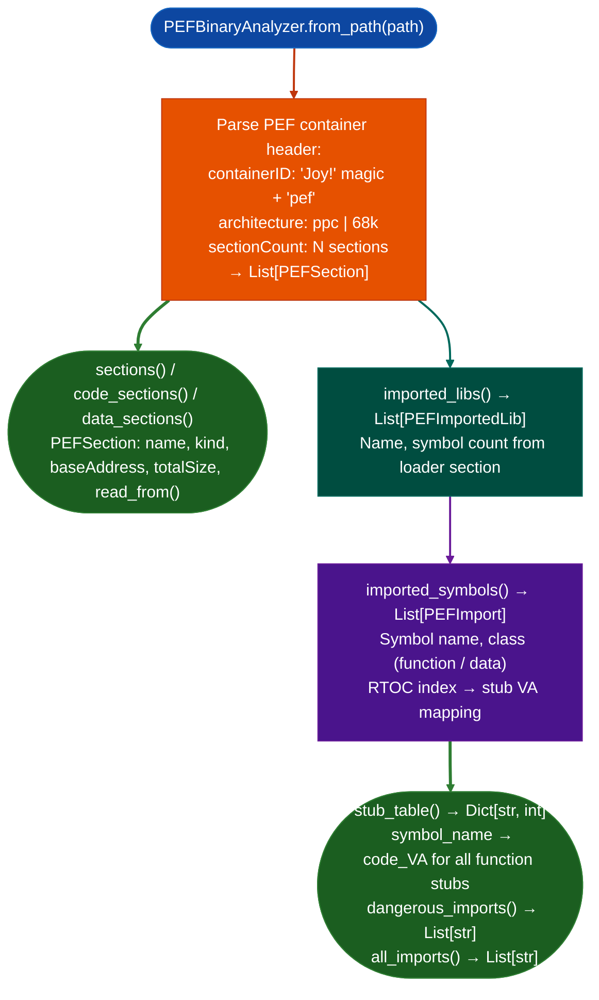

# PowerPC PEF/CFM Binary Analysis

Parse PowerPC PEF Preferred Executable Format binaries used by Mac Classic CFM Code Fragment Manager: resolving CFM import stubs, mapping symbol names to code VAs, and providing a `BinaryContext`-compatible surface for taint analysis against PGPuam, PGPuam Server, and Mac Classic networking utilities.

---

## Why this exists

1. **`PPC32TaintTracker` requires ELF, it cannot load PEF files.** All PEF CFM PPC32 Mac Classic binaries PGPuam, PGPuam Server, and Tool_Chest networking utilities were analyzed by hand across sessions 3–11 because there was no PEF-aware loader. `PEFBinaryAnalyzer` provides PEF container parsing, section extraction, and import name resolution for the full CFM binary class.

2. **CFM import stub resolution was manual every session.** Each session had to re-derive the RTOC-offset formula: `sym[i] → i*4 from r2`: identify which code VAs were stubs, and map them to symbol names. `PEFBinaryAnalyzer.stub_table()` produces the complete stub-to-name mapping in one call, providing the same `dangerous_imports()` interface as `PPC32ELF` for taint analysis.

3. **PEF sections have semantic kinds**: code (`is_code()`), data (`is_data()`), and loader (`is_loader()`), and the loader section contains the imported library table (`PEFImportedLib`) and per-symbol import table (`PEFImport`). `PEFBinaryAnalyzer` exposes all three levels, enabling function-level analysis targeting only the code section VAs rather than the full 4 GB address space.

---

## How it works



---

## Usage

```python
from ablation.analyzers.pef_binary_analyzer import PEFBinaryAnalyzer

analyzer = PEFBinaryAnalyzer.from_path('/path/to/PGPuam')

# Section overview
for sec in analyzer.sections():
    print(f"  {sec.name}  kind={sec.kind_name()}  size={sec.totalSize:#x}")

# Import resolution
stubs = analyzer.stub_table()
print(f"CFM stubs: {len(stubs)}")

# Dangerous imports for taint analysis
for name in analyzer.dangerous_imports():
    va = stubs[name]
    print(f"  DANGEROUS {name} at stub {va:#x}")
```

---

## Example output

The following illustrates PEF analysis output format. Actual sections and symbols are binary-specific.

```
PEFBinaryAnalyzer: PGPuam

Sections:
  .code   kind=code    size=<size>
  .data   kind=data    size=<size>
  .loader kind=loader  size=<size>

Imported libs: <N>
  OpenTransport v<ver>  (<N> symbols)
  InterfaceLib  v<ver>  (<N> symbols)

stub_table(): <S> stubs resolved

dangerous_imports():
  OTAsyncOpenEndpoint    stub=<va>
  OTOptionManagement     stub=<va>
```

---

## False positives

**`dangerous_imports()` uses the same symbol list as `PPC32ELF.dangerous_imports()`**: symbols are dangerous by name, not by call site context. A dangerous import that is never called at runtime for example an imported symbol referenced only for version checks will still appear. Validate with `PPC32PLTTracer` call-site analysis before treating as an exploitable call path.

**PEF `sectionCount` may include unnamed sections with `kind=packed`**: packed sections are BSS-like and contain no code. `code_sections()` filters these; do not use `sections()` directly as a code region list.

---

## Pipeline position

Run `PEFBinaryAnalyzer` on any Mac Classic `.pfcd`/PEF binary before taint analysis. Use `stub_table()` to seed taint source/sink identification. Chain with `PEFABIClobberScanner` for argument register clobber detection on the same binary.

---

## Reading output

`PEFBinaryAnalyzer.from_path(path)` (or `from_bytes(data)`) returns a `PEFBinaryAnalyzer`. Access parsed content via properties:

`PEFBinaryAnalyzer.sections` returns `List[PEFSection]`:

| Attribute | Content |
|:---|:---|
| `name` | Section name string empty if no name in container |
| `kind` | Kind integer: `0=code`, `1=data`, `2=loader` |
| `kind_name` | Property: `'code'`, `'data'`, or `'loader'` string |
| `default_address` | Base VA for this section |
| `total_size` | Total size including zero-fill |
| `file_offset` | Absolute file offset of section data |

`PEFBinaryAnalyzer.imports` returns `List[PEFImport]`:

| Attribute | Content |
|:---|:---|
| `index` | Global import index (0-based) |
| `lib_name` | Shared library name this symbol comes from |
| `sym_name` | Imported symbol name |
| `sym_class` | PEF symbol class constant |
| `rtoc_offset` | Byte offset from RTOC to TVect pointer slot |

---

## See also

- [PEF ABI Clobber Detection](ppc32-heap-slot-overflow.md): `PEFABIClobberScanner` for argument register clobber between PEF call sites
- [PPC32 Import Caller Tracing](verified-ppc32-import-callers.md): ELF equivalent for PPC32 `.so` targets
