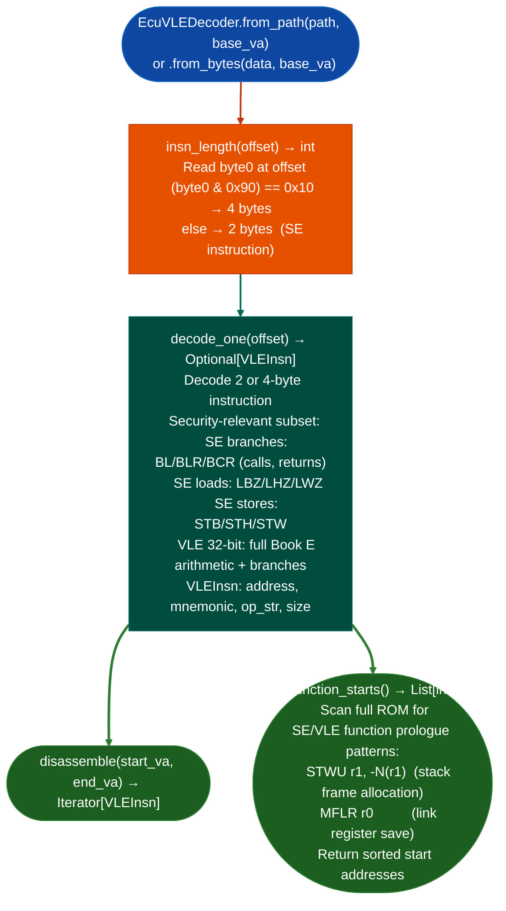

# PowerPC VLE Decoding

Decode PowerPC VLE Variable Length Encoding firmware for NXP e200z4/z6/z7 ECU cores: distinguishing 16-bit SE Short Encoding and 32-bit instructions by first-byte analysis, providing `function_starts()` for seeding taint-tracking pipelines against flat ROM images without ELF headers or VLE section flags.

---

## Why this exists

1. **VLE is a mixed-width ISA used by NXP e200z4/z6/z7 cores on GM E39, E39a, E54, and E92 PCMs.** Capstone has no VLE support, and the standard PPC32 decoder does not handle the SE instruction encoding. Without `EcuVLEDecoder`, VLE ECU firmware appears as undisassemblable binary data: `EcuArchDetector` detects the architecture, but there is no decoder to provide `function_starts()` for downstream analysis.

2. VLE instruction width discrimination uses a single-byte check: `(byte0 & 0x90) == 0x10` → 32-bit VLE or Book E instruction; otherwise → 16-bit SE instruction. This makes `EcuVLEDecoder.insn_length(offset)` O(1), enabling fast sequential decode of large ROM images without per-instruction disassembly.

3. `VLEInsn` uses the same field conventions as `M68kInsn`: `address`, `mnemonic`, `op_str`, `size`: enabling the same downstream pipeline stages CFG building, taint seed identification to consume VLE output without ISA-specific dispatch. This was a deliberate design choice to allow unified ECU analysis pipelines.

---

## How it works



---

## Usage

```python
from ablation.analyzers.ecu_vle_decoder import EcuVLEDecoder

decoder = EcuVLEDecoder.from_path('/path/to/gm_e39a.bin', base_va=0x00000000)

# Function starts
starts = decoder.function_starts()
print(f"Found {len(starts)} VLE functions")

# Disassemble a function
for insn in decoder.disassemble(starts[0], starts[1]):
    print(f"  {insn.address:#x} ({insn.size}B): {insn.mnemonic} {insn.op_str}")
```

---

## Example output

The following illustrates VLE disassembly output format. Actual addresses are ROM-specific.

```
EcuVLEDecoder: gm_e39a.bin  (base_va=0x00000000)

function_starts(): <N> VLE functions found

Disassembly at 0x00001000:
  0x1000 (4B): stwu  r1, -0x10(r1)
  0x1004 (4B): mflr  r0
  0x1008 (2B): se_li r3, 0x0
  0x100a (2B): se_bl <target>
```

---

## False positives

**VLE function start heuristics detect `STWU r1, -N(r1)` in data sections**: validate starts against known code regions within ROM-mapped Flash address ranges before treating all detected starts as valid function entries.

**SE instruction width detection using first-byte analysis is byte-offset sensitive**: if the decoder loses alignment for example due to a data constant that looks like an SE instruction, subsequent decodes will be incorrect. Use `function_starts()` seeds as alignment anchors to reset decode position.

---

## Pipeline position

Run `EcuVLEDecoder` after `EcuArchDetector` confirms `ppc_vle` architecture. `function_starts()` provides the seed list for taint analysis. For full RE on VLE ECU targets, chain with `sink_arg_classifier_ppc32.py` for sink classification.

---

## Reading output

`EcuVLEDecoder.function_starts()` returns `List[int]`: VA list of VLE functions.

`EcuVLEDecoder.disassembleva, size` returns a list of `VLEInstruction` objects:

| Attribute | Content |
|:---|:---|
| `va` | Virtual address |
| `size` | Instruction size in bytes 2 for SE, 4 for standard VLE |
| `mnemonic` | VLE mnemonic for example `stwu`, `se_li`, `se_bl` |
| `operands` | Operand string |

---

## See also

- [Flat ROM Function Discovery](flat-rom-function-discovery.md): `EcuArchDetector` that identifies VLE architecture
- [PPC32 Import Caller Tracing](verified-ppc32-import-callers.md): PPC32 PLT caller analysis for linked VLE targets
- [Calibration Parsers](calibration-parsers.md): A2L/open_damos for GM E39a/E92 calibration data
