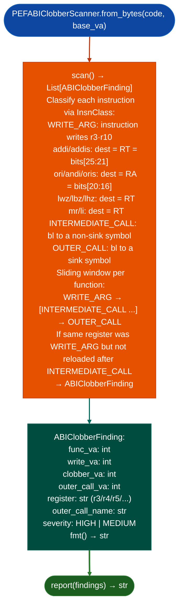

# PEF ABI Clobber Detection

Detect argument register clobber in PPC32 PEF/CFM binaries: finding call sites where an argument register (`r3`–`r10`) is written for an outer call but then overwritten by an intermediate `bl` instruction before the outer call reads it, producing a silent argument corruption that is structurally invisible to naive call-site inspection.

---

## Why this exists

1. **Three bugs in the hand-written OpenTransport scanner were eliminated by making the fix structural.** `ori`/`addi` destination-field asymmetry was a recurring source of errors: D-form arithmetic (`addi`/`lwz`/`addic`) places the destination in RT = bits[25:21], while D-form logical (`ori`/`andi`/`oris`) places the destination in RA = bits[20:16]. `PEFABIClobberScanner` uses `encoding_dag.Template`/`Field` for correct PPC32 bitfield extraction, making this asymmetry impossible to mishandle.

2. **PEF CFM binaries use the Mac Classic PPC32 ABI where r3–r10 are volatile caller-saved argument registers.** An intermediate `bl` call is permitted to clobber any of these registers. Compilers ensure the outer arguments are reloaded before the outer call, but handwritten or decompiler-produced code sometimes omits the reload. `PEFABIClobberScanner.scan()` finds every site where the reload is missing.

3. `ABIClobberFinding.fmt()` includes the clobbered register, the clobbering instruction VA, and the outer call target: providing the exact three-way triple needed for a confirmation byte-trace: write-VA → clobber-VA → outer-call-VA. This is sufficient to generate a PoC payload that exploits the clobbered argument.

---

## How it works



---

## Usage

```python
from ablation.analyzers.pef_abi_clobber_scanner import PEFABIClobberScanner
from ablation.analyzers.pef_binary_analyzer import PEFBinaryAnalyzer

analyzer = PEFBinaryAnalyzer.from_path('/path/to/PGPuam')
code_section = analyzer.code_sections()[0]
code_bytes = code_section.read_from(open('/path/to/PGPuam', 'rb').read())

scanner = PEFABIClobberScanner.from_bytes(code_bytes, base_va=code_section.baseAddress)
findings = scanner.scan()
print(PEFABIClobberScanner.report(findings))
```

---

## Example output

The following illustrates ABI clobber detection output format. Actual addresses are binary-specific.

```
PEFABIClobberScanner: PGPuam  (code section)

Findings: <N>

  [HIGH] r3 clobbered before OTAsyncOpenEndpoint
    write_va=<va_a>  (li r3, 0x1)
    clobber_va=<va_b>  (bl OTInetGetInterfaceInfo)
    outer_call_va=<va_c>  (bl OTAsyncOpenEndpoint)
```

---

## False positives

**An intermediate `bl` that does not clobber the argument register in practice**: the ABI permits clobbering r3–r10, but many leaf functions do not modify registers they do not need. `PEFABIClobberScanner` conservatively treats all intermediate `bl` calls as potential clobbers. Verify by tracing the intermediate callee's actual r3 write behavior before escalating a finding.

**Inlined `mr` or `li` after the intermediate call that reloads the register**: if the reload instruction is categorized as `WRITE_ARG` with the same register, the scanner should clear the clobber state. Verify that the reload appears between `clobber_va` and `outer_call_va` in the disassembly.

---

## Pipeline position

Run `PEFABIClobberScanner` immediately after `PEFBinaryAnalyzer` provides the code section. Use `PEFBinaryAnalyzer.stub_table()` to identify outer call targets (sinks) before scanning. Pair with `PEFBinaryAnalyzer.dangerous_imports()` to focus on clobbers affecting dangerous sink arguments only.

---

## Reading findings

`PEFABIClobberScanner.scan()` returns a list of finding dicts:

| Field | Content |
|:---|:---|
| `severity` | `HIGH` |
| `title` | `PEF_ABI_ARG_CLOBBER` |
| `reg` | Clobbered register name for example `r3`, `r4` |
| `write_va` | VA of the instruction that clobbers the register |
| `clobber_va` | VA of the call that overwrites the register before the outer call |
| `outer_call_va` | VA of the outer call that receives the clobbered value |

---

## See also

- [PowerPC PEF/CFM Binary Analysis](powerpc-pef-cfm.md): `PEFBinaryAnalyzer` that provides the code section for scanning
- [PPC64 BE Sink Classification](ppc64-be-sink-classification.md): PPC64 equivalent for ELF targets
- [Named Taint Sources and Bounds](named-taint-sources-and-bounds.md): `TaintTracker` for full dataflow taint from clobbered arguments
