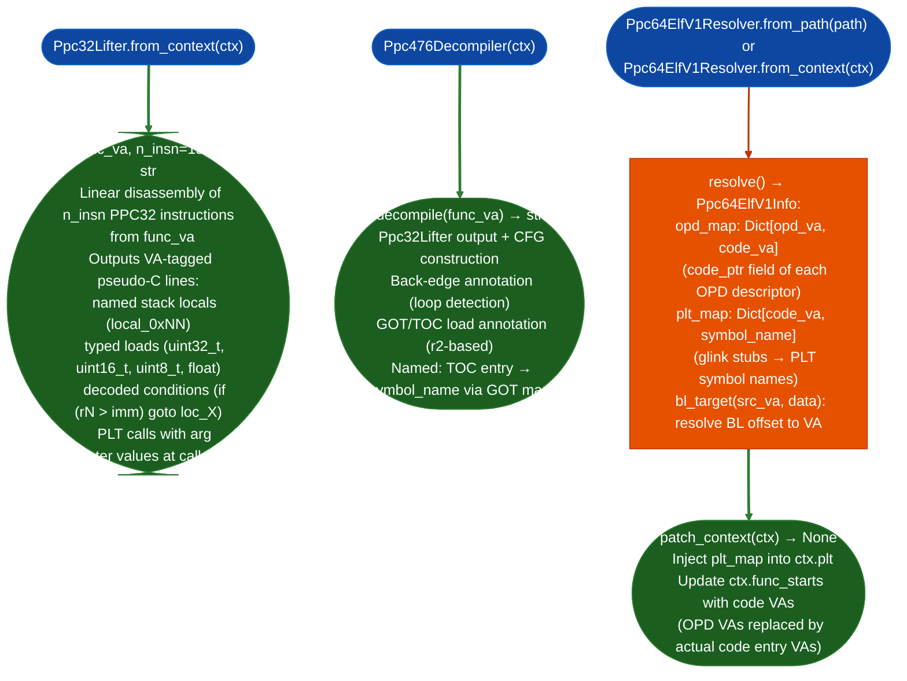

# PPC32/PPC476 Dedicated Lifting

Python-native PPC32 BE function pseudo-code lifter (`Ppc32Lifter`) and IBM PPC476 C-like decompiler (`Ppc476Decompiler`): filling the gap left by `BinaryLifter`'s structural-only PPC32 backend, with named stack locals, typed load widths, condition expression decoding, and PLT call resolution.

---

## Why this exists

1. **`BinaryLifter`'s PPC32 backend (`arch='ppc32'`) emits structural output: most instructions appear as comments, conditions are not decoded, and stack accesses are raw offsets like `*(sp-128+0x28)`.** `Ppc32Lifter` fills the PPC32 gap Gap PPC476-GAP-003 for the IBM PPC476 and any PPC32 BE target: it produces named stack local variables (`local_0x28`), typed load annotations `uint32_t`, `uint16_t`, `uint8_t`, `float`, decoded condition expressions (`if (r3 > 5)`), and PLT call resolution with argument values at call time.

2. **`Ppc476Decompiler` is a higher-level analysis pass on top of `Ppc32Lifter`, it adds CFG construction with loop detection, back-edge annotation, and GOT/TOC load annotation specific to the IBM PPC476 Book E ABI.** The PPC476 uses a TOC pointer in r2 for position-independent data access and a different calling convention r3-r10 args, r3 return than PPC-32 Embedded ABI. `Ppc476Decompiler` understands both ABIs and selects the correct one based on the binary's ELF ABI tag.

3. **`Ppc64ElfV1Resolver` addresses a separate gap: `BinaryContext.plt` is empty on PPC64 BE (ELFv1) binaries** because `BinaryContext` uses the ELFv2 path for PLT extraction. On ELFv1, every symbol value is an OPD descriptor address not a code address, and disassembling at an OPD VA produces a pointer, not a function prologue. `resolve()` builds the correct code_va→symbol_name map and `patch_context(ctx)` injects it into an existing `BinaryContext`.

---

## How it works



---

## Usage

```python
from ablation.analyzers.ppc32_lifter import Ppc32Lifter
from ablation.analyzers.ppc476_decompiler import Ppc476Decompiler
from ablation.analyzers.ppc64_elfv1_resolver import Ppc64ElfV1Resolver
from ablation.analyzers.binary_context import BinaryContext

ctx = BinaryContext.load_or_build('/path/to/ppc_target.elf')

# ── PPC32 lifter (structural + named locals + typed) ─────────────────────────
lifter = Ppc32Lifter.from_context(ctx)
pseudo = lifter.lift(0x1fa00, n_insn=200)
print(pseudo)

# ── PPC476 decompiler (adds CFG + TOC + GOT annotation) ──────────────────────
decompiler = Ppc476Decompiler(ctx)
decomp = decompiler.decompile(0x1fa00)
print(decomp)

# ── PPC64 ELFv1 resolver (fix BinaryContext PLT for POWER Linux) ─────────────
resolver = Ppc64ElfV1Resolver.from_path('/path/to/ppc64be.elf')
info = resolver.resolve()
print(info.fmt())   # OPD count, PLT stub count

# Patch an existing BinaryContext (fixes empty plt_entries)
resolver2 = Ppc64ElfV1Resolver.from_context(ctx)
resolver2.patch_context(ctx)
# ctx.plt now has correct stub_va → symbol_name entries
```

---

## Example output

The following illustrates the pseudo-code output format. Actual names and values are binary-specific.

```
Ppc32Lifter output for <func-va>:
  <va>  uint32_t local_0x28 = *(r1 + 0x28)    // lwz r3, 0x28(r1)
  <va>  uint16_t local_0x2c = *(r1 + 0x2c)    // lhz r4, 0x2c(r1)
  <va>  if (local_0x28 > 0x100) goto loc_<va> // cmpwi r3, 0x100 / bgt
  <va>  <sym> = <callee>(local_0x28, ...)     // bl <sym>

Ppc64ElfV1Info:
  OPD entries: <N>
  PLT stubs resolved: <M>
  Sample: <opd-va> → code_va=<code-va>  (<symbol-name>)
```

---

## False positives

**`Ppc32Lifter.lift()` uses linear disassembly, it does not build a CFG and will decode data sections as instructions if `func_va` + `n_insn * 4` extends past the function end.** Always bound `n_insn` to a conservative function-size estimate or use `BinaryContext` function boundaries to derive the correct `n_insn` count.

**`Ppc64ElfV1Resolver.patch_context()` replaces `ctx.func_starts` OPD VAs with code VAs, this is irreversible on the in-memory BinaryContext.** Do not call `patch_context()` if you need the original OPD addresses for any subsequent analysis. Build a new `BinaryContext` from the patched state if both OPD and code VAs are needed.

---

## Pipeline position

Use `Ppc32Lifter` and `Ppc476Decompiler` after `TaintTracker` identifies a candidate function and manual confirmation is needed, these tools produce human-readable output for manual triage. For PPC64 BE IBM POWER Linux targets, run `Ppc64ElfV1Resolver.patch_context()` before any PLT-dependent tool `TaintTracker`, `SinkArgClassifier` to ensure the PLT map is populated.

---

## Reading output

`Ppc32Lifter.liftva, n_insn=150` returns a `str`: multi-line C-like pseudocode with typed local variables, PPC register comments, and symbolic callee names. There is no structured return object; the full pseudocode is in the string.

---

## See also

- [Binary Lifter](binary-lifter.md): structural PPC32 backend (`arch='ppc32'`) for automated pipeline use
- [PPC32 Heap Slot Overflow](ppc32-heap-slot-overflow.md): scanner for PPC32-specific heap allocation overflow patterns
- [Verified PPC32 Import Callers](verified-ppc32-import-callers.md): PPC32 PLT caller verification complementary to PPC64 ELFv1
- [VMX/AltiVec Density Ranking](vmx-altivec-density-ranking.md): PPC64 VMX instruction density analysis
