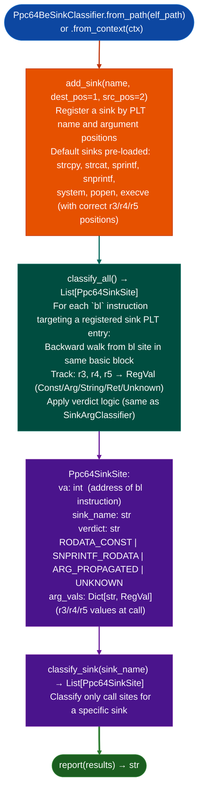

# PPC64 BE Sink Classification

Classify PPC64 big-endian ELFv1 `bl` branch-link call sites to dangerous sinks: providing `RODATA_CONST`, `SNPRINTF_RODATA`, `ARG_PROPAGATED`, and `UNKNOWN` verdicts using `r3`/`r4`/`r5` argument register analysis, filling the gap left by `SinkArgClassifier` which only processes x86 `call` instructions.

---

## Why this exists

1. **`SinkArgClassifier` scans for `insn.mnemonic.lower() == 'call'` and never fires on PPC64 BE.** PPC64 uses `bl` branch-and-link for function calls with a completely different stub layout: calls go through glink stubs and OPD descriptors. This means that for any IBM POWER Linux binary, `SinkArgClassifier.classify_all()` returns zero classifications: every `strcpy`/`sprintf` call site goes unclassified. `LL-008/010/011/012` were found by manual disassembly precisely because no automated classifier existed before `Ppc64BeSinkClassifier`.

2. **PPC64 uses `r3`/`r4`/`r5` for arguments 0–2 (not `rdi`/`rsi`/`rdx`).** `Ppc64BeSinkClassifier` tracks backward from `bl <sink>` using the PPC64 BE register convention, correctly reading `r3` as arg 0 dest buffer, `r4` as arg 1 source or format string, and `r5` as arg 2 length/size. The `add_sink()` API allows specifying which argument position holds the dangerous input for each sink.

3. `Ppc64SinkSite` carries the same verdict taxonomy as `SinkArgClassifier`'s x86 output: `RODATA_CONST` (safe), `SNPRINTF_RODATA` safe snprintf with constant format, `ARG_PROPAGATED` caller-controlled, taint-worthy, `UNKNOWN` uncertain, requires manual review. This means the same triage rule applies: eliminate `RODATA_CONST` first, then run `TaintTracker` only on `ARG_PROPAGATED`/`UNKNOWN` sites.

---

## How it works



---

## Usage

```python
from ablation.analyzers.ppc64_be_sink_classifier import Ppc64BeSinkClassifier
from ablation.analyzers.binary_context import BinaryContext

ctx = BinaryContext.load_or_build('/path/to/power_linux_binary')
classifier = Ppc64BeSinkClassifier.from_context(ctx)

# Add a vendor-specific sink (fadcsystem equivalent for IBM targets)
classifier.add_sink('ibm_exec_wrapper', dest_pos=1, src_pos=2)

# Classify all sinks — same triage rule as x86:
# Eliminate RODATA_CONST first, then TaintTracker on ARG_PROPAGATED/UNKNOWN
results = classifier.classify_all()

# Triage
taint_worthy = [s for s in results if s.verdict in ('ARG_PROPAGATED', 'UNKNOWN')]
safe = [s for s in results if s.verdict == 'RODATA_CONST']
print(f"Total: {len(results)}  Taint-worthy: {len(taint_worthy)}  Safe: {len(safe)}")

# Classify a specific sink
sprintf_sites = classifier.classify_sink('sprintf')
print(classifier.report(sprintf_sites))
```

---

## Example output

The following illustrates the PPC64 BE sink classification output format. Actual addresses and counts are binary-specific.

```
Ppc64BeSinkClassifier: power_linux_binary  (PPC64 BE ELFv1)

Sinks registered: strcpy, strcat, sprintf, snprintf, system, popen

Classification results: <N> total
  RODATA_CONST:    <A> (safe — constant format/dest in .rodata)
  SNPRINTF_RODATA: <B> (safe — snprintf with constant format)
  ARG_PROPAGATED:  <C> (taint-worthy — r3/r4 from caller arg)
  UNKNOWN:         <D> (requires manual review)

ARG_PROPAGATED sites:
  <va>  sprintf  r4=Arg(1)  r3=Arg(0)  [dest AND format both propagated]
```

---

## False positives

**PPC64 BE backward walk is bounded to the same basic block**: `r4` loaded in a predecessor block beyond the walk boundary is classified as `UNKNOWN` rather than `ARG_PROPAGATED`. This under-classifies some propagated sinks. Treat `UNKNOWN` with the same priority as `ARG_PROPAGATED` for taint analysis.

**glink stubs complicate `bl` target resolution**: `Ppc64BeSinkClassifier` uses `BinaryContext.plt` to resolve `bl <glink_stub>` to the PLT symbol name. If `Ppc64ElfV1Resolver.patch_context()` has not been run see [PPC64 ELFv1 Resolution](ppc64-elfv1-resolution.md), `ctx.plt` is empty and all `bl` targets resolve as `None`, producing zero classifications. Always apply the ELFv1 resolver before running this classifier.

---

## Pipeline position

Run `Ppc64BeSinkClassifier.classify_all()` after `Ppc64ElfV1Resolver.patch_context()` on any PPC64 BE binary, in the same pipeline position as `SinkArgClassifier` on x86 targets. Eliminate `RODATA_CONST` findings before routing the remaining `ARG_PROPAGATED`/`UNKNOWN` sites to `TaintTracker`.

---

## Reading output

`Ppc64BeSinkClassifier.classify_all()` returns a list of `SinkClassification` objects:

| Attribute | Content |
|:---|:---|
| `sink_name` | Sink function name |
| `arg_pos` | 0-indexed argument position being classified |
| `func_va` | VA of the calling function |
| `call_va` | VA of the call instruction |
| `verdict` | `'RODATA_CONST'`, `'SNPRINTF_RODATA'`, `'ARG_PROPAGATED'`, or `'UNKNOWN'` |
| `detail` | Human-readable trace of the argument provenance |
| `severity` | `'HIGH'` ARG_PROPAGATED, `'MEDIUM'` SNPRINTF_RODATA / UNKNOWN, or `'LOW'` RODATA_CONST |

Only `ARG_PROPAGATED` and `UNKNOWN` sinks are passed to `PPC64TaintTracker`.

---

## See also

- [Sink Argument Classification](sink-argument-classifier.md): x86/x64 equivalent of this module
- [PPC64 ELFv1 Resolution](ppc64-elfv1-resolution.md): prerequisite PLT patching for PPC64 BE binaries
- [Named Taint Sources and Bounds](named-taint-sources-and-bounds.md): `TaintTracker` for confirmed ARG_PROPAGATED sites
