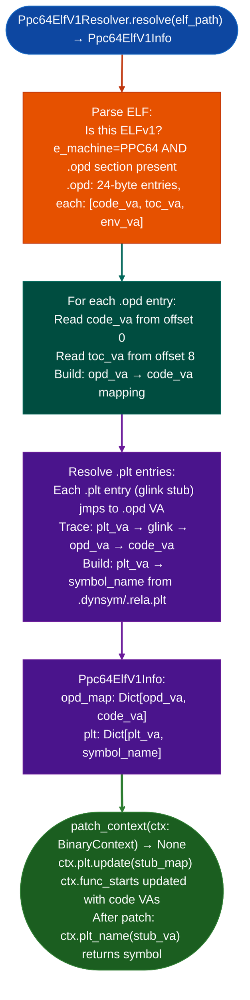

# PPC64 ELFv1 PLT and OPD Resolution

Resolve PPC64 big-endian ELFv1 OPD Official Procedure Descriptor entries and patch `BinaryContext.plt`: enabling correct PLT name resolution for `BinaryContext`, `FuncProfiler`, and all downstream analysis tools on IBM POWER binaries that use the ELFv1 ABI where function pointers are indirect descriptors, not code addresses.

---

## Why this exists

1. **PPC64 ELFv1 big-endian, used by IBM POWER5–9 Linux and AIX uses OPD Official Procedure Descriptor tables: each "function pointer" is a 3-word descriptor containing the actual code address, TOC pointer, and environment pointer.** A call to `0x10001234` calls the OPD descriptor at that address, not the code directly. `BinaryContext.load_or_build()` builds `ctx.plt` using direct VA-to-symbol mapping, which is empty on ELFv1 binaries because all PLT entries go through the glink stubs and OPD descriptors. `Ppc64ElfV1Resolver.patch_context()` fixes this.

2. Without `patch_context()`, every `BinaryContext.plt_name(va)` call on an ELFv1 binary returns `None`: `FuncProfiler`, `SinkArgClassifier`, `TaintTracker`, and `WindowAnalyzer` all show blank call targets instead of symbol names. This was the root cause of zero PLT-name annotations on all POWER Linux binaries until the gap PPC64-GAP-ELFv1 was closed.

3. **`Ppc64ElfV1Resolver` is documented in `ppc32-ppc476-dedicated-lifting.md` as well**, that page covers the full PPC32/PPC476/PPC64 lifting stack including the OPD resolver. This page exists as a targeted reference specifically for the ELFv1 PLT patching use case, providing the minimal recipe for analysts encountering blank PLT annotations.

---

## How it works



---

## Usage

```python
from ablation.analyzers.ppc64_elfv1_resolver import Ppc64ElfV1Resolver
from ablation.analyzers.binary_context import BinaryContext

ctx = BinaryContext.load_or_build('/path/to/power_linux_binary')

# Check if PLT is empty (ELFv1 symptom)
if not ctx.plt:
    print("PLT empty — may be ELFv1 binary; applying resolver")
    resolver = Ppc64ElfV1Resolver.resolve('/path/to/power_linux_binary')
    resolver.patch_context(ctx)
    print(f"Patched {len(ctx.plt)} PLT entries")

# Now PLT names work
print(ctx.plt_name(0x10001234))  # 'system' (previously None)

# All downstream tools now see correct PLT annotations
from ablation.analyzers.func_profiler import FuncProfiler
fp = FuncProfiler.from_context(ctx)
profile = fp.profile(va=0x20001234, end_va=0x20001500)
print(profile.fmt())  # CALLS section now shows symbol names
```

---

## Example output

The following illustrates the PLT patching output format.

```
Before patch_context():
  ctx.plt: {}  (empty — ELFv1 OPD not resolved)
  plt_name(0x10001234): None

After patch_context():
  ctx.plt: {0x10001234: 'system', 0x10001250: 'recv', ...}
  plt_name(0x10001234): 'system'
  Patched: <N> PLT entries

FuncProfiler output (after patch):
  CALLS:
    0x20001240: system  [SINK]  r3=Arg(0)  (previously: '0x10001234')
```

---

## False positives

**`Ppc64ElfV1Resolver` detects ELFv1 by checking for the `.opd` section**: a PPC64 ELFv2 binary little-endian, used by newer POWER Linux does not have `.opd` and should not be patched. `Ppc64ElfV1Info.plt` will be empty if the binary is not ELFv1; `patch_context()` with an empty `plt` is a no-op.

---

## Pipeline position

Run `Ppc64ElfV1Resolver.patch_context()` immediately after `BinaryContext.load_or_build()` on any PPC64 BE binary where `ctx.plt` is empty. This step is required before any analysis that relies on PLT name resolution. See `ppc32-ppc476-dedicated-lifting.md` for the complete PPC32/PPC64 lifting workflow.

---

## Reading output

`Ppc64ElfV1Resolver.patch_context(ctx)` modifies `ctx.plt` and `ctx.func_starts` in-place and returns `None`. Access the resolved data via `Ppc64ElfV1Resolver.resolve()`, which returns a `Ppc64ElfV1Info`:

| Attribute | Content |
|:---|:---|
| `binary_path` | Path to the analyzed ELF |
| `opd_va` | VA of the `.opd` section |
| `opd_size` | Size of the `.opd` section in bytes |
| `toc` | TOC pointer value read from the entry-point OPD entry |
| `text_va` | VA of the `.text` section |
| `opd_to_code` | `Dict[int, int]`: OPD entry VA → code function VA |
| `stub_map` | `Dict[int, str]`: PLT stub VA → import symbol name |

After `patch_context()`, `ctx.plt` maps stub VAs to import names and `ctx.func_starts` lists code VAs not OPD VAs.

---

## See also

- [PPC32/PPC476 Dedicated Lifting](ppc32-ppc476-dedicated-lifting.md): complete PPC32/PPC64 analysis stack
- [PS3 OPD Virtual Tables](ps3-opd-virtual-tables.md): PS3 Cell PPU OPD-based vtable analysis
- [Persistent Analysis Context](persistent-analysis-context.md): `BinaryContext.plt` patched by this module
