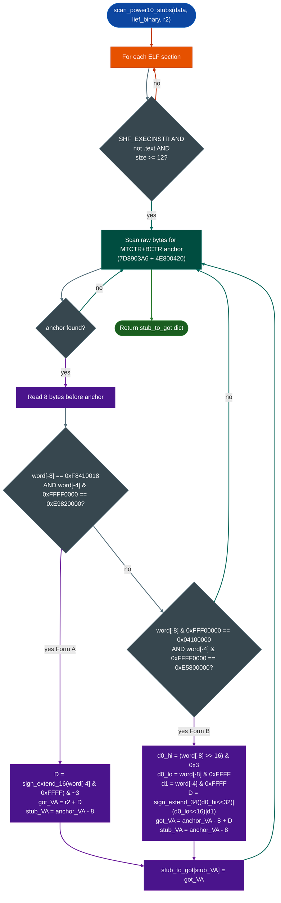

# Power10PPC64PLTStubScanner

Scan executable non-`.text` ELF sections for the two Power10 ppc64le ELFv2 PLT stub forms that the classic `addis+ld` scanner misses: closing ELFv2-PLD-GAP-001.

---

## Why this exists

1. **The classic ELFv2 PLT stub scanner recognises only one stub form.** `SinkArgClassifierPPC64ELFv2._remap_plt_rev_to_stubs` looks for the 5-instruction sequence `std r2 / addis r12,r2,ha / ld r12,lo(r12) / mtctr r12 / bctr`. GNU ld 2.38+ emits two compact alternatives for Power10 (`-mcpu=power10`) targets; neither contains `addis r12,r2,ha`, so both pass through unrecognised. Result: `classify_all()` sees 0 sinks on affected objects.

2. **Form A: compact 4-instruction ld-from-r2 stub.** When the GOT offset fits in a signed 16-bit displacement from the TOC base (`r2`), GNU ld emits `std r2 / ld r12,D(r2) / mtctr r12 / bctr`. The ld-from-r2 pattern was not in the scanner.

3. **Form B: 8-byte PLD pcrel stub.** GNU ld emits `pld r12,@got@pcrel / mtctr r12 / bctr` for Power10 PC-relative GOT addressing (`-mpower10-stubs`). `pld` is a prefixed instruction: a 4-byte MLS prefix word + a 4-byte LD-class suffix word, encoding a 34-bit signed PC-relative displacement. Capstone silently produces no decoded instructions for the prefix word, making the entire stub invisible.

4. **The gap affected real targets.** IBM Advance Toolchain 17.0 `glibc-hwcaps/power10/libgo.so` 57 MB, 7 588 PLTGOT relocs produced 0 SAC results with the old scanner. After integrating this module, all 7 588 stubs resolve: including `execve@0x12f3968 ARG_PROPAGATED`.

---

## How it works



**Integration into ELFv2 SAC:**
`scan_power10_stubs` is called from `_remap_plt_rev_to_stubs` as a secondary pass, after the classic `addis+ld` scan completes. The returned `{stub_VA: got_VA}` dict is merged into the main PLT remapping table before name lookup. No interface changes: all existing callers benefit automatically.

**Form A instruction encoding:**

```
 Offset   Bytes (LE)   Instruction
  -8     F8 41 00 18   std  r2,  0x18(r1)   # save TOC
  -4     E9 82 xx xx   ld   r12, D(r2)       # compact GOT load
   0     7D 89 03 A6   mtctr r12
  +4     4E 80 04 20   bctr
```

`D = sign_extend_16(word[-4] & 0xFFFF) & ~3` DS-form: low 2 bits carry opcode suffix, must be cleared
`GOT_VA = r2 + D`

**Form B instruction encoding:**

```
 Offset   Bytes (LE)   Field
  -8     04 1x xx xx   PLD prefix — opcode=1, type=MLS, R=1, d0_hi[1:0] + d0_lo[15:0]
  -4     E5 8x xx xx   PLD suffix — opcode=57, RT=r12, RA=0, d1[15:0]
   0     7D 89 03 A6   mtctr r12
  +4     4E 80 04 20   bctr
```

34-bit displacement: `D = sign_extend_34(d0_hi << 32 | d0_lo << 16 | d1)`
`GOT_VA = prefix_VA + D`

---

## Usage

This module is invoked automatically by `SinkArgClassifierPPC64ELFv2`. No direct call is required in normal workflow.

Standalone use to inspect a Power10 binary's PLT stub layout:

```python
import lief
from ablation.analyzers.ppc64_power10_plt_stubs import scan_power10_stubs

data = open('/path/to/power10.so', 'rb').read()
b    = lief.parse('/path/to/power10.so')
r2   = int(b.get_section('.got').virtual_address) + 0x8000
stubs = scan_power10_stubs(data, b, r2)
for stub_va, got_va in sorted(stubs.items()):
    print(f'stub=0x{stub_va:x}  got=0x{got_va:x}')
```

**Typical output at17.0 power10/libgo.so, 7 588 stubs:**
```
stub=0x0007b820  got=0x00d3e9c8   # write
stub=0x0007b830  got=0x00d3e9d8   # close
stub=0x0007b840  got=0x00d3e9e8   # mmap
...
stub=0x012f3960  got=0x01370768   # execve  ← ARG_PROPAGATED
7588 stubs resolved
```

---

## FORGE audit

Gate: **PASSED** 2026-10-22 and commit `3da1ef2b`. No HIGH or CRITICAL issues.

Tested on:
- `at17.0 glibc-hwcaps/power10/libgo.so` 57 MB, 7 588 pltgot relocs: 0 → 7 588 stubs resolved; `execve@0x12f3968` classified `ARG_PROPAGATED`.
- Non-Power10 ppc64le binary `pam_hsc.so` and classic ELFv2 stubs: returns empty dict, no false positives.
- Section with SHF_EXECINSTR cleared: skipped correctly, no stubs returned.
- Stub at end of section fewer than 12 bytes remaining: loop exits cleanly, no out-of-bounds read.
- DS-form sign extension: `D=0xFFFC` (−4) and `D=0x7FFC` (+32 764) both verified correct against known GOT layout.
- PLD 34-bit sign extension: form B with `d0_hi=3` sign bit set for 34-bit verified to produce correct negative displacement.

---

## False positives

MTCTR+BCTR is not unique to PLT stubs: indirect branch dispatch tables use the same anchor pair. The pre-anchor check limits false matches to sequences that also match the STD-R2 + LD-R12-R2 mask or the PLD prefix/suffix masks. These bit patterns are architecturally specific: the LD-R12-R2 check requires `RT=r12` and `RA=r2`; dispatch tables that load r12 from r1 or other registers do not match.

---

## Pipeline position

**Before this module:** `SinkArgClassifierPPC64ELFv2.from_context(ctx)` initialises PLT tables via LIEF `pltgot_relocations`.

**This module runs inside:** `_remap_plt_rev_to_stubs` as a secondary pass, after the classic `addis+ld` scan has run on `.plt`/`.plt.got` sections.

**After this module:** `classify_all()` classifies each resolved call site using the merged stub→GOT→name table.

---

## See also

- [SinkArgClassifierPPC64ELFv2](sink-arg-classifier-ppc64-elfv2.md): parent classifier that integrates this scanner
- [SinkArgClassifierPPC64ELFv1](sink-arg-classifier-ppc64-elfv1.md): big-endian ELFv1 counterpart no Power10 support needed: big-endian POWER uses ELFv1 OPD stubs
- [SinkArgClassifier](sink-arg-classifier.md): x86-64 baseline and full verdict reference
