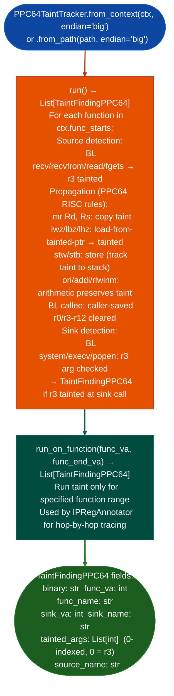

# PPC64 Taint Analysis

Track data flow through PPC64 big-endian and little-endian ELF binaries: supporting ELFv1 AIX, older Linux PPC64 and ELFv2 modern OpenPOWER Linux and POWER8+ ABIs with eight integer argument registers (`r3`–`r10`) and propagating taint from `recv`/`read`/`recvfrom` sources through to exec-class sinks: via `ablation/analyzers/taint_tracker_ppc64.py` `PPC64TaintTracker`.

---

## Why this exists

1. **PPC64 BE is the architecture for FortiOS 6.x and earlier binaries**: the target architecture for the original FortiGate taint analysis work. `PPC64TaintTracker` provides the same labeled-taint model as `TaintTrackerARM64` but for PPC64 BE, covering `r3`–`r10` argument registers and the `r2` TOC pointer that distinguishes ELFv1 from ELFv2.

2. **ELFv1 AIX, old Linux PPC64 uses function descriptors in `.opd`**: each function is a 3-pointer struct code VA, TOC, environment pointer. Standard VA-based function lookup fails on ELFv1 without first resolving OPD entries. `PPC64TaintTracker.from_context(ctx, endian='big')` handles ELFv1 automatically when `Ppc64ElfV1Resolver` has patched the context; pass `endian='little'` for ELFv2 LE modern IBM POWER servers, RHEL PPC64LE.

3. **`PPC64TaintTracker.run_on_functionfunc_va, func_end_va` enables targeted per-function analysis**: rather than running the full binary taint scan, the caller specifies the function VA bounds and receives taint findings only for that function. This is the mechanism used by `IPRegAnnotator` to extend taint chains across function boundaries without re-running the full corpus.

---

## How it works



---

## Usage

```python
from ablation.analyzers.taint_tracker_ppc64 import PPC64TaintTracker
from ablation.analyzers.binary_context import BinaryContext
from ablation.analyzers.ppc64_elfv1_resolver import Ppc64ElfV1Resolver

ctx = BinaryContext.load_or_build('/path/to/fortios_6x_httpd')
# ELFv1 requires OPD resolution before PPC64TaintTracker runs
Ppc64ElfV1Resolver(ctx).patch_context()

tracker = PPC64TaintTracker.from_context(ctx, endian='big')
findings = tracker.run()

# TaintFindingPPC64 fields: binary, func_va, func_name, sink_va, sink_name,
#   tainted_args (List[int], 0 = r3), source_name
for f in findings:
    args = [f'r{3 + i}' for i in f.tainted_args]
    print(f"  {f.func_name}+{f.sink_va - f.func_va:#x}: "
          f"{f.sink_name}({', '.join(args)})  src={f.source_name}")
```

---

## Example output

The following is a schematic example showing output structure and field names. Values are illustrative.

```
PPC64TaintTracker: <binary>  (big-endian, ELFv1)

Sources: recv, recvfrom, read, fgets
Sinks:   system, execv, popen

Findings: <N>

  <func_name>+<offset>: system(r3)  src=recv
    TaintFindingPPC64(func_va=<va>, sink_va=<va>, tainted_args=[0], source_name='recv')
```

---

## False positives

**ELFv1 OPD resolution required first**: if `Ppc64ElfV1Resolver.patch_context()` has not run, PLT entries point to OPD descriptors rather than code VAs and `run()` will not locate sink call sites. Always run `Ppc64ElfV1Resolver` before `PPC64TaintTracker` on ELFv1 targets.

**`r2` TOC tracking is approximate**: ELFv2 binaries use `r2` as the TOC pointer throughout; ELFv1 sets it per-function via the OPD entry. If a compiler-optimized function repurposes `r2` as a general-purpose register valid per ABI but rare, the tracker may misidentify it as taint flowing through `r2`.

---

## Pipeline position

Run `PPC64TaintTracker` after `BinaryContext.load_or_build()` and `Ppc64ElfV1Resolver.patch_context()` ELFv1 targets only. Precede with `SinkArgClassifier` using `Ppc64BeSinkClassifier` to eliminate `RODATA_CONST` sinks before tracker invocation. Use `run_on_function()` when `IPRegAnnotator` is extending chains across function boundaries.

---

## Reading findings

`PPC64TaintTracker.run()` returns a list of `TaintFindingPPC64` objects:

| Attribute | Content |
|:---|:---|
| `binary` | Path of the analyzed binary |
| `func_va` | VA of the function containing the sink |
| `func_name` | Name of the function containing the sink |
| `sink_va` | VA of the sink call instruction |
| `sink_name` | Name of the sink function |
| `tainted_args` | `List[int]`: 0-indexed argument positions that carry tainted values |
| `source_name` | Name of the taint source such as `'recv'` and `'read'` |

---

## See also

- [PPC64 ELFv1 Resolution](ppc64-elfv1-resolution.md): required preprocessing for ELFv1 targets
- [PPC64 BE Sink Classification](ppc64-be-sink-classification.md): `Ppc64BeSinkClassifier` for pre-filtering before tracker
- [Named Taint Sources and Bounds](named-taint-sources-and-bounds.md): ARM64/x86-64 equivalent taint model
