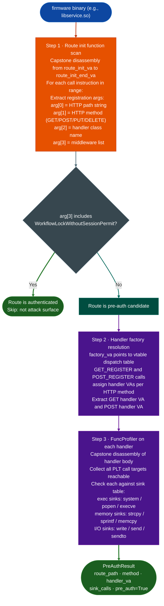
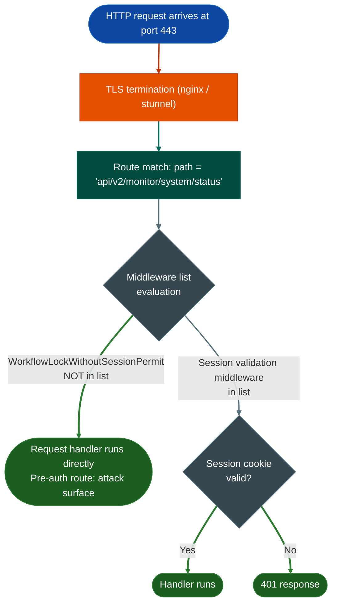

<a id="preauthrouteauditor"></a>
<a id="preauthroute-auditor"></a>
# Unauthenticated Attack Surface

Traverses the control flow graph from the network entry point and identifies every code path that reaches a security-sensitive operation before an authentication gate. Produces a reachability map so manual review starts at the authentication boundary, not before it.

---

## Why this exists <sup>[↑](#preauthroute-auditor)</sup>

One thing blocked pre-auth surface mapping before `PreAuthRouteAuditor`:

**Manual route table reading was the only option.**
Web framework route tables in compiled firmware binaries are initialized at runtime through registration calls such as `route_url_registerpath, handler_class`. Finding which routes skip authentication required reading the route init function manually, identifying the registration call pattern, extracting handler class names, and then tracing those handlers to see whether they gate on session validation. For a binary with 400 routes that takes days. `PreAuthRouteAuditor` does it in a single function call.

---

## How it works <sup>[↑](#preauthroute-auditor)</sup>

The auditor targets flatui-style web frameworks FortiManager, FortiAnalyzer web management backends but the control flow graph traversal approach applies to any route-registration framework where the authentication check is expressed as a middleware parameter at registration time.

### Full pipeline <sup>[↑](#preauthroute-auditor)</sup>



### What "pre-auth" means in this framework <sup>[↑](#preauthroute-auditor)</sup>



Flatui-style frameworks encode the middleware list as a bitfield or a set of string constants passed to the registration call. The auditor reads that argument at the call site and checks whether the session validation constant is present. A missing constant means the handler is reachable without authentication.

---

## Usage <sup>[↑](#preauthroute-auditor)</sup>

VA constants must be updated per firmware version. Read the route init function VA from the binary before calling:

```python
from ablation.analyzers.preauth_route_auditor import PreAuthRouteAuditor

auditor = PreAuthRouteAuditor.from_path('/path/to/libservice.so')
results = auditor.run(
    route_init_va=0x27b324,
    route_init_end_va=0x288d50,
    factory_va=0x2a5000,
    factory_end_va=0x2b0000,
)
print(results.fmt())
```

Each `RouteEntry` in `results.routes` exposes:

| Field | Content |
|---|---|
| `url` | Recovered route string |
| `handler` | Handler class or registration name |
| `method_ids` | Numeric method identifiers recovered at registration |
| `middleware` | Recovered middleware description |
| `is_preauth` | Whether the auditor found no recognized session middleware |

Handler details are stored separately in `results.handlers`. Each `HandlerEntry` can contain GET and POST code addresses and their `FuncProfiler` results. Sink calls belong to those profiles, not directly to `RouteEntry`.

---

## Validate exposure safely

Use `results.preauth_with_sinks()` to select route/handler pairs with dangerous sinks for manual review. There is no built-in `PocGenerator`; construct protocol requests only after confirming the route, method, parameters, and deployment context from the binary and configuration.

Compare unauthenticated and authenticated responses only in an isolated, authorized test instance, preserving status, body differences, and side-effect evidence. Do not replay a candidate against production or assume that a route marked pre-auth is externally reachable.

---

## Illustrative output <sup>[↑](#preauthroute-auditor)</sup>

The following illustrates the `PreAuthAuditResult.fmt()` structure rather than a particular firmware run:

```text
=== PreAuthRouteAuditor Results ===
  Total routes scanned:  24
  Pre-auth routes found: 3

--- Pre-auth routes ---
  '/api/admin/reboot'
    handler=AdminReboot  middleware=...
  Handler: AdminReboot
    GET  0x0041b400  *** SINKS: system@0x0041b590 ***
```

The auditor does not assign the generic HIGH/MEDIUM/LOW labels shown in an older example. Severity and exploitability require handler-specific review.

---

## False positives <sup>[↑](#preauthroute-auditor)</sup>

Routes registered with auth middleware at the application level rather than in the recognized registration argument can appear unauthenticated. Global middleware, alternate registration helpers, intentional public endpoints, and deployment routing need separate review. Conversely, middleware text alone does not prove that authentication is implemented correctly.

---

## Pipeline position <sup>[↑](#preauthroute-auditor)</sup>

**Before this module:** `from_path()` builds a `BinaryContext` internally. Supply route-init and factory virtual addresses verified for the exact binary version; do not reuse the illustrative addresses as universal Fortinet constants.

**After this module:** Inspect selected handler profiles, verify user-controlled inputs and authorization wrappers, and use taint or path analysis where supported. Register only independently reviewed findings with `FindingRegistry`.

This is a focused flatui compatibility analyzer. New registration idioms can be added as they are observed, but no generic Python/JavaScript source-route scanner is performed by this class.

---

## Reading output <sup>[↑](#preauthroute-auditor)</sup>

`run()` returns `PreAuthAuditResult` with `routes`, `preauth_routes`, and `handlers`. `preauth_with_sinks()` returns `(RouteEntry, HandlerEntry)` tuples. `fmt()` presents those objects for review; it does not establish live HTTP reachability or a vulnerability severity.

---

## See also <sup>[↑](#preauthroute-auditor)</sup>

- [BinaryContext](binary-context.md): function and import resolution before scanning
- [SinkArgClassifier](sink-arg-classifier.md): eliminate RODATA_CONST call sites before taint
- [TaintAnalysis](taint-analysis.md): confirm propagation from source to flagged sink
- [PathSolver](path-solver.md): verify path feasibility for confirmed candidates
- [FindingRegistry](registry.md): record confirmed findings
